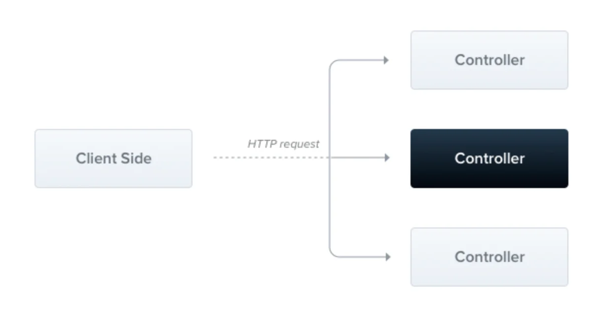

> 
> 
> <a id="22aeda9b0fe18173b078cd7bcfb73bf1"></a>
> 
> <strong>목차</strong>
> 
> - [Controller 패턴](#22aeda9b0fe181edb1e6dbfd573e1fa4)
> - [1. 라우팅](#22aeda9b0fe180f78210d9e104d7c66a)
> - [2. Request 객체: @Req() ( @Request() )](#22aeda9b0fe180ae8496c71eca472986)
> - [3. HTTP 메서드: @Get(), @Post() …](#22aeda9b0fe180cfadcad3605c74a516)
> - [4. HTTP 상태 코드 : @HttpCode(...) ](#22aeda9b0fe180808d47d9a81879791b)
> - [5. 응답 헤더: @Header()](#22aeda9b0fe180c3b030ffef66ef3e1f)
> - [6. 리다이렉트: @Redirect()](#22aeda9b0fe1808ea9e4fecc2d4e764d)
> - [7. Path Variable: @Param()](#22aeda9b0fe180bfabadfd9ebb022e3d)
> - [8. Query parameters: Query()](#22aeda9b0fe180a086c9ef81ff90f182)
> - [9. Request payloads(요청 본문): @Body() + DTO](#22aeda9b0fe1800ab978c0d186d18880)
> - [10. State sharing ( 동기화 문제 )](#22aeda9b0fe18027b9ebd995162131ce)
> - [11. Asynchronicity: async, RxJs-스트림](#22aeda9b0fe18078bd93dec7e1f60f79)
> - [12. Response: @Res(), passthrough 옵션](#22beda9b0fe180cdb69ce55cedc685b1)
> - [13. 시작 및 실행](#22beda9b0fe18064bc57c502603e4404)

<a id="22aeda9b0fe181edb1e6dbfd573e1fa4"></a>

## Controller 패턴

---

[Documentation &#124; NestJS &#45; A progressive Node&#46;js framework]()

> 📖 
> 
> <a id="22aeda9b0fe18035bd5be4a976507d70"></a>
> 
> <code>컨트트롤러</code>는 <strong><u>요청과 응답 처리에 대한 책임</u></strong>을 가지는 클래스를 말한다&#46;
> 
> 
> 
> - 컨트롤러는 여러 경로를 가지며, 각 경로는 서로 다른 작업 수행이 가능하다&#46;
> 
> - 기본적으로 <code>데코레이터</code>를 사용하여 정의한다&#46; 
> 
> - <code>데코레이터</code>는 <strong><u>클래스를 필요한 메타데이터와 연결</u></strong>하여<br><strong>Nest</strong>가 <strong><u>요청과 컨트롤러를 매핑하는 라우팅 맵</u></strong><strong> 생성을</strong> 가능하도록 한다&#46; 

> ⚠️ 
> 
> <a id="22aeda9b0fe180d3aebafa3f814818b5"></a>
> 
> 리소스 경로를 구분하는 <code>/</code>는 생략하여 작성한다&#46;
> 
> <details>
> <summary>ex)</summary>
> 
> <a id="22aeda9b0fe1804f8617e2956d576f28"></a>
> 
> ```javascript
> import { Controller, Get } from '@nestjs/common';
> 
> @Controller('cats')
> export class CatsController {
>   @Get()
>   findAll(): string {
>     return 'This action returns all cats';
>   }
> }
> ```
> 
> </details>

<a id="22aeda9b0fe180f78210d9e104d7c66a"></a>

### 1&#46; 라우팅

> ✏️ 
> 
> <a id="22aeda9b0fe180e28efbcb8c210dc421"></a>
> 
> Spring에서의 <code>&#64;RequestMapping</code>과 같이 공통된 리소스에 대한 prefix를 <code>&#64;Controller</code> 안에 선언 가능하다&#46;

<a id="22aeda9b0fe1802ba1a8e28dc4d19e67"></a>

```javascript

import { Controller, Get } from '@nestjs/common';

@Controller('cats')
export class CatsController {
	
	//* 엔드포인트: 'localhost:8080/cats'
  @Get() 
  findAll(): string {
    return 'This action returns all cats';
  }
}
```

- <code>&#64;Controller(’cats’)</code>/<code>&#64;GET()</code> 데코레이터를 통해  핸들러(<code>findAll()</code>) 메서드와  <code>GET /cats</code> 요청을 매핑하는 라우팅 맵이 생성된다&#46; 

- 그리고 <code>GET /cats</code> 요청이 발생되는 경우, 해당 라우팅 맵을 통해 <code>finaAll()</code>을 매핑하여 처리한다&#46;

<a id="22aeda9b0fe180ae8496c71eca472986"></a>

### 2&#46; Request 객체&#58; <code>&#64;Req()</code> ( <code>&#64;Request()</code> )

> ✏️ 
> 
> <a id="22aeda9b0fe1804a9e5cf6a8857152c6"></a>
> 
> Nest는 기본 플랫폼(기본적으로 Express)에서 <strong><a href="https://expressjs.com/en/api.html#req">요청 객체</a></strong><code>&#64;Req()</code> 에 대한 접근 권한을 제공한다&#46;

<a id="22aeda9b0fe180738e4ee9f5a05a469f"></a>

```javascript

import { Controller, Get, Req } from '@nestjs/common';
import { Request } from 'express';

@Controller('cats')
export class CatsController {
  @Get()
  findAll(@Req() request: Request): string {
    return 'This action returns all cats';
  }
}
```

- Request 객체는 HTTP 요청을 나타내며 <strong><u>쿼리 문자열, 매개변수, HTTP 헤더 및 본문</u></strong>에 대한 속성을 포함한다&#46;

- 대부분의 경우, 추가적으로 데코레이터를 제공하기 때문에 <code>&#64;Res</code>를 통해 직접 액세스할 필요가 없다&#46; 
    - <code>&#64;Body</code>, <code>&#64;Query</code> …
        <a id="22aeda9b0fe1803cb7eadd4a40c6271d"></a>

        자세한 내용은 아래 Docs 참조

        [Documentation &#124; NestJS &#45; A progressive Node&#46;js framework]()

<a id="22aeda9b0fe180cfadcad3605c74a516"></a>

### 3&#46; HTTP 메서드&#58; <code>&#64;Get()</code>, <code>&#64;Post()</code> …

> ✏️ 
> 
> <a id="22aeda9b0fe180f59f64d5c62fb65a1a"></a>
> 
> Nest는 모든 <strong>표준 HTTP 메서드에 대한 데코레이터를 제공</strong>한다&#46;
> 
> -  <code>&#64;Get()</code>, <code>&#64;Post()</code>, <code>&#64;Put()</code>, <code>&#64;Delete()</code>, <code>&#64;Patch()</code>, <code>&#64;Options()</code>, <code>&#64;Head()</code>&#46;&#46;&#46;
> 
> - <code>&#64;All()</code>&#58; 모두 허용, 사용 X 

<a id="22aeda9b0fe180f28523d4fd71c602cf"></a>

```javascript
import { Controller, Get, Post } from '@nestjs/common';

@Controller('cats')
export class CatsController {
  @Post()
  create(): string {
    return 'This action adds a new cat';
  }

  @Get()
  findAll(): string {
    return 'This action returns all cats';
  }
}
```

<a id="22aeda9b0fe180808d47d9a81879791b"></a>

### 4&#46; HTTP 상태 코드 &#58; <code>&#64;HttpCode(&#46;&#46;&#46;)</code> 

> ✏️ 
> 
> <a id="22aeda9b0fe180f39858cdae6fdc3dfa"></a>
> 
> 응답의 <strong><u>기본 상태 코드</u></strong>는 항상<strong> </strong><strong><code>200</code></strong>이다&#46; 
> 
> - 단, <strong><u>POST 요청</u></strong>의 경우 기본값은 <strong><code>201</code></strong>이다&#46;
> 
> - 직접 상태코드를 지정하는 경우, 아래와같이 <strong><code>&#64;HttpCode(상태코드)</code></strong>로 명시한다&#46;

<a id="22aeda9b0fe180fb84b0eaa49af17945"></a>

```javascript
@Post()
@HttpCode(204)
create() {
  return 'This action adds a new cat';
}
```

<a id="22aeda9b0fe180c3b030ffef66ef3e1f"></a>

### 5&#46; 응답 헤더&#58; <code>&#64;Header()</code>

> ✏️ 
> 
> <a id="22aeda9b0fe180cab388f92e9a06bab2"></a>
> 
> 사용자 정의 응답 헤더를 지정 가능하다&#46; 
> 
> - <code>&#64;Header()</code>
> 
> - <code>res&#46;header()</code>직접 호출

<a id="22aeda9b0fe18014b764cadced5918a7"></a>

```javascript
@Post()
@Header('Cache-Control', 'no-store')
create() {
  return 'This action adds a new cat';
}
```

<a id="22aeda9b0fe1808286cfde25f8029a19"></a>

 

<a id="22aeda9b0fe1808ea9e4fecc2d4e764d"></a>

### 6&#46; 리다이렉트&#58; <code>&#64;Redirect()</code>

> ✏️ 
> 
> <a id="22aeda9b0fe18083be09e380f83c6d3d"></a>
> 
> <strong><code>&#64;Redirect()</code></strong>을 통해 응답을 특정 URL로 리디렉션 가능하다&#46;  ( <code>res&#46;redirect()</code>로 직접 호출도 가능 )
> 
> - 2개의 인자를 갖으며, 둘다 옵션 값이다&#46;
>     - <code>url</code>
> 
>     - <code>상태코드</code> (기본값&#58; <code>302 Found</code>)

<a id="22aeda9b0fe180a79b28e059f30a3ea9"></a>

```javascript
@Get()
@Redirect('https://nestjs.com', 301)
	...
```

> ✏️ 
> 
> <a id="22aeda9b0fe1808f8846da36c75c22d4"></a>
> 
> dynamic한 redirect 처리도 가능하다&#46;
> 
> - <code>HtttpRedirectResponse</code> 인터페이스(<code>&#64;nestjs/common</code>)에 따라 객체를 반환 이를 수행한다&#46; 
> 
> - 반환된 값은 데코레이터(<code>&#64;Redirect</code>)로 전달된 모든 인수보다 우선순위를 갖는다&#46;
> 
> - 따라서 이를 통해 특정 상황에 따른 세부적인 리다이렉트 처리를 하여 다이나믹하게 동작 가능하다&#46; 

<a id="22aeda9b0fe18037ab32f7c4237e0895"></a>

```javascript
@Get('docs')
@Redirect('https://docs.nestjs.com', 302)
getDocs(@Query('version') version) {
  if (version && version === '5') {
    return { url: 'https://docs.nestjs.com/v5/' };
  }
}
```

<a id="22aeda9b0fe180bfabadfd9ebb022e3d"></a>

### 7&#46; Path Variable&#58; <code>&#64;Param()</code>

> ✏️ 
> 
> <a id="22aeda9b0fe180bbbe10ecbf9cf034fe"></a>
> 
> 동적 데이터를 처리하는 경우, <code>&#64;Get(&#58;id)</code> 만으로는 가져올 수 없다&#46; 아래의 예제와 같이 추가로 <code>&#64;Param()</code> 데코레이터를 사용하여  <strong><u>path variable에 액세스 가능</u></strong>하다&#46; 

<a id="22aeda9b0fe18059af35c1eff846b132"></a>

```javascript
// Case1 - @Param
@Get(':id')
findOne(@Param() params: any): string {
  console.log(params.id);
  return `This action returns a #${params.id} cat`;
}

// Case2 - @Bind
@Get(':id')
@Bind(Param('id'))
findOne(id) {
  return `This action returns a #${id} cat`;
}
```

<a id="22aeda9b0fe180a086c9ef81ff90f182"></a>

### <strong>8&#46; Query parameters&#58; </strong><strong><code>Query()</code></strong>

> ✏️ 
> 
> <a id="22beda9b0fe18066b3c3caee64e5a7b7"></a>
> 
> 요청 path에 정의되는 쿼리 파라미터는 <code>&#64;Query(&#46;&#46;)</code> 데코레이터를 통해  가져올 수 있다&#46;

- <strong>예시 1) 일반적인 사용</strong>
    <a id="22beda9b0fe1805f90c4e6c84e5bece9"></a>

    ```typescript
    GET /cats?age=2&breed=Persian
    ```

    <a id="22beda9b0fe180feaf3afeb5fc6f8a0a"></a>

    ```typescript

    @Get()
    async findAll(@Query('age') age: number, @Query('breed') breed: string) {
      return `This action returns all cats filtered by age: ${age} and breed: ${breed}`;
    }

    ```

- <strong>예시 2) 중첩 객체 및 배열</strong>
    > ✏️ 
    > 
    > <a id="22beda9b0fe1808a89c9de045be8e556"></a>
    > 
    > Nest에서는 중첩 객체, 배열로 쿼리 파라미터를 정의 가능하다&#46; 
    > 
    > <a id="22beda9b0fe180dfb9a2e60d1b81b20e"></a>
    > 
    > <strong><u>중첩 객체 or 배열</u></strong><strong><u>의 쿼리 파라미터</u></strong>를 파싱하기 위해선 <strong><u>HTTP 어댑터(Express or Fastify)구성</u></strong>이 필요하다&#46;

    <a id="22beda9b0fe180d18d69efecaf9233ad"></a>

    ```typescript
    // nested objects
    ?filter[where][name]=John&filter[where][age]=30

    // nested arrays
    ?item[]=1&item[]=2
    ```

    <a id="22beda9b0fe180549f9affb852ce81c7"></a>

    ```typescript
    // Express - extended parser
    const app = await NestFactory.create<NestExpressApplication>(AppModule);
    app.set('query parser', 'extended');

    // Fastify - querystringParser
    const app = await NestFactory.create<NestFastifyApplication>(
      AppModule,
      new FastifyAdapter({
        querystringParser: (str) => qs.parse(str),
      }),
    );
    ```

<a id="22aeda9b0fe1800ab978c0d186d18880"></a>

### <strong>9&#46; Request payloads(요청 본문)&#58; </strong><strong><code>&#64;Body()</code></strong><strong> &#43; </strong><strong><code>DTO</code></strong>

> ✏️ 
> 
> <a id="22beda9b0fe1806aa046c97863dfe481"></a>
> 
> <strong><u>요청 본문(body)</u></strong>은 <code>&#64;Body()</code> 데코레이터와 <code>DTO</code><strong>( Data Transfer Object )</strong>를 통해 처리한다&#46;
> 
> - Spring과 동일

<a id="22beda9b0fe18079bb43fbc65e7304fc"></a>

<strong>Dto 정의</strong>

<a id="22beda9b0fe180f8a9bff5dd31ca56ef"></a>

```typescript

export class CreateCatDto {
  name: string;
  age: number;
  breed: string;
}
```

<a id="22beda9b0fe180949a3cc1ec6b356e55"></a>

<strong>controller에서 </strong><strong><code>&#64;Body</code></strong><strong>로 요청 Dto 받아오기</strong>

<a id="22beda9b0fe18086a536d113096ea0dc"></a>

```typescript

@Post()
async create(@Body() dto: CreateCatDto) {
  return 'This action adds a new cat';
}
```

> 💬 
> 
> <a id="22beda9b0fe18003b430fa051dd95a22"></a>
> 
> Dto에 필드 정의를 통해 데이터의 필터링을 할 수 있다&#46; 

[Documentation &#124; NestJS &#45; A progressive Node&#46;js framework]()

<a id="22aeda9b0fe18027b9ebd995162131ce"></a>

### 10&#46; <strong>State sharing ( 동기화 문제 )</strong>

<a id="22aeda9b0fe180909c78f178b4d254d1"></a>

<a href="#/post/22aeda9b-0fe1-806b-88b0-ce68b3e415bb">페이지</a> 

<a id="22aeda9b0fe18078bd93dec7e1f60f79"></a>

### 11&#46; <strong>Asynchronicity&#58; </strong><strong><code>async</code></strong><strong>, </strong><strong><code>RxJs&#45;스트림</code></strong>

<a id="22beda9b0fe18000afefd922c665dc2e"></a>

<strong>1&#46; async 함수</strong>

> ✏️ 
> 
> <a id="22beda9b0fe180958dcbde27c8a5ce31"></a>
> 
> 자바스크립에서의 일반적인 비동기 처리인  <code>async</code>  키워드를  지원한다&#46;

<a id="22aeda9b0fe180b3824ee87d99fb051d"></a>

```java
@Get()
async findAll(): Promise<any[]> {
  return [];
}
```

<a id="22beda9b0fe180d09875f1cf77b4a54a"></a>

<strong>2&#46; RxJS</strong>

> ✏️ 
> 
> <a id="22beda9b0fe180d595ccf92e106daece"></a>
> 
> <code>RxJS</code>를 통한 <strong><u>스트림</u></strong> 방식의 비동기 처리도 지원한다&#46;

<a id="22beda9b0fe1803aa697df465906dc03"></a>

```java

@Get()
findAll(): Observable<any[]> {
  return of([]);
}
```

- 스트림에 대한 내용은 아래 참조 
    [RxJS]()

<a id="22beda9b0fe180cdb69ce55cedc685b1"></a>

### 12&#46; Response&#58; <code>&#64;Res()</code>, <code>passthrough</code> 옵션

<a id="22beda9b0fe18089b5d5f2684cca8170"></a>

<strong>1&#46; express의 </strong><strong><code>&#64;Res()</code></strong>

> ✏️ 
> 
> <a id="22beda9b0fe180b09614c0df78d0e013"></a>
> 
> express의 <code>&#64;Res()</code> 데코레이터를 통해 Response 객체에 직접 접근하여 상태코드와 body를 구성할 수 있다&#46;

<a id="22beda9b0fe1807e9503f4f87fd2ecd6"></a>

```typescript
import { Controller, Get, Post, Res, HttpStatus } from '@nestjs/common';
import { Response } from 'express';

@Controller('cats')
export class CatsController {
  @Post()
  create(@Res() res: Response) {
    res.status(HttpStatus.CREATED).send();
  }

  @Get()
  findAll(@Res() res: Response) {
     res.status(HttpStatus.OK).json([]);
  }
}
```

- 위 방법은 응답 객체에 대한 완전한 제어권(헤더 조작 및 라이브러리별 기능 접근 등)을 제공하여 더 유연하고 효과적이지만, 신중하게 사용해야 한다&#46;
    - Spring 과 달리 NestJS는 <strong>Express, Fastify, Lambda 등 다양한 플랫폼 지원</strong>하기 때문에 express의 <code>&#64;Res()</code>는 <strong><u>코드가 특정 플랫폼(Express)에 고착</u></strong>되며,<strong><u> 플랫폼 변경을 어렵게 만</u></strong>드는 <strong><u>단점</u></strong><strong>이 있다&#46;</strong>

    - <strong><u>응답 객체를 모의하는 등의 작업이 필요</u></strong>하기 때문에 <strong>테스트가 더 어려워질 수 있</strong>다&#46;

    - 해당 방식 사용 시<code>&#64;HttpCode()</code>에서 인터셉터 및 / 데코레이터 와 같이 표준 응답 처리에 의존하는 Nest 기능과의 호환성이 손실 

1. &#64;Header의 <code>passthrough</code> 옵션 활성화
    <a id="22beda9b0fe1806b82b8f5dff4f605cb"></a>

    ```typescript
    @Get()
    findAll(@Res({ passthrough: true }) res: Response) {
      res.status(HttpStatus.OK);
      return [];
    }

    ```

    <a id="22beda9b0fe18085beb7f70de14e8337"></a>

    <code>passthrough</code>을 옵션을 활성화하면 기본 응답 객체와 상호 작용 가능하다&#46;

    - ex) 특정 조건에 따라 쿠키나 헤더 설정 가능

    <a id="22beda9b0fe1808398d0f0d81659e27c"></a>

    그러면서도 프레임워크에서 나머지 작업을 처리할 수 있다&#46;

<a id="22beda9b0fe18064bc57c502603e4404"></a>

### 13&#46; 시작 및 실행

> ✏️ 
> 
> <a id="22beda9b0fe180fcb349fec3160a469a"></a>
> 
> 컨트롤러는 항상 모듈의 일부여야 한다&#46; 
> 
> - <code>&#64;Module()</code> 데코레이터의 controllers 배열에 포함시킨다&#46;

<a id="22beda9b0fe18000a8b9f6d27c0bfde1"></a>

```typescript

import { Module } from '@nestjs/common';
import { CatsController } from './cats/cats.controller';

@Module({
  controllers: [CatsController],
})
export class AppModule {}
```

- 루트 모듈 외 다른 모듈을 정의하지 않았다&#46; 따라서 <code>AppModule</code>를 통해 controller를 등록한다&#46;
