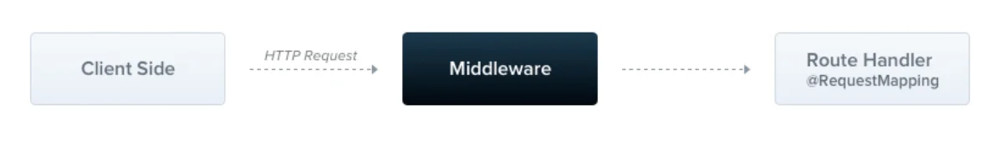
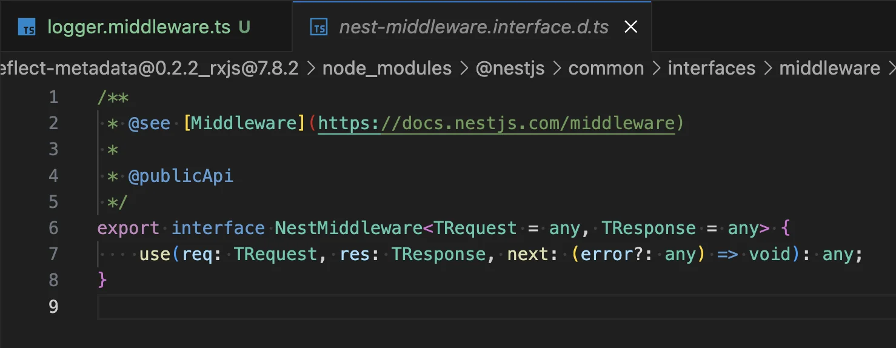
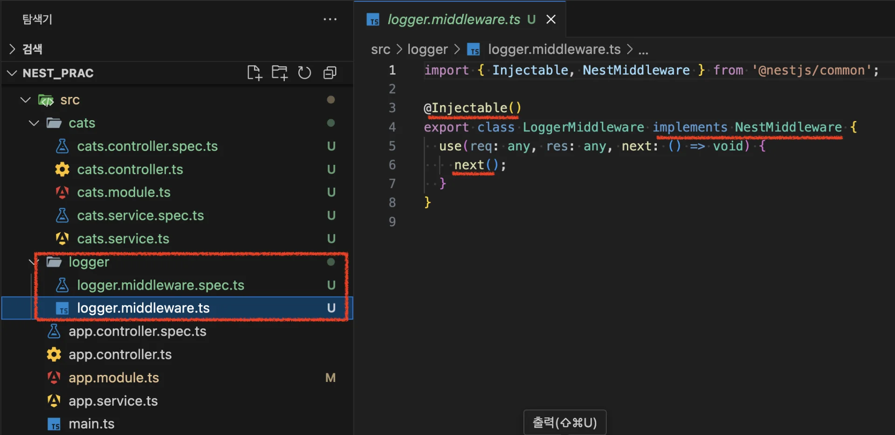
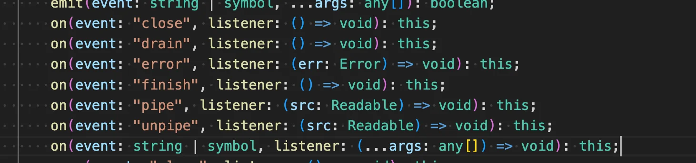
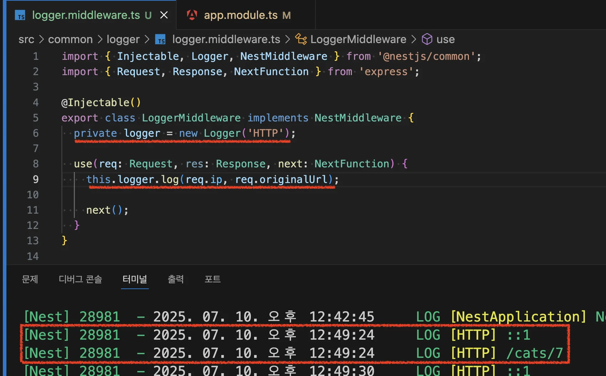

> 
> 
> <a id="22beda9b0fe1801d82fddac417ac125d"></a>
> 
> <strong>목차</strong>
> 
> - [미들웨어 ( Middleware )](#22beda9b0fe180dea99be9b29f6bb701)
> - [미들웨어 정의](#22ceda9b0fe1800cad57edc280da9788)
> - [미들웨어 적용](#22ceda9b0fe18057a50fdd0134361fb3)
> - [[ 실습 ] logger 미들웨어 생성 및 적용 확인](#22ceda9b0fe180fcb4d6e7ad17912cdd)

[Documentation &#124; NestJS &#45; A progressive Node&#46;js framework]()

<a id="22beda9b0fe180dea99be9b29f6bb701"></a>

## 미들웨어 ( Middleware )

---



> 📖 
> 
> <a id="22beda9b0fe1802bb8d4c9706af75db3"></a>
> 
> <code>미들웨어</code>는 <code>route handler</code>(Controller 내 요청 매핑함수)보다 먼저 호출되는 함수이다&#46; 
> 
> <a id="22ceda9b0fe180d0b7dcc642dfbfdd75"></a>
> 
> 미들웨어 함수는 <strong><u>요청 및 응답 객체에 액세스 가능</u></strong>하며, 애플리케이션의 요청&#45;응답 주기에서 <code>next()</code> 미들웨어 함수에 액세스할 수 있다&#46;
> 
> - <code>next</code> 미들웨어 함수는 일반적으로 <code>next</code>라는 이름의 변수로 표시된다&#46;

> 
> 
> <a id="22ceda9b0fe180b4a634c33c8a620c9e"></a>
> 
> Nest 미들웨어는 기본적으로 Express의 미들웨어와 동일하다&#46; 
> 
> <details>
> <summary>Express 미들웨어의 기능 설명</summary>
> 
> > 참조&#58; ‣
> 
> - 모든 코드 실행
> 
> - 요청 및 응답 객체 변경
> 
> - 요청&#45;응답 주기 종료
> 
> - 스택의 다음 미들웨어 함수 호출
> 
> - 현재 미들웨어 함수가 요청&#45;응답 주기를 종료하지 않으면, 다음 미들웨어 함수로 제어권을 넘기기위해  <code>next()</code>를 호출해야한다&#46;
>     - 그렇지 않으면 요청은 중단 상태로 남는다&#46;
> 
> </details>

> 
> 
> <a id="22ceda9b0fe1802fad32fedb0f24a4e1"></a>
> 
> Nest Middleware는 의존성 주입을 지원한다&#46; 
> 
> - provider, controller와 마찬가지로 <code>constructor(생성자 주입)</code>를 통해 동일한 모듈 내에서 사용 가능한 의존성을 주입할 수 있다&#46;

<a id="22ceda9b0fe1800cad57edc280da9788"></a>

### 미들웨어 정의

<details>
<summary>🧐 <strong><code>NestMiddleware</code></strong><strong> 인터페이스</strong></summary>



- 미들웨어 클래스가 반드시 <code>use(req, res, next)</code> 메서드를 가지고 있도록 <strong>강제한다&#46; </strong>

<a id="22ceda9b0fe180359c72ef7bc4240955"></a>

<strong>      ⇒ 타입 안정성(type safety)</strong>, <strong>예측 가능한 구조</strong> 보장

</details>

> ✏️ 
> 
> - <code>&#64;Injectable()</code> 데코레이터를 사용하여<strong><u> 함수나 클래스에서 사용자 지정 Nest 미들웨어를 구현</u></strong>한다&#46;
> 
> - <code>NestMiddleware</code> 인터페이스 구현하여 전처리 로직을 정의한다&#46;

<a id="22ceda9b0fe180c59b7dcc6e964415a4"></a>

```typescript
import { Injectable, NestMiddleware } from '@nestjs/common';
import { Request, Response, NextFunction } from 'express';

@Injectable()
export class Middleware implements NestMiddleware {
  use(req: Request, res: Response, next: NextFunction) {
    
    //... 전처리 로직 작성
    
    next();
  }
}
```

<a id="22ceda9b0fe18057a50fdd0134361fb3"></a>

### 미들웨어 적용

[Documentation &#124; NestJS &#45; A progressive Node&#46;js framework]()

> ✏️ 
> 
> <a id="22ceda9b0fe180b48ae0d9191930258e"></a>
> 
> 이전과 같이 <code>&#64;Module</code> 데코레이터에서 provider를 정의한 것처럼 <strong><u>미들웨어를 적용할 수 없</u></strong>다&#46; 
> 
> <a id="22ceda9b0fe180299583f7dc1ea9f0f1"></a>
> 
> 대신, <strong>모듈 클래스의 </strong><strong><code>configure()</code></strong><strong>메서드를 사용</strong>하여 <strong>미들웨어를 설정</strong>한다&#46; 
> 
> > 적용 과정  
> 
> 1. <strong><u>NestModule 인터페이스를 구현</u></strong>하여 <strong><u>configure() 메서드 오버라이드</u></strong>
> 
> 1. <strong><u>configure() 메서드 내 </u></strong><strong><u>consumer에서 미들웨어, path 설정</u></strong>

<details>
<summary>1&#46;  특정 경로 설정</summary>

<a id="22ceda9b0fe1800ba271c74aa36c8269"></a>

```typescript

import { Module, NestModule, MiddlewareConsumer } from '@nestjs/common';
import { LoggerMiddleware } from './common/middleware/logger.middleware';
import { CatsModule } from './cats/cats.module';

@Module({
  imports: [CatsModule],
})
export class AppModule implements NestModule {
  configure(consumer: MiddlewareConsumer) {
    consumer
      .apply(LoggerMiddleware)
      .forRoutes('cats');  
		      // 'cats': 해당 경로에만 미들웨어 적용
			    // '*': 전체 경로에 미들웨어 적용
  }
}
```

</details>

<details>
<summary>2&#46;  특정 경로 &#43; 특정 메서드 설정</summary>

> ✏️ 
> 
> <a id="22ceda9b0fe180588334c8af46ff57fd"></a>
> 
>  미들웨어를 구성할 때 <strong><u>경로와 요청을 포함하는 객체를 forRoutes()메서드에 전달</u></strong>하여 미들웨어를 특정 요청 메서드로 더 제한적으로 설정 가능하다&#46;

<a id="22ceda9b0fe1806385c7d7148b9b13b5"></a>

```typescript

import { Module, NestModule, RequestMethod, MiddlewareConsumer } from '@nestjs/common';
import { LoggerMiddleware } from './common/middleware/logger.middleware';
import { CatsModule } from './cats/cats.module';

@Module({
  imports: [CatsModule],
})
export class AppModule implements NestModule {
  configure(consumer: MiddlewareConsumer) {
    consumer
      .apply(LoggerMiddleware)
      .forRoutes({ path: 'cats', method: RequestMethod.GET });
  }
}
```

</details>

> 
> 
> <a id="22ceda9b0fe180a48ca5e57a8963da6c"></a>
> 
> <code>configure()</code> 메서드에 <code>async/await</code> 키워드를 사용하여 <u>비동기</u>로 동작되도록 할 수 있다&#46;
> 
> - <code>configure()</code> 메서드 본문 내 비동기 작업이 완료될 때까지 기다린다&#46;

> ⚠️ 
> 
> <a id="22ceda9b0fe1803593b5e8c32d16a29f"></a>
> 
> <strong><code>Express Adapter</code></strong>를 사용할 경우, <strong><code>NestJS</code></strong> 앱은 기본적으로 패키지 <strong><code>body&#45;parser</code></strong>에서 <strong><code>json</code></strong> 및 <strong><code>urlencoded</code></strong>를 등록한다&#46;
> 
> <a id="22ceda9b0fe180978abee8a38d7161cd"></a>
> 
> 즉, <strong><code>MiddlewareConsumer</code></strong>를 통해 해당 미들웨어 사용자를 지정하려면 <strong><code>NestFactory&#46;create()</code></strong>로 <strong><u>애플리케이션을 생성할 때</u></strong>, <strong><code>bodyParser</code></strong><strong><u>플래그</u></strong><strong>를 </strong><strong><code>false</code></strong><strong>로 설정</strong>하여 <strong><u>전역 미들웨어를 비활성화</u></strong> 해야한다&#46;

<a id="22ceda9b0fe180fcb4d6e7ad17912cdd"></a>

### &#91; 실습 &#93; logger 미들웨어 생성 및 적용 확인

<details>
<summary>1&#46; CLI를 통한 logger 미들웨어 생성</summary>

<a id="22ceda9b0fe180399fdfd3a91e27f5c6"></a>

```bash
# logger middleware 생성
nest g mi logger
```



- CLI로 생성 시, 이와 같이 기본적 설정을 자동으로 해준다&#46; 

</details>

<details>
<summary>2&#46;  미들웨어에 로깅 로직 정의</summary>

> ✏️ 
> 
> <a id="22ceda9b0fe180c69543dc1cf6539bee"></a>
> 
> NestJS에서는 로깅 출력 시, <code>Logger</code> 클래스를 사용한다&#46;

> ✏️ 
> 
> <a id="22ceda9b0fe180ddb2c5e3f81d135faa"></a>
> 
> <code>&#46;on(이벤트, 햄위)</code>
> 
> 
> 
> - 특정 이벤트 발생 시, 트리거를 발생 시켜 특정 행위가 동작되도록 할 수 있다&#46; 
> 
> <details>
> <summary>ex) <code>res&#46;on(’finish’, ()⇒{…})</code></summary>
> 
> <a id="22ceda9b0fe18005ab8fd7934b44b7d0"></a>
> 
> ```typescript
> res.on('finish', () => {
>   this.logger.log(
>     `${req.ip} ${req.method} ${req.originalUrl} ${res.statusCode} - ${res.statusMessage}`,
>   );
> });
> ```
> 
> - 응답이 완료(<code>finish</code>) 됐을 경우, 트리거를 통해 로그를 출력한다&#46;
> 
> </details>

<a id="22ceda9b0fe1807ebe97fd170b943eb2"></a>

```typescript
import { Injectable, Logger, NestMiddleware } from '@nestjs/common';
import { Request, Response, NextFunction } from 'express';

@Injectable()
export class LoggerMiddleware implements NestMiddleware {
  private logger = new Logger('HTTP');

  use(req: Request, res: Response, next: NextFunction) {
    res.on('finish', () => {
      this.logger.log(
        `${req.ip} ${req.method} ${req.originalUrl} ${res.statusCode} - ${res.statusMessage}`,
      );
    });

    next();
  }
}
```

</details>

<details>
<summary>3&#46; 미들웨어 적용 ( 의존성 주입 )</summary>

<a id="22ceda9b0fe180b7bb74f9d2ee56aaa5"></a>

```typescript

import { Module, NestModule, MiddlewareConsumer } from '@nestjs/common';
import { LoggerMiddleware } from './common/middleware/logger.middleware';
import { CatsModule } from './cats/cats.module';

@Module({
  imports: [CatsModule],
})
export class AppModule implements NestModule {
  configure(consumer: MiddlewareConsumer) {
    consumer
      .apply(LoggerMiddleware)
      .forRoutes('cats');
  }
}
```

- <code>AppModule</code> 레벨에서의 <code>LoggerMiddleware</code> 적용

</details>

<details>
<summary>4&#46; 미들웨어 적용 확인</summary>




- 해당되는 route handler가 호출되기 전, 미들웨어에 정의한 로깅 로직이 정상 출력되는 것을 확인할 수 있다&#46;

</details>
