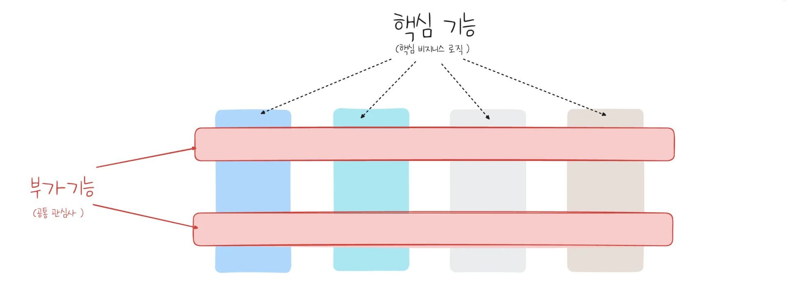
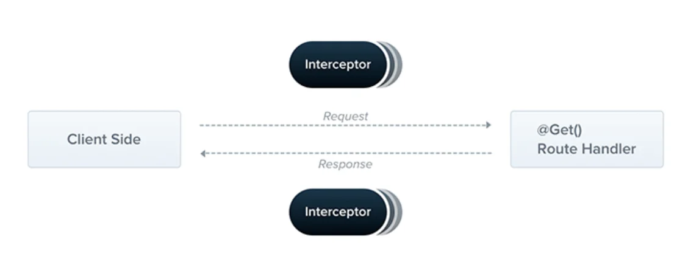

> 
> 
> <a id="22beda9b0fe181cf824dd45803037885"></a>
> 
> <strong>목차</strong>
> 
> - [AOP ( Aspect-oriented programming,  관점 지향 프로그래밍 )](#22beda9b0fe18138a8dacfd3de71f817)
> - [Interceptors](#22deda9b0fe180f0b6c8d3620ee21cf4)
> - [설명](#22deda9b0fe180eab4dddb3d214d7044)
> - [ex) 사용자 상호작용 로깅](#22deda9b0fe1801d9888c8f60bded08c)
> - [Rerference](#22deda9b0fe180fb81c8e97ad150243d)

<a id="22beda9b0fe18138a8dacfd3de71f817"></a>

## AOP ( Aspect&#45;oriented programming,  관점 지향 프로그래밍 )

---

> 📖 
> 
> <a id="22deda9b0fe180ae8411f6afe1d89d23"></a>
> 
> <strong><code>AOP</code></strong><strong> ( Aspect&#45;oriented programming,  관점 지향 프로그래밍 )</strong>
> 
> 
> 
> <a id="22deda9b0fe180359c76e86c2a270704"></a>
> 
> 로깅, 인증 처리 ( Sercurity, guard ) 등 <strong><u>코드 전역적으로 사용</u></strong>되는 <code>공통 관심사</code>의 경우, <strong><u>Aspect(측면)으로 분리</u></strong>함으로써 <strong>중복되는 로직을 모듈화</strong>하고 <strong>핵심 비지니스 로직과 분리</strong>시켜 <strong><u>코드의 응집성을 높이고 유지보수 및 확장성을 용이</u></strong>하게 하도록 코드 설계하는 기법이다&#46;

<a id="22deda9b0fe180728079c4f9ff94e3f2"></a>

Spring에서는 Annotation(<code>&#64;</code>)을 통해 처리하는 것이 일반적이지만, 

<a id="22deda9b0fe18075920deee6aff3238a"></a>

NestJS에서는 그와 유사한 Decorator가 아닌 Interceptor를 사용해서 처리한다&#46; 

<a id="22deda9b0fe180f0b6c8d3620ee21cf4"></a>

## Interceptors

---

> 📖 
> 
> <a id="22deda9b0fe1808783b4cd23489b9e53"></a>
> 
> <strong><code>Interceptors</code></strong><strong> </strong>
> 
> ---
> 
> 
> 
> > Interceptors는 <code>NestInterceptor</code>를 구현하고 <code>&#64;Injectable()</code>가 적용된 클래스이다&#46;
> 
> <details>
> <summary><code>Interceptor</code>는 <a href="https://en.wikipedia.org/wiki/Aspect-oriented_programming">AOP 기법</a>에서 영감을 받아 여러 가지 유용한 기능을 제공한다&#46;</summary>
> 
> - 메서드 실행 전/후에 추가 로직 바인딩
> 
> - 함수에서 반환된 결과 변환
> 
> - 함수에서 발생한 예외 변환
> 
> - 기본 기능 동작 확장
> 
> - 특정 조건(예&#58; 캐싱 목적)에 따라 함수를 완전히 재정의
> 
> </details>

> 📌 
> 
> <a id="22deda9b0fe1809b9d22f7595bc47bf2"></a>
> 
> 요청의 생명주기에서의 Interceptor 실행 순서
> 
> <details>
> <summary><a href="https://docs.nestjs.com/faq/request-lifecycle#summary">Request Lifecycle</a></summary>
> 
> 1. Incoming request
> 
> 1. Middleware
>     - 2&#46;1&#46; Globally bound middleware
> 
>     - 2&#46;2&#46; Module bound middleware
> 
> 1. Guards
>     - 3&#46;1 Global guards
> 
>     - 3&#46;2 Controller guards
> 
>     - 3&#46;3 Route guards
> 
> 1. <strong>Interceptors (pre&#45;controller)</strong>
>     - 4&#46;1 Global interceptors
> 
>     - 4&#46;2 Controller interceptors
> 
>     - 4&#46;3 Route interceptors
> 
> 1. Pipes
>     - 5&#46;1 Global pipes
> 
>     - 5&#46;2 Controller pipes
> 
>     - 5&#46;3 Route pipes
> 
>     - 5&#46;4 Route parameter pipes
> 
> 1. Controller (method handler)
> 
> 1. Service (if exists)
> 
> 1. <strong>Interceptors (post&#45;request)</strong>
>     - 8&#46;1 Route interceptor
> 
>     - 8&#46;2 Controller interceptor
> 
>     - 8&#46;3 Global interceptor
> 
> 1. Exception filters
>     - 9&#46;1 route
> 
>     - 9&#46;2 controller
> 
>     - 9&#46;3 global
> 
> 1. Server response
> 
> </details>

<details>
<summary><strong>🧐 Route Handler 이전에 전처리를 하기위한 middleware가 존재하는데, 왜 굳이 Interceptor 계층을 따로 만들어서 처리하는가?</strong></summary>

<a id="22deda9b0fe180fbb5f1f05f22de0ae2"></a>

<a href="#/post/22deda9b-0fe1-802e-a807-cc51abda8319">페이지</a> 

</details>

<a id="22deda9b0fe180eab4dddb3d214d7044"></a>

### 설명

<a id="22deda9b0fe18071ae34de4eba64e387"></a>

각 인터셉터는 <code>NestInterceptor</code>를 상속해 두 개의 인수(<strong>ExecutionContext, CallHandler)</strong>를 받는 <code>intercept()</code> 메서드를 구현한다&#46;

<a id="22deda9b0fe180449964ffe76b8f6b27"></a>

<strong>1&#46; </strong> <strong>실행 컨텍스트 ( ExecutionContext )</strong>

<a id="22deda9b0fe1804d9c1af5574ffb3970"></a>

ExecutionContext는 ArgumentsHost를 확장하여 현재 실행 프로세스에 대한 추가 정보를 제공하는 여러 가지 새로운 도우미 메서드를 추가한다&#46;

- ExecutionContext는 ArgumentsHost를 상속한다&#46;

- 앞서 예외 필터 장에서 ArgumentsHost 살펴봤다&#46;
    <a id="29ceda9b0fe18032a201d914558f1264"></a>

     ArgumentsHost는 원래 핸들러에 전달된 인수를 감싸는 래퍼이며, <br>애플리케이션 유형에 따라 다른 인수 배열을 포함한다&#46;

<a id="22deda9b0fe18087828dc657629a0a0b"></a>

이러한 세부 정보는 다양한 컨트롤러, 메서드 및 실행 컨텍스트에서 작동할 수 있는 보다 일반적인 인터셉터를 구축하는 데 도움이 될 수 있다&#46;

- <a href="https://docs.nestjs.com/fundamentals/execution-context"> ExecutionContext</a>

1. <strong>호출 핸들러 ( CallHandler )</strong>

<a id="22deda9b0fe180a4a317d187accc9542"></a>

두 번째 인수는 <code>CallHandler</code>이다&#46; <code>CallHandler</code> 인터페이스는 <code>handle()</code> 메서드를 구현하며, 이 메서드를 사용하여 인터셉터의 특정 지점에서 경로 핸들러 메서드를 호출할 수 있다&#46; 

<a id="22deda9b0fe180dba546fb86225bc555"></a>

intercept() 메서드 구현에서 handle() 메서드를 호출하지 않으면 라우트 핸들러 메서드가 전혀 실행되지 않는다&#46;

<a id="22deda9b0fe180c5b644e5f210664e58"></a>

이 접근 방식은 intercept() 메서드가 요청/응답 스트림을 효과적으로 래핑한다는 것을 의미한다&#46;

<a id="29ceda9b0fe1802bb230e0f19c7b752d"></a>

 결과적으로 최종 경로 핸들러 실행 전후에 사용자 지정 로직을 구현할 수 있다&#46;

<a id="22deda9b0fe18053a202d80e2cfb0862"></a>

 handle()을 호출하기 전에 실행되는 intercept() 메서드에 코드를 작성할 수 있다는 것은 분명하지만, 이후의 동작에는 어떻게 영향을 미칠 수 있을까? 

<a id="22deda9b0fe18034a348d7baaf7251fd"></a>

handle() 메서드는 Observable을 반환하므로 강력한 RxJS 연산자를 사용하여 응답을 추가로 조작할 수 있다&#46;

<a id="22deda9b0fe18095874ef33be3aef25d"></a>

관점 지향 프로그래밍(AOP) 용어를 사용하면 경로 핸들러 호출(즉, handle() 호출)을 포인트컷(Pointcut)이라고 하며, 이는 추가 로직이 삽입되는 지점임을 나타낸다&#46;

<a id="22deda9b0fe180e5bf17d4808f67cff6"></a>

예를 들어, POST /cats 요청이 들어왔다라고 한다면, 이 요청은 CatsController 내부에 정의된 create() 핸들러로 전달된다&#46; 

<a id="22deda9b0fe180ed9851e9feac2177c6"></a>

handle() 메서드를 호출하지 않는 인터셉터가 도중에 호출되면 create() 메서드는 실행되지 않는다&#46; 

<a id="22deda9b0fe18062b2c9d8721d12e6ed"></a>

handle()이 호출되고 해당 Observable이 반환되면 create() 핸들러가 트리거된다&#46; 그리고 Observable을 통해 응답 스트림이 수신되면 해당 스트림에서 추가 작업을 수행하고 최종 결과를 호출자에게 반환한다&#46;

<a id="22deda9b0fe1801d9888c8f60bded08c"></a>

### ex) 사용자 상호작용 로깅

<a id="22deda9b0fe18011ab55c84568c7ed32"></a>

```typescript
import { Injectable, NestInterceptor, ExecutionContext, CallHandler } from '@nestjs/common';
import { Observable } from 'rxjs';
import { tap } from 'rxjs/operators';

@Injectable()
export class LoggingInterceptor implements NestInterceptor {
  intercept(context: ExecutionContext, next: CallHandler): Observable<any> {
		// 핸들러 시작전
    console.log('Before...');

    const now = Date.now();
    return next
      .handle()
      .pipe(
	      // 핸들러 실행 이후 
        tap(() => console.log(`After... ${Date.now() - now}ms`)),
      );
  }
}
```

<a id="22deda9b0fe180b6a204f4e87175f9fc"></a>

<strong>Binding interceptors</strong>

<a id="22deda9b0fe1803497aed3fdf282318a"></a>

```typescript
// cats.controller.ts
@UseInterceptors(LoggingInterceptor)
export class CatsController {}
```

<a id="22deda9b0fe180fb81c8e97ad150243d"></a>

## Rerference

[Aspect Oriented Programming with Spring &#58;&#58; Spring Framework]()

[Aspect&#45;oriented programming]()

[Documentation &#124; NestJS &#45; A progressive Node&#46;js framework]()
