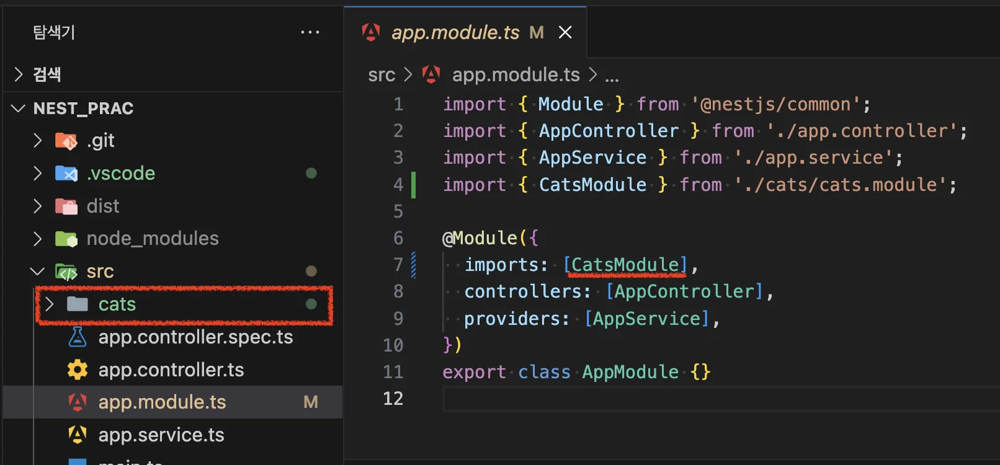
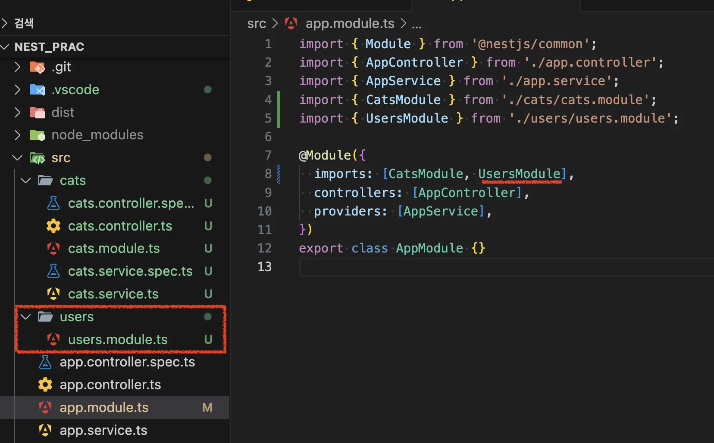
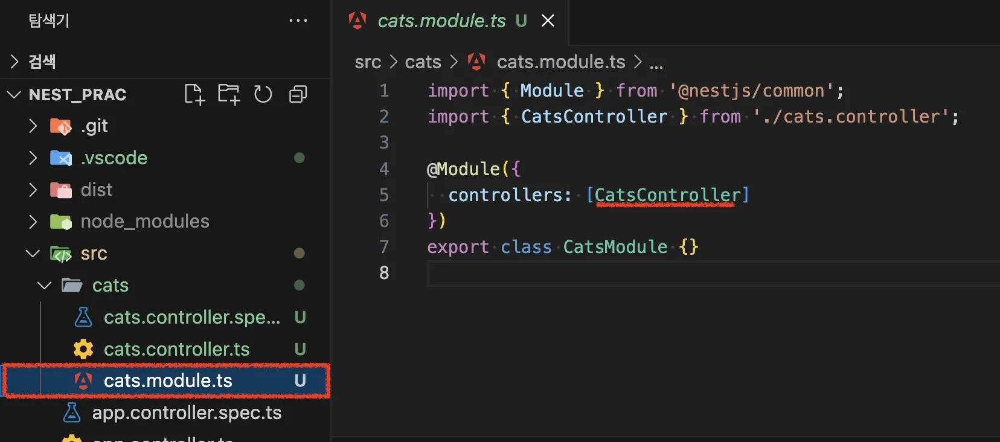
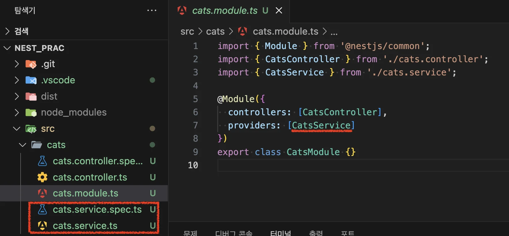
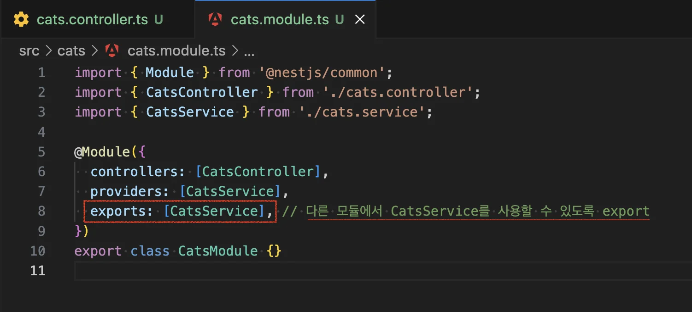

> 
> 
> <a id="22beda9b0fe180e39422c02d06934e99"></a>
> 
> <strong>목차</strong>
> 
> - [Nest CLI](#22beda9b0fe1803ca83aebf9df2d4c5f)
> - [[ 실습 ] NestJS를 통한 간단한 CRUD API 구축](#22beda9b0fe180b38492c857e37fa627)
> - [모듈 캡슐화 및 export 처리](#22beda9b0fe180e8a281e1568f3a807d)
> - [Provider로 제공](#22ceda9b0fe18001af90d99711b1e4b8)

<a id="22beda9b0fe1803ca83aebf9df2d4c5f"></a>

## <strong>Nest CLI</strong>

---

[Documentation &#124; NestJS &#45; A progressive Node&#46;js framework]()

<a id="22beda9b0fe180d58e86f9f8d42f0731"></a>

```bash
nest g mo {모듈명}   # 모듈 생성
nest g co {모듈명}   # 컨트롤러 생성
nest g s {모듈명}    # 서비스 생성
```

<details>
<summary><strong>1&#46; 모듈 생성</strong></summary>

<a id="22beda9b0fe1809b9611e805f37a1191"></a>

```bash
# nest g mo {모듈명}
nest g mo cats
```



- CLI로 모듈 등록 시, 자동으로 해당 모듈을 루트 모듈(AppModule)에 등록해준다&#46; <br>따라서 CLI를 통한 모듈 생성을 권장한다&#46; 

<a id="22beda9b0fe180ac8356ee356fd96524"></a>

```bash
# nest g mo {모듈명}
nest g mo users
```



- 추가한 또다른 모듈도 자동으로 루트 모듈에 <code>import</code> 된디&#46;

</details>

<details>
<summary><strong>2&#46; 컨트롤러 생성</strong></summary>

<a id="22beda9b0fe180608ca2dbbf327edf63"></a>

```bash
# nest g mo {모듈명}
nest g co cats
```



- CLI로 컨트롤러 생성 시, 해당 모듈에 자동으로 컨트롤러가 등록된다&#46; 

</details>

<details>
<summary><strong>3&#46; 서비스 생성</strong></summary>

<a id="22beda9b0fe180278137e80c4cec7a06"></a>

```bash
# nest g s {모듈명}
nest g s cats
```



- 동일하게 Service가 생성되고 해당 모듈에 자동 등록된다&#46;

</details>

<a id="22beda9b0fe180b38492c857e37fa627"></a>

## &#91; 실습 &#93; NestJS를 통한 간단한 CRUD API 구축

---

> ✏️ 
> 
> <a id="22beda9b0fe180f19baffe63e4c236ae"></a>
> 
> 이전 Express 예저를 NestJS로 재구현
> 
> - express 예제&#58; ‣

<details>
<summary>&#91; 코드 &#93; 이전 express 예제</summary>

<a id="22beda9b0fe1802ab0c8d2018f9185b3"></a>

<strong>cats&#46;route&#46;ts</strong>

<a id="22beda9b0fe180719e8ef51ba24c67e1"></a>

```typescript
import { Router } from "express";
import { NextFunction } from "express-serve-static-core";
import {
  createCat,
  readAllCats,
  readCat,
  updateCat,
  updatePartialCat,
  deleteCat,
} from "./cats.service.js";

const router = Router();

router.post("/cats", createCat);
router.get("/cats", readAllCats);
router.get("/cats/:id", readCat);
router.put("/cats/:id", updateCat);
router.patch("/cats/:id", updatePartialCat);
router.delete("/cats/:id", deleteCat);

export default router;
```

</details>

<details>
<summary>&#91; 코드 &#93;  NestJS 예제</summary>

<a id="22beda9b0fe180c2b0fbfc6391805f57"></a>

<strong>cats&#46;controller&#46;ts</strong>

<a id="22beda9b0fe180e598d8e08c22425654"></a>

```typescript
import { Controller, Delete, Get, Patch, Post, Put } from '@nestjs/common';
import { CatsService } from './cats.service';

@Controller('cats')
export class CatsController {
  constructor(private readonly catsService: CatsService) {}

  // 엔드포인트: /cats/
  @Get()
  getAllCats(): string {
    return 'all cats';
  }

  // 엔드포인트: /cats/:id
  @Get(':id')
  getOneCat(): string {
    return 'one cat';
  }

  // 엔드포인트: /cats/
  @Post()
  createlCat(): string {
    return 'create cat';
  }

  // 엔드포인트: /cats/:id
  @Put(':id')
  updaateCat(): string {
    return 'update cat';
  }

  // 엔드포인트: /cats/:id
  @Patch(':id')
  updatePartialCat(): string {
    return 'update partial cat';
  }

  // 엔드포인트: /cats/:id
  @Delete(':id')
  deleteCat(): string {
    return 'delete cat';
  }
}
```

- 간단한 CRUD 

</details>

<a id="22beda9b0fe180e8a281e1568f3a807d"></a>

## 모듈 캡슐화 및 export 처리

---

> 📖 
> 
> <a id="22beda9b0fe180cb8bf7eefb3153e353"></a>
> 
> <em><strong>모듈은 기본적으로 Provider를 캡슐화하기 때문 </strong></em>에 다른 모듈에서 사용하려면 <code>export</code>를 통해 해당되는 Provider를  내보내줘야 한다&#46;
> 
> > The module <strong>encapsulates</strong> providers by default, meaning you can only inject providers that are either part of the current module or explicitly exported from other imported modules&#46; The exported providers from a module essentially serve as the module&#39;s public interface or API&#46;<br>&#45; 참조&#58;  <a href="https://docs.nestjs.com/modules">https&#58;//docs&#46;nestjs&#46;com/modules</a>
> 
> - 현재 모듈에 포함되어 있거나 다른 가져온 모듈에서 명시적으로 내보낸 <code>Provider</code>만 주입할 수 있다&#46;
> 
> - 모듈에서 내보낸 <code>Provider</code>는 기본적으로 해당 모듈의 공용 인터페이스 또는 API 역할을 한다&#46;

> 🧐 
> 
> <a id="22beda9b0fe180fab309d607134e4d1d"></a>
> 
> <strong>캡술화</strong>
> 
> <a id="22beda9b0fe180fa8c14c318ff2e7bed"></a>
> 
> 객체(Object)의 속성(field)과 행위(method)를  하나로 묶고 분리하여, 구현된 일부를 감춰 은닉한다&#46; <br>( 은닉&#58; hiding, 숨긴다&#46; )



- 위와 같이 해당되는 모듈에서 provider를 명시적으로 <code>export</code> 처리해야 다른 모듈에서 사용할 수 있다&#46;

<a id="22ceda9b0fe18001af90d99711b1e4b8"></a>

### Provider로 제공

<a id="22ceda9b0fe180ddae84dc9728d4b656"></a>

루트 모듈의 provider로 제공하는 것도 가능하다&#46; 그러나 매번 추가될 때마다 providers에 추가를 한다면, 앱이 확장되면 될 수록 관리가 어렵다&#46; 

- 안티 패턴

<a id="22ceda9b0fe180cd9352dff5350336d2"></a>

따라서 각 하위 모듈마다 export 처리를 하는 것을 권장한다&#46;
