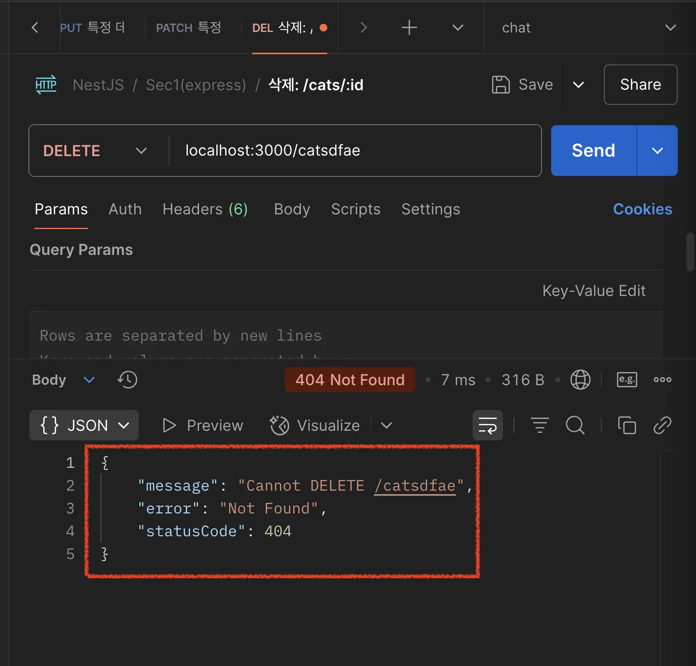

> 📖 
> 
> <a id="22beda9b0fe180f28dded9d4cbaf5bdd"></a>
> 
> Nest는 애플리케이션 전체에서 처리되지 않는 예외(unhandled exception)를 중앙에서 처리하는 계층(Layer)을 제공한다&#46; 
> 
> - Spring에서의 <code>Global Exception Handler</code> 처리와 동일
> 
> - 코드 어디선가 예외가 발생 되었을 경우, 직접 try&#45;catch로 처리하는 것이 아닌 전역적으로 처리 가능

<a id="22ceda9b0fe1808cb4cbc84f44f1c00f"></a>

### 표준 예외 처리 &#45; <code>HttpException</code>

> ✏️ 
> 
> <a id="22ceda9b0fe18038976cc6dcca1a4651"></a>
> 
> Nest는 <code>&#64;nestjs/common</code> 패키지 차원에서<code>HttpException</code> <strong><u>예외 클래스</u></strong>를 제공한다&#46;

<details>
<summary>예제 1)</summary>

<a id="22ceda9b0fe18016a51fe4964d00118a"></a>

<strong>Route Handler</strong>

<a id="22ceda9b0fe1800da74ec5c1286049fe"></a>

```typescript
// cats.controller.ts
@Get()
async findAll() {
  throw new HttpException('Forbidden', HttpStatus.FORBIDDEN);
}
```

<a id="22ceda9b0fe1802cb5b1ee61dacfa2f9"></a>

<strong>Response</strong>

<a id="22ceda9b0fe18024bd66daea6cf07769"></a>

```typescript
{
  "statusCode": 403,
  "message": "Forbidden"
}
```

- NestJS에서 Error 발생 시의 기본 응답 포맷
    

</details>

<details>
<summary>예제 2) </summary>

<a id="22ceda9b0fe1807e9feaea6c42e33e19"></a>

<strong>Route Handler</strong>

<a id="22ceda9b0fe180198ddcfbc208991097"></a>

```typescript
// cats.controller.ts
@Get()
async findAll() {
  try {
    await this.service.findAll()
  } catch (error) {
    throw new HttpException(
    // arg 1
    {
      status: HttpStatus.FORBIDDEN,
      error: 'This is a custom message',
    },
    // arg 2
    HttpStatus.FORBIDDEN, 
    // arg 3
    {
      cause: error
    });
  }
}
```

<a id="22ceda9b0fe180f394cbe104bc0b2ce7"></a>

<strong>Response</strong>

<a id="22ceda9b0fe1805b8fdee40bd9ebd7a9"></a>

```typescript
{
  "status": 403,
  "error": "This is a custom message"
}
```

</details>

<a id="22ceda9b0fe180eeaca1d73cf975e196"></a>

### Custom Exceptions

[Documentation &#124; NestJS &#45; A progressive Node&#46;js framework]()

> ✏️ 
> 
> <a id="22ceda9b0fe180548eb5d84c1af9ac1e"></a>
> 
> 사용자 정의 예외(<code>Custom Exceptions</code>)는 아래와 같이 <code>HttpException</code> 상속하여 처리한다&#46;
> 
> <a id="22ceda9b0fe18028a548dd14ce0b0219"></a>
> 
> <code>HttpException</code>을 상속해서 사용자 정의 예외(Custom Exception)를 만들면, Nest의 <strong>Exception Filter 시스템</strong>이 이를 감지하고 자동으로 HTTP 응답으로 변환한다&#46;

- Custom Exception 정의
    <a id="22ceda9b0fe1806c83efe7f209d7d487"></a>

    ```typescript
    import { HttpException, HttpStatus } from '@nestjs/common';

    export class CustomForbiddenException extends HttpException {
      constructor() {
        super('커스텀 접근 금지 오류입니다.', HttpStatus.FORBIDDEN);
      }
    }
    ```

- 
    <a id="22ceda9b0fe18069a694da5557f9961d"></a>

    ```typescript
    // custom.controller.ts
    @Get()
    someMethod() {
      throw new CustomForbiddenException();
    }
    ```

    - <code>ForbiddenException</code>은 기본  <code>HttpException</code>을 상속하기 때문에 <code>built&#45;in exception handler</code>와 원할하게 작동한다&#46;  

    - 따라서 findAll() 메서드 안에서 사용 가능하다&#46;

<a id="22ceda9b0fe18054bb92c7f6cafc4fe5"></a>

### <strong>Built&#45;in HTTP Exceptions</strong>

> ✏️ 
> 
> <a id="22ceda9b0fe1805e8c87e3a81560173c"></a>
> 
> Nest에서는 기본 <code>HttpException</code>을 상속하는 <strong><u>표준 예외 집합을 제공</u></strong>한다&#46; 
> 
> - 해당 예외들은 <code>&#64;nestjs/common</code> 패키지에서 제공된다&#46; 
> 
> - 가장 일반적인 HTTP 예외들을 나타낸다&#46;

<details>
<summary>종류</summary>

| <strong>Exception Class</strong> | <strong>HTTP Status</strong> | <strong>의미 (요약)</strong> |
| --- | --- | --- |
| <code>BadRequestException</code> | 400 | 잘못된 요청 (Validation 실패 등) |
| <code>UnauthorizedException</code> | 401 | 인증 실패 (토큰 없음/만료 등) |
| <code>ForbiddenException</code> | 403 | 인가 실패 (권한 없음) |
| <code>NotFoundException</code> | 404 | 리소스를 찾을 수 없음 |
| <code>MethodNotAllowedException</code> | 405 | 해당 HTTP 메서드가 지원되지 않음 |
| <code>NotAcceptableException</code> | 406 | Accept 헤더 조건 불일치 |
| <code>RequestTimeoutException</code> | 408 | 요청 시간 초과 |
| <code>ConflictException</code> | 409 | 중복 충돌 (예&#58; 중복된 회원가입 등) |
| <code>GoneException</code> | 410 | 리소스가 영구적으로 제거됨 |
| <code>PayloadTooLargeException</code> | 413 | 요청 본문(payload)이 너무 큼 |
| <code>UnsupportedMediaTypeException</code> | 415 | Content&#45;Type이 지원되지 않음 |
| <code>UnprocessableEntityException</code> | 422 | 요청은 형식상 맞지만 처리 불가능 |
| <code>PreconditionFailedException</code> | 412 | 조건부 요청 실패 |
| <code>InternalServerErrorException</code> | 500 | 서버 내부 오류 |
| <code>NotImplementedException</code> | 501 | 아직 구현되지 않음 |
| <code>BadGatewayException</code> | 502 | 게이트웨이로부터 잘못된 응답 |
| <code>ServiceUnavailableException</code> | 503 | 서비스 불가 상태 |
| <code>GatewayTimeoutException</code> | 504 | 게이트웨이 응답 지연 |
| <code>HttpVersionNotSupportedException</code> | 505 | 지원되지 않는 HTTP 버전 |

</details>

<details>
<summary>매개변수&#58; <code>cause</code></summary>

> ✏️ 
> 
> <a id="22ceda9b0fe1804fa52aff6ff7b36ac1"></a>
> 
> 모든 Built&#45;in Exception들은 옵션 파라미터를 사용해 오류 원인과 오류 설명 모두 응답으로 제공할 수 있다&#46;

<a id="22ceda9b0fe1800eb170d651bebc1a25"></a>

Custom Exception &#45; options 파라미터 설정

<a id="22ceda9b0fe180118dbaf30ccbf84235"></a>

```typescript
throw new BadRequestException(
		'Something bad happened',    // 메세지
		{
		  cause: new Error(),
		  description: 'Some error description',
		}
);
```

<a id="22ceda9b0fe180bc858be6b394545977"></a>

<strong>응답</strong>

<a id="22ceda9b0fe18001b861dab2b334311e"></a>

```json
{
  "message": "Something bad happened",
  "error": "Some error description",
  "statusCode": 400
}
```

</details>

<a id="22ceda9b0fe180b98963e26cfb22bf48"></a>

### Exception filters

<a id="22ceda9b0fe180b6aca5da04a983d21a"></a>

### Exception logging

<a id="22ceda9b0fe180acb66ef8a289662fff"></a>

By default, the exception filter does not log built&#45;in exceptions like <code>HttpException</code> (and any exceptions that inherit from it)&#46; When these exceptions are thrown, they won&#39;t appear in the console, as they are treated as part of the normal application flow&#46; The same behavior applies to other built&#45;in exceptions such as <code>WsException</code> and <code>RpcException</code>&#46;

<a id="22ceda9b0fe180eebc88c03bb91ca55a"></a>

These exceptions all inherit from the base <code>IntrinsicException</code> class, which is exported from the <code>&#64;nestjs/common</code> package&#46; This class helps differentiate between exceptions that are part of normal application operation and those that are not&#46;

<a id="22ceda9b0fe1805d973bc733a60e7f04"></a>

If you want to log these exceptions, you can create a custom exception filter&#46; We&#39;ll explain how to do this in the next section&#46;

[Documentation &#124; NestJS &#45; A progressive Node&#46;js framework]()

[Documentation &#124; NestJS &#45; A progressive Node&#46;js framework]()

[http.exception.ts](https://github.com/nestjs/nest/blob/master/packages/common/exceptions/http.exception.ts)

<a id="22ceda9b0fe180e1b96ad1b072db4025"></a>

### Spring과 비교

<a id="22ceda9b0fe180d2bb7ee3716cc27fa4"></a>

<a href="#/post/22ceda9b-0fe1-806e-8abf-c6e30fd8b0dc">페이지</a>
