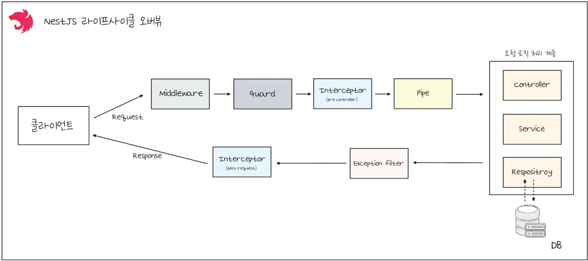

> 
> 
> <a id="22deda9b0fe180e6915be01a11368bc0"></a>
> 
> 목차
> 
> - [middleware,  Interceptor  비교](#22deda9b0fe18079a858d7707a22e911)
> - [의문점](#22deda9b0fe180d6bee6c2d86daaa4aa)
> - [해답](#22deda9b0fe18097bf42d6ef5558da75)
> - [디자인 패턴 학습을 통한 인사이트](#22deda9b0fe180ae94bccc33e3e2f021)
> - [NestJS의 Middleware vs Interceptor: 설계 의도 기반 계층 분리의 실례](#22deda9b0fe1807c8b35d518be50da6b)
> - [설계 의도에 따른 명확한 분리](#22deda9b0fe1800badc6c9969895552d)
> - [정리](#22deda9b0fe18013a00dcfce3ea42d4f)

<a id="22deda9b0fe18079a858d7707a22e911"></a>

# middleware,  Interceptor  비교

---

<a id="22deda9b0fe180d6bee6c2d86daaa4aa"></a>

## 의문점

> 🧐 
> 
> <a id="22deda9b0fe180e6b3ffe6dc4ef0bbc7"></a>
> 
> Route Handler 이전에 전처리를 하기위한 middleware가 존재하는데, 왜 굳이 Interceptor 계층을 따로 만들어서 처리하는가?

<a id="22deda9b0fe18046b94cd7c89013648c"></a>

Interceptor 챕터 학습 도중 위와 같은 의문점이 들었다&#46;

<a id="22deda9b0fe18049a01fe60795e321c4"></a>

NestJS의 요청 처리 라이프사이클을 살펴보면, <strong>Middleware와 Interceptor 모두 Controller의 route handler 이전에 실행되는 전처리 계층</strong>이라는 점에서 동일한 역할을 수행하는 것처럼 보인다&#46;

<details>
<summary><a href="https://docs.nestjs.com/faq/request-lifecycle#summary">Request Lifecycle</a></summary>



1. Incoming request

1. <strong>Middleware</strong>
    - 2&#46;1&#46; Globally bound middleware

    - 2&#46;2&#46; Module bound middleware

1. Guards
    - 3&#46;1 Global guards

    - 3&#46;2 Controller guards

    - 3&#46;3 Route guards

1. <strong>Interceptors (pre&#45;controller)</strong>
    - 4&#46;1 Global interceptors

    - 4&#46;2 Controller interceptors

    - 4&#46;3 Route interceptors

1. Pipes
    - 5&#46;1 Global pipes

    - 5&#46;2 Controller pipes

    - 5&#46;3 Route pipes

    - 5&#46;4 Route parameter pipes

1. Controller (method handler)

1. Service (if exists)

1. <strong>Interceptors (post&#45;request)</strong>
    - 8&#46;1 Route interceptor

    - 8&#46;2 Controller interceptor

    - 8&#46;3 Global interceptor

1. Exception filters
    - 9&#46;1 route

    - 9&#46;2 controller

    - 9&#46;3 global

1. Server response

</details>

<a id="22deda9b0fe1805c95d7f07420237be9"></a>

그렇다면 둘다 전처리를 담당하는 것인데, 왜 굳이 계층을 분리하여 설계했을까?

<a id="22deda9b0fe18097bf42d6ef5558da75"></a>

## <strong>해답</strong>

> ✏️ 
> 
> <a id="22deda9b0fe180b78b9af71f05f9bc62"></a>
> 
> <strong><code>Middleware</code></strong>와 <strong><code>Interceptor</code></strong>는 일견 비슷해 보이는 두 계층이지만, 각각의 <strong>설계 철학과 추상화 레벨</strong>은 근본적으로 다르다&#46; 
> 
> <a id="22deda9b0fe1803ca106e9be660b7fc9"></a>
> 
> 문제는 &#34;언제 실행되는가&#34;가 아니라 <strong><u>&#34;무엇을 위해 존재하는가&#34;</u></strong>에 있다&#46;

<a id="22deda9b0fe180ae94bccc33e3e2f021"></a>

### 디자인 패턴 학습을 통한 인사이트

<a id="22deda9b0fe18059b46be4764ccde44c"></a>

디자인 패턴을 학습하면서 발견한 흥미로운 사실은, 구조적으로 유사하거나 심지어 동일한 형태를 가진 패턴들이 별개의 패턴으로 분류되는 근본적인 이유가 <strong><u>설계 의도(Design Intent)</u></strong>에 있다는 점이다&#46;

<a id="22deda9b0fe1808fb12be47b4bf5f960"></a>

즉, 코드의 표면적 구조나 구현 방식이 아니라, <strong>그 패턴이 해결하고자 하는 문제의 본질과 설계자의 의도가 패턴 분류의 핵심 기준</strong>이 된다는 것이다&#46;

<a id="22deda9b0fe1804da8aeecc286759778"></a>

이는 소프트웨어 아키텍처에서 <strong>&#39;What&#39;보다 &#39;</strong><strong>Why&#39;가 더 중요</strong><strong>하다</strong>는 원칙을 보여주는 대표적인 사례라고 할 수 있다&#46; 

- 동일한 구조라도 서로 다른 문제 영역을 타겟팅하고, 다른 설계 철학을 반영한다면, 이는 명백히 구별되는 패턴으로 인식되어야 한다&#46;

<a id="22deda9b0fe180a0a685e91cc4815d49"></a>

결과적으로, 패턴의 진정한 가치는 코드의 재사용성이나 구조적 우아함에 있는 것이 아니라, <strong>문제 해결에 대한 명확한 의도와 맥락</strong>을 제공하는 데 있다고 볼 수 있다&#46;

<a id="22deda9b0fe1807c8b35d518be50da6b"></a>

### NestJS의 Middleware vs Interceptor&#58; 설계 의도 기반 계층 분리의 실례

<a id="22deda9b0fe180f3bbe2e060f1b7e07b"></a>

이러한 설계 의도의 중요성은 <strong>NestJS</strong>의 <strong><code>Middleware</code></strong><strong>와 </strong><strong><code>Interceptor</code></strong> <strong>계층 분리에서 명확하게 드러난다&#46; </strong>

<a id="22deda9b0fe180189cf6c9f0fb209287"></a>

<strong>두 개념 모두 요청&#45;응답 파이프라인에서 동작</strong>하며, <strong>기능적으로는 유사한 역할</strong>을 수행할 수 있지만, <strong><u>각각의 설계 철학과 관심사가 명확히 구분</u></strong>된다&#46;

> <code>Middleware</code>&#58; 인프라스트럭처 레벨의 관심사

- <strong><code>의도</code></strong>&#58; HTTP 요청이 애플리케이션 로직에 도달하기 전 전처리

- <strong><code>관심사</code></strong>&#58; 로깅, 인증, CORS, 보안, 요청 파싱 등

- <strong><code>위치</code></strong>&#58; Express&#46;js 미들웨어 레벨에서 동작

- <strong><code>특징</code></strong>&#58; 비즈니스 로직과 무관한 <strong>인프라스트럭처 계층</strong>의 책임

> <strong><code>Interceptor</code></strong>&#58; 애플리케이션 레벨의 관심사

- <strong><code>의도</code></strong>&#58; 비즈니스 로직 실행 전후의 데이터 변환 및 제어

- <strong><code>관심사</code></strong>&#58; 응답 데이터 변환, 캐싱, 타임아웃, 예외 처리, 성능 모니터링

- <strong><code>위치</code></strong>&#58; NestJS 컨텍스트 내에서 동작

- <strong><code>특징</code></strong>&#58; 비즈니스 로직과 밀접한 <strong>애플리케이션 계층</strong>의 책임

<a id="22deda9b0fe1800badc6c9969895552d"></a>

### <strong>설계 의도에 따른 명확한 분리</strong>

<a id="22deda9b0fe1804090d4f7bc8a980c11"></a>

```typescript
// Middleware: 인프라 레벨의 관심사
export class LoggerMiddleware implements NestMiddleware {
  use(req: Request, res: Response, next: NextFunction) {
    console.log(`${req.method} ${req.url}`);
    next();
  }
}
```

<a id="22deda9b0fe18079b7c2e07c2a3f1b85"></a>

```typescript
// Interceptor: 애플리케이션 레벨의 관심사
@Injectable()
export class TransformInterceptor implements NestInterceptor {
  intercept(context: ExecutionContext, next: CallHandler): Observable<any> {
    return next.handle().pipe(
      map(data => ({ success: true, data }))
    );
  }
}
```

<a id="22deda9b0fe180ca9133c65fc4614d41"></a>

동일한 기능을 구현할 수 있음에도 불구하고, <strong>각 계층의 설계 의도</strong>에 따라 명확히 구분함으로써 다음과 같은 이점을 얻는다

- <strong>관심사의 분리</strong>&#58; 각 계층이 담당해야 할 책임이 명확해짐

- <strong>유지보수성</strong>&#58; 변경 사항이 적절한 계층에만 영향을 미침

- <strong>확장성</strong>&#58; 새로운 요구사항이 올바른 계층에 배치됨

- <strong>팀 협업</strong>&#58; 개발자들이 코드의 의도를 즉시 파악할 수 있음

<a id="22deda9b0fe1802180ffe7807fd622d6"></a>

이처럼 NestJS의 계층 분리는 기술적 구현보다는 <strong>설계 의도와 관심사의 명확한 구분</strong>이 아키텍처 설계에서 얼마나 중요한지를 보여주는 탁월한 사례라고 할 수 있다&#46;

<a id="22deda9b0fe18013a00dcfce3ea42d4f"></a>

## 정리

<a id="22deda9b0fe1800eabebd98d24a65094"></a>

```typescript
Request
  ▼
[Middleware]      <-- Express 수준 (raw req/res 조작 가능)
  ▼
[Guards]          <-- 인증/인가
  ▼
[Interceptors]    <-- Nest 수준 (응답 가공, 로깅, 트랜잭션 등)
  ▼
[Controller -> Handler]
  ▼
[Interceptors (after)]
  ▼
[Response]
```

| <strong>구분</strong> | <strong><code>Middleware</code></strong> | <strong><code>Interceptor</code></strong> |
| --- | --- | --- |
| 적용 위치 | <strong>라우팅 전 단계</strong> (Express 수준) | <strong>라우팅 후, 핸들러 전/후</strong> (Controller &#38; Handler 수준) |
| 실행 시점 | <strong>Handler 실행 전에만</strong> | <strong>Handler 실행 전/후</strong> 양방향 가능 |
| 활용 목적 | 로깅, 인증, CORS, 요청 변조 등 | 응답 변환, 캐싱, 트랜스포머, 측정 등 |
| Nest lifecycle 참여 | ❌ Nest의 DI/Exception Filter/Guard와 <strong>무관</strong> | ✅ Nest lifecycle 완전 참여 (DI, Guard 이후) |
| DI 주입 가능 여부 | ❌ 의존성 주입 안 됨 | ✅ DI 지원 (&#64;Injectable() 사용) |
| 예외 처리 | ❌ try&#45;catch로 직접 해야 함 | ✅ Exception filter나 Observable에서 처리 |
| 리턴 조작 | ❌ 요청만 조작 가능, 응답은 불가능 | ✅ 응답도 조작 가능 (map() 등) |
