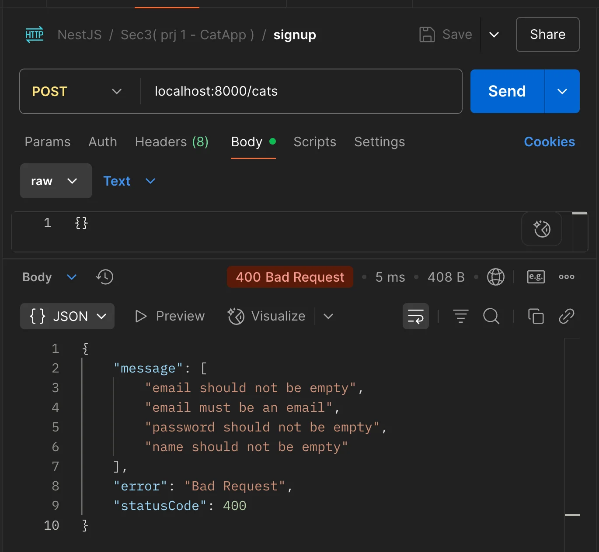

> 
> 
> <a id="22deda9b0fe18133b9dfcde614f5abe2"></a>
> 
> <strong>목차</strong>
> 
> - [Validation ( 유효성 검사 )](#22deda9b0fe1815ca413c9678d4ce7de)
> - [1. class-validator 패키지 설치](#22deda9b0fe18048a4d2d02cb18cc98a)
> - [2. validationpipe 전역 설정](#22eeda9b0fe1808db609ddaf77785988)
> - [3. 유효성 검사 - Validation Decorater ( ex. @IsEmail() … )](#22deda9b0fe1800cab16d2f8375225cd)
> - [4. 테스트](#22eeda9b0fe180a9af05f76f5381f85e)

[Documentation &#124; NestJS &#45; A progressive Node&#46;js framework]()

<a id="22deda9b0fe1815ca413c9678d4ce7de"></a>

## Validation ( 유효성 검사 )

---

<a id="22deda9b0fe18048a4d2d02cb18cc98a"></a>

### 1&#46; <code>class&#45;validator</code> 패키지 설치

[class-validator](https://github.com/typestack/class-validator)

<a id="22deda9b0fe18177b4f6d51de263a23c"></a>

```bash
# npm
npm i --save class-validator class-transformer

# pnpm
pnpm add --save class-validator class-transformer
```

<a id="22eeda9b0fe1808db609ddaf77785988"></a>

### 2&#46; <code>validationpipe</code> 전역 설정

[Documentation &#124; NestJS &#45; A progressive Node&#46;js framework]()

> ✏️ 
> 
> <a id="22eeda9b0fe18094828cf5d3be310ec5"></a>
> 
> <code>main&#46;ts</code> 에서 아래와 같이 전역설정을 해줘야 validation 데코레이터(ex&#46; <code>&#64;isEmail</code> …) 적용 가능하다&#46;
> 
> <a id="22eeda9b0fe180f485c0d8f33eeb986a"></a>
> 
> <code>VaildationPipe</code>를 애플리케이션 레벨로 바인딩 처리하여, 올바르지 않은 요청 데이터로부터 모든 엔드포인트를 보호할 수 있다&#46; 
> 
> - <code>ValidationPipe</code>는 내부적으로 <strong>클래스의 타입 정보(metatype)와 데코레이터로 붙인 </strong><strong><code>class&#45;validator</code></strong><strong>의 메타데이터를 읽어 처리한다&#46;</strong>

<a id="22eeda9b0fe1804ebcb1fdc56626dc73"></a>

```typescript
// main.ts
import { NestFactory } from '@nestjs/core';
import { AppModule } from './app.module';
import { ValidationPipe } from '@nestjs/common';

async function bootstrap() {
  const app = await NestFactory.create(AppModule);
  
  // 방법 1
  app.useGlobalPipes(new ValidationPipe());
	
	// 방법 2 - 실무 권장
	app.useGlobalPipes(
    new ValidationPipe({
      transform: true, // class-transformer 작동
      whitelist: true, // DTO에 정의되지 않은 값 제거
      forbidNonWhitelisted: true, // 허용되지 않은 값이 있으면 에러 발생
    }),
  );
  
  await app.listen(process.env.PORT ?? 3000);
}
bootstrap();
```

<details>
<summary>🧐 <code>ValidationPipe</code> 옵션 </summary>

<a id="22feda9b0fe180fab57beee379cf2465"></a>

```typescript
// nestjs/packages/common/pipes/validation.pipe.ts

export class ValidationPipe implements PipeTransform {
  constructor(private options: ValidationPipeOptions = {}) {
    this.transform = options.transform ?? false;
    this.whitelist = options.whitelist ?? false;
    this.forbidNonWhitelisted = options.forbidNonWhitelisted ?? false;
    ...
  }
}
```

- <code>ValidationPipe</code>의 내부 정의 코드는 위와 같다&#46; 

<a id="22feda9b0fe180dc80d8cb5603e6a15c"></a>

```typescript
app.useGlobalPipes(new ValidationPipe())
```

<a id="22feda9b0fe180118b2ce5733061a636"></a>

```typescript
app.useGlobalPipes(
  new ValidationPipe({
    transform: false,
    whitelist: false,
    forbidNonWhitelisted: false,
  }),
);
```

- 따라서 옵션 값 없이 세팅하면 위와 같이 <code>false</code>로 기본 설정된다&#46; 

</details>

<a id="22deda9b0fe1800cab16d2f8375225cd"></a>

### 3&#46; 유효성 검사 &#45; Validation Decorater ( ex&#46; <code>&#64;IsEmail()</code> … )

> ✏️ 
> 
> <a id="22eeda9b0fe18051a488fa563d566bcb"></a>
> 
> 유효성 검사는 유저로부터 데이터를 받아오는 DTO 계층에서 처리하는 것이 일반적이다&#46; 

<a id="22deda9b0fe180acac34e4130c181d3d"></a>

```typescript
import { IsEmail, IsNotEmpty } from 'class-validator';

export class CreateUserDto {
  @IsEmail()
  email: string;

  @IsNotEmpty()
  password: string;
}
```

<a id="22eeda9b0fe180a9af05f76f5381f85e"></a>

### 4&#46; 테스트

<details>
<summary>1&#46; validation 기본 설정</summary>

<a id="22eeda9b0fe180a5a812e593d64cbeee"></a>

```typescript
// main.ts
import { NestFactory } from '@nestjs/core';
import { AppModule } from './app.module';
import { ValidationPipe } from '@nestjs/common';

async function bootstrap() {
  const app = await NestFactory.create(AppModule);
  app.useGlobalPipes(new ValidationPipe());
  await app.listen(process.env.PORT ?? 3000);
}
bootstrap();
```

</details>

<details>
<summary>2&#46; DTO(<code>CatRequestDto</code>), 유효성 검사</summary>

<a id="22eeda9b0fe18005b100c39988b9093a"></a>

```typescript
// cats.request.dto.ts
import { IsEmail, IsNotEmpty } from 'class-validator';

export class CatRequestDto {
  @IsEmail()
  @IsNotEmpty()
  email: string;

  @IsNotEmpty()
  password: string;

  @IsNotEmpty()
  name: string;
}
```

</details>

<details>
<summary>3&#46; 테스트용 route handler 정의</summary>

<a id="22eeda9b0fe1801ebad4e9d6145c5fd3"></a>

```typescript
// cats.controller.ts
import { Body, UseFilters, UseInterceptors } from '@nestjs/common';
import { Controller, Get, Post, Put } from '@nestjs/common';
import { CatRequestDto } from './dto/CatRequestDto';

@Controller('cats')
export class CatsController {
  
  @Post()
  async signUp(@Body() body: CatRequestDto) {
    console.log(body);
    return 'signup';
  }
}
```

</details>

<details>
<summary>4&#46; 테스트 ( 포스트맨 호출 )</summary>



</details>
