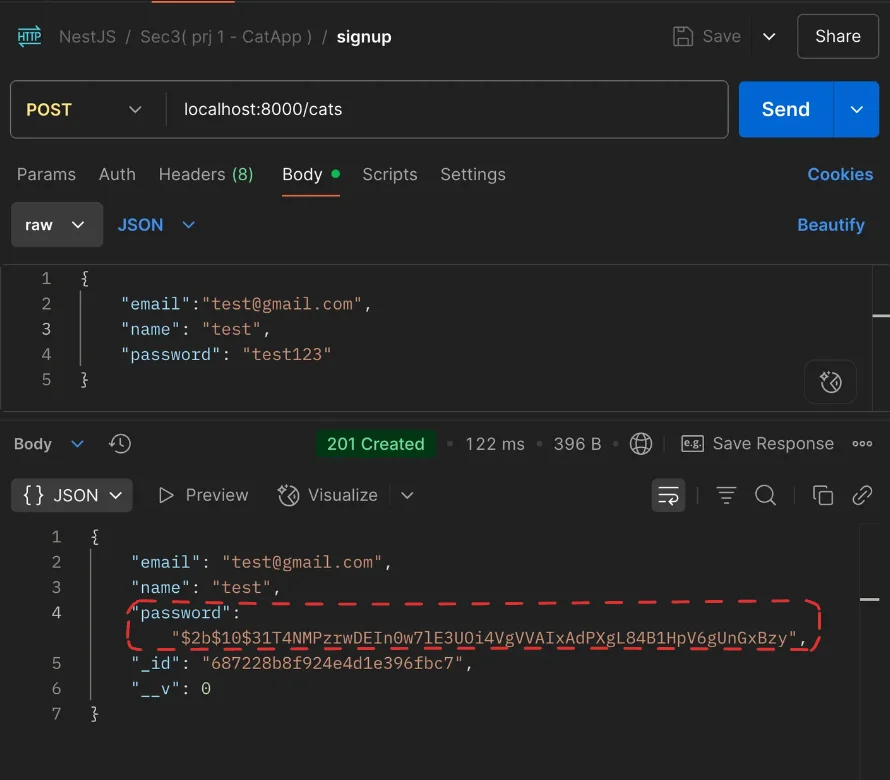
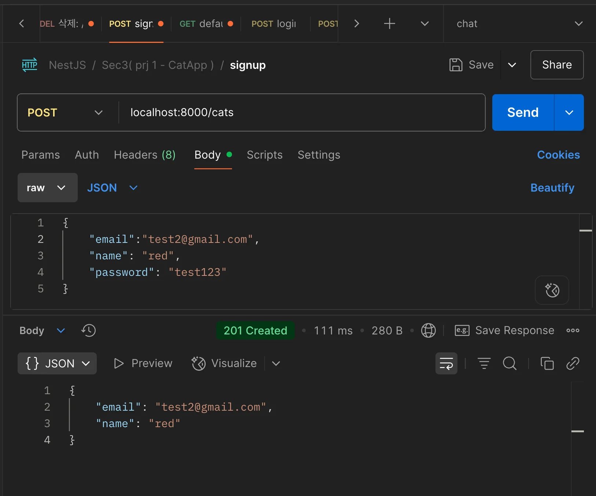

> 
> 
> <a id="22eeda9b0fe18143a61bf91dc2df0149"></a>
> 
> <strong>목차</strong>
> 
> - [회원가입 API ](#22eeda9b0fe1804b9630df6aa1cc3dcb)
> - [코드](#22feda9b0fe1805e8088fb64cfcc761e)
> - [Virtual Field](#22eeda9b0fe180cbb8e2cf7c30b5c7ab)
> - [코드](#22eeda9b0fe1808587ceda767a16a33b)
> - [응답 - 포스트맨](#22eeda9b0fe180dc92d9de82a1a282bb)

<a id="22eeda9b0fe1804b9630df6aa1cc3dcb"></a>

## 회원가입 API 

---

> 💬 
> 
> - <a href="#/post/22deda9b-0fe1-8094-ba57-ea4fa43986cf">페이지</a> 
> 
> - <a href="#/post/22deda9b-0fe1-8059-bdd2-faa2a1313f78">페이지</a> 
> 
> - <a href="#/post/22eeda9b-0fe1-80e5-bf33-d8b1901445f0">페이지</a> 

[feat: 회원가입 API](https://github.com/gyungsubLee/NestJS_prac/commit/8333f72710c671bca8d17bdcfb972432a7e6f53f)

<a id="22feda9b0fe1805e8088fb64cfcc761e"></a>

### 코드

<details>
<summary>&#91; 코드 &#93; Module</summary>

<a id="22feda9b0fe180238c29f2b59b49ecf1"></a>

```typescript
// cats.module.ts
import { Module } from '@nestjs/common';
import { CatsController } from './cats.controller';
import { CatsService } from './cats.service';
import { MongooseModule } from '@nestjs/mongoose';
import { Cat, CatSchema } from './schemas/cat.schema';

@Module({
  imports: [MongooseModule.forFeature([{ name: Cat.name, schema: CatSchema }])],
  controllers: [CatsController],
  providers: [CatsService],
})
export class CatsModule {}
```

</details>

<details>
<summary>&#91; 코드 &#93; Controller</summary>

<a id="22feda9b0fe180e4856ce0fb879958e2"></a>

```typescript
// cats.controller.ts
import { Body, UseFilters, UseInterceptors } from '@nestjs/common';
import { Controller, Get, Post, Put } from '@nestjs/common';
import { CatRequestDto } from './dto/CatRequestDto';
import { CatsService } from './cats.service';

@Controller('cats')
export class CatsController {
  constructor(private readonly catsService: CatsService) {}

  @Post()
  async signUp(@Body() reqDto: CatRequestDto) {
    return await this.catsService.signUp(reqDto);
  }
	
	. . .
}

```

</details>

<details>
<summary>&#91; 코드 &#93; Service</summary>

<a id="22feda9b0fe180dcb123e81d173a006a"></a>

```typescript
// cats.service.ts
import { Injectable, UnauthorizedException } from '@nestjs/common';
import { CatRequestDto } from './dto/CatRequestDto';
import { Model } from 'mongoose';
import { Cat } from './schemas/cat.schema';
import { InjectModel } from '@nestjs/mongoose';
import * as bcrypt from 'bcrypt';

@Injectable()
export class CatsService {
  constructor(
    @InjectModel(Cat.name)
    private readonly catModel,
  ) {}

  async signUp(reqDto: CatRequestDto): Promise<Cat> {
    const { email, password, name } = reqDto;
    const isCatExists = await this.catModel.exists({ email });

    if (isCatExists) {
      throw new UnauthorizedException('Cat with this email already exists');
    }

    const hashedPassword = await bcrypt.hash(password, 10);

    const cat = await this.catModel.create({
      email,
      name,
      password: hashedPassword,
    });

    return cat.readOnlyData;
  }
}
```

</details>

<details>
<summary>&#91; 코드 &#93; Repository</summary>

<a id="22feda9b0fe18092ad55dd7b09e42f23"></a>

```typescript
// cats.repository.ts
```

</details>

<details>
<summary>&#91; 코드 &#93; DTO</summary>

<a id="22feda9b0fe18043a7c8ddddf478c629"></a>

```typescript
// cats.request.dto.ts
import { IsEmail, IsNotEmpty } from 'class-validator';

export class CatRequestDto {
  @IsEmail()
  @IsNotEmpty()
  email: string;

  @IsNotEmpty()
  password: string;

  @IsNotEmpty()
  name: string;
}
```

</details>

<details>
<summary>&#91; 코드 &#93; Schema</summary>

<a id="22feda9b0fe1802195dec95ca1d084d1"></a>

```typescript
// cats.schema.ts
import { Prop, Schema, SchemaFactory } from '@nestjs/mongoose';
import { IsEmail, IsNotEmpty, IsString } from 'class-validator';
import { HydratedDocument } from 'mongoose';

export type CatDocument = HydratedDocument<Cat>;

@Schema()
export class Cat {
  @Prop({ required: true, unique: true })
  email: string;

  @Prop({ required: true })
  name: string;

  @Prop({ required: true })
  password: string;

  @Prop()
  imgUrl: string;

  readonly readOnlyData: { id: string; email: string; name: string };
}

export const CatSchema = SchemaFactory.createForClass(Cat);

CatSchema.virtual('readOnlyData').get(function (this: HydratedDocument<Cat>) {
  return {
    id: this._id.toString(),
    email: this.email,
    name: this.name,
  };
});

```

</details>

<a id="22eeda9b0fe180cbb8e2cf7c30b5c7ab"></a>

## Virtual Field

---

> ✏️ 
> 
> <a id="22eeda9b0fe18076b8a5e9f66fb67b8a"></a>
> 
> 실제 DB에 저장되는 field가 아닌 <strong><u>비지니스 로직에서 사용 가능한 필터링된 field 데이터</u></strong>를 만들어 클라이언트에 제공할 수 있다&#46;
> 
> <a id="22eeda9b0fe180ceaa73d122679ab7ea"></a>
> 
> 이를 통해 민감한 데이터를 감추는 보안 처리가 가능하다&#46;

<a id="22eeda9b0fe1808587ceda767a16a33b"></a>

### 코드

<details>
<summary>&#91; 코드 &#93; Cat &#45; <code>CatSchema&#46;virtual(…)</code></summary>

<a id="22eeda9b0fe180589e43e310e97137b3"></a>

```typescript
// cat.schema.ts
import { Prop, Schema, SchemaFactory } from '@nestjs/mongoose';
import { IsEmail, IsNotEmpty, IsString } from 'class-validator';
import { HydratedDocument } from 'mongoose';

export type CatDocument = HydratedDocument<Cat>;

@Schema()
export class Cat {
  @Prop({ required: true, unique: true })
  email: string;

  @Prop({ required: true })
  name: string;

  @Prop({ required: true })
  password: string;

  @Prop()
  imgUrl: string;

  readonly readOnlyData: { id: string; email: string; imgUrl: string };
}

export const CatSchema = SchemaFactory.createForClass(Cat);

CatSchema.virtual('readOnlyData').get(function (this: Cat) {
  return {
    email: this.email,
    name: this.name,
    imgUrl: this.imgUrl,
  };
});

```

</details>

<details>
<summary>&#91; 코드 &#93; CatsService</summary>

<a id="22eeda9b0fe180578df5c04fa6433090"></a>

```typescript
import { Injectable, UnauthorizedException } from '@nestjs/common';
import { CatRequestDto } from './dto/CatRequestDto';
import { Model } from 'mongoose';
import { Cat } from './schemas/cat.schema';
import { InjectModel } from '@nestjs/mongoose';
import * as bcrypt from 'bcrypt';

@Injectable()
export class CatsService {
  constructor(
    @InjectModel(Cat.name)
    private readonly catModel,
  ) {}

  async signUp(reqDto: CatRequestDto): Promise<Cat> {
    const { email, password, name } = reqDto;
    const isCatExists = await this.catModel.exists({ email });

    if (isCatExists) {
      throw new UnauthorizedException('Cat with this email already exists');
    }

    const hashedPassword = await bcrypt.hash(password, 10);

    const cat = await this.catModel.create({
      email,
      name,
      password: hashedPassword,
    });

    return cat.readOnlyData;
  }
}

```

</details>

<a id="22eeda9b0fe180dc92d9de82a1a282bb"></a>

### 응답 &#45; 포스트맨

<details>
<summary><strong>🤬 문제</strong> &#45; 민감 데이터인 <code>passwor</code>가 응답 값으로 출력됨</summary>



</details>



- 이전에 출력된 password를 필터링한 데이터들을 응답
