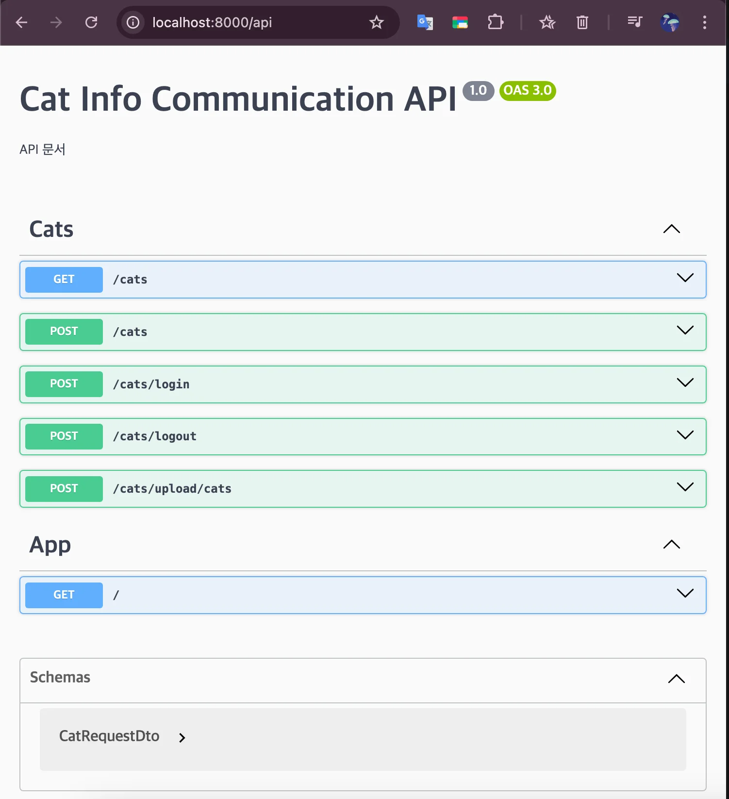
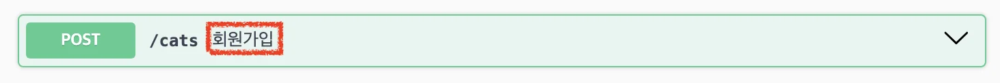
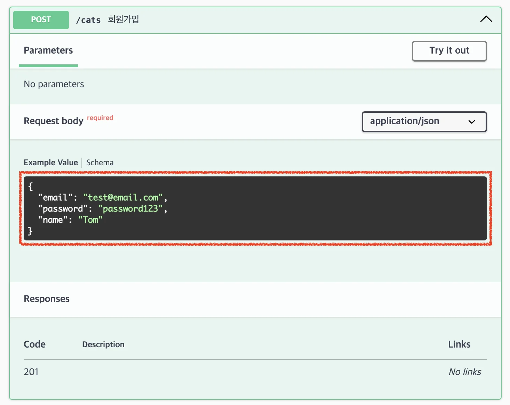
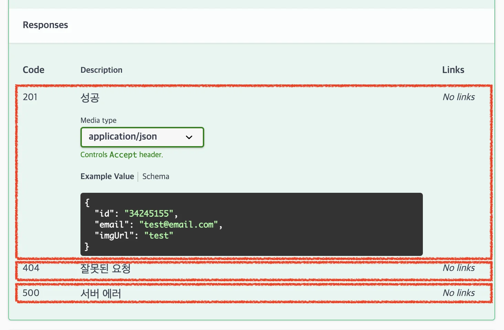

> 
> 
> <a id="22feda9b0fe181e29772e7e5266a9dc9"></a>
> 
> <strong>목차</strong>
> 
> - [API 문서 - Swagger UI](#22feda9b0fe1813987fcea813968ac36)
> - [1. 패키지 설치](#22feda9b0fe180c68ac6ecc523d0d0b5)
> - [2. Swagger를 통한 API 문서 생성 및 경로 매핑](#22feda9b0fe180a69573ccddb93ad8e8)
> - [3. 구체적인 설명 추가하기](#22feda9b0fe1806ea783e037ad60a8f7)
> - [4.  문서 보안 처리](#231eda9b0fe18012bdaccafe9da898c7)

[Documentation &#124; NestJS &#45; A progressive Node&#46;js framework]()

<a id="22feda9b0fe1813987fcea813968ac36"></a>

## API 문서 &#45; Swagger UI

---

<a id="22feda9b0fe180c68ac6ecc523d0d0b5"></a>

### 1&#46; 패키지 설치

<a id="22feda9b0fe180da9aeff6799fc54ebd"></a>

```bash
# npm
npm install --save @nestjs/swagger

# pnpm
pnpm add --save @nestjs/swagger
```

<a id="22feda9b0fe180a69573ccddb93ad8e8"></a>

### 2&#46; Swagger를 통한 API 문서 생성 및 경로 매핑

> ✏️ 
> 
> <a id="22feda9b0fe180f09cd6d3d07cd48e30"></a>
> 
>  <code>main&#46;ts</code>파일에 <code>SwaggerModule</code>을 통해 Swagger 초기화

<a id="22feda9b0fe1808f8068c0cb958074e2"></a>

```typescript
import { NestFactory } from '@nestjs/core';
import { AppModule } from './app.module';
import { ValidationPipe } from '@nestjs/common';
import { HttpErrorFilter } from './common/exceptions/http-exception.filter';
import { DocumentBuilder, SwaggerModule } from '@nestjs/swagger';

async function bootstrap() {
  const app = await NestFactory.create(AppModule);
	
	// Swagger 문서 설정
  const config = new DocumentBuilder()
    .setTitle('Cat Info Communication API')
    .setDescription('API 문서')
    .setVersion('1.0')
    .addTag('Cats')
    .build();
  const document = SwaggerModule.createDocument(app, config);
  SwaggerModule.setup('api', app, document); // 경로 매핑

  app.useGlobalPipes(new ValidationPipe());
  app.useGlobalFilters(new HttpErrorFilter());

  await app.listen(process.env.PORT ?? 3000);
}
bootstrap();
```

<details>
<summary>구체적인 경로 설정</summary>

<a id="22feda9b0fe1808fb609c78dbfef33f0"></a>

```typescript
SwaggerModule.setup('swagger', app, documentFactory, {
  jsonDocumentUrl: 'swagger/json',
});
```

<a id="22feda9b0fe180d99728ed61230e8dfb"></a>

→ Swagger Docs 엔드포인트&#58; <code>http&#58;//localhost&#58;3000/swagger/json</code>

</details>



<a id="22feda9b0fe1806ea783e037ad60a8f7"></a>

### 3&#46; 구체적인 설명 추가하기

<details>
<summary><strong>Route Handler에 설명 추가 &#45; </strong><strong><code>&#64;ApiOperation</code></strong></summary>

> ✏️ 
> 
> <a id="22feda9b0fe180fb830bc45bc87a9d54"></a>
> 
> <code>&#64;ApiOperation</code> &#45; summary를 통해 해당 api에 설명을 추가할 수 있다&#46;

<a id="22feda9b0fe18045afd5f33786dad766"></a>

```typescript
import { Body, UseFilters, UseInterceptors } from '@nestjs/common';
import { Controller, Get, Post, Put } from '@nestjs/common';
import { CatRequestDto } from './dto/CatRequestDto';
import { CatsService } from './cats.service';
import { ApiOperation } from '@nestjs/swagger';

@Controller('cats')
export class CatsController {
  constructor(private readonly catsService: CatsService) {}

  @ApiOperation({ summary: '회원가입' })
  @Post()
  async signUp(@Body() reqDto: CatRequestDto) {
    return await this.catsService.signUp(reqDto);
  }
}
```



</details>

<details>
<summary><strong>Request Body 예시 추가 &#45; </strong><strong><code>&#64;ApiProperty</code></strong></summary>

> ✏️ 
> 
> <a id="22feda9b0fe18073b72ed4f288fc3cc3"></a>
> 
> 해당하는 DTO에 <code>&#64;ApiProperty</code>를 통해 예시 데이터를 추가할 수 있다&#46;
> 
> <details>
> <summary>포맷</summary>
> 
> <a id="22feda9b0fe18059a6b0d2f2eb8f5b32"></a>
> 
> ```typescript
> import { ApiProperty } from '@nestjs/swagger';
> 
> @ApiProperty({
> 	example: '...',
> 	description: '...',
> 	required: true,
> })
> ```
> 
> </details>

<a id="22feda9b0fe180beb254d972fba8e0aa"></a>

```
// CatRequestDto.ts
import { ApiProperty } from '@nestjs/swagger';
import { IsEmail, IsNotEmpty } from 'class-validator';

export class CatRequestDto {
  @ApiProperty({
    example: 'test@email.com',
    description: 'email',
    required: true,
  })
  @IsEmail()
  @IsNotEmpty()
  email: string;

  @ApiProperty({
    example: 'password123',
    description: 'password',
    required: true,
  })
  @IsNotEmpty()
  password: string;

  @ApiProperty({
    example: 'Tom',
    description: 'name',
    required: true,
  })
  @IsNotEmpty()
  name: string;
}
```



</details>

<details>
<summary><strong>Response 예시 추가 &#45; </strong><strong><code>&#64;ApiResponse</code></strong></summary>

> ✏️ 
> 
> <a id="22feda9b0fe180bc879ed630de525d65"></a>
> 
> <code>&#64;ApiResponse</code>로 Swagger 문서에서 볼수 있는 예시(<code>status</code>, <code>description</code>, <code>body(type)</code>)를 정의할 수 있다&#46;

<a id="22feda9b0fe180499313d0c3b2c4df0a"></a>

```typescript
import { Body, UseFilters, UseInterceptors } from '@nestjs/common';
import { Controller, Get, Post, Put } from '@nestjs/common';
import { CatRequestDto } from './dto/cats.request.dto';
import { CatsService } from './cats.service';
import { ApiOperation, ApiResponse } from '@nestjs/swagger';
import { readOnlyCatData } from './dto/cats.dto';

@Controller('cats')
export class CatsController {
  constructor(private readonly catsService: CatsService) {}

  @ApiResponse({
    status: 500,
    description: '서버 에러',
  })
  @ApiResponse({
    status: 404,
    description: '잘못된 요청',
  })
  @ApiResponse({
    status: 201,
    description: '성공',
    type: readOnlyCatData,
  })
  @ApiOperation({ summary: '회원가입' })
  @Post()
  async signUp(@Body() reqDto: CatRequestDto) {
    return await this.catsService.signUp(reqDto);
  }
}
```



</details>

<details>
<summary><strong>readOnly DTO 정의 &#45; </strong><strong><code>Response DTO</code></strong></summary>

> ✏️ 
> 
> <a id="22feda9b0fe180e584fdc4087ab0a778"></a>
> 
> response에 대한 예시로 Password가 제외된 필터링된 데이터가 필요하기 때문에 아래와 같이 read Only 클래스를 생성

<a id="22feda9b0fe180b786dde726c8cd5c59"></a>

```typescript
import { ApiProperty } from '@nestjs/swagger';
import { Cat } from '../schemas/cat.schema';

export class readOnlyCatData {
  @ApiProperty({
    example: '68738166cfb95410ad3d24f1',
    description: 'id',
    required: true,
  })
  id: string;

  @ApiProperty({
    example: 'test@email.com',
    description: 'email',
  })
  email: string;

  @ApiProperty({
    example: 'test',
    description: 'name',
  })
  imgUrl: string;
}
```

<a id="22feda9b0fe1808fb0c1ec4ffe6c9b38"></a>

```typescript
import { Body, UseFilters, UseInterceptors } from '@nestjs/common';
import { Controller, Get, Post, Put } from '@nestjs/common';
import { CatRequestDto } from './dto/cats.request.dto';
import { CatsService } from './cats.service';
import { ApiOperation, ApiResponse } from '@nestjs/swagger';
import { readOnlyCatData } from './dto/cats.dto';

@Controller('cats')
export class CatsController {
  constructor(private readonly catsService: CatsService) {}

  @ApiResponse({
    status: 500,
    description: '서버 에러',
  })
  @ApiResponse({
    status: 404,
    description: '잘못된 요청',
  })
  @ApiResponse({
    status: 201,
    description: '성공',
    type: readOnlyCatData,
  })
  @ApiOperation({ summary: '회원가입' })
  @Post()
  async signUp(@Body() reqDto: CatRequestDto) {
    return await this.catsService.signUp(reqDto);
  }
}

```

</details>

<details>
<summary><strong>특정 필드만 상속하여 DTO 확장 &#45; </strong><strong><code>PickType</code></strong></summary>

[Documentation &#124; NestJS &#45; A progressive Node&#46;js framework]()

> ✏️ 
> 
> <a id="22feda9b0fe1808298e5cf281c2abc90"></a>
> 
> 하드 코딩된 로직을 상속 구조로 개선

<details>
<summary>&#91; 코드 &#93; Cat</summary>

<a id="22feda9b0fe180b48440f8b09c879d79"></a>

```typescript
// cats.schema.ts
import { Prop, Schema, SchemaFactory } from '@nestjs/mongoose';
import { IsEmail, IsNotEmpty, IsString } from 'class-validator';
import { HydratedDocument } from 'mongoose';
import { ApiProperty } from '@nestjs/swagger';

export type CatDocument = HydratedDocument<Cat>;

@Schema()
export class Cat {
  @ApiProperty({
    example: 'test@email.com',
    description: 'email',
    required: true,
  })
  @IsEmail()
  @IsNotEmpty()
  @Prop({ required: true, unique: true })
  email: string;

  @ApiProperty({
    example: 'Tom',
    description: 'name',
    required: true,
  })
  @IsNotEmpty()
  @Prop({ required: true })
  name: string;

  @ApiProperty({
    example: 'password123',
    description: 'password',
    required: true,
  })
  @IsNotEmpty()
  @Prop({ required: true })
  password: string;

  @Prop()
  imgUrl: string;

  readonly readOnlyData: { id: string; email: string; name: string };
}

export const CatSchema = SchemaFactory.createForClass(Cat);

CatSchema.virtual('readOnlyData').get(function (this: HydratedDocument<Cat>) {
  return {
    id: this._id.toString(),
    email: this.email,
    name: this.name,
  };
});

```

</details>

<details>
<summary>&#91; 코드 &#93; CatRequestDto</summary>

<a id="22feda9b0fe180bcb9f5eef708a830bd"></a>

```typescript
// cats.request.dto.ts
import { Cat } from '../schemas/cat.schema';

export class CatRequestDto extends Cat {}
```

</details>

<details>
<summary>&#91; 코드 &#93; readOnlyCatData ( response dto )</summary>

<a id="22feda9b0fe180e8a601eed401c693a1"></a>

```typescript
// cats.dto.ts
import { ApiProperty, PickType } from '@nestjs/swagger';
import { Cat } from '../schemas/cat.schema';

export class readOnlyCatData extends PickType(Cat, ['email', 'name'] as const) {
  @ApiProperty({
    example: '68738166cfb95410ad3d24f1',
    description: 'id',
    required: true,
  })
  id: string;
}
```

</details>

</details>

<details>
<summary><strong> 다중 상속 &#45; </strong><strong><code>IntersectionType</code></strong></summary>

[Documentation &#124; NestJS &#45; A progressive Node&#46;js framework]()

<a id="22feda9b0fe1801ba662d8f2ed6d908a"></a>

```typescript

import { ApiProperty } from '@nestjs/swagger';

export class CreateCatDto {
  @ApiProperty()
  name: string;

  @ApiProperty()
  breed: string;
}

export class AdditionalCatInfo {
  @ApiProperty()
  color: string;
}
```

<a id="22feda9b0fe1809cbe73faafb4e019d1"></a>

```typescript
export class UpdateCatDto extends IntersectionType(
  CreateCatDto,
  AdditionalCatInfo,
) {}
```

</details>

<a id="231eda9b0fe18012bdaccafe9da898c7"></a>

### 4&#46;  문서 보안 처리

> ✏️ 
> 
> <a id="231eda9b0fe180a8bccdf7155907410c"></a>
> 
> 서비스를 베포했을 때 해당 Swagger 문서가 누구나 볼 수 있도록 노출되면 심각한 보안 문제를 초래할 수 있다&#46; 
> 
> <a id="231eda9b0fe180dab556f093a275dbac"></a>
> 
> 이를 위해 <strong><u>Swagger 문서 접근</u></strong> 시 <strong><u>인증 후, 볼 수 있</u></strong>도록 해야한다&#46; 

[npm&#58; express&#45;basic&#45;auth]()
