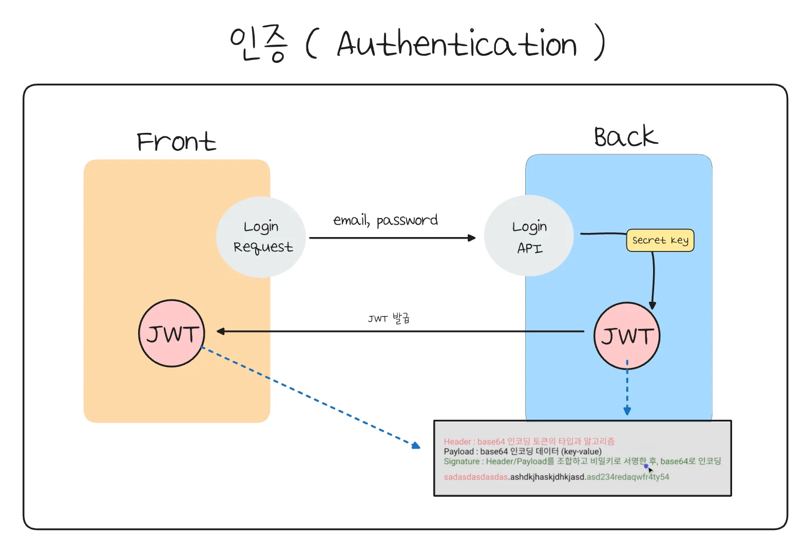
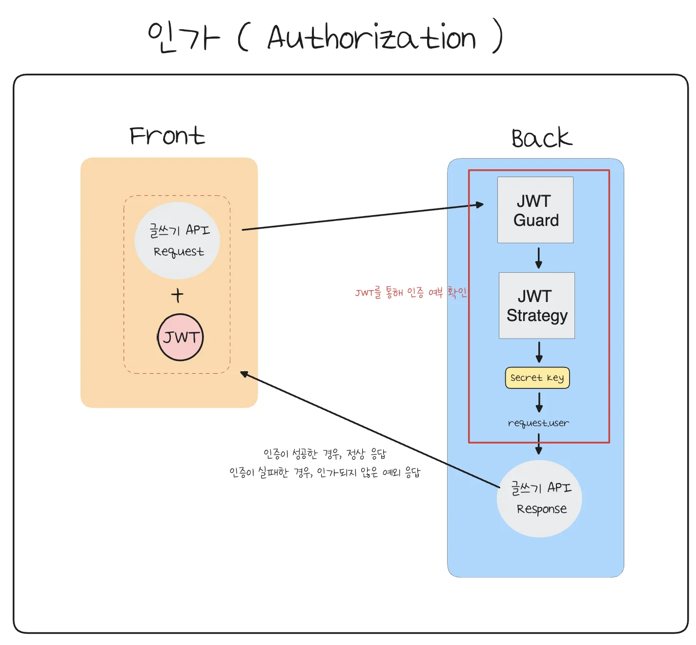

> 
> 
> <a id="22feda9b0fe18168800dec760e23031e"></a>
> 
> <strong>목차</strong>
> 
> - [JWT ( JSON WEB TOKEN )](#230eda9b0fe180758beffc6b0c6cb6e9)
> - [인증 ( Authentication )  -  로그인](#230eda9b0fe180ff842ae9011d48e892)
> - [인가 ( Authorization )](#230eda9b0fe1803fb68cfd32933e6898)
> - [Reference](#230eda9b0fe1803d8139d1c4ea3f3a1d)

<a id="230eda9b0fe180758beffc6b0c6cb6e9"></a>

## JWT ( JSON WEB TOKEN )

---

> 
> 
> <a id="22feda9b0fe181ab97bcfac08adf4d84"></a>
> 
> <strong>이전 정리</strong>
> 
> - <a href="#/post/13deda9b-0fe1-81e5-9fba-cacecf4b24cd">페이지</a> 
> 
> - <a href="https://beautiful-college-c84.notion.site/1dfeda9b0fe18060a5e1fed52e34c78f">페이지</a> 
> 
> - <a href="#/post/13deda9b-0fe1-8152-ad91-da9d646c6232">페이지</a> 

> ⚠️ 
> 
> <a id="230eda9b0fe180568c31dd5072ee4d4c"></a>
> 
> JWT는 bas64로 인코딩된 문자열 값이다&#46; 즉, <strong>누구나 쉽게 파싱해서 원본 데이터를 볼 수 있</strong>다&#46; 따라서 payload에 담기는 <strong><u>유저 상태 정보에는 민감한 데이터를 포함하면 안</u></strong><strong>된다&#46; </strong>

- <code>Header</code> &#58;  토큰의 타입과 알고리즘 

- <code>Payload</code>&#58; 유저에 대한 상태 정보 

- <code>Signature</code>&#58; Header/Payload를 조합하고 비밀키로 서명

- ex)
    <a id="230eda9b0fe1807d8796d1d273fb15c3"></a>

    ```plaintext
    sadasdasdasdas.ashdkjhaskjdhkjasd.asd234redaqwfr4ty54
    ```

<a id="230eda9b0fe180ff842ae9011d48e892"></a>

## 인증 ( Authentication )  &#45;  로그인

---



> 로그인 시 유저의 인증 정보를 확인 후 JWT의 발급 과정은 위와 같다&#46; 

1. 프론트엔드에서 유저의 email, password를 담아 요청을 보낸다&#46; 

1. 서버에는 해당 요청을 받아, 가입된 회원 정보인지 확인한다&#46; 

1. 인증이 완료되었으면, 유저의 상태 정보가 담긴 JWT 토큰을 발급해서 응답으로 프론트엔드에 보낸다&#46; 

1. 프론트엔드는 로컬 스토리지, HTTP Only 쿠키에 저장하여 인가가 필요한 요청에 사용한다&#46;

> ✏️ 
> 
> <a id="231eda9b0fe18093acf5c5724f76557f"></a>
> 
> <strong>코드</strong>
> 
> - <a href="#/post/22eeda9b-0fe1-800d-b0a1-fc642917f996">페이지</a> 

<a id="230eda9b0fe1803fb68cfd32933e6898"></a>

## 인가 ( <strong>Authorization )</strong>

---

> ✏️ 
> 
> <a id="230eda9b0fe1805b9d5ee0f69f36a07a"></a>
> 
> <strong><code>인가(Authorization)</code></strong><strong>는 인증된 사용자가 특정 리소스에 접근하거나 특정 작업을 수행할 수 있는 권한을 가지고 있는지 확인하는 과정을 말한다&#46;</strong>



> 인가

1. HTTP 헤더에 JWT를 실어서 같이 보낸다&#46;  ( Authentication )

1. 백엔드 서버에서는 해당 요청을 받고, JWT Guard를 통해 JWT Strategy를 실행 시킨다&#46;

1. JWT Strategy는 서버에 저장된 Secret key를 통해 JWT를 디코딩하여 인증 여부를 판단
    - JWT 인증 후, 유저 정보를 요청 큐(메모리 등)에 저장(<code>request&#46;user</code>)하여 이후 로직에서 재활용

1. 인증 여부에 따라 프론트에게 응답 전송

> ✏️ 
> 
> <a id="231eda9b0fe180b9bcfcc1086276addb"></a>
> 
> <strong>코드</strong>
> 
> - <a href="#/post/230eda9b-0fe1-8081-9f0b-fd00744b10ff">페이지</a> 

<a id="230eda9b0fe1803d8139d1c4ea3f3a1d"></a>

## Reference

[JWT&#46;IO]()

[직접 만들어보며 이해하는 JWT]()
