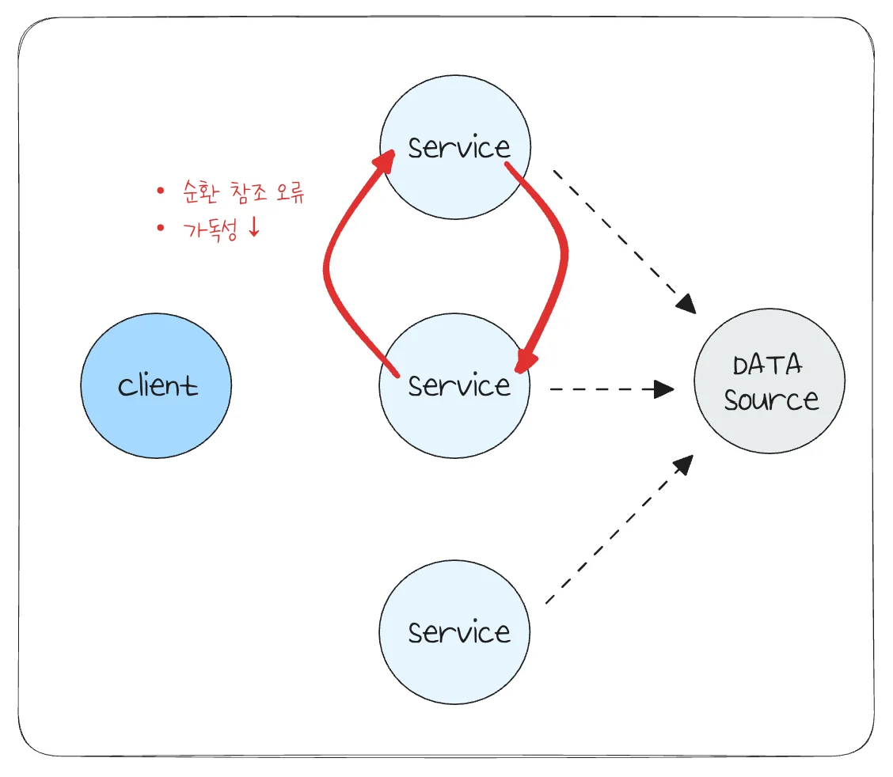
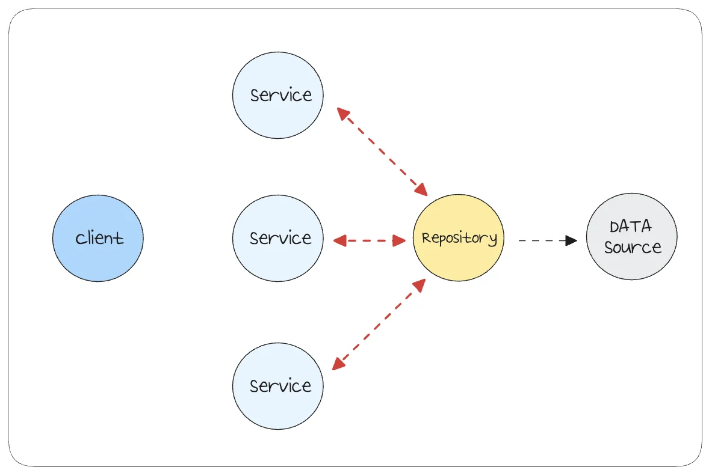

> 
> 
> <a id="22feda9b0fe1806e8c13e6a2c28f8ba0"></a>
> 
> <strong>목차</strong>
> 
> - [문제점 - Service 레이어에서의 직접 Data Source 접근](#22feda9b0fe180b0b0c7d96cf27173e1)
> - [Repository 패턴 ](#22feda9b0fe1800698adcc2ef538f274)
> - [리펙토링  - Repository 패턴 도입](#22feda9b0fe180608ad4c92d51c0c8f6)
> - [리펙토링](#22feda9b0fe180f19e33fe523b25b0aa)

<a id="22feda9b0fe180b0b0c7d96cf27173e1"></a>

## 문제점 &#45; Service 레이어에서의 직접 Data Source 접근

---

> ❗ 
> 
> 
> 
> <a id="22feda9b0fe1806d8133d8ad6e3fd472"></a>
> 
> 위와 같이 <strong>Sevice 계층에서 데이터 소스에 직접 접근</strong>하는 구조는 아래와 같은 문제점을 갖는다&#46; 

- 순환 참조 오류 
    - 서로 다른 도메인 모듈이 상대방의 엔티티에 접근해야 하는 경우,<br>Service 레이어 간 직접적인 상호 참조로 인한 의존성 그래프의 순환 구조 형성한다&#46; <br>그러므로써 모듈 로딩 시점에서 런타임 오류 및 컴파일 실패가 발생된다&#46; 

- 책임 중복
    - Service 계층에서 비지니스 로직에 대한 책임뿐만 아니라, 데이터 소스에 대한 처리 역활도 할당된다&#46; 

    - 이는 <code>단일 책임 원칙(SRP)</code>을 위반하여 유지보수 와 확장성 측면을 떨어뜨린다&#46; 

- 가독성 ↓
    - 위에 대한 순환 참조 오류는 해결할 수 있다&#46; 그러나 서비스 계층에 여러 책임이 할당되기 때문에 여전히 가독성이 떨어지는 코드이다&#46; 

<a id="22feda9b0fe1800698adcc2ef538f274"></a>

## Repository 패턴 

---

> 📖 
> 
> 
> 
> <a id="22feda9b0fe180468ca7d8aaf57f4f17"></a>
> 
> 위에 대한 문제점은 <strong><u>Repository 패턴 도입</u></strong>을 통해 해결할 수 있다&#46; 

<a id="22feda9b0fe18099b37fcb6323a6b310"></a>

Repository 패턴은 <strong><u>서비스와 데이터베이스 사이에 중계자 역할</u></strong>을 하는 <strong>Repsoitory 클래스를 추가</strong>하는 방법을 말한다&#46; 

<a id="22feda9b0fe180eb9071efd6be08b6c4"></a>

이를 통해 <u>데이터 소스에 접근 및 데이터 조작에 대한 책임을 하나의 클래스 분리</u>시켜 단일 책임 원칙 준수 및 순환 참조 오류에 대한 해결이 가능하다&#46; 

<a id="22feda9b0fe180469b10e7eca5ec0f32"></a>

또한 <strong><u>Repository 계층 추상화</u></strong>를 통해 서비스 계층에서 <strong>데이터 출처와 관계없이 </strong><strong><u>동일한 방식 데이터에 접근</u></strong><strong> 가능</strong>하다&#46;

<a id="22feda9b0fe180d1b70ec1d78608b807"></a>

만약 <u>MongoDB, MySQL 등으로 여러 개의 데이터 출처 </u>생겨도 Repository 라는 중간계층을 통해 접근하기 때문에, 다형성 활용을 통해 <strong><u>간단하게 구현체 변경</u></strong>만을 통해서만 확장 및 수정이 가능해진다&#46;  ( <code>전략 패턴</code> )

<a id="22feda9b0fe180608ad4c92d51c0c8f6"></a>

## 리펙토링  &#45; Repository 패턴 도입

---

<details>
<summary>리펙토링 전</summary>

<details>
<summary>&#91; 코드 &#93; CatsModule</summary>

<a id="22feda9b0fe180ada132e91f351c2709"></a>

```typescript
// cats.module.ts
import { Module } from '@nestjs/common';
import { CatsController } from './cats.controller';
import { CatsService } from './cats.service';
import { MongooseModule } from '@nestjs/mongoose';
import { Cat, CatSchema } from './schemas/cat.schema';

@Module({
  imports: [MongooseModule.forFeature([{ name: Cat.name, schema: CatSchema }])],
  controllers: [CatsController],
  providers: [CatsService],
})
export class CatsModule {}

```

</details>

<details>
<summary>&#91; 코드 &#93; CatsService</summary>

<a id="22feda9b0fe1803895cae9dd416619f2"></a>

```typescript
// cats.service.ts
import { Injectable, UnauthorizedException } from '@nestjs/common';
import { CatRequestDto } from './dto/cats.request.dto';
import { Model } from 'mongoose';
import { Cat } from './schemas/cat.schema';
import { InjectModel } from '@nestjs/mongoose';
import * as bcrypt from 'bcrypt';

@Injectable()
export class CatsService {
  constructor(
    @InjectModel(Cat.name)
    private readonly catModel,
  ) {}

  async signUp(reqDto: CatRequestDto): Promise<Cat> {
    const { email, password, name } = reqDto;
    const isCatExists = await this.catModel.exists({ email });

    if (isCatExists) {
      throw new UnauthorizedException('Cat with this email already exists');
    }

    const hashedPassword = await bcrypt.hash(password, 10);

    const cat = await this.catModel.create({
      email,
      name,
      password: hashedPassword,
    });

    return cat.readOnlyData;
  }
}

```

</details>

</details>

> 
> 
> <a id="235eda9b0fe180d68109f5ae9dff0bf7"></a>
> 
> TypeORM 사용 시 Repository 레이어를 자동으로 제공해준다&#46; 
> 
> - JPA와 동일

<a id="22feda9b0fe180f19e33fe523b25b0aa"></a>

### 리펙토링

<details>
<summary>&#91; 코드 &#93; CatsRepository</summary>

<a id="22feda9b0fe1802f8035ffdd1290ef07"></a>

```typescript
// cats.repository.ts
import { InjectModel } from '@nestjs/mongoose';
import { Cat } from './schemas/cat.schema';
import { Model } from 'mongoose';
import { Injectable } from '@nestjs/common';

@Injectable()
export class CatsRepository {
  constructor(
    @InjectModel(Cat.name)
    private readonly catModel: Model<Cat>,
  ) {}

  async findByEmail(email: string): Promise<Cat | null> {
    return this.catModel.findOne({ email }).exec();
  }

  async save(cat: Partial<Cat>): Promise<Cat> {
    return await this.catModel.create(cat);
  }
}
```

</details>

<details>
<summary>&#91; 코드 &#93; CatsService</summary>

<a id="22feda9b0fe180c98d29d82abff33afc"></a>

```typescript
// cats.service.ts
import { Injectable, UnauthorizedException } from '@nestjs/common';
import { CatRequestDto } from './dto/cats.request.dto';
import { Model } from 'mongoose';
import { Cat } from './schemas/cat.schema';
import { InjectModel } from '@nestjs/mongoose';
import * as bcrypt from 'bcrypt';
import { CatsRepository } from './cats.repository';

@Injectable()
export class CatsService {
  constructor(private readonly catsRepository: CatsRepository) {}

  async signUp(reqDto: CatRequestDto): Promise<Cat['readOnlyData']> {
    const { email, password, name } = reqDto;
    const isCatExists = await this.catsRepository.findByEmail(email);

    if (isCatExists) {
      throw new UnauthorizedException('Cat with this email already exists');
    }

    const hashedPassword = await bcrypt.hash(password, 10);

    const cat = await this.catsRepository.save({
      email,
      name,
      password: hashedPassword,
    });

    return cat.readOnlyData;
  }
}

```

</details>

<details>
<summary>&#91; 코드 &#93; CatsModule</summary>

<a id="22feda9b0fe180f6a2f3fdccf8708e7a"></a>

```typescript
// cats.module.ts
import { Module } from '@nestjs/common';
import { MongooseModule } from '@nestjs/mongoose';
import { CatsController } from './cats.controller';
import { CatsRepository } from './cats.repository';
import { Cat, CatSchema } from './cats.schema';
import { CatsService } from './cats.service';

@Module({
  imports: [MongooseModule.forFeature([{ name: Cat.name, schema: CatSchema }])],
  controllers: [CatsController],
  providers: [CatsService, CatsRepository],
  exports: [CatsService],
})
export class CatsModule {}
```

</details>
