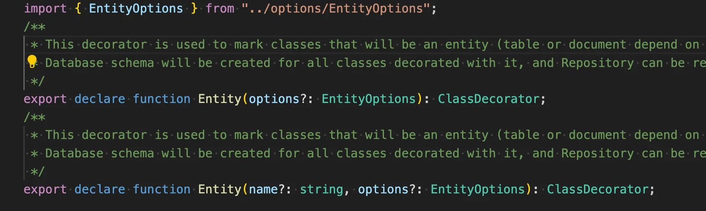
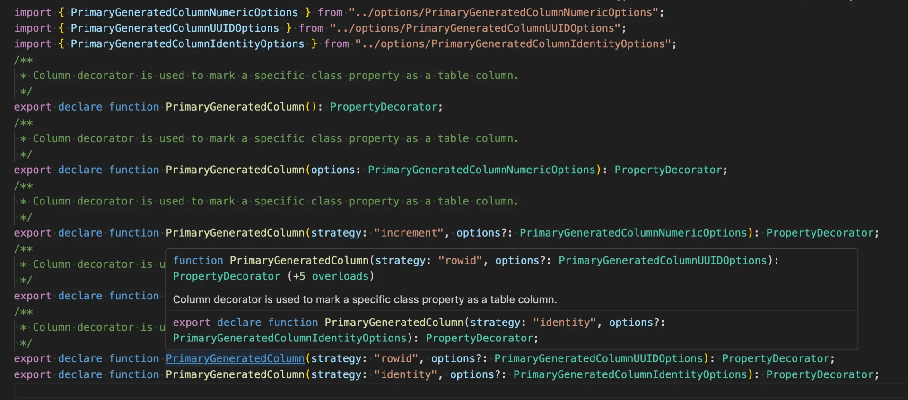

> 
> 
> <a id="231eda9b0fe1802abaa0ce25893929e1"></a>
> 
> <strong>목차</strong>
> 
> - [TypeORM ( MySQL )](#231eda9b0fe18037b5f6df825a0d2f5c)
> - [1. TypeORM 기본 셋업](#233eda9b0fe180fa8857db92b87836ff)
> - [2.  Entity 정의](#234eda9b0fe1809aacf0fa308b38d789)
> - [방법 1 - 데코레이터 ( @Entity )](#234eda9b0fe180648592e18427f22629)
> - [방법 2 - 클래스 ( EntitySchema )](#234eda9b0fe1802fa260c430e5b4736a)
> - [3. Repository pattern](#233eda9b0fe18005a119fee50dd283fe)
> - [3. 관계](#233eda9b0fe180498cdac0e43e7ce856)
> - [4. 엔티티 자동 로드](#233eda9b0fe180bb8315dda3564f5b96)
> - [5. 트랜젝션](#233eda9b0fe180dbbf02f3382700a9c7)
> - [6. Subscribers](#235eda9b0fe1805e9ccbd69c59356ec4)
> - [코드](#235eda9b0fe180ebafaee7cc6f322cd5)
> - [EntitySubscriberInterfaces의 메서드 설명](#235eda9b0fe180fd8928d864d3088d1d)
> - [주요 이벤트 타입 설명](#235eda9b0fe18054a540cfbf0cc68d27)

[Documentation &#124; NestJS &#45; A progressive Node&#46;js framework]()

[Getting Started &#124; TypeORM]()

<a id="231eda9b0fe18037b5f6df825a0d2f5c"></a>

## TypeORM ( MySQL )

---

<a id="233eda9b0fe180fa8857db92b87836ff"></a>

### 1&#46; TypeORM 기본 셋업

<details>
<summary>1&#46; MySQL 컨테이너 환경 구축 ( compose )</summary>

<a id="232eda9b0fe18047aebadb988ed0a599"></a>

```yaml
services:
  mysql:
    image: mysql:8.4
    container_name: mysql
    restart: unless-stopped
    ports:
      - "${MYSQL_PORT}:3306"
    environment:
      MYSQL_ROOT_PASSWORD: ${MYSQL_ROOT_PASSWORD}
      MYSQL_DATABASE: ${MYSQL_DATABASE}
      MYSQL_USER: ${MYSQL_USER}
      MYSQL_PASSWORD: ${MYSQL_PASSWORD}
    volumes:
      - ./data:/var/lib/mysql
#    networks:
#      - app-network

#networks:
#  app-network:
#    driver: bridge
```

<a id="232eda9b0fe1802ead3accad5e574012"></a>

```typescript
// .env
MYSQL_ROOT_PASSWORD=admin123
MYSQL_DATABASE=nest
MYSQL_USER=user1
MYSQL_PASSWORD=user123
MYSQL_PORT=3306
HOST=localhost
```

</details>

<details>
<summary>2&#46; 패키지 설치</summary>

<a id="232eda9b0fe180a5a174e6cd02e9858b"></a>

```bash
# npm
npm install --save @nestjs/typeorm typeorm mysql2

# pnpm
pnpm add --save @nestjs/typeorm typeorm mysql2
```

</details>

<details>
<summary>3&#46; DB 연동 1 &#45; ConfigService를 통한 DI</summary>

> 
> 
> [환경변수 설정 - process.env 직접 접근 시 단점](#/post/233eda9b-0fe1-80c6-b90a-fca9411f535a)

> ✏️ 
> 
> <a id="233eda9b0fe180ca9f7ef2152f800ddd"></a>
> 
> 환경 변수 등록은 설정 참조
> 
> - <a href="#/post/22deda9b-0fe1-8083-960b-faeeff88659d">페이지</a>

<a id="232eda9b0fe18028b3feebf801ce833a"></a>

```typescript
// src/app.module.ts
import { Module } from '@nestjs/common';
import { ConfigModule, ConfigService } from '@nestjs/config';
import { TypeOrmModule } from '@nestjs/typeorm';
import { User } from './users/user.entity'; // 예시 Entity
import { UsersModule } from './users/users.module';

@Module({
  imports: [
    // .env 파일을 전역 환경변수로 로드
    ConfigModule.forRoot({
      isGlobal: true, // 다른 모듈에서도 ConfigService를 사용 가능하게 함
    }),

    // TypeORM 설정을 동적으로 구성
    TypeOrmModule.forRootAsync({
      imports: [ConfigModule],
      inject: [ConfigService],
      useFactory: (configService: ConfigService) => ({
        type: 'mysql',
        host: configService.get('DB_HOST'),
        port: parseInt(configService.get('DB_PORT'), 10),
        username: configService.get('DB_USERNAME'),
        password: configService.get('DB_PASSWORD'),
        database: configService.get('DB_DATABASE'),
        entities: [User], // 또는 [__dirname + '/**/*.entity{.ts,.js}']
        synchronize: true, // dev 전용 옵션, prod에서는 false로!
      }),
    }),

    UsersModule,
  ],
})
export class AppModule {}
```

<a id="233eda9b0fe180578649cef57d62b934"></a>

<br>

</details>

<details>
<summary>4&#46; health check</summary>

<a id="233eda9b0fe180898da8c8c5b84ba734"></a>

```typescript
// app.controller.ts
import { Controller, Get } from '@nestjs/common';
import { AppService } from './app.service';

@Controller()
export class AppController {
  constructor(private readonly appService: AppService) {}

  @Get('health')
  getHealth(): string {
    return 'OK';
  }
}
```

- health check용 api 생성

<a id="233eda9b0fe1801d85e9f2b5ffb71fa1"></a>

```typescript
// app.module.ts
import { Module } from '@nestjs/common';
import { ConfigModule } from '@nestjs/config';
import { TypeOrmModule } from '@nestjs/typeorm';
import { AppController } from './app.controller';
import { AppService } from './app.service';

@Module({
  controllers: [AppController],
  providers: [AppService],
  imports: [
    ConfigModule.forRoot({ isGlobal: true }),
    TypeOrmModule.forRoot({
      type: 'mysql',
      host: process.env.HOST,
      port: parseInt(process.env.MYSQL_PORT ?? '3306', 10),
      username: process.env.MYSQL_USER,
      password: process.env.MYSQL_PASSWORD,
      database: process.env.MYSQL_DATABASE,
      entities: [],
      synchronize: true,
    }),
  ],
})
export class AppModule {}
```

- AppController 모듈에 등록


- 정상 응답 확이

</details>

<a id="234eda9b0fe1809aacf0fa308b38d789"></a>

### 2&#46;  Entity 정의

<a id="234eda9b0fe180648592e18427f22629"></a>

### 방법 1 &#45; 데코레이터 ( <code>&#64;Entity</code> )

[Decorator reference &#124; TypeORM]()

> ✏️ 
> 
> <a id="234eda9b0fe1802a93adda91c962a0e0"></a>
> 
> 스프링과 유사하게 Decorator(Annotation) 방식으로 엔티티를 정의한다&#46; 

<details>
<summary><code>&#64;Entity()</code></summary>



</details>

<details>
<summary><code>&#64;PrimaryGeneratedColumn(&#46;&#46;&#46;)</code> </summary>



| <strong>전략 (</strong>strategy<strong>)</strong> | <strong>설명</strong> | <strong>주로 사용되는 DB</strong> |
| --- | --- | --- |
| <code>increment</code> | AUTO&#95;INCREMENT / SERIAL 방식으로 숫자 증가 | MySQL, Postgres |
| <code>uuid</code> | UUID v4로 랜덤한 고유 문자열 생성 | 모든 DB (uuid 지원 시) |
| <code>rowid</code> | SQLite 전용 rowid 방식 사용 | SQLite |
| <code>identity</code> | SQL 표준 IDENTITY 방식 사용 | Postgres 10&#43;, MSSQL |
| 생략 (undefined) | 기본 <code>increment</code>로 처리 | MySQL 기본 등 |

</details>

<details>
<summary><code>&#64;Column(&#46;&#46;&#46;)</code></summary>

[Decorator reference &#124; TypeORM]()

> ✏️ 
> 
> <a id="235eda9b0fe1805fa84fd71b545950f9"></a>
> 
> TypeORM의 <code>&#64;Entity()</code> 안에서 <strong><u>각 클래스 프로퍼티를 DB 컬럼으로 매핑</u></strong>해주는 데코레이터이다&#46;

<details>
<summary>&#91; 코드 &#93;</summary>

<a id="235eda9b0fe1808eb9b7e105fb0cd17f"></a>

```typescript
import { SimpleColumnType, SpatialColumnType, WithLengthColumnType, WithPrecisionColumnType, WithWidthColumnType } from "../../driver/types/ColumnTypes";
import { ColumnCommonOptions } from "../options/ColumnCommonOptions";
import { SpatialColumnOptions } from "../options/SpatialColumnOptions";
import { ColumnWithLengthOptions } from "../options/ColumnWithLengthOptions";
import { ColumnNumericOptions } from "../options/ColumnNumericOptions";
import { ColumnEnumOptions } from "../options/ColumnEnumOptions";
import { ColumnEmbeddedOptions } from "../options/ColumnEmbeddedOptions";
import { ColumnHstoreOptions } from "../options/ColumnHstoreOptions";
import { ColumnWithWidthOptions } from "../options/ColumnWithWidthOptions";
import { ColumnOptions } from "../options/ColumnOptions";

export declare function Column(): PropertyDecorator;
export declare function Column(options: ColumnOptions): PropertyDecorator;
export declare function Column(type: SimpleColumnType, options?: ColumnCommonOptions): PropertyDecorator;
export declare function Column(type: SpatialColumnType, options?: ColumnCommonOptions & SpatialColumnOptions): PropertyDecorator;
export declare function Column(type: WithLengthColumnType, options?: ColumnCommonOptions & ColumnWithLengthOptions): PropertyDecorator;
export declare function Column(type: WithWidthColumnType, options?: ColumnCommonOptions & ColumnWithWidthOptions): PropertyDecorator;
export declare function Column(type: WithPrecisionColumnType, options?: ColumnCommonOptions & ColumnNumericOptions): PropertyDecorator;
export declare function Column(type: "enum", options?: ColumnCommonOptions & ColumnEnumOptions): PropertyDecorator;
export declare function Column(type: "simple-enum", options?: ColumnCommonOptions & ColumnEnumOptions): PropertyDecorator;
export declare function Column(type: "set", options?: ColumnCommonOptions & ColumnEnumOptions): PropertyDecorator;
export declare function Column(type: "hstore", options?: ColumnCommonOptions & ColumnHstoreOptions): PropertyDecorator;
export declare function Column(type: (type?: any) => Function, options?: ColumnEmbeddedOptions): PropertyDecorator;
```

</details>

<details>
<summary><strong>1&#46; 기본 사용 ( 타입 추론 기반 )</strong></summary>

<a id="235eda9b0fe180a080ade89f52a11a56"></a>

```typescript
@Column()
name: string;
```

- 타입스크립트 타입 (<code>string</code>, <code>number</code>, <code>boolean</code>)으로 DB 컬럼 타입을 자동 추론한다&#46;

- 실제로는 내부적으로 reflect&#45;metadata릍 통해 <code>name&#58; string</code>을 <code>varchar</code>, <code>age&#58; number</code>를 int로 매핑한다&#46; 

</details>

<details>
<summary><strong>2&#46; 옵션 지정 ( ColumnOptions 객체 전달 )</strong></summary>

<a id="235eda9b0fe1808c88d8ec5956177721"></a>

```typescript
@Column({ type: 'varchar', length: 100, nullable: false })
name: string;
```

- 모든 세부 설정을 ColumnOptions 객체로 전달하여 유연하게 정의할 수 있다&#46;

<details>
<summary>자주 사용하는 옵션</summary>

- type

- length

- nullable

- default

- unique

</details>

</details>

<details>
<summary><strong>3&#46; 단순 타입 &#43; 옵션 (SimpleColumnType)</strong></summary>

<a id="235eda9b0fe1801e9fcbdecbe33d33fc"></a>

```typescript
// ex 1)
@Column("int", { default: 0 })
score: number;

// ex 2)
@Column("boolean", { default: false })
isActive: boolean;
```

- type을 명시하고 옵션만 간단히 추가

<details>
<summary>SimpleColumnType</summary>

- &#34;int&#34;, &#34;varchar&#34;, &#34;text&#34;, &#34;boolean&#34;, &#34;datetime&#34;, &#34;date&#34;, &#34;float&#34;, &#34;uuid&#34; 등

<a id="235eda9b0fe180ed8d3ed35238ec1ee2"></a>

<br>

</details>

</details>

<details>
<summary><strong>4&#46; 문자열 길이 지정 (WithLengthColumnType)</strong></summary>

<a id="235eda9b0fe180cdadd9c5ba8e33207b"></a>

```typescript
// ex)  'varchar(255)'로 DB 스키마 생성
@Column("varchar", { length: 255 })
title: string;
```

- 문자열 타입 등에  사용

- <code>length</code> 속성으로 지정한 크기로 DB에 생성됨

</details>

<details>
<summary><strong>5&#46; 숫자 정밀도 지정 (WithPrecisionColumnType)</strong></summary>

<a id="235eda9b0fe180d5bec5d866ab03315a"></a>

```typescript
@Column("decimal", { precision: 10, scale: 2 })
price: number;
```

- <code>decimal</code>, <code>numeric</code> 타입 등에 사용
    - <code>precision</code>&#58; 전체 자릿수

    - <code>scale</code>&#58; 소수점 자릿수

</details>

<details>
<summary><strong>6&#46; Enum</strong></summary>

<a id="235eda9b0fe1804395b1ec2deb45a85f"></a>

```typescript
enum Role {
  USER = 'user',
  ADMIN = 'admin',
}

@Column("enum", { enum: Role, default: Role.USER })
role: Role;
```

- 권한, 상태 구분 등에 사용

</details>

<details>
<summary><strong>7&#46; Embedded 타입</strong></summary>

<a id="235eda9b0fe180cbb1b6e9d7d6e8ca18"></a>

```typescript
class Address {
  @Column()
  street: string;

  @Column()
  city: string;
}

@Entity()
class User {
  @Column(() => Address)
  address: Address;
}
```

- 복잡한 구조를 하나의 클래스로 분리해서 재사용할 때 유용

</details>

</details>

<details>
<summary>ex) </summary>

<a id="233eda9b0fe1803b890fc2ac4cbf3dd1"></a>

```typescript
import { Entity, Column, PrimaryGeneratedColumn } from 'typeorm';

@Entity()
export class User {
  @PrimaryGeneratedColumn() // @GeneratedValue(strategy = GenerationType.IDENTITY) 동일
  id: number;

  @Column()
  firstName: string;

  @Column()
  lastName: string;

  @Column({ default: true })
  isActive: boolean;
}
```

</details>

<a id="234eda9b0fe1802fa260c430e5b4736a"></a>

### 방법 2 &#45; 클래스 ( <code>EntitySchema</code> )

[Documentation &#124; NestJS &#45; A progressive Node&#46;js framework]()

> ✏️ 
> 
> <a id="234eda9b0fe180cd9669d8f467773c2e"></a>
> 
> <code>EntitySchema</code>를 사용하여 엔터티와 열(column)에 스키마를 지정한다&#46;

<details>
<summary>ex) </summary>

<a id="234eda9b0fe1804c85a7f8aa64eeeb20"></a>

```typescript

import { EntitySchema } from 'typeorm';
import { User } from './user.entity';

export const UserSchema = new EntitySchema<User>({
  name: 'User',
  target: User,
  columns: {
    id: {
      type: Number,
      primary: true,
      generated: true,
    },
    firstName: {
      type: String,
    },
    lastName: {
      type: String,
    },
    isActive: {
      type: Boolean,
      default: true,
    },
  },
  relations: {
    photos: {
      type: 'one-to-many',
      target: 'Photo', // the name of the PhotoSchema
    },
  },
});

```

</details>

<a id="233eda9b0fe18005a119fee50dd283fe"></a>

### <strong>3&#46; Repository pattern</strong>

[Documentation &#124; NestJS &#45; A progressive Node&#46;js framework]()

> ✏️ 
> 
> <a id="233eda9b0fe180588fd9f41b486e5fdf"></a>
> 
> <code>TypeORM</code>은 repository 패턴을 지원한다&#46;  각 엔티티는 자신의 repository를 가지며, 이러한 repository는 DB의 데이터 소스에서 얻을 수 있다&#46;

<details>
<summary>2&#46; 각 모듈에서 Repository 등록</summary>

> ✏️ 
> 
> <a id="233eda9b0fe180458ba5e1f4a290c7f6"></a>
> 
> <code>TypeOrmModule&#46;forFeature(&#91;User&#93;)</code>
> 
> <a id="233eda9b0fe18044ac51d3086df4e56f"></a>
> 
> User 엔티티에 대응하는 <code>Repository(UserRepository)</code>를 <strong><u>Nest의 DI 컨테이너에 등록</u></strong>하고,해당 모듈 안에서 <code>&#64;InjectRepository(User)</code>로 주입 가능하도록 설정해주는 메서드이다&#46;

<a id="233eda9b0fe1809ca8c4fc42cbe57875"></a>

```typescript
// user.module.ts
import { Module } from '@nestjs/common';
import { TypeOrmModule } from '@nestjs/typeorm';
import { UsersService } from './users.service';
import { UsersController } from './users.controller';
import { User } from './user.entity';

@Module({
  imports: [TypeOrmModule.forFeature([User])],
  providers: [UsersService],
  controllers: [UsersController],
})
export class UsersModule {}

```

</details>

<details>
<summary>3&#46;  Service 계층에서 Repository 사용</summary>

<a id="233eda9b0fe180a38459c763723be784"></a>

```typescript
// users.service.ts
// UsersService에서 Repository 주입
import { Injectable } from '@nestjs/common';
import { InjectRepository } from '@nestjs/typeorm';
import { Repository } from 'typeorm';
import { User } from './user.entity';

@Injectable()
export class UsersService {
  constructor(
    @InjectRepository(User)
    private usersRepository: Repository<User>, // Repository<User> 타입으로 DI
  ) {}

  findAll(): Promise<User[]> {
    return this.usersRepository.find();
  }

  findOne(id: number): Promise<User | null> {
    return this.usersRepository.findOneBy({ id });
  }

  async remove(id: number): Promise<void> {
    await this.usersRepository.delete(id);
  }
}
```

</details>

<a id="233eda9b0fe180498cdac0e43e7ce856"></a>

### 3&#46; 관계

<a id="235eda9b0fe180859263cfb02f0b2789"></a>

‣

<a id="235eda9b0fe18010817ae1a02014d944"></a>

‣

> ✏️ 
> 
> <a id="235eda9b0fe1805c987efce6890f462d"></a>
> 
> 두개 이상의 테이블 간의 연관관계를 데코레이터 기반으로 정의할 수 있다&#46;
> 
> - 일대일 연관관계(<code>1&#58;1</code>)&#58; <code>&#64;OneToOne()</code>
> 
> - 일대다 연관관계(<code>1&#58;N</code>)&#58; <code>&#64;OneToMany()</code>
> 
> - 다대일 연관관계(<code>N&#58;1</code>)&#58; <code>&#64;ManyToOne()</code>
> 
> - 다대다 연관관계(<code>N&#58;M</code>)&#58; <code>&#64;ManyToMany()</code> 

<details>
<summary>ex) </summary>

<a id="235eda9b0fe180dc87dcfc8a78512a55"></a>

각 사용자는 여러개의 사진을 가질 수 있다&#46;

<a id="235eda9b0fe18016b4cff46a345bbeff"></a>

```typescript

import { Entity, Column, PrimaryGeneratedColumn, OneToMany } from 'typeorm';
import { Photo } from '../photos/photo.entity';

@Entity()
export class User {
  @PrimaryGeneratedColumn()
  id: number;

  @Column()
  firstName: string;

  @Column()
  lastName: string;

  @Column({ default: true })
  isActive: boolean;

  @OneToMany(type => Photo, photo => photo.user)
  photos: Photo[];
}

```

</details>

<a id="233eda9b0fe180bb8315dda3564f5b96"></a>

### 4&#46; 엔티티 자동 로드

[Documentation &#124; NestJS &#45; A progressive Node&#46;js framework]()

> ✏️ 
> 
> <a id="235eda9b0fe18029b823c539d6ddb23b"></a>
> 
> <strong><u>데이터 소스 옵션의 엔티티 배열에 엔티티를 수동으로 추가</u></strong>하는 작업은 매우 번거롭다&#46; 
> 
> <a id="235eda9b0fe180eb9d5dfccd94839384"></a>
> 
> 또한 <strong><u>루트 모듈에서 엔티티들을 참조</u></strong>하면 <strong>애플리케이션의 도메인의 경계가 깨</strong>지고 <strong>구현 세부 정보가 다른 도메인 모듈로 누출될 수 있</strong>다&#46; 
> 
> <details>
> <summary>코드예시</summary>
> 
> <a id="235eda9b0fe180f4afbee5f76629928c"></a>
> 
> ```typescript
> // app.module.ts
> import { Module } from '@nestjs/common';
> import { TypeOrmModule } from '@nestjs/typeorm';
> import { User } from './users/user.entity';
> 
> @Module({
>   imports: [
>     TypeOrmModule.forRoot({
>       type: 'mysql',
>       host: 'localhost',
>       port: 3306,
>       username: 'root',
>       password: 'root',
>       database: 'test',
>       entities: [User, Post, Comment],  // 엔티티 수동 등록
>       synchronize: true,
>     }),
>   ],
> })
> export class AppModule {}
> ```
> 
> </details>
> 
> <a id="234eda9b0fe18063aec1d31852d54787"></a>
> 
> 이러한 문제를 해결하기 위해  NestJS에서는 자동으로 엔티티들을 불러올 수 있도록 <strong><u><code>autuLoadEntities</code></u></strong><strong><u> 설정을 제공</u></strong>한다&#46; 
> 
> <a id="235eda9b0fe180059fafc7b91b9d1bc5"></a>
> 
> 이를 통해 모듈 간의 의존성을 명확히 유지하면서도 엔티티 등록 작업을 간소화할 수 있다&#46;

<details>
<summary>1&#46; 루트 모듈(AppModule)에서 자동 등록 설정 &#45; <code>TypeOrmModule&#46;forRoot({ autoLoadEntities&#58; true })</code></summary>

<a id="234eda9b0fe18001ac37c84addc1367c"></a>

```typescript
// app.module.ts
import { Module } from '@nestjs/common';
import { TypeOrmModule } from '@nestjs/typeorm';

@Module({
  imports: [
    TypeOrmModule.forRoot({
      ...
      autoLoadEntities: true,
    }),
  ],
})
export class AppModule {}
```

</details>

<details>
<summary>2&#46; 각 모듈에서 해당 엔티티 등록 &#45; <code>TypeOrmModule&#46;forFeature(&#91;…&#93;)</code></summary>

<a id="235eda9b0fe1809783f9cd09e767104f"></a>

```typescript
// user.module.ts
@Module({
  imports: [
    TypeOrmModule.forFeature([User]), // 이걸 하면 자동 등록됨
  ],
  providers: [UserService],
})
export class UsersModule {}
```

- <code>autuLoadEntities&#58; true</code> 설정 시, 각 모듈에서 <code>TypeOrmModule&#46;forFeature(&#91;Entity&#93;)</code>로 등록한 엔티티들이 자동으로 전역 설정에 반영된다&#46; 

</details>

<details>
<summary>⚠️ <strong>단순히 Entity 간에 관계를 맺는다고 해서 자동으로 등록되지는 않</strong>는다&#46;</summary>

<a id="235eda9b0fe1808681d7c138fc24c341"></a>

```typescript
@Entity()
export class Post {
  @ManyToOne(() => User, (user) => user.posts)
  user: User;
}
```

<a id="235eda9b0fe180e59531cbdfafe1bb2d"></a>

등록된 모듈에서 User 엔티티가 위처럼 관계를 통해 정의되어도 <br><code>TypeOrmModule&#46;forFeature(&#91;User&#93;)</code>로 등록하지 않으면 <code>autoLoadEntities</code>가 감지하지 못한다&#46; 

<a id="235eda9b0fe180fa877ff3c61e582d5b"></a>

```typescript
TypeOrmModule.forFeature([Post, User])
```

<a id="235eda9b0fe180848994d19ab100c59d"></a>

위와 같이 명시적으로 <code>forFeature()</code>로 등록 해줘야 한다&#46; 

</details>

<details>
<summary>ex) </summary>

<a id="234eda9b0fe180b7a654eb02e37205ff"></a>

```javascript
// 폴더 구조
src/
├── app.module.ts
├── user/
│   ├── user.module.ts
│   ├── user.entity.ts
│   └── user.service.ts
└── product/
    ├── product.module.ts
    ├── product.entity.ts
    └── product.service.ts
```

<details>
<summary>&#91; 코드 &#93; User</summary>

<a id="234eda9b0fe1806b83dcff9d2d5122b6"></a>

```typescript
import { Entity, PrimaryGeneratedColumn, Column } from 'typeorm';

@Entity()
export class User {
  @PrimaryGeneratedColumn()
  id: number;

  @Column()
  name: string;
}
```

</details>

<details>
<summary>&#91; 코드 &#93; UserModule &#45; <code>TypeOrmModule&#46;forFeature(&#46;&#46;&#46;)</code>로 엔티티 등록</summary>

<a id="234eda9b0fe180e6a208c2e5470d6785"></a>

```typescript
import { Module } from '@nestjs/common';
import { TypeOrmModule } from '@nestjs/typeorm';
import { User } from './user.entity';

@Module({
  imports: [TypeOrmModule.forFeature([User])], // 각 모듈마다 forFeature()를 통해 자동으로 불러옴
})
export class UserModule {}
```

</details>

<details>
<summary>&#91; 코드 &#93; Product</summary>

<a id="234eda9b0fe1804da9b8e4f1a6bff9fc"></a>

```typescript
import { Entity, PrimaryGeneratedColumn, Column } from 'typeorm';

@Entity()
export class Product {
  @PrimaryGeneratedColumn()
  id: number;

  @Column()
  title: string;
}
```

</details>

<details>
<summary>&#91; 코드 &#93; ProductModule &#45; <code>TypeOrmModule&#46;forFeature(&#46;&#46;&#46;)</code>로 엔티티 등록</summary>

<a id="234eda9b0fe1805dbfe6fe983eb5d5e6"></a>

```typescript
import { Module } from '@nestjs/common';
import { TypeOrmModule } from '@nestjs/typeorm';
import { Product } from './product.entity';

@Module({
  imports: [TypeOrmModule.forFeature([Product])], // 👈 마찬가지로 자동 등록됨
})
export class ProductModule {}
```

</details>

<details>
<summary>&#91; 코드 &#93; AppModule &#45; <code>autoLoadEntities&#58; true</code>&#58; 자동 등록</summary>

<a id="234eda9b0fe1801e9647ee5c3f087c37"></a>

```typescript
import { Module } from '@nestjs/common';
import { TypeOrmModule } from '@nestjs/typeorm';
import { UserModule } from './user/user.module';
import { ProductModule } from './product/product.module';

@Module({
  imports: [
    TypeOrmModule.forRoot({
      type: 'mysql',
      host: 'localhost',
      port: 3306,
      username: 'root',
      password: '',
      database: 'test',
      autoLoadEntities: true, // ✅ 핵심 옵션
      synchronize: true,
    }),
    UserModule,
    ProductModule,
  ],
})
export class AppModule {}
```

</details>

</details>

<a id="233eda9b0fe180dbbf02f3382700a9c7"></a>

### 5&#46; 트랜젝션

> ✏️ 
> 
> <a id="233eda9b0fe18000ad39d98309f98e06"></a>
> 
> TypeORM에서의 Transaction을 처리하는데 다양한 전략이 있다&#46;
> 
> - <code>QueryRunner</code>는 트랜젝션에 대해 완전한 제어권을 제공한다&#46;

<details>
<summary>방법 1 &#45; <code>QueryRunner</code>를 사용한 트랜잭션 처리</summary>

<a id="233eda9b0fe180cc82a8e2efb9e0725e"></a>

```typescript
import { DataSource } from '@nestjs/typeorm';

@Injectable()
export class UsersService {

		// DataSource 주입
	  constructor(private dataSource: DataSource) {}
		
		// 방법 1 - QueryRunner를 사용한 트랜잭션 처리
		async createMany(users: User[]) {
			  const queryRunner = this.dataSource.createQueryRunner();
			
			  await queryRunner.connect();
			  await queryRunner.startTransaction();
			  try {
			    await queryRunner.manager.save(users[0]);
			    await queryRunner.manager.save(users[1]);
			
			    await queryRunner.commitTransaction();
			  } catch (err) {
			    // since we have errors lets rollback the changes we made
			    await queryRunner.rollbackTransaction();
			  } finally {
			    // you need to release a queryRunner which was manually instantiated
			    await queryRunner.release();
			  }
		}
}
```

</details>

<details>
<summary>방법 2 &#45; <code>callback</code>&#58; <code>dataSource&#46;transaction(callback)</code></summary>

<a id="233eda9b0fe1808c9fc3eb034315a59f"></a>

```typescript
import { DataSource } from '@nestjs/typeorm';

@Injectable()
export class UsersService {

		// DataSource 주입
	  constructor(private dataSource: DataSource) {}
		
		// 방법 2 - callback
		async createMany(users: User[]) {
			  await this.dataSource.transaction(async manager => {
				    await manager.save(users[0]);
				    await manager.save(users[1]);
			  });
		}
}
```

</details>

<a id="235eda9b0fe1805e9ccbd69c59356ec4"></a>

### 6&#46; Subscribers

> ✏️ 
> 
> <a id="235eda9b0fe180d591c3c5e7fa29a4b7"></a>
> 
> 특정 엔티티의 이벤트를 수신할 수 있다&#46;

<details>
<summary><code>EntitySubscriberInterfaces</code></summary>

<a id="235eda9b0fe180ebafaee7cc6f322cd5"></a>

### 코드

<a id="235eda9b0fe1803a81a0f591e7a20381"></a>

```typescript
import { TransactionCommitEvent } from "./event/TransactionCommitEvent";
import { TransactionRollbackEvent } from "./event/TransactionRollbackEvent";
import { TransactionStartEvent } from "./event/TransactionStartEvent";
import { UpdateEvent } from "./event/UpdateEvent";
import { RemoveEvent } from "./event/RemoveEvent";
import { InsertEvent } from "./event/InsertEvent";
import { LoadEvent } from "./event/LoadEvent";
import { SoftRemoveEvent } from "./event/SoftRemoveEvent";
import { RecoverEvent } from "./event/RecoverEvent";
import { AfterQueryEvent, BeforeQueryEvent } from "./event/QueryEvent";

export interface EntitySubscriberInterface<Entity = any> {
    listenTo?(): Function | string;
    afterLoad?(entity: Entity, event?: LoadEvent<Entity>): Promise<any> | void;
    beforeQuery?(event: BeforeQueryEvent<Entity>): Promise<any> | void;
    afterQuery?(event: AfterQueryEvent<Entity>): Promise<any> | void;
    beforeInsert?(event: InsertEvent<Entity>): Promise<any> | void;
    afterInsert?(event: InsertEvent<Entity>): Promise<any> | void;
    beforeUpdate?(event: UpdateEvent<Entity>): Promise<any> | void;
    afterUpdate?(event: UpdateEvent<Entity>): Promise<any> | void;
    beforeRemove?(event: RemoveEvent<Entity>): Promise<any> | void;
    beforeSoftRemove?(event: SoftRemoveEvent<Entity>): Promise<any> | void;
    beforeRecover?(event: RecoverEvent<Entity>): Promise<any> | void;
    afterRemove?(event: RemoveEvent<Entity>): Promise<any> | void;
    afterSoftRemove?(event: SoftRemoveEvent<Entity>): Promise<any> | void;
    afterRecover?(event: RecoverEvent<Entity>): Promise<any> | void;
    beforeTransactionStart?(event: TransactionStartEvent): Promise<any> | void;
    afterTransactionStart?(event: TransactionStartEvent): Promise<any> | void;
    beforeTransactionCommit?(event: TransactionCommitEvent): Promise<any> | void;
    afterTransactionCommit?(event: TransactionCommitEvent): Promise<any> | void;
    beforeTransactionRollback?(event: TransactionRollbackEvent): Promise<any> | void;
    afterTransactionRollback?(event: TransactionRollbackEvent): Promise<any> | void;
}
```

<a id="235eda9b0fe180fd8928d864d3088d1d"></a>

### <code>EntitySubscriberInterfaces</code><strong>의 메서드 설명</strong>

| <strong>메서드 이름</strong> | <strong>시점</strong> | <strong>이벤트 객체</strong> | <strong>설명</strong> |
| --- | --- | --- | --- |
| <code>listenTo()</code> | &#45; | &#45; | 어떤 엔티티의 이벤트를 구독할지 지정 (User, Post, etc&#46;) |
| <code>afterLoad()</code> | 엔티티 로드 후 | LoadEvent | DB에서 엔티티가 로딩된 후 |
| <code>beforeQuery()</code> | 쿼리 실행 전 | BeforeQueryEvent | SQL 실행 전 |
| <code>afterQuery()</code> | 쿼리 실행 후 | AfterQueryEvent | SQL 실행 후 |
| <code>beforeInsert()</code> | INSERT 전 | InsertEvent | INSERT 트리거 직전 |
| <code>afterInsert()</code> | INSERT 후 | InsertEvent | INSERT 완료 후 |
| <code>beforeUpdate()</code> | UPDATE 전 | UpdateEvent | UPDATE 트리거 직전 |
| <code>afterUpdate()</code> | UPDATE 후 | UpdateEvent | UPDATE 완료 후 |
| <code>beforeRemove()</code> | 삭제 전 (물리 삭제) | RemoveEvent | remove() 호출 직전 |
| <code>afterRemove()</code> | 삭제 후 (물리 삭제) | RemoveEvent | remove() 호출 직후 |
| <code>beforeSoftRemove()</code> | 소프트 삭제 전 | SoftRemoveEvent | softRemove() 호출 전 |
| <code>afterSoftRemove()</code> | 소프트 삭제 후 | SoftRemoveEvent | softRemove() 호출 후 |
| <code>beforeRecover()</code> | 복구 전 | RecoverEvent | recover() 실행 직전 |
| <code>afterRecover()</code> | 복구 후 | RecoverEvent | recover() 실행 직후 |
| <code>beforeTransactionStart()</code> | 트랜잭션 시작 전 | TransactionStartEvent | 명시적 트랜잭션 시작 직전 |
| <code>afterTransactionStart()</code> | 트랜잭션 시작 후 | TransactionStartEvent | 명시적 트랜잭션 시작 직후 |
| <code>beforeTransactionCommit()</code> | 커밋 전 | TransactionCommitEvent | 커밋 직전 |
| <code>afterTransactionCommit()</code> | 커밋 후 | TransactionCommitEvent | 커밋 직후 |
| <code>beforeTransactionRollback()</code> | 롤백 전 | TransactionRollbackEvent | 트랜잭션 롤백 전 |
| <code>afterTransactionRollback()</code> | 롤백 후 | TransactionRollbackEvent | 트랜잭션 롤백 후 |

<a id="235eda9b0fe18054a540cfbf0cc68d27"></a>

### 주요 이벤트 타입 설명

<details>
<summary><code>InsertEvent&#60;T&#62;</code> &#45; INSERT 직전/직후에 사용</summary>

- 대상 엔티티&#58; evet

</details>

<details>
<summary><code>UpdateEvent&#60;T&#62;</code> &#45; UPDATE 직전/직후에 사용</summary>

| <strong>속성</strong> | <strong>설명</strong> |
| --- | --- |
| <code>event&#46;databaseEntity</code> | DB에 있던 원래 값 (SELECT 된 값) |
| <code>event&#46;entity</code> | 새로 수정될 값 (메모리상 변경된 값) |
| <code>event&#46;updatedColumns</code> | 실제로 바뀐 컬럼만 리스트로 제공 |
| <code>event&#46;manager</code> | 트랜잭션 내 EntityManager |

</details>

</details>

<details>
<summary>dd</summary>

<a id="235eda9b0fe1805d9e2ad81845cb0c3d"></a>

```typescript

import {
  DataSource,
  EntitySubscriberInterface,
  EventSubscriber,
  InsertEvent,
} from 'typeorm';
import { User } from './user.entity';

@EventSubscriber()
export class UserSubscriber implements EntitySubscriberInterface<User> {
  constructor(dataSource: DataSource) {
    dataSource.subscribers.push(this); // 기본 해당 Entity의 subscribers를 DataSouce에 등록해야 한다.
  }

  listenTo() {
    return User; // 어떤 엔티티에 대해 구독할지 명시
  }

	// 트리거 이벤트 명시  - beforeInsert: 
  beforeInsert(event: InsertEvent<User>) {
    console.log(`BEFORE USER INSERTED: `, event.entity);  // 삽입 직전 후처리
  }
}
```

- Subscriber는 매 요청마다 생성되면 안 되기 때문에 request&#45;scoped가 될 수 없다&#46; 

</details>
