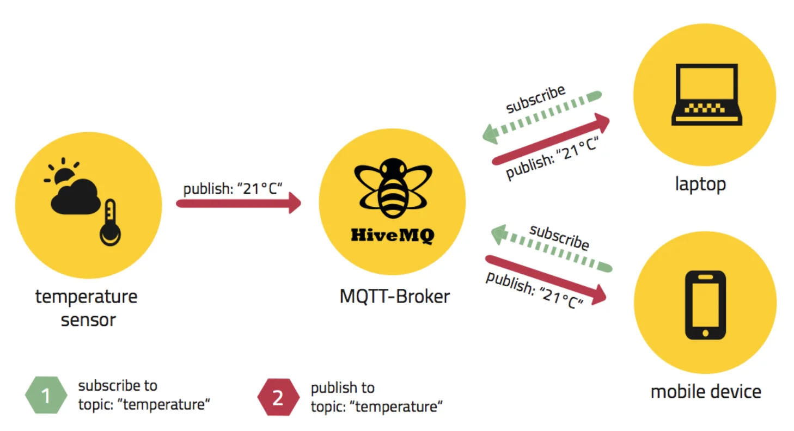

> 
> 
> <a id="237eda9b0fe181e69214c84f36093694"></a>
> 
> <strong>목차</strong>
> 
> - [1. MQTT](#237eda9b0fe18108ac4af4d8cbb716a9)
> - [NestJS에서 MQTT 사용](#238eda9b0fe18068980ae0f6693750e7)
> - [1.1 패키지 설치](#238eda9b0fe180238fabec967c8e4931)
> - [Reference](#238eda9b0fe18089a9e9ef154ad0ec83)

<a id="237eda9b0fe18108ac4af4d8cbb716a9"></a>

## 1&#46; <strong>MQTT</strong>

---

> 📖 
> 
> 
> 
> <a id="237eda9b0fe181b99bfdcd5c6fafbd25"></a>
> 
> <strong><a href="https://mqtt.org/"><code>MQTT</code></a></strong><code> (Message Queuing Telemetry Transport)</code>는 2016년 국제 표준화 된 (ISO 표준 ISO/IEC PRF 20922) <strong><u>발행&#45;구독(Publish&#45;Subscribe</u></strong>) 기반의 낮은 지연시간에 최적화된 오픈 소스 <strong><u>경량 메시지 프로토콜</u></strong>이다&#46;
> 
> <a id="238eda9b0fe1802292f7f079f9b520e8"></a>
> 
> <strong>주로 </strong><strong><u>IoT(사물인터넷)</u></strong>, <strong><u>M2M(Machine to Machine)</u></strong><u> </u>환경 등 <strong><u>네트워크 대역폭이나 자원이 제한된 환경</u></strong>, 혹은 <strong><u>대규모 트래픽 전송</u></strong>을 상황에서 효율적인 통신을 위해 설계되었다&#46;

<details>
<summary> 특징</summary>

1. 연결 지향적 ( Connection Oriented )
    - 

</details>

<a id="238eda9b0fe18068980ae0f6693750e7"></a>

## NestJS에서 MQTT 사용

---

<a id="238eda9b0fe180238fabec967c8e4931"></a>

### 1&#46;1 패키지 설치

<a id="238eda9b0fe180a3b49affddadb30ae6"></a>

```bash
npm i --save mqtt

npm install @nestjs/microservices
```

> ✏️ 
> 
> <a id="238eda9b0fe180f5bf20c3ac865a3491"></a>
> 
> <strong><code>&#64;nestjs/microservices</code></strong>
> 
> - <strong>microservices</strong> 기능 (예&#58; <code>MQTT</code>, <code>Redis</code>, <code>RabbitMQ</code> 등 <strong><u>transport 계층</u></strong>)을 사용하려면 <strong>직접 설치해야 한다</strong>
>     - NestJS의 공식 패키지이긴 하지만, <strong>기본 설치 시 포함되지 않는다&#46;</strong>

> ✏️ 
> 
> <a id="238eda9b0fe1806ba2b5ecdb9b23e0ef"></a>
> 
> <strong><code>Microservice Transporters</code></strong>
> 
> <a id="238eda9b0fe1801facf4cd250d71b0df"></a>
> 
> NestJS에서 <strong><code>Transport&#46;MQTT</code></strong><strong>, </strong><strong><code>Transport&#46;TCP</code></strong><strong>, </strong><strong><code>Transport&#46;REDIS</code></strong><strong>, </strong><strong><code>Transport&#46;NATS</code></strong><strong>, </strong><strong><code>Transport&#46;RMQ</code></strong> 등으로 지정하는 메세지 전송 방식이다&#46; 

<a id="238eda9b0fe18089a9e9ef154ad0ec83"></a>

## Reference

---

[MQTT Essentials&#58; Your 2025 Learning Hub for IoT &#38; IIoT Data Streaming]()

[Documentation &#124; NestJS &#45; A progressive Node&#46;js framework]()

[Beginners Guide To The MQTT Protocol]()

[&#91;통신 이론&#93; MQTT, MQTT Protocol (MQTT 프로토콜) 이란? &#45; 1 (이론편)]()
