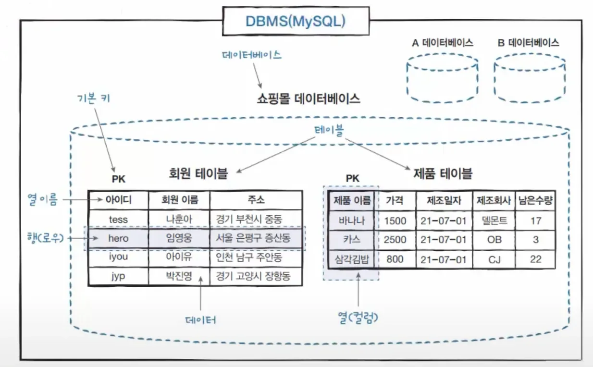
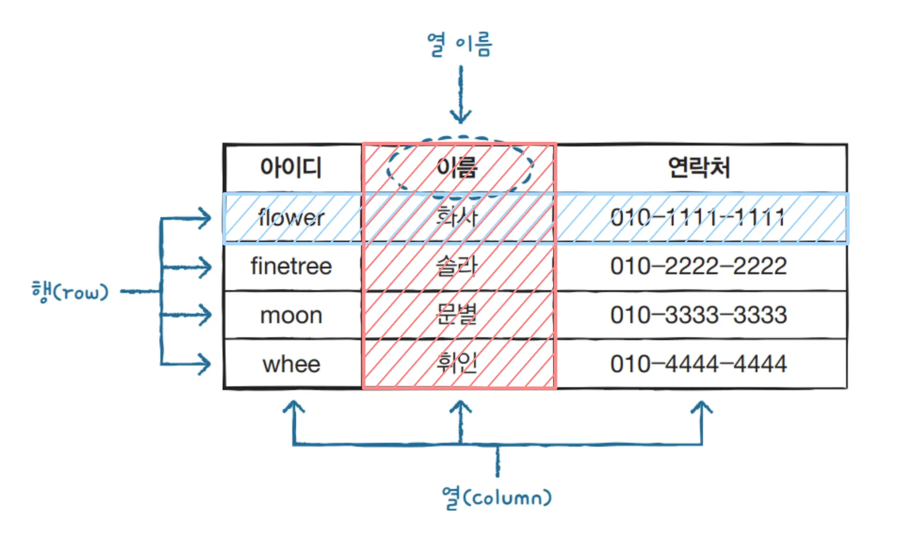

> 
> 
> 
> 
> <strong>목차</strong>
> 
> - [RDBMS - 테이블](#23aeda9b0fe18155ac7aeb22051ce89c)
> - [테이블(Table), ](#23beda9b0fe180fcaa5efafe03549d2c)
> - [컬럼(Column), 로우(Row)](#23beda9b0fe1807598e5fa26c8cd4f43)

## RDBMS &#45; 테이블

---

> 📖 
> 
> 
> 
> 관계형 데이터베이스는 <strong><u>여러 테이블</u></strong>로 구성된다&#46; ( 테이블은 쉽게 얘기해 <code>표</code>와 같다&#46;  )
> 
> - 관계형 데이터베이스(RDBMS)는 <code>MySQL</code>, <code>MariaDB</code>, <code>PostgreSQL</code> 등이 있다
> 
> 
> 
> 테이블은 <strong><u>열(컬럼, Column)</u></strong> 과 <strong><u>행(로우, Row)</u></strong>로 이루어져 있다&#46;
> 
> 
> 
> 엑셀에서 표에 데이터를 차례로 정리하듯, 관계형 데이터베이스에서도 테이블에 데이터를 차곡차곡 저장한다&#46; 

### 테이블(Table), 

### 컬럼(Column), 로우(Row)

- 행(row)&#58; 가로

- 열(column)&#58; 세로
