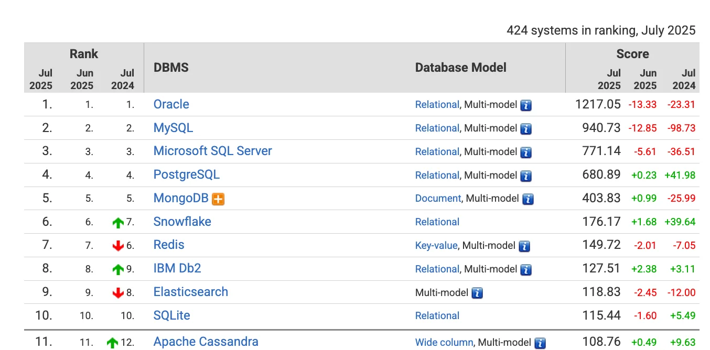

> 
> 
> 
> 
> <strong>목차</strong>
> 
> - [1. SQL](#23eeda9b0fe1812c8956f380af677061)
> - [DB 랭킹 확인](#23eeda9b0fe180479e3bf146f105e22b)
> - [Standard SQL 개요](#23eeda9b0fe18006af8dccc669537d13)
> - [Standard SQL 기능](#23eeda9b0fe180b9827cde62079cc2fe)
> - [Reference](#23eeda9b0fe18083aab1d96790e857f1)

## 1&#46; SQL

---

> 📖 
> 
> 
> 
> SQL은 <code>Structured Query Langauge</code>( <code>구조적 쿼리 언어</code> )의 약어로 관계형 데이터베이스 관리 시스템에서 데이터 정의, 데이터 조작, 데이터 제어를 위해 사용하는 언어이다
> 
> - 최초에는 SEQUAL ( Structured English Query Language ) 이라는 이름으로 불리었으나, 상표권 문제로 현재의 SQL 명칭을 따르게 되었다&#46;

> ✏️ 
> 
> 
> 
> <strong>E&#46;F&#46; Codd 박사와 시스템 R 프로젝트</strong>
> 
> 
> 
> 1970년 IBM에서 근무하던 수학자 E&#46; F&#46; Codd 박사는 수학자 관점에서 데이터 관리를 위한 이론을 논문으로 발표하고 시스템 R(Relation) 프로젝트 진행
> 
> 
> 
> RDBMS가 갖춰야 하는 대부분의 아키텍처 설계 및 테스트가 이뤄짐

### <strong>DB 랭킹 확인</strong>

[DB&#45;Engines Ranking]()

### Standard SQL 개요

- 1970년&#58; E&#46;F&#46;Codd 관계형 DBMS 논문 발표

- 1974년&#58; IBM SQL 개발

- 1979년&#58; Oracle 상용 DBMS 발표

- 1980년&#58; Sysbase SQL Server 발표

- 1983년&#58; IBM DB2 발표

- 1986년&#58; ANSI/ISO SQL 표준 최초 제정(SQL&#45;86, SQL1)

- 1992년&#58; ANSI/ISO SQL 표준 개정(SQL&#45;92, SQL2)

- 1999년 ANSI/ISO SQL 표준 개정(SQL&#45;99, SQL3)

- 2003년 ANSI/ISO SQL 표준 개정(SQL&#58;2003)

- 2006년 ANSI/ISO SQL 표준 개정(SQL&#58;2006)

- 2008년 ANSI/ISO SQL 표준 개정(SQL&#58;2008)

- 2011년 ANSI/ISO SQL 표준 개정(SQL&#58;2011)

- 2016년 ANSI/ISO SQL 표준 개정(SQL&#58;2016)

### Standard SQL 기능

- STANDARD JOIN 기능 추가

- SCALAR SUBQUERY, TOP&#45;N QUERY 등의 새로운 SUBQUERY 기능

- ROLLUP, CUBE, GROUPING SETS 등의 새로운 리포팅 기능

- WINDOW FUNCTION 같은 새로운 개념의 분석 기능

## Reference

---

[DBMS의 탄생과 발전, 그리고 역사]()

[About SQL]()

[dl&#46;acm&#46;org]()

[SQL]()

[bookmark]()
