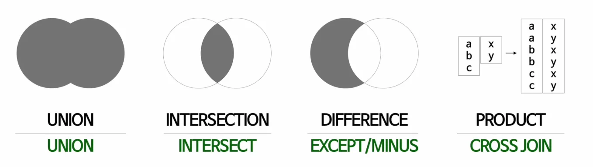
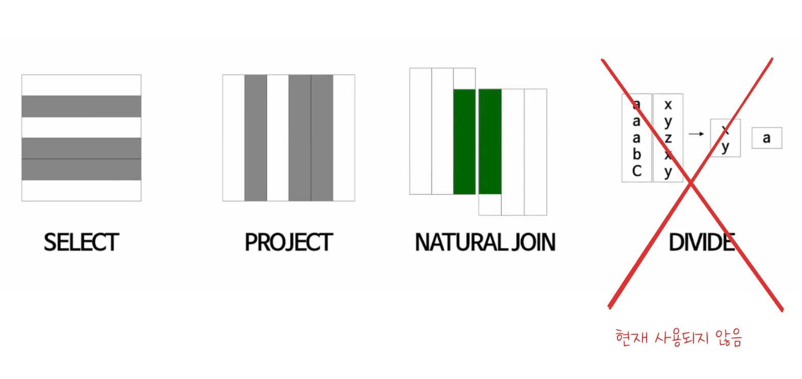

> 
> 
> 
> 
> <strong>목차</strong>
> 
> - [일반 집합 연산자](#23eeda9b0fe1812db7bdda54c3387246)
> - [순수 관계 연산자](#23eeda9b0fe180f0b2c6ea15cccb86ca)

## 일반 집합 연산자

---

- 데이터베이스에는 일반 집합 연산자 4가지가 있다&#46; 
    - <code>UNION</code>(합집합) &#45; UNION

    - <code>INTERSECTION</code>(교집합) &#45; INTERSECT

    - <code>DIFFERENCE</code>(차집합) 
        - SQL server&#58; <code>EXCEPT</code>

        - oracle&#58; <code>MINUS</code> 

    - <code>PRODUCT</code> &#45; CROSS JOIN

## 순수 관계 연산자

---

- 순수 관계 연산자는 3가지 방법이 존재한다&#46; 
    - <code>SELECT</code>

    - <code>PROJECT</code>

    - <code>NATURAL JOIN</code>

    - <del><code>DIVIDE</code></del><del>&#58; 현재는 사용되지 않음</del>
