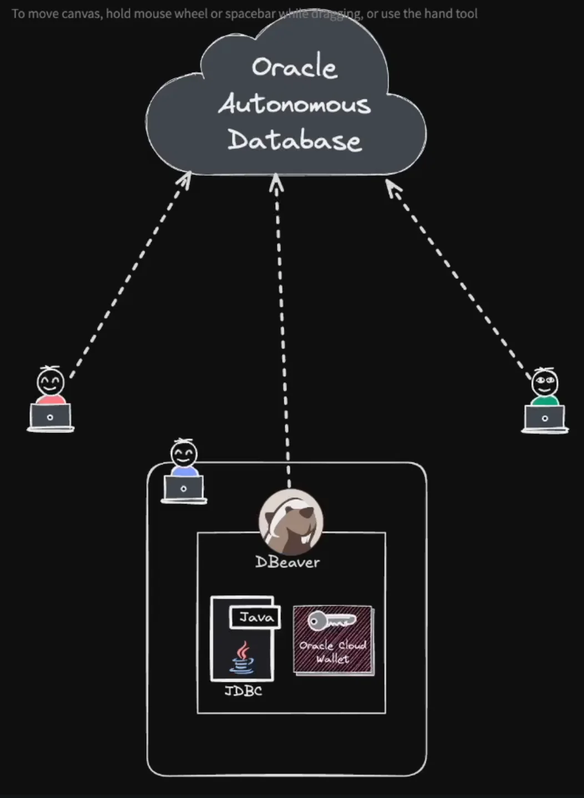
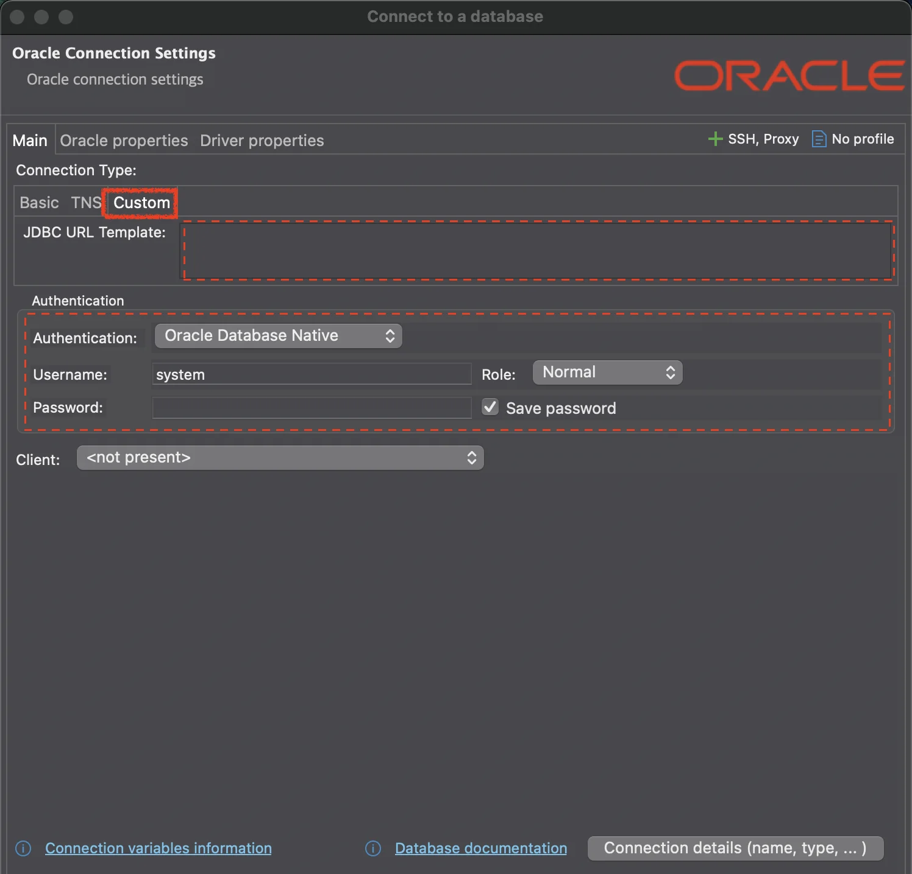
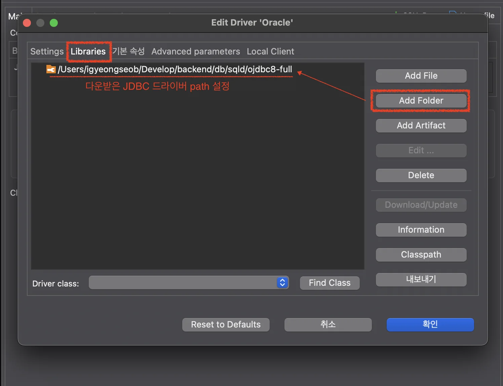
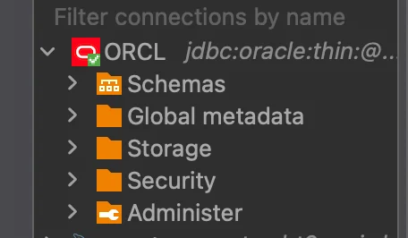

> 
> 
> <a id="23eeda9b0fe18038bfe8ca02fdc19220"></a>
> 
> <strong>목차</strong>
> 
> - [1. 실습을 위한 환경 설정](#23eeda9b0fe18061a180f6cbd04266fc)
> - [1. DBeaver 설치](#23eeda9b0fe1801bbdd4f68b75b11c4f)
> - [2. Oracle Cloud Wallet 설정 ( 보안 )](#23eeda9b0fe180f2b8def59929460504)
> - [3. JDBC driver 설정](#23eeda9b0fe1802fb8badecada510a15)
> - [2. DBeaver 설정](#23eeda9b0fe180359fcfd080bc14a3e3)
> - [1. JDBC URL Template 입력](#23eeda9b0fe180849db4e3586d70bb5a)
> - [2. 인증 설정](#23eeda9b0fe1808ba8e2e607c0616ed5)
> - [3. Driver 설정](#23eeda9b0fe18006a979e69b4441839a)
> - [4. 정상 작동 ](#23eeda9b0fe1803d8bd4f44b606e51c8)

<a id="23eeda9b0fe18061a180f6cbd04266fc"></a>

## 1&#46; 실습을 위한 환경 설정



<a id="23eeda9b0fe1801bbdd4f68b75b11c4f"></a>

### 1&#46; DBeaver 설치

[Download]()

<a id="23eeda9b0fe180f2b8def59929460504"></a>

### 2&#46; Oracle Cloud Wallet 설정 ( 보안 )

[실습 환경 설정하기(파일 다운로드) &#124; 8시간 완성 SQLD(2과목)]()

- 강의 페이지에서 다운로드(보안에 유의)

- 적절한 위치로 옮기고 압축 풀기

<a id="23eeda9b0fe1802fb8badecada510a15"></a>

### 3&#46; JDBC driver 설정

[JDBC and UCP Downloads page &#124; Oracle 대한민국]()

- 19c 드라이버 다운로드

<a id="23eeda9b0fe180359fcfd080bc14a3e3"></a>

## 2&#46; DBeaver 설정



<a id="23eeda9b0fe180849db4e3586d70bb5a"></a>

### <strong>1&#46; JDBC URL Template 입력</strong>

<a id="23eeda9b0fe1803f8b5ec32ba77960a2"></a>

```shell
# 문법 
jdbc:oracle:thin:@[TNS name]?TNS_ADMIN=[Wallet 경로]

# ex)
jdbc:oracle:thin:@sqld_high?TNS_ADMIN=/Users/igyeongseob/Develop/backend/db/sqld/Wallet_SQLD
```

- 경로 구분시 macOS는 <code>/</code>로 Windows 에서는 <code>&#92;&#92;</code> 으로 구분

<a id="23eeda9b0fe1808ba8e2e607c0616ed5"></a>

### 2&#46; 인증 설정

- Username&#58; <code>sqld&#95;user</code>

- Password&#58; <code>T174MY8abBZpzEQ</code>

<a id="23eeda9b0fe18006a979e69b4441839a"></a>

### 3&#46; Driver 설정



<a id="23eeda9b0fe1803d8bd4f44b606e51c8"></a>

### 4&#46; 정상 작동 



- 위와 같이 정상 작동이 되는 것을 확인할 수 있음
