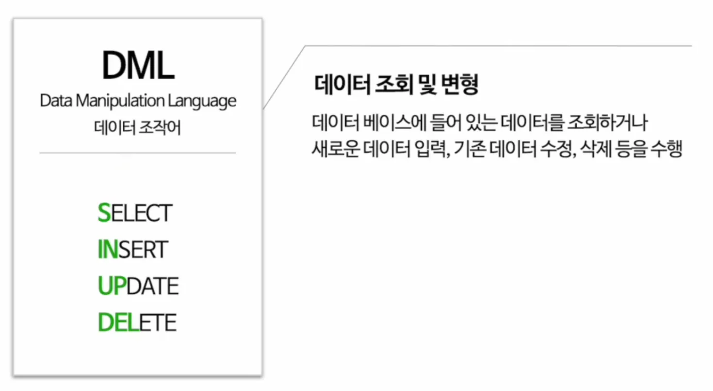
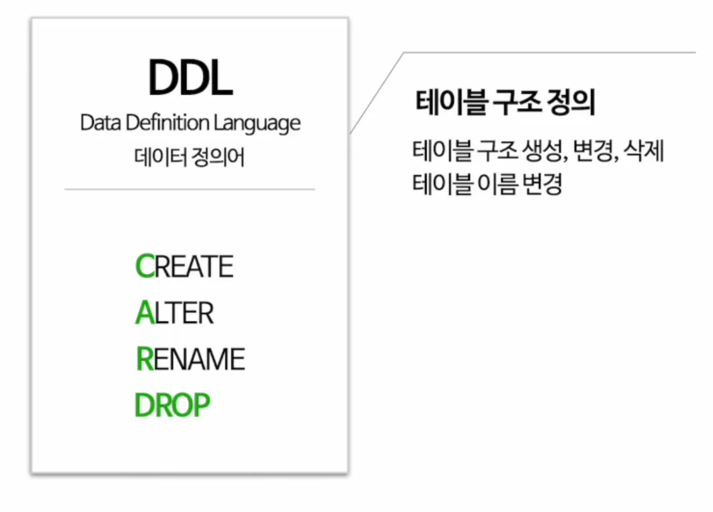
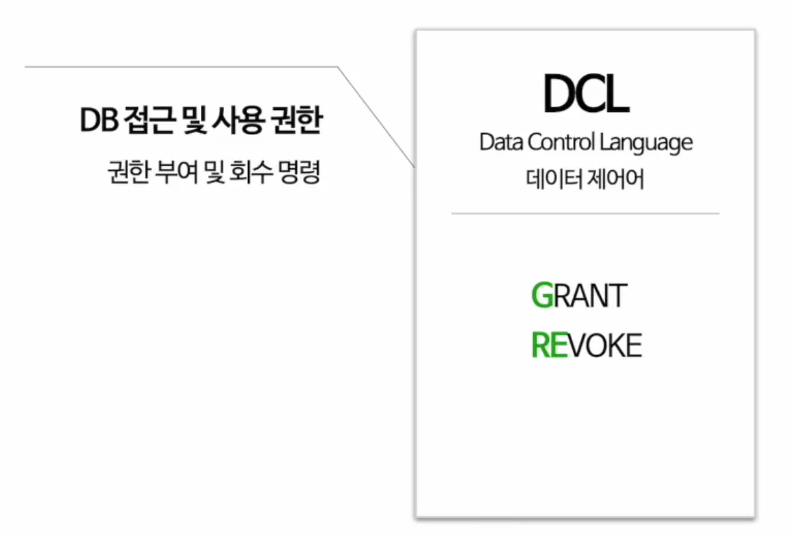
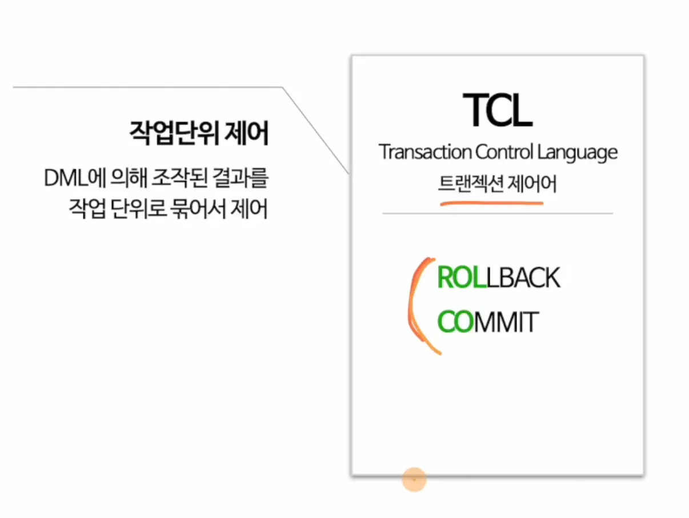

> 
> 
> 
> 
> <strong>목차</strong>
> 
> - [SQL 명령어 종류](#23eeda9b0fe18018b89cc8912d3346a3)

## SQL 명령어 종류

---

- 주작이 신업델?
    

    주작이 발이 있어서 신발을 신업 델

- 정의어 &#45; 카드롭

- 컨트롤 제어권을 줄래? 그래

- 트랜스젠더가 롤러코스터를 탓다&#46;
