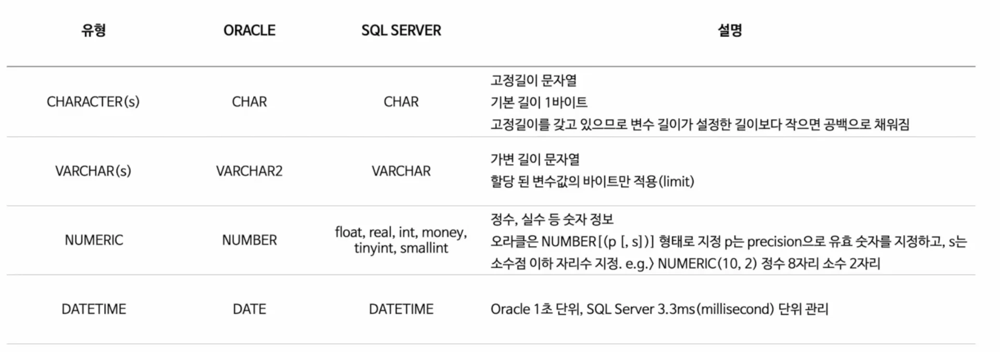

> 
> 
> 
> 
> <strong>목차</strong>
> 
> - [데이터 유형](#23eeda9b0fe1817a8bcee850f9d14a7f)

## 데이터 유형

---

- <code>CHAR</code>는 고정된 길이로써 성능 이점이 있지만, 실질적으로 거의 체감하지 못하는 정도이다&#46;
    

    따라서 완전히 고정된 길이가 아니라면 <code>VARCHAR</code>를 사용하는 것을 권장한다&#46;
