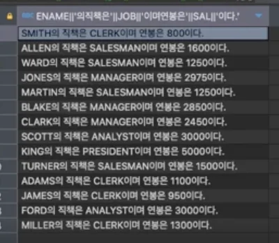

> ✏️ 
> 
> <a id="244eda9b0fe180d78752f0cb6d7c76b8"></a>
> 
> <strong>합성 연산자</strong>
> 
> <a id="244eda9b0fe180e8b125c324493bde89"></a>
> 
> 문자를 결합하는데 사용한다&#46; 
> 
> - Oracle&#58; <code>&#124;&#124;</code>
> 
> - SQL Server&#58; <code>&#43;</code>
> 
> - <code>CONCAT()</code>&#58; 2개의 문자열만 합성 가능하다&#46; 

<details>
<summary>ex 1) Oracle&#58; <code>&#124;&#124;</code></summary>

<a id="244eda9b0fe18001a1f1fcc3c850709d"></a>

```sql
SELECT ename || '의 직책은 ' || job || '이며 연봉은 ' || sal || '이다.'
FROM emp;
```



</details>

<details>
<summary>ex 2) SQL Server&#58; <code>&#43;</code></summary>

<a id="244eda9b0fe180b58678e6779b94ba1e"></a>

```sql
SELECT ename + '의 직책은 ' + job + '이며 연봉은 ' + sal + '이다.'
FROM emp;
```


</details>

<details>
<summary>ex3) <code>concat(… , …)</code></summary>

<a id="244eda9b0fe1808e8aa7d97b0ad0f217"></a>

```sql
SELECT concat('연봉', sal)
FROM emp;
```

- <strong><u>2개의 인자만 받</u></strong>아 합성 가능하다&#46; 

- <code>concat(1st, 2nd, 3rd)</code> → ❌, 3개 이상 인자 불가 


</details>
