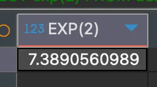
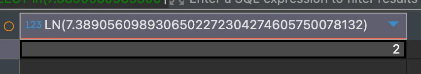

> 
> 
> <a id="244eda9b0fe181faaaa0c087812f04bc"></a>
> 
> <strong>목차</strong>
> 
> - [소수점 자르기 : trunc(target, 소수점 자리수)](#244eda9b0fe181c997f7c893605c38f8)
> - [삼각함수: sin(), cos(), tan()](#246eda9b0fe18071aad2e21cee8ee006)
> - [지수 함수:  exp()  ( 밑: e, 자연상수 )](#246eda9b0fe18082b2f2fc6c4bd665ef)
> - [지수 함수:  : power(밑, 지수)](#246eda9b0fe18000964bea887c71ed95)
> - [제곱근 함수: sqrt(target)](#246eda9b0fe1800a9706e1f762a3cb71)
> - [로그 함수: log(밑, target)](#246eda9b0fe1809f9e4fdd0f1950419e)
> - [로그 함수: ln(target) = log(target)  ( 밑: e, 자연상수 )](#246eda9b0fe180ccb8cce64f9273db8b)

<a id="244eda9b0fe181c997f7c893605c38f8"></a>

### 소수점 자르기 &#58; <code>trunc(target, 소수점 자리수)</code>

<a id="244eda9b0fe1816798c3ed5c6e27e19f"></a>

```sql
# Oracle
SELECT
	trunc(38.888, 2) # 결과: 38.88 ( 소수점 2자리 미만 자름 )
FROM dual
```


<a id="246eda9b0fe18071aad2e21cee8ee006"></a>

### 삼각함수&#58; <code>sin()</code>, <code>cos()</code>, <code>tan()</code>

<a id="246eda9b0fe18096a92be94e93bc4aaf"></a>

```sql
# Oracle, SQL Server
SELECT
	sin(0),        # 결과: 0 
	cos(0),        # 결과: 1
	tan(0)         # 결과: 0
FROM dual
```


<a id="246eda9b0fe18082b2f2fc6c4bd665ef"></a>

### 지수 함수&#58;  <code>exp()</code>  ( 밑&#58; <code>e</code>, 자연상수 )

<a id="246eda9b0fe1805ba92dd031b41f5132"></a>

```sql
# Oracle, SQL Server
SELECT
	exp(2)
FROM dual
```

- <code>exp(2)</code>&#58; <code class="language-math">e^2</code>



<a id="246eda9b0fe18000964bea887c71ed95"></a>

### 지수 함수&#58;  &#58; <code>power(밑, 지수)</code>

<a id="246eda9b0fe1801fa3d0ef761f8a46e2"></a>

```sql
# Oracle, SQL Server
SELECT
	power(2, 4) 
FROM dual
```

- <code>power(2, 4)</code>&#58; <code class="language-math">2^4</code> = 16


<a id="246eda9b0fe1800a9706e1f762a3cb71"></a>

### 제곱근 함수&#58; <code>sqrt(target)</code>

<a id="246eda9b0fe180e29bb5eae541879068"></a>

```sql
# Oracle, SQL Server
SELECT
	sqrt(4) 
FROM dual
```

- <code>sqrt(4)</code>&#58;  <code class="language-math">&#92;sqrt{4}</code> = 2


<a id="246eda9b0fe1809f9e4fdd0f1950419e"></a>

### 로그 함수&#58; <code>log(밑, target)</code>

<a id="246eda9b0fe180cdab6cc70d458b1739"></a>

```sql
# Oracle, SQL Server
SELECT
	log(10, 100)
FROM dual
```

- <code>log(10, 100)</code>&#58; <code class="language-math">&#92;log&#95;{10}(100)</code> = 2


<a id="246eda9b0fe180ccb8cce64f9273db8b"></a>

### 로그 함수&#58; <code>ln(target)</code> = <code>log(target)</code>  ( 밑&#58; <code>e</code>, 자연상수 )

<a id="246eda9b0fe180dd9566eab13907f2a0"></a>

```sql
# Oracle, SQL Server
SELECT
	ln(7.3890560989306502272304274605750078132)  # 결과: 2
	log(7.3890560989306502272304274605750078132)  # 결과: 2
FROM dual
```

- <code>ln(7&#46;38&#46;&#46;&#46;) </code>&#58; <code class="language-math">&#92;log&#95;{e}(7&#46;38&#46;&#46;&#46;)</code> = <code class="language-math">log&#95;{e}(e^2)</code> =  2


