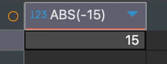
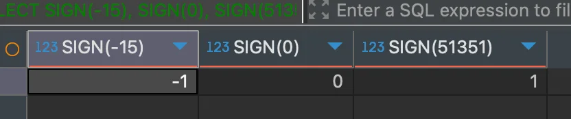
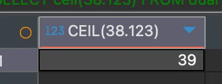
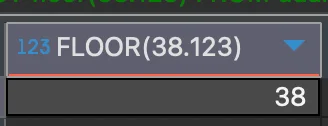

> 
> 
> <a id="244eda9b0fe180c6a2e5d8ce7fb8a610"></a>
> 
> <strong>목차</strong>
> 
> - [절댓값 반환: ABS() ( absolute )](#244eda9b0fe180439e2ecf42ae1fb789)
> - [음수, 양수, 0 판단: SIGN()](#244eda9b0fe18029aa1ef611ff854ccd)
> - [나머지 연산: mod(), %](#244eda9b0fe18019ab17c9dada149f41)
> - [올림 함수: ceil(), ceiling()](#244eda9b0fe180b8a631dc2274d9ac68)
> - [내림 함수: floor()](#244eda9b0fe1800a81fee35db885e733)
> - [반올림 함수: round(값, 소수점)](#244eda9b0fe180d6b6eefa3bdd7e5c16)

<a id="244eda9b0fe180439e2ecf42ae1fb789"></a>

### 절댓값 반환&#58; <code>ABS()</code> ( absolute )

<a id="244eda9b0fe18036afa1e26d8916de63"></a>

```sql
# Oracle, SQL Server
SELECT
	ABS(-15)
FROM dual

# 결과: 15
```



<a id="244eda9b0fe18029aa1ef611ff854ccd"></a>

### 음수, 양수, 0 판단&#58; <code>SIGN()</code>

> ✏️ 
> 
> - 양수&#58; <code>1</code>
> 
> - 0&#58; <code>0</code>
> 
> - 음수&#58; <code>&#45;1</code>

<a id="244eda9b0fe18056ae10e7e8bf9b1272"></a>

```sql
# Oracle, SQL Server
SELECT
	SIGN(-15)        # 결과: -1 
	SIGN(0)          # 결과: 0
	SIGN(51351)      # 결과: 1
FROM dual
```



<a id="244eda9b0fe18019ab17c9dada149f41"></a>

### 나머지 연산&#58; <code>mod()</code>, <code>%</code>

<a id="244eda9b0fe180ebb12ddd9f545a9d10"></a>

```sql
# Oracle
SELECT
	mod(7, 3)   # 결과: 1
FROM dual
```


<a id="244eda9b0fe1803f962ff600e19ec3d2"></a>

```sql
# SQL Server
SELECT
	7%4    # 결과: 3
FROM dual
```

<a id="244eda9b0fe180b8a631dc2274d9ac68"></a>

### 올림 함수&#58; <code>ceil()</code>, <code>ceiling()</code>

<a id="244eda9b0fe1803b942ec232fef4b846"></a>

```sql
# Oracle
SELECT
	ceil(38.123),   # 결과: 39
FROM dual
```



<a id="244eda9b0fe1802cb7fbdf4c4f301418"></a>

```sql
# SQL Server
SELECT
	ceiling(38.123),   # 결과: 39
FROM dual
```

<a id="244eda9b0fe1800a81fee35db885e733"></a>

### 내림 함수&#58; <code>floor()</code>

<a id="244eda9b0fe180109b4edfd47e414bff"></a>

```sql
# Oracle, SQL Server
SELECT
	floor(38.123),   # 결과: 38
FROM dual
```



<a id="244eda9b0fe180d6b6eefa3bdd7e5c16"></a>

### 반올림 함수&#58; <code>round(값, 소수점)</code>

<a id="244eda9b0fe180e9902ac1f57f4042cd"></a>

```sql
# Oracle
SELECT
  # Case 1) 2번째 인자: 소수점
	round(38.125, 2),    # 결과: 38.13
	
	# Case 2) 2번째 인자 제거
	round(38.535),       # 결과: 39
	
	# Case 3) 2번쨰 인자: 음수
	round(38.535, -1)   # 결과: 40
		# '-1' 은 일의 자리를 뜻함
		
FROM dual
```

<a id="244eda9b0fe180b2b8deca2f573723ca"></a>

```sql
# SQL Server
SELECT
  # Case 1) 2번째 인자: 소수점
	round(38.125, 2),      # 결과: 38.13
	
	# Case 2) 2번째 인자 제거 불가
	round(38.535, 0),      # 결과: 39
	
	# Case 3) 2번쨰 인자: 음수
	round(38.535, -1)     # 결과: 40
		# '-1' 은 일의 자리를 뜻함
	
FROM dual
```
