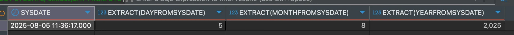

> 
> 
> <a id="246eda9b0fe1803aab4af1ec7dfdcdd9"></a>
> 
> <strong>목차</strong>
> 
> - [현재 날짜: SYSDATE, GETDATE()](#246eda9b0fe1806495a7c128590747c0)
> - [현재 날짜 필터링 1: extract('포맷' FROM SYSDATE), DATEPART(포맷, GETDATE()), 포맷(GETDATE())](#246eda9b0fe18096a8aecc15d8bfd3c2)
> - [현재 날짜 필터링 2: extract('포맷' FROM SYSDATE), DATEPART(포맷, GETDATE()), 포맷(GETDATE())](#246eda9b0fe180e88e72e7f9c1d82e00)
> - [날짜 연산: TO_DATE(), convert(), dateadd()](#246eda9b0fe180dab7deef1fad82bcf5)

<a id="246eda9b0fe1806495a7c128590747c0"></a>

### 현재 날짜&#58; <code>SYSDATE</code>, <code>GETDATE()</code>

<a id="246eda9b0fe18065a16af31fedbbb583"></a>

```sql
# Oracle
SELECT
	SYSDATE  # 결과: 2025-08-05 11:16:58.000 ( 현재 시간 )
FROM dual
```


<a id="246eda9b0fe180a19697cf2f780a93e9"></a>

```sql
# SQL Server
SELECT
	GETDATE()  # 결과: 현재 시간
```

<a id="246eda9b0fe18096a8aecc15d8bfd3c2"></a>

### 현재 날짜 필터링 1&#58; <code>extract(&#39;포맷&#39; FROM SYSDATE)</code>, <code>DATEPART(포맷, GETDATE())</code>, <code>포맷(GETDATE())</code>

<a id="246eda9b0fe180b68401d84b78d8ad6e"></a>

```sql
# Oracle
SELECT
	SYSDATE,
	extract(DAY FROM SYSDATE),
	extract(MONTH FROM SYSDATE),
	extract(YEAR FROM SYSDATE)
FROM dual
```



<a id="246eda9b0fe180f88ccfd05da6c8373c"></a>

```sql
# SQL Server
SELECT
	# DATEPART(포맷, GETDATE())
	DATEPART(DAY, GETDATE()),
	DATEPART(MONTH, GETDATE()),
	DATEPART(YEAR, GETDATE()),
	
	# 포맷(GETDATE())
	DAY(GETDATE()),
	MONTH(GETDATE()),
	YEAR(GETDATE()),
	GETDATE()
```


<a id="246eda9b0fe180e88e72e7f9c1d82e00"></a>

### 현재 날짜 필터링 2&#58; <code>extract(&#39;포맷&#39; FROM SYSDATE)</code>, <code>DATEPART(포맷, GETDATE())</code>, <code>포맷(GETDATE())</code>

<a id="246eda9b0fe1800792eec6ace53cad26"></a>

```sql
SELECT
	TO_CHAR(SYSDATE, 'YYYY-MM-DD'),
	TO_CHAR(SYSDATE, 'YYYY-MM'),
	TO_CHAR(SYSDATE, 'YYYY'),
	TO_NUMBER(TO_CHAR(SYSDATE, 'YYYY'))
FROM dual
```


<a id="246eda9b0fe180f4ba75f088cd3daa82"></a>

```sql
# SQL Server
SELECT
	# DATEPART(포맷, GETDATE())
	DATEPART(DAY, GETDATE()),
	DATEPART(MONTH, GETDATE()),
	DATEPART(YEAR, GETDATE()),
	
	# 포맷(GETDATE())
	DAY(GETDATE()),
	MONTH(GETDATE()),
	YEAR(GETDATE()),
	GETDATE()
```


<a id="246eda9b0fe180dab7deef1fad82bcf5"></a>

### 날짜 연산&#58; <code>TO&#95;DATE()</code>, <code>convert()</code>, <code>dateadd()</code>

<a id="246eda9b0fe180898e49d262d4fe375c"></a>

```sql
SELECT
	TO_DATE('2025-08-05', 'YYYY-MM-DD'),
	TO_DATE('2025-08-05', 'YYYY-MM-DD')+1,        # + 날짜
	TO_DATE('2025-08-05', 'YYYY-MM-DD')+1/24,     # + 시간
	TO_DATE('2025-08-05', 'YYYY-MM-DD')+1/24/60   # + 분
FROM dual
```


<a id="246eda9b0fe18034b9d8e290b55ff5a7"></a>

```sql
# SQL Server
SELECT
	# convert(DATETIME, 날짜)
	convert(DATETIME, '2025-08-05'),
	convert(DATETIME, '2025-08-05')+1,        # + 날짜
	convert(DATETIME, '2025-08-05')+1/24,     # + 시간
	convert(DATETIME, '2025-08-05')+1/24/60,   # + 분
	
	# dateadd()
	dateadd(hour, 3, convert(DATETIME, '2025-08-05'))
```


