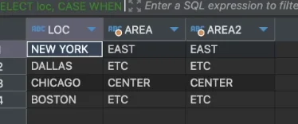
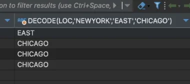

> 
> 
> <a id="249eda9b0fe181dfb0f5c8003a73f40d"></a>
> 
> <strong>목차</strong>
> 
> - [1. CASE 문 ](#249eda9b0fe181148b1ed18a36d1a5f0)
> - [2. Case 문 축약: DECODE() ](#249eda9b0fe1805c8f06d9c9617ef37e)

<a id="249eda9b0fe181148b1ed18a36d1a5f0"></a>

### 1&#46; CASE 문 

<a id="249eda9b0fe181cda0b5df77a237f93a"></a>

```sql
# Oracle, SQL Server
SELECT
	loc,
	CASE WHEN loc='NEW YORK' THEN 'EAST'
			 WHEN loc='CHICAGO' THEN 'CENTER'
			 ELSE 'ETC' END AS area,
			 
	# 공통된 변수 - 앞으로 추출하여 중복 제거 가능
 	CASE loc WHEN 'NEW YORK' THEN 'EAST'
			     WHEN'CHICAGO' THEN 'CENTER'
					 ELSE 'ETC' END AS area2,
FROM dual
```



<a id="249eda9b0fe1805c8f06d9c9617ef37e"></a>

### 2&#46; Case 문 축약&#58; <code>DECODE()</code> 

<a id="249eda9b0fe180d4bac4e392177003ec"></a>

```sql
# Oracle
SELECT
	# DECODE(변수, CASE1=('NEW YORK', 'EAST'), CASE2=('CHICAGO', 'CENTER'), ELSE)
	DECODE(loc, 'NEW YORK', 'EAST', 'CHICAGO', 'CENTER', 'ETC')
FROM dual
```


