<a id="25beda9b0fe180f382bef931a087cc16"></a>

## Postman 

---

> 📖 
> 
> <a id="25beda9b0fe180fbbf2be73ca243801a"></a>
> 
> 개발자들이 만든 API를 Postman을 통해 GUI 환경에서 손쉽게 테스트 가능하다&#46; 이를 통해 HTTP 요청을 만들고 서버로부터 응답을 확인하여 API 테스트 및 디버깅을 진행한다&#46; 
> 
> 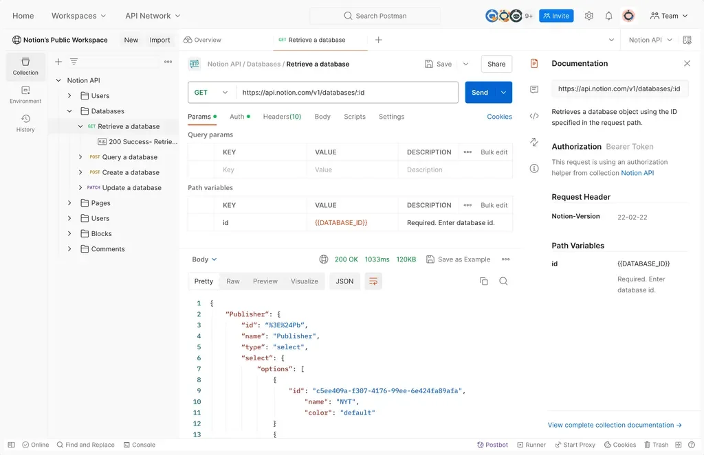
> 
> - Postman은 RESTful API 뿐만 아니라 GraphQL, SOAP 등 다양한 API 유형을 테스트할 수 있고 Postman 공유를 통한 팀 간의 협업도 가능하다&#46;

<details>
<summary><strong>Postman 설치하기</strong></summary>

1. <strong>포스트맨 공식 사이트 다운로드 페이지 접속</strong>
    [Download Postman &#124; Get Started for Free]()

1. 각 환경에 맞는 다운로드 버튼 클릭
    - Mac
        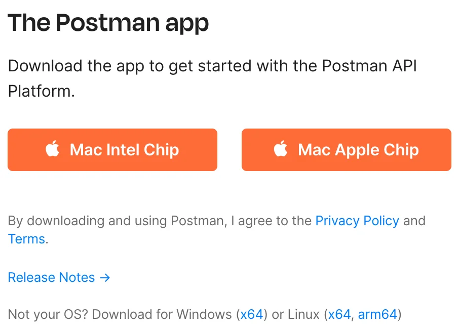

    - Window
        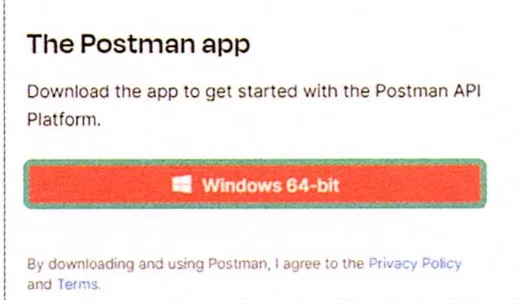

1. 설치 완료 후 프로그램 실행
    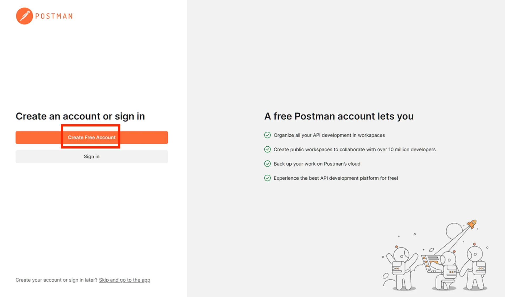

1. 회원가입
    - 구글 이메일로 간편하게 회원가입이 가능하다&#46;

    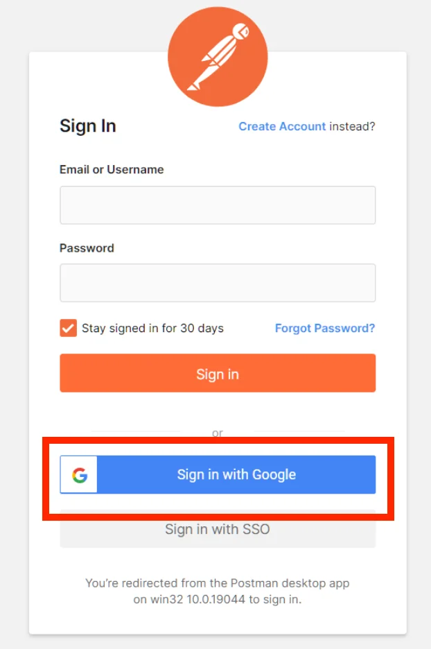

1. 설치 및 실행 완료
    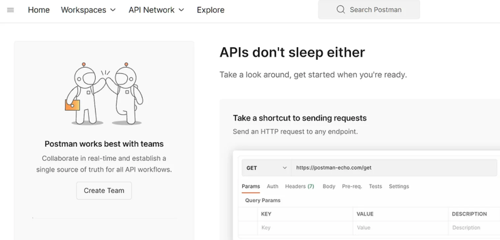

1. 내 워크스페이스에 API 테스트 준비하기
    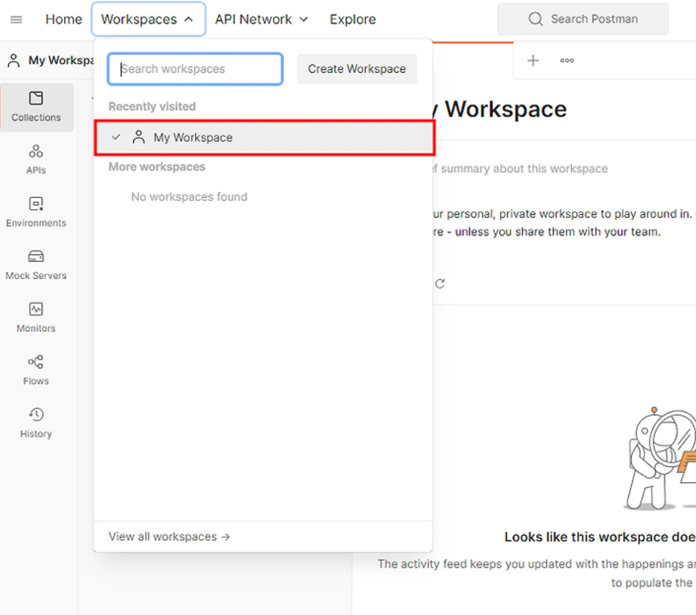

</details>

<details>
<summary><strong>Git Clone</strong></summary>

> 📖 Git Clone은 원격 저장소(repository)의 전체 내용을 로컬 컴퓨터로 복사하는 Git 명령어이다&#46; 
> 
> -  프로젝트의 코드를 내려받아 로컬 환경에서 작업 가능
> 
> - 저장소의 전체 이력(history)과 파일을 모두 복사하며, 이후 로컬에서 변경한 내용을 원격 저장소에 Push 가능

<details>
<summary>학습 예제 </summary>

- MVC 패턴이 적용된 JSP
    <a id="25beda9b0fe18092962cf145da0ed320"></a>

    <a href="https://github.com/UK-spring/spring-basic-jsp">깃허브 링크 바로가기</a>

- Controller Interface, View Resolver
    <a id="25beda9b0fe18034ac2cd33e0e30f7e5"></a>

    <a href="https://github.com/UK-spring/spring-basic-mvc-v1">깃허브 링크 바로가기</a>

- Spring Annotation
    <a id="25beda9b0fe180d68a2edf6419fa166c"></a>

    <a href="https://github.com/UK-spring/spring-basic-mvc-v2">깃허브 링크 바로가기</a>

- CRUD 실습
    <a id="25beda9b0fe18083b634c476eb58ab25"></a>

    <a href="https://github.com/UK-spring/spring-basic-crud">깃허브 링크 바로가기</a>

- 메모장 프로젝트
    <a id="25beda9b0fe180c4b3eaf864a65d9307"></a>

    <a href="https://github.com/UK-spring/spring-basic-inmemory">깃허브 링크 바로가기</a>

- Layered Architecture
    <a id="25beda9b0fe1802391f2db2caabe7aa6"></a>

    <a href="https://github.com/UK-spring/spring-baisc-layered">깃허브 링크 바로가기</a>

- 데이터베이스 접근 기술 적용
    <a id="25beda9b0fe180d0859de87b029917c2"></a>

    <a href="https://github.com/UK-spring/spring-basic-db">깃허브 링크 바로가기</a>

</details>

<details>
<summary>1&#46; Git clone 명령어 복사하기</summary>

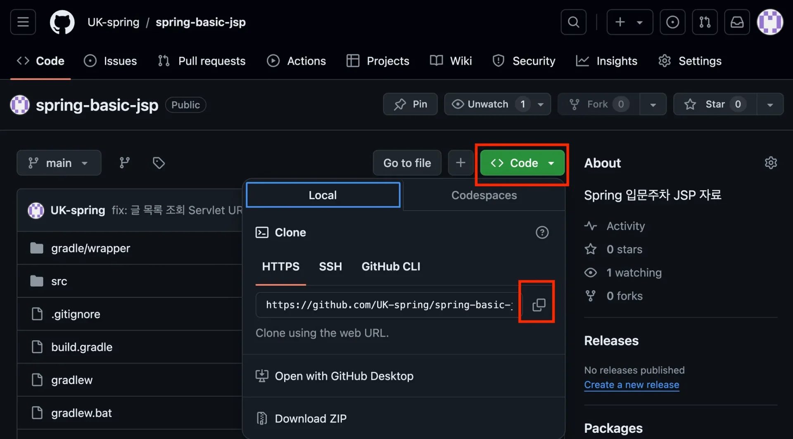

</details>

<details>
<summary>2&#46; Local 환경에 프로젝트를 보관할 디렉토리 생성</summary>

- 원하는 위치(바탕화면 등)에 workspace 폴더 생성


</details>

<details>
<summary>3&#46; workspace 폴더 이동 후 Git clone 명령어 실행</summary>

<details>
<summary>Window</summary>

1. Git Bash 실행
    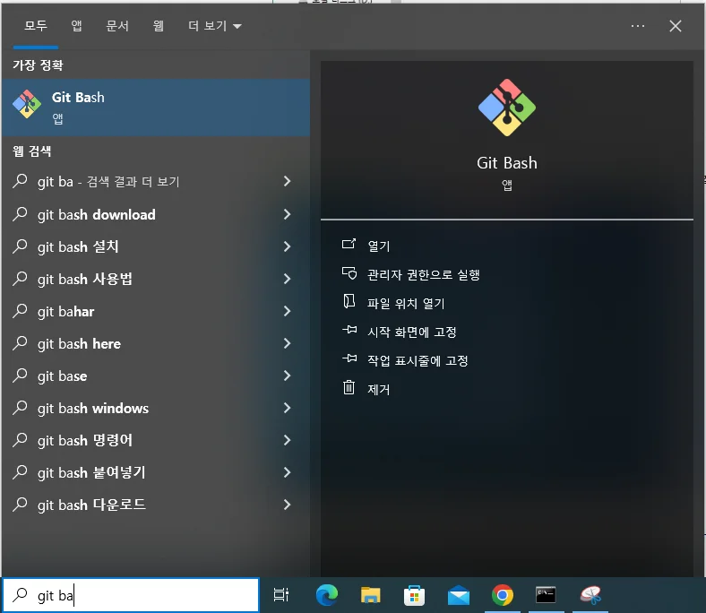

1. <strong><code>ls</code></strong><strong> </strong>명령어 실행(현재 내 위치)
    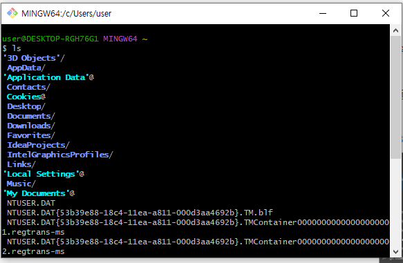

1. <code>cd Desktop</code>  명령어 실행(바탕화면 이동)

1. <code>cd workspace</code> (생성한 workspace로 이동)

1. git clone 명령어 실행

</details>

<details>
<summary>Mac</summary>

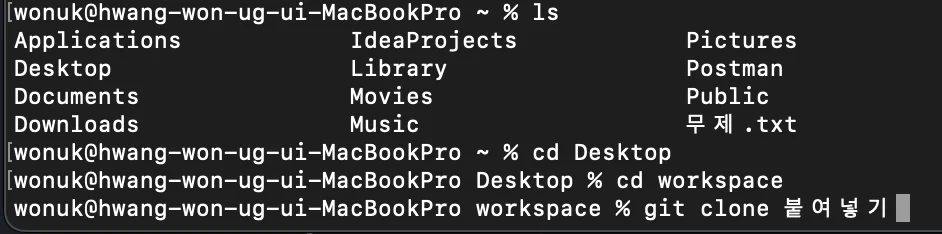

1. 터미널 접속 → <code>ls</code> 명령어 실행(현재 내 위치)

1. <code>cd Desktop</code>(바탕화면 이동)

1. <code>cd workspace</code> (생성한 workspace로 이동)

1. git clone 명령어 실행

</details>

- git clone 명령어
    <a id="25beda9b0fe180cdb1dffbfe0754d4d8"></a>

    ```plaintext
    git clone (여기 붙여넣기 앞에 공백하나 있습니다!)
    ```

</details>

<details>
<summary>🧐 git clone 명령어가 안된다면, &#45; zip 파일 다운</summary>

1. Download ZIP
    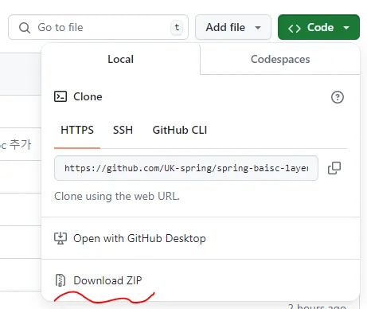

1. workspace 폴더에 압축해제
    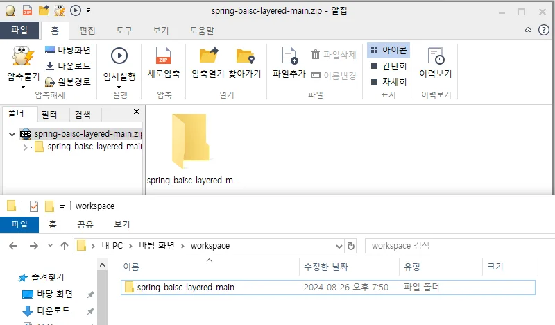

</details>

</details>

<a id="25beda9b0fe18098a130c721d141df2c"></a>

## Curl 테스트 

---

> 📖 
> 
> <a id="25beda9b0fe1801fb9fec903c9c355a5"></a>
> 
> curl은 <strong><code>Command Line URL</code></strong>의 약자로, <strong><u>터미널(또는 CLI)에서 URL 기반 요청을 보낼 수 있게 해</u></strong>주는 도구이다&#46;
> 
> -  <strong>브라우저 대신 터미널에서 HTTP 요청을 보낼 수 있는 프로그램</strong>
> 
> - <code>HTTP</code>, <code>HTTPS</code>, <code>FTP</code>, <code>SMTP</code> 등 다양한 프로토콜을 지원한다&#46; 
> 
> - 대부분의 Unix 계열 OS(macOS, Linux)에 기본 내장됨

<details>
<summary>기본 사용법  및 예시</summary>

<a id="25beda9b0fe180309473e0783f513da1"></a>

```bash
curl [옵션] [URL]
```

<details>
<summary>ex) </summary>

1. <strong>GET 요청</strong>
    <a id="25beda9b0fe180039f27d9561da1305d"></a>

    ```bash
    curl https://jsonplaceholder.typicode.com/posts/1
    ```

    - <code>GET</code>은 <strong><u>기본 메서드</u></strong>이기 때문에 따로 설정하지 않아도 됨

1. <strong>POST 요청 (데이터 전송)</strong>
    <a id="25beda9b0fe180068aaec6bb5ab36d10"></a>

    ```bash
    curl -X POST https://jsonplaceholder.typicode.com/posts \
      -H "Content-Type: application/json" \
      -d '{"title":"foo","body":"bar","userId":1}'
    ```

    - <code>&#45;X</code>&#58; 메서드 지정 (POST)

    - <code>&#45;H</code>&#58; 헤더 추가

    - <code>&#45;d</code>&#58; body 데이터 추가

1. <strong>파일 다운로드</strong>
    <a id="25beda9b0fe18052b2abc6e4c31a7720"></a>

    ```bash
    curl -O https://example.com/file.zip
    ```

    - <code>&#45;O</code>&#58; 원래 이름 그대로 저장<br>

</details>

</details>

<details>
<summary>자주 쓰는 옵션</summary>

| <strong>옵션</strong> | <strong>설명</strong> |
| --- | --- |
| <code>&#45;X</code> | HTTP 메서드 지정 (GET, POST, PUT, DELETE 등) |
| <code>&#45;H</code> | 헤더 추가 (ex&#46; &#45;H &#34;Authorization&#58; Bearer &#60;token&#62;&#34;) |
| <code>&#45;d</code> | 데이터 전송 (POST/PUT 요청에 body 넣을 때) |
| <code>&#45;o</code> | 출력 결과를 파일로 저장 (ex&#46; &#45;o result&#46;json) |
| <code>&#45;O</code> | 다운로드 시 원래 이름으로 저장 |
| <code>&#45;v</code> | 요청/응답의 상세 로그 출력 (debug 용도) |
| <code>&#45;I</code> | 응답의 header만 확인 (HEAD 요청처럼 동작) |

</details>

<details>
<summary>자주 사용되는 실무 패턴</summary>

1. <strong>API 테스트 ( JWT )</strong>
    <a id="25beda9b0fe180659ee4e2b183e2a840"></a>

    ```bash
    curl -X GET "https://api.example.com/users" 
    	-H "Authorization: Bearer <token>"
    ```

1. <strong>JSON 데이터 전송</strong>
    <a id="25beda9b0fe18009a9f1e884998aa85b"></a>

    ```bash
    curl -X POST "https://api.example.com/login" \
      -H "Content-Type: application/json" \
      -d '{"username":"test","password":"1234"}'
    ```

1. <strong>응답을 파일에 저장</strong>
    <a id="25beda9b0fe1806baf23cb2bc7ee3853"></a>

    ```bash
    curl https://api.example.com/data -o data.json
    ```

</details>

<a id="25beda9b0fe180828b1cd1a422a590e1"></a>

### Reference

<a id="25beda9b0fe18099be5bdd0c68c56e43"></a>

‣

<a id="25beda9b0fe180e8a1adc9e780dde9d8"></a>

‣

<a id="25beda9b0fe1806c8a1bddcab6de48dc"></a>

‣
