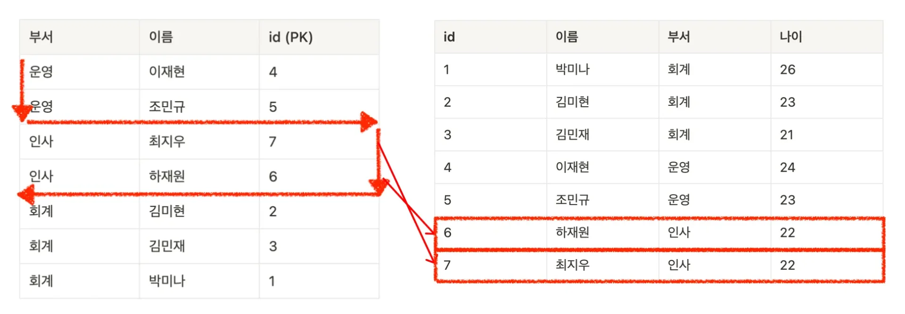

> 
> 
> <a id="256eda9b0fe181919a8ec161ba98409c"></a>
> 
> <strong>목차</strong>
> 
> - [예시) 멀티 컬럼 인덱스 생성](#256eda9b0fe180a38a69d242f363105f)
> - [조회 시 인덱스 동작 과정 이해](#256eda9b0fe1816699c8d7a327abc9c1)
> - [🧐 인덱스 B+ Tree 구조 비교](#256eda9b0fe180ad82a5f0bb871f25c2)

<a id="256eda9b0fe180a38a69d242f363105f"></a>

### 예시) 멀티 컬럼 인덱스 생성

<details>
<summary>1&#46; 테이블 생성</summary>

<a id="256eda9b0fe18001b0d1dbad879cc86e"></a>

```sql
DROP TABLE IF EXISTS users;  // 존재하는 경우 삭제

CREATE TABLE users (
    id INT AUTO_INCREMENT PRIMARY KEY,
    이름 VARCHAR(100),
    부서 VARCHAR(100),
    나이 INT
);
```

</details>

<details>
<summary>2&#46; 더미 데이터 생성</summary>

<a id="256eda9b0fe1806db838f16dcc6727ad"></a>

```sql
INSERT INTO users (이름, 부서, 나이) VALUES
('박미나', '회계', 26),
('김미현', '회계', 23),
('김민재', '회계', 21),
('이재현', '운영', 24),
('조민규', '운영', 23),
('하재원', '인사', 22),
('최지우', '인사', 22);
```

</details>

<details>
<summary>3&#46; 멀티 컬럼 인덱스 생성 및 확인</summary>

<a id="256eda9b0fe180288f70f03294a4bb19"></a>

```sql
// 멀티 컬럼 인덱스 생성
CREATE INDEX idx_부서_이름 ON users (부서, 이름);

// 생성 확인
SHOW INDEX FROM users;
```

</details>

<a id="256eda9b0fe1816699c8d7a327abc9c1"></a>

### 조회 시 인덱스 동작 과정 이해

<a id="256eda9b0fe18046b932cfe366dbd0af"></a>

```sql
SELECT * FROM users
WHERE 부서 = '인사'
ORDER BY 이름;
```



<a id="256eda9b0fe180c9b066c0f1fa1137f4"></a>

예시에 해당하는 조건인 <code>(부서, 이름)</code> 으로 인덱스를 만들었기 때문에 빠른 탐색이 가능하다&#46; 

- 설정된 인덱스&#58; <code>부서</code>, <code>이름</code>

- 필터링 조건
    - <code>WHERE 부서 = ‘인사’</code>

    - <code>ORDER BY 이름</code>

<a id="256eda9b0fe180ad82a5f0bb871f25c2"></a>

### 🧐 인덱스 B&#43; Tree 구조 비교

- 단일 인덱스 &#45; B&#43; Tree 구조
    - 

- 멀티 컬럼 인덱스 &#45; B&#43; Tree 구조
