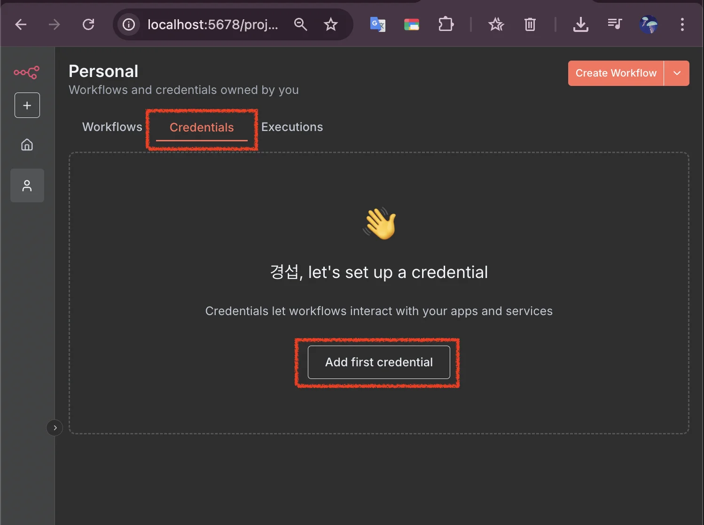

> /icons/tag_pink.svg 
> 
> <a id="257eda9b0fe1819788d6ce5f69754777"></a>
> 
> &#91;인프런&#93; <strong>회사에서 바로 쓰는 업무자동화 AI 에이전트 (w&#46; n8n, LangGraph)</strong>
> 
> - 기간&#58; 25&#46;08&#46;22(금) &#126; 25&#46;&#46;()
> 
> - 강의&#58; ‣
> 
> <details>
> <summary>reference</summary>
> 
> - ‣
> 
> - ‣
> 
> - ‣
> 
> </details>

<details>
<summary>Template</summary>

> 

> ✏️ 

> 📖 

> 
> 
> <a id="257eda9b0fe1810b9cbcd627da49b080"></a>
> 
> <strong>목차</strong>
> 
> - [ Credentials](#25deda9b0fe1807ebbb6da506894413d)
> - [ 5개의 유즈케이스 ](#257eda9b0fe18087969cec23673d5194)

<details>
<summary>&#91; 코드 &#93;</summary>

<a id="257eda9b0fe18102b592dec39e2604a1"></a>

```typescript

```

</details>

[제목 없음](#/post/257eda9b-0fe1-81f4-b28b-e5c1acf4fe73)

[[ 실습 ]](#/post/257eda9b-0fe1-8153-bf9b-f265ce1b2466)

[[ 의문점 ]](#/post/257eda9b-0fe1-81e8-af93-f319388f15bb)

</details>

[n8n 구축](#/post/257eda9b-0fe1-80cc-b939-e9ec542cc2ea)

<a id="25deda9b0fe1807ebbb6da506894413d"></a>

###  Credentials

<details>
<summary>credentials 생성</summary>



- 메인 화면 &#45; Credentials &#45; Add first credentails

</details>

[Google Drive Credential 생성](#/post/25deda9b-0fe1-8029-a0b4-ca6f6d46a91a)

[제목 없음](#/post/25deda9b-0fe1-8080-b79e-f491bc329f50)

[제목 없음](#/post/25deda9b-0fe1-8099-9a04-fb6fc70399ec)

<a id="257eda9b0fe18087969cec23673d5194"></a>

###  5개의 유즈케이스 

[1. 이메일 작성 도우미](#/post/257eda9b-0fe1-8051-9fae-c4aa6cccb352)

[2. 회사 기사 검색](#/post/257eda9b-0fe1-8005-a50e-fa145559fe32)

[3. 사내 QnA 봇](#/post/257eda9b-0fe1-80d1-af36-e68a8b08fa4e)

[4. Text-to-SQL](#/post/257eda9b-0fe1-80c4-ba00-f5bd7a87ef73)

[5. Github 코드 리뷰 에이전트](#/post/257eda9b-0fe1-800a-b526-c8025836f0f6)

[bookmark]()
