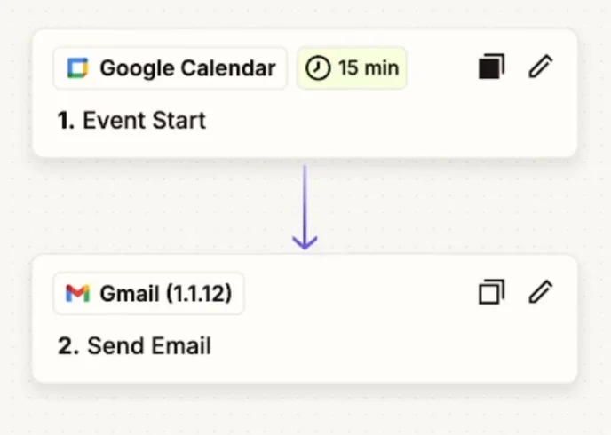

> 
> 
> 
> 
> <strong>목차</strong>
> 
> - [[비교] zapier ( workflow 2개까지 무료 )](#258eda9b0fe180ea9c64d35e69b6d004)
> - [Google Cloud ](#258eda9b0fe180e99a1ee2a3a96e464a)
> - [1. Server Action](#257eda9b0fe180ec974ed12516d3cdbb)

> 

> ✏️ 

> 📖 

### &#91;비교&#93; <code>zapier</code> ( workflow 2개까지 무료 )

- Google Calender → 이메일 전송
    

- Google From → 이메일 전송
    - 수강평 form 제출 → gmail 전송

> 🗣 
> 
> 
> 
> 비슷한 자동화 툴인 <code>Zapier</code>의 경우, 2개의 workflow까지 무료로 사용할 수있다&#46; 또한 <code>make도</code> 일정 부분 이상의 workflow 구축 시 유료 서비스로 이용해야 한다&#46;
> 
> 
> 
>  따라서 <code>n8n</code>을  자동화 툴로 선택하는 것이 비용적으로 더 이점이 있다&#46;

### Google Cloud 

[bookmark]()

Auth 토큰 생성

## 1&#46; Server Action
