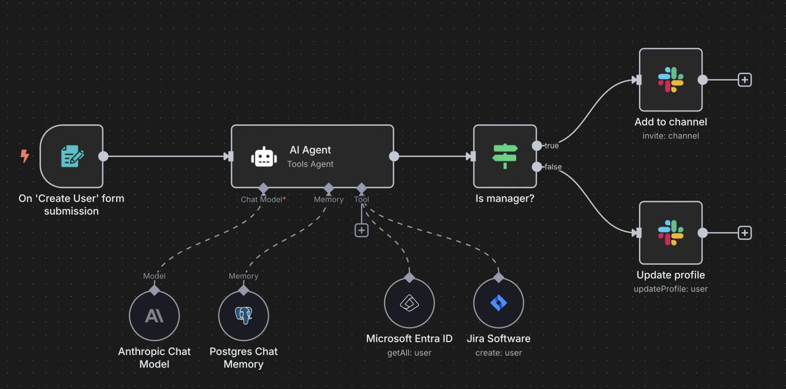
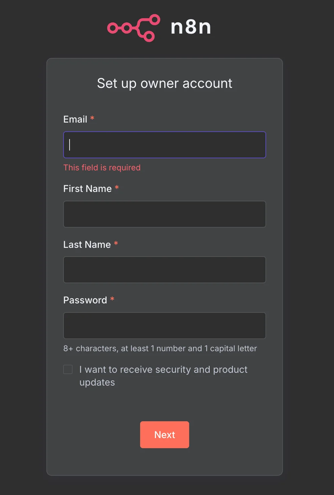
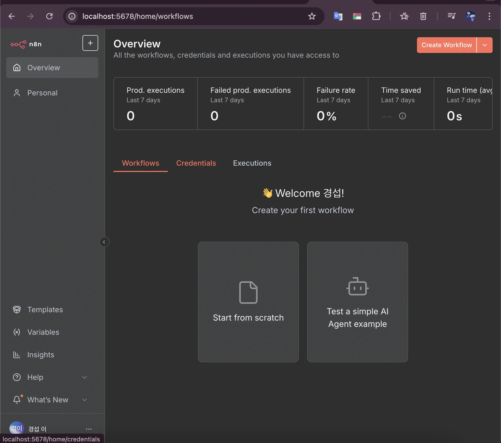

> 
> 
> <a id="257eda9b0fe1812cbfefeb17a816049d"></a>
> 
> <strong>목차</strong>
> 
> - [n8n](#257eda9b0fe180babbc5dc944040f3d1)
> - [1. SaaS 방식 ( n8n 클라우드 )](#257eda9b0fe18013a192e18797917475)
> - [2. 셀프 호스팅 방식 (추천)](#257eda9b0fe1808f9e77c9461831e420)
> - [인프라 구축](#257eda9b0fe18066964ff0f8980ea4e1)
> - [로컬 호스트](#257eda9b0fe18092b849cd0ba029804f)
> - [ AWS](#257eda9b0fe1801c8e3bf3085b6529dd)

<a id="257eda9b0fe180babbc5dc944040f3d1"></a>

## n8n

---

> 📖 
> 
> <a id="257eda9b0fe180108fcad9cd695f845b"></a>
> 
> <code>n8n</code>이란 <strong><u>코딩없이 </u></strong><strong><u>업무 자동화</u></strong><strong><u> ( AI 추가 가능 )를 가능</u></strong>하게 해주는 <strong><u>워크플로우 자동화 플랫폼</u></strong>이다&#46;
> 
> - 코딩 없이 값 입력만으로 연동 가능하다&#46;

[n8n&#46;io &#45; AI workflow automation tool]()

<details>
<summary>실제 업무 활용 사례</summary>



- <strong>다중 플랫폼 연동</strong>&#58; Slack, Jira, Notion, Github 연결

- <strong>스크럼 관리 자동화</strong>&#58; Notion 티켓과 Slack 메세지 비교

- <strong>AI 기반 보고서 생성</strong>&#58; 일일/주간/월간 자동 리포트

</details>

<details>
<summary>핵심 장점</summary>

- <strong><code>유연성</code></strong>&#58;
    - 다양한 기업 환경에 적응

    - 기업별 API 사용 정책에 유연하게 대응

    - 플러그인 방식의 확장성

- <strong><code>호환성</code></strong>&#58; 여러 AI 제공업체 지원

- <strong><code>편의성</code></strong>&#58; 코딩 없는 워크플로우 구성

- <strong><code>경제성</code></strong>&#58; 셀프 호스팅 시 비용 효율적

</details>

<details>
<summary>지원하는 AI 모델₩</summary>

- <code>OpenAI</code>

- <code>Anthropic</code>

- <code>Google Gemini</code>

- <code>AWS Bedrock</code>

</details>

<details>
<summary>구축 방법</summary>

<a id="257eda9b0fe18013a192e18797917475"></a>

### 1&#46; SaaS 방식 ( n8n 클라우드 )

> 장점

- 인프라 관리 불필요

- 즉시 사용 가능

> 단점

- 월 24유로 비용 발생 ( 약 4만원 )

- 연간 계약 필요

- 사용량 제한 존재

<a id="257eda9b0fe1808f9e77c9461831e420"></a>

### 2&#46; 셀프 호스팅 방식 (추천)

<a id="257eda9b0fe1804aacedd05cd3f057e7"></a>

Docker 통한 구축

- <code>AWS T2 micro</code>&#58; 월 약 17,000원

- <code>T2 small</code>&#58; 월 약 20,000원

- SaaS 대비 50% 비용 절감 가능

</details>

<a id="257eda9b0fe18066964ff0f8980ea4e1"></a>

## 인프라 구축

---

[n8n](https://github.com/n8n-io/n8n)

<a id="257eda9b0fe18092b849cd0ba029804f"></a>

### 로컬 호스트

- docker
    <a id="257eda9b0fe1809699cfcbfcfd3c3c97"></a>

    ```bash
    docker volume create n8n_data
    docker run -it --rm --name n8n -p 5678:5678 -v n8n_data:/home/node/.n8n docker.n8n.io/n8nio/n8n
    ```

- docker compose
    <a id="257eda9b0fe180508096c312085b0186"></a>

    ```bash
    services:
      n8n:
        image: docker.n8n.io/n8nio/n8n
        container_name: n8n
        ports:
          - "5678:5678"
        volumes:
          - n8n_data:/home/node/.n8n
        restart: unless-stopped

    volumes:
      n8n_data:
    ```

    <a id="257eda9b0fe1806294ceded2322ef036"></a>

    ```bash
    # 실행
    docker compose up -d

    # 종료
    docker compose down
    ```

- 초기 계정 설정
    

- 정상 접속 ( 메인 화면 )
    

<a id="257eda9b0fe1801c8e3bf3085b6529dd"></a>

###  AWS
