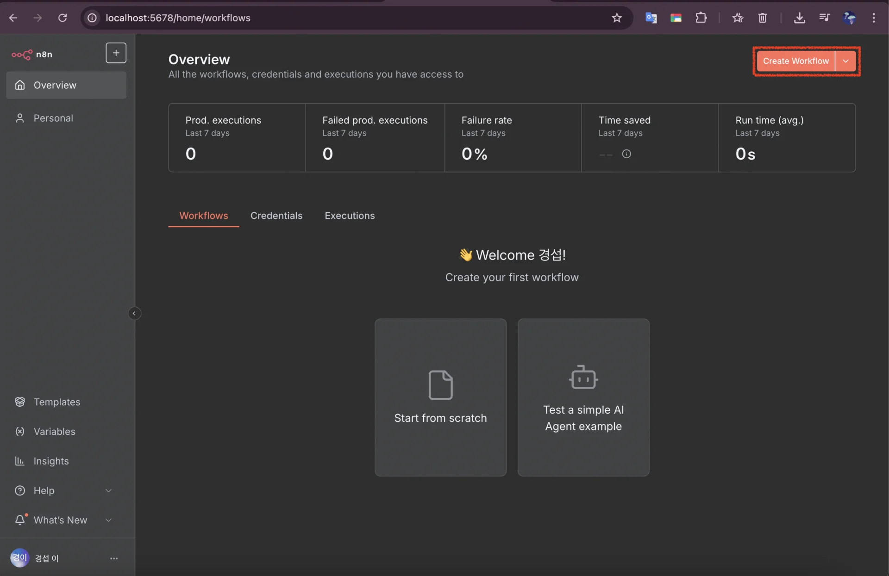
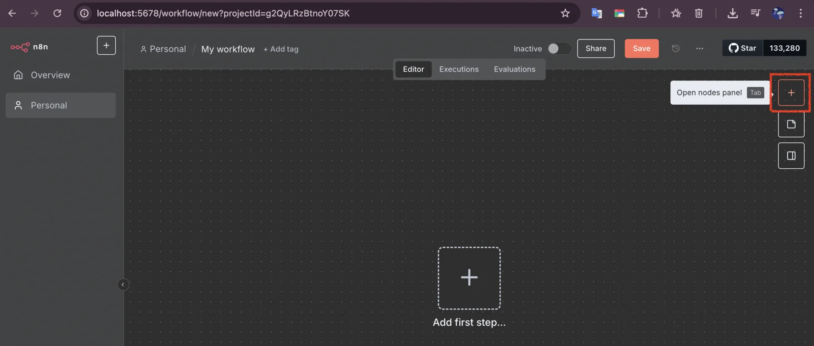
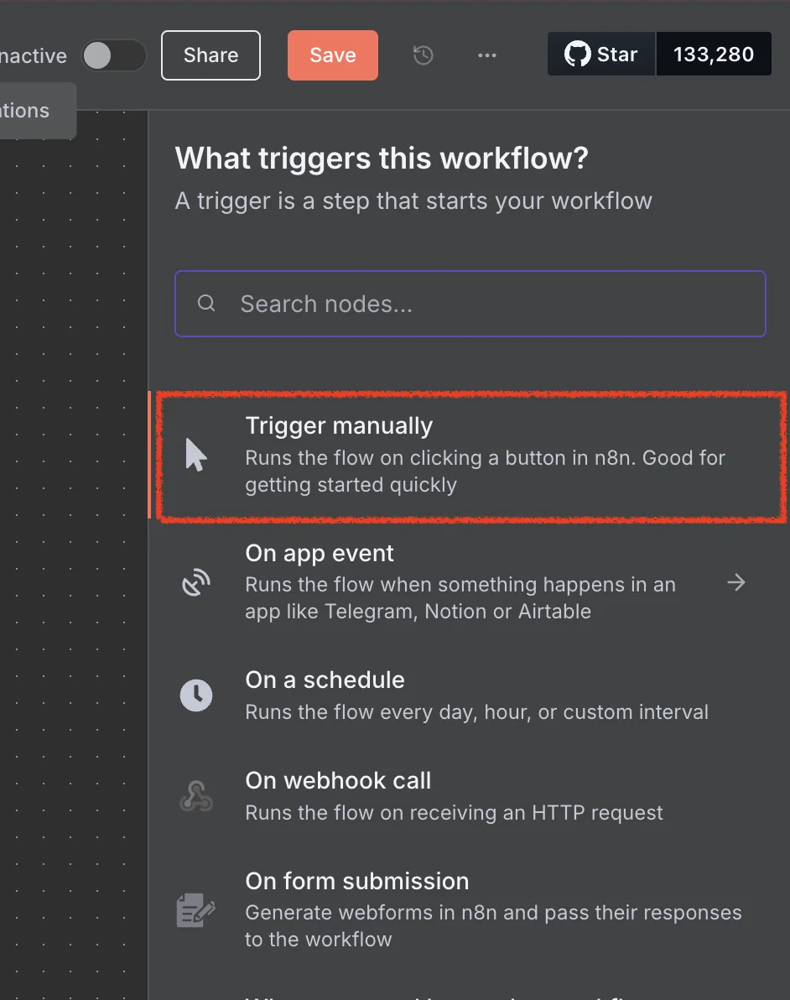
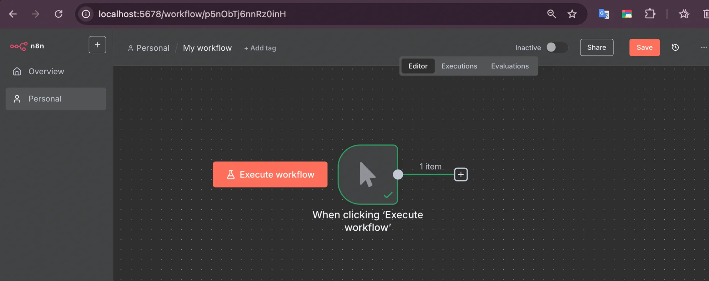
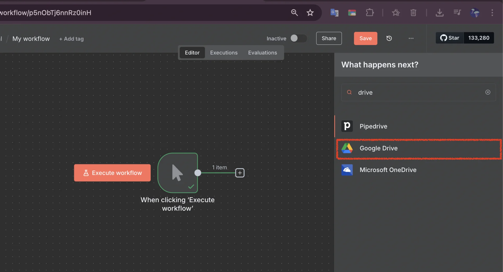

> 
> 
> 
> 
> <strong>목차</strong>
> 
> - [RAG (Retrieval-Augmented Generation)](#257eda9b0fe180e0ab96eac65b6423c1)
> - [사내 Q&A Bot](#25deda9b0fe180898035feeef368ece5)
> - [구축](#25deda9b0fe1801f8755d07424b392e6)

## RAG (Retrieval&#45;Augmented Generation)

---

> 📖 
> 
> 
> 
> <code>RAG</code> ( Retrieval&#45;Augmented Generation )는 대규모 언어 모델(LLM)에 <strong><u>외부 데이터 검색 기능을 결합</u></strong>하여, 더 정확하고 최신 정보를 제공하는 기술이다&#46; 단순히 학습된 내용에 의존하지 않고 <strong> </strong><strong>필요한 순간 </strong><strong><u>관련 자료를 검색</u></strong><strong>해 근거를 포함한 답변을 생성</strong>한다&#46;

‣

## 사내 Q&#38;A Bot

---

> 📖 
> 
> 
> 
> RAG을 기반으로, 기업 내부 문서와 데이터베이스에서 관련 정보를 검색해 자연어 답변을 생성하는 맞춤형 지식 챗봇
> 
> - <code>대형 언어 모델(LLM)</code>  &#43;  <code>정보 검색 기능</code> 
> 
> 

> 
<code>vector store 저장</code> &#45;  <strong><code>유사도 검색</code></strong>

> 
> 
> 
> 사람마다 질문하는 형식이 다를 수 있기 때문에 키워드 검색만으로는 원하는 문서를 가져오지 못할 수 있다&#46; 따라서 이를 <strong><u>임베딩을 통해 숫자로 변환(벡터화)</u></strong>하고 <strong><u>숫자 리스트를 비교</u></strong>해서 유사도 검색을 진행해 적절한 문서를 찾는다&#46;
> 
> 

실무 사용 사례 ( 기사 )

‣

‣

‣

활용 예시

> ✏️ 
> 
> 
> 
> 담당자(실무자)가 아니라면 어떤 문서를 봐야 되는지 정확하게 모르고 익숙한 작업이 아니라면 어디서부터 찾아봐야 될지도 잘 모른다&#46; 
> 
> 
> 
> 이에 대한 문제를 빠르게 해결하기 위해 관련된 정보들을 AI가 이해할 수 있도록 벡터화 해서 빠르게 답변을 얻어 생산성을 증가시킨다&#46; 

- 반복적인 질문 응대 자동화, 직원 온보딩, 업무 참고자료 제공 등 사내 지식 관리

- 검색과 생성의 결합으로 기존 검색의 한계를 뛰어넘는 맥락 중심의 문서 기반 정확한 답변 제공

> 질문 예시 

- 휴가 날짜 

- 업무 결제 담당자

- … 

장점

- 정확성 및 최신성
    - 사내 정책, 업무 매뉴얼, 인사/재무 규정 등 실제 문서에서 정보를 검색하므로, 누락이나 오류 없이 실시간으로 최신 문서를 반영한 답변이 가능

- 환각(Hallucination) 감소
    - 기존 LLM이 잘못된 답변을 생성하는 문제점을, RAG는 실재하는 자료만을 바탕으로 답변하여 오류를 크게 줄임

- 출처 명시 및 신뢰성
    - 응답에 관련 문서의 출처 정보를 함께 제공하므로, 사용자 신뢰도를 높일 수 있음

- 비정형 문서 처리
    - 기업 내 다양한 형태(마크다운, 슬랙 대화, 워드, PDF 등)의 비정형 문서도 벡터화하여 검색 가능

    - 프로젝트별 전문 지식 손쉽게 제공 가능

### 구축

1&#46; workflow 추가 

- <code>Create workflow</code> 클릭

2&#46; workflow 실행 트리거 추가 <code>Trigger manually</code>

> ✏️ 
> 
> 
> 
> 해당 워크플로우 실행 시 트리거가 발생됨

- workflow 실행 트리거가 위 화면처럼 생성된다&#46; 

3&#46; 

- 구글 시트로 파일 목록 제공 

