> 
> 
> 
> 
> <strong>목차</strong>
> 
> - [Google Cloud - project](#25deda9b0fe180b082c5c3ecd672df1f)
> - [1. Google Cloud Console - OAuth Client 생성](#25deda9b0fe180fb8b5cff87349138bf)
> - [2. n8n  Credentials 등록](#25deda9b0fe18079af53d9de26b11704)
> - [1. Server Action](#25deda9b0fe18178b32fc4dca3bce3c8)

### Google Cloud &#45; project

생성

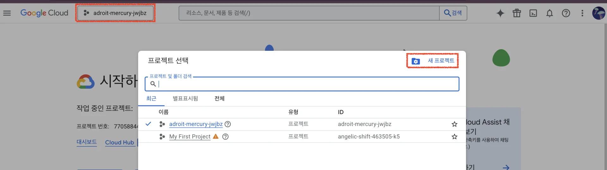

- 상단 메뉴 &#45; 프로젝트 선택 &#45; 새 프로젝트 

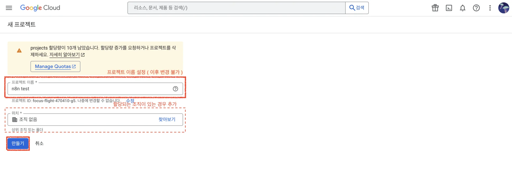

- 생성할 프로젝트 정보 입력 및 생성
    - 프로젝트 이름 ( 이후 변경 불가 )

    - 조직 ( 있을 시 선택 )

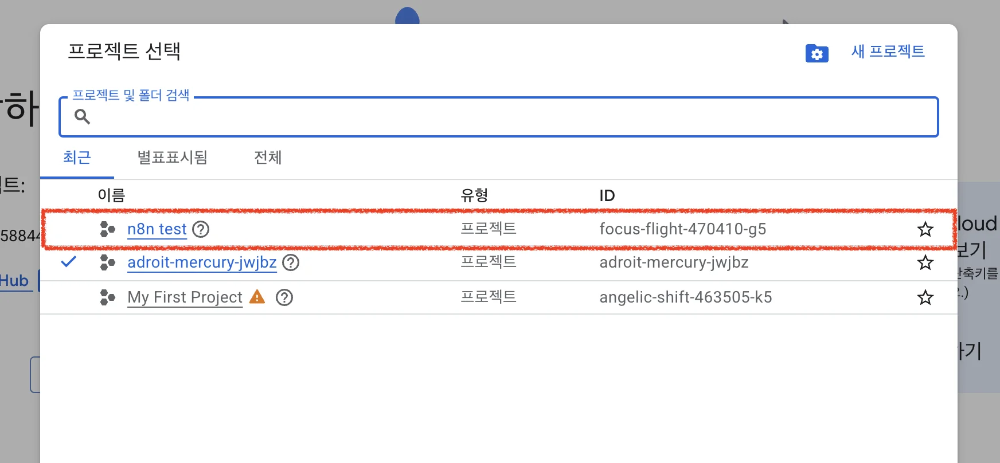

- 위 화면과 같이 정상 생성된 것을 확인할 수 있음

삭제

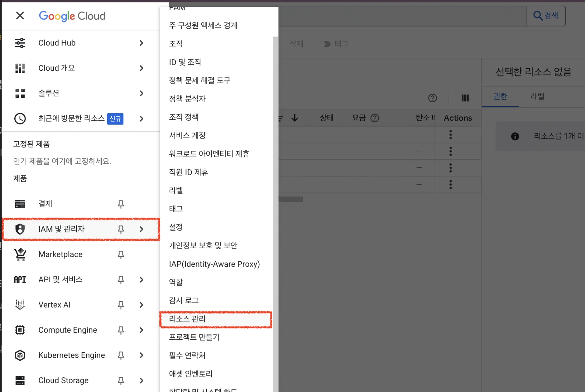

- 왼쪽 메뉴 &#45; IAM 및 관리자 &#45; 리소스 관리

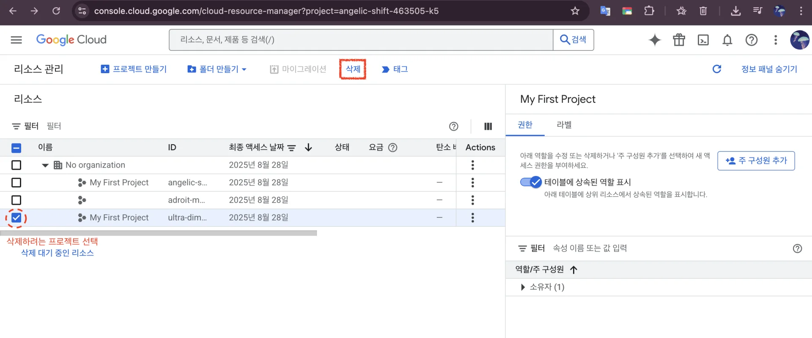

- 삭제하려는 프로젝트 선택 &#45; 삭제 클릭

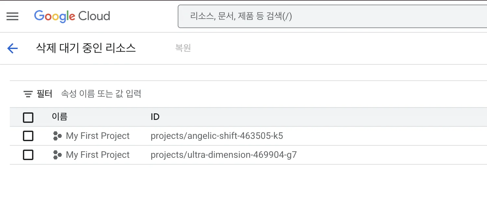

- 삭제 대기 중인 리소스로 해당 프로젝트 업로드?
    - 삭제하는데 시간이 걸림

3&#46; 

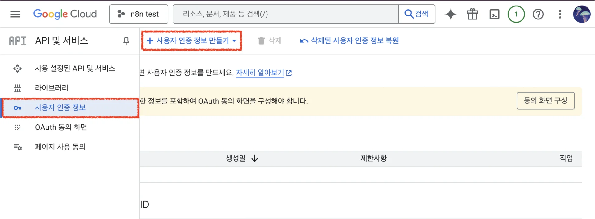

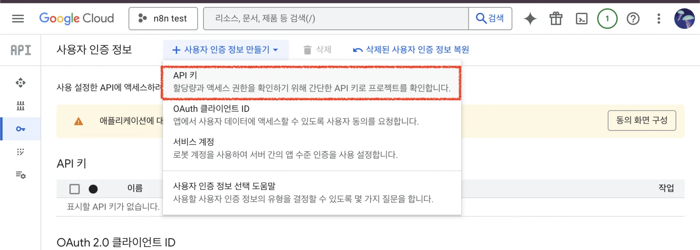

‣

### 1&#46; Google Cloud Console &#45; <code>OAuth Client</code> 생성

> ✏️ 
> 
> 
> 
> Google Drive API는 보통 <code>OAuth2</code>로 인증한다&#46; 
> 
> - ‣
> 
> - 유사 작업&#58; <a href="https://beautiful-college-c84.notion.site/218eda9b0fe18075bcaee4dd6de996c6">페이지</a> 

1&#46; Google Cloud Console 접속 → 프로젝트 생성

- 상단 메뉴 &#45; 프로젝트 선택 &#45; 새 프로젝트 

- 생성할 프로젝트 정보 입력 및 생성
    - 프로젝트 이름 ( 이후 변경 불가 )

    - 조직 ( 있을 시 선택 )

- 위 화면과 같이 정상 생성된 것을 확인할 수 있음

2&#46; Google Drive API <code>enable(사용)</code> 설정

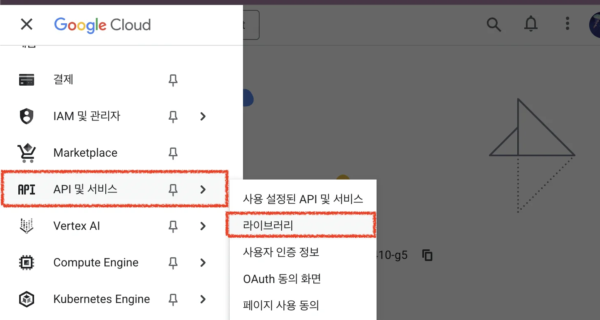

- 왼쪽 메뉴 &#45; API 및 서비스(<strong>API &#38; Services) &#45; 라이브러리(Library)</strong>

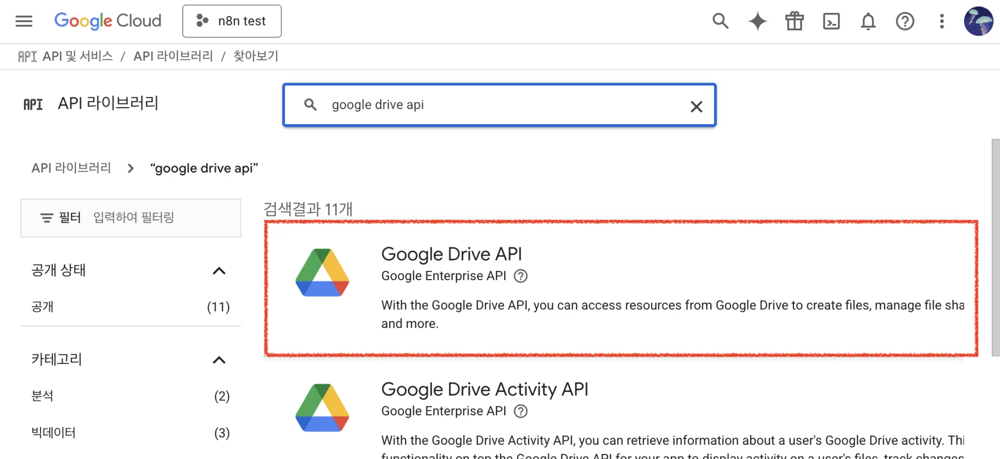

- Google Drive API 검색

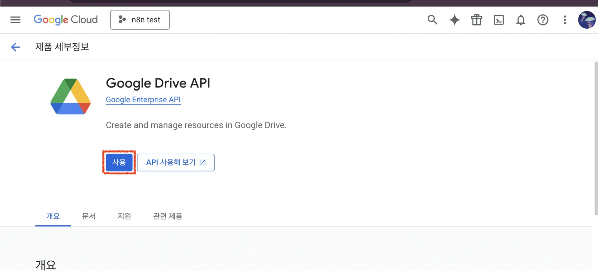

- Enable(사용) 클릭

3&#46; OAuth 클라이언트 ID 생성

- OAuth 클라이언트 ID를 만들려면 먼저 동의 화면을 구성해야 한다&#46;
    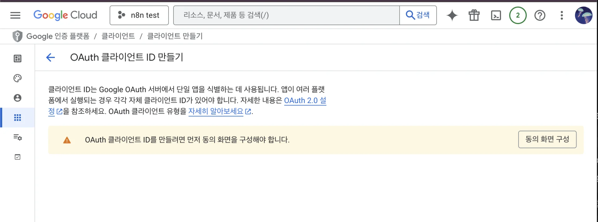

    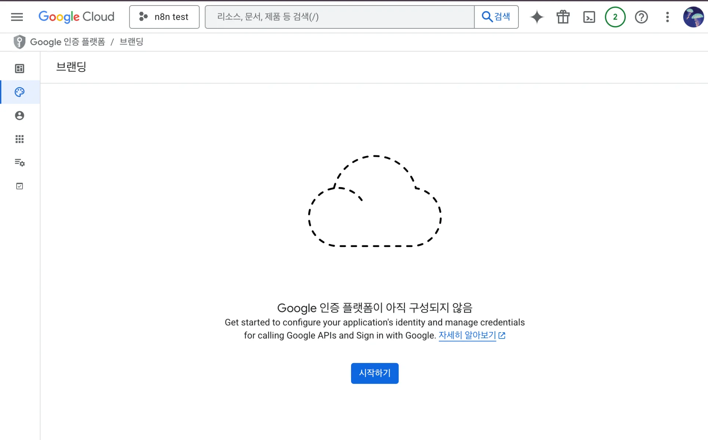

### 2&#46; n8n  Credentials 등록

- 메인 화면 &#45; Credentials &#45; Add first credentails

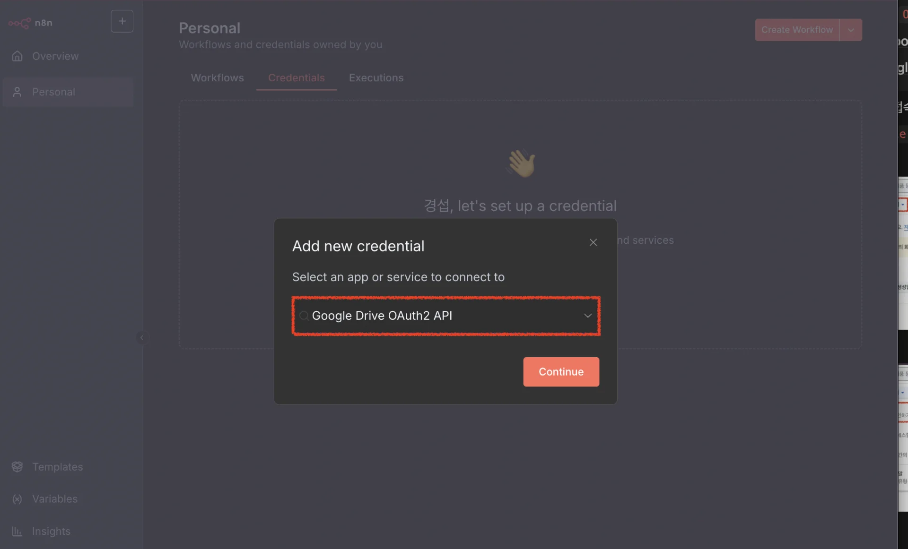

- <code>Google Drive OAuth2 API</code> 검색

## 1&#46; Server Action
