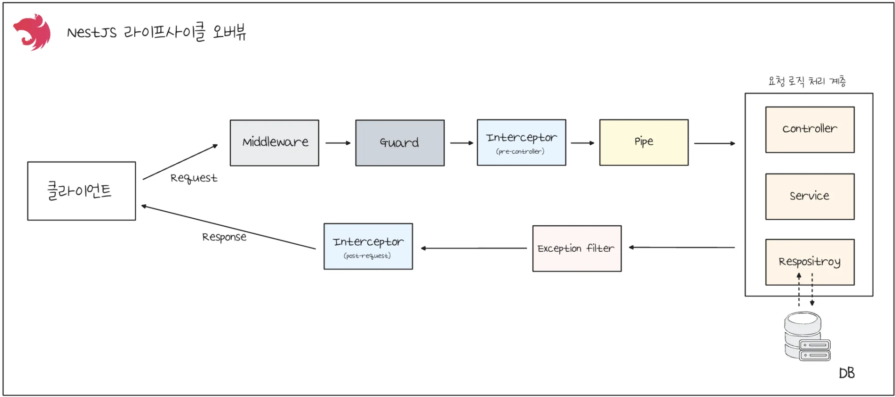

> /icons/tag_red.svg 
> 
> <a id="260eda9b0fe18109a152d69442c4e54a"></a>
> 
> &#91;인프런&#93; <strong> 한 번에 끝내는 NestJS 패키지 &#45; 기초부터 MSA까지</strong>
> 
> - 기간&#58; 25&#46;08&#46;31(일) &#126; 25&#46;0&#46;(일)
> 
> - 강의&#58; ‣
> 
> - reference&#58;
>     - <a href="https://beautiful-college-c84.notion.site/f8fcb79de22747e9a0049e1899533a9e">페이지</a> 
> 
>     - ‣

<details>
<summary>Template</summary>

> 

> ✏️ 

> 📖 

> 
> 
> <a id="260eda9b0fe181a38e65dba118433c9d"></a>
> 
> <strong>목차</strong>
> 
> - [ Part. 1  - basic](#26deda9b0fe180268028f4de54403e13)
> - [추가 정리 -  Error Note](#285eda9b0fe1807481fae7197e0d0018)

<details>
<summary>&#91; 코드 &#93;</summary>

<a id="260eda9b0fe181ed96ebdb7230d14f20"></a>

```typescript

```

</details>

[Template ( )](#/post/26deda9b-0fe1-80bc-811c-c73284765a9c)

[제목 없음](#/post/260eda9b-0fe1-815a-9a48-f001f2d6a464)

[[ 실습 ]](#/post/260eda9b-0fe1-81a0-84b6-cd55a5173048)

[[ 의문점 ]](#/post/260eda9b-0fe1-816a-9a2d-ed7eff87d9dd)

</details>




<a id="26deda9b0fe180268028f4de54403e13"></a>

##  Part&#46; 1  &#45; basic

[Nest CLI](#/post/266eda9b-0fe1-807e-9171-cbbbc7a95935)

[의존성](#/post/266eda9b-0fe1-8075-8566-dd23c3b108ac)

[NestJS 파일 구조](#/post/274eda9b-0fe1-8013-bc60-d1432363d145)

[포스트맨 ( Postman ) - 정리 전](#/post/27beda9b-0fe1-80a6-be55-e4d333e19789)

---

[핵심 개념 ( DI, IoC, LifeCycle )](#/post/266eda9b-0fe1-8024-a98b-f96fc0fe686a)

[디버거 ( Debugger )](#/post/260eda9b-0fe1-808d-80dd-c77a5f42b7b0)

---

[유효성 검사 및 변환 ( Class Validator, Class Transformer )](#/post/27deda9b-0fe1-8071-8d19-d2363d6d91d0)

[환경변수](#/post/27deda9b-0fe1-803b-9420-d56f837bcc6c)

[DB ( SQL, TypeORM, QueryBuilder, Transaction, Migration )](#/post/274eda9b-0fe1-8023-ba05-d84527f93ae0)

[Pipe](#/post/27deda9b-0fe1-80cf-9baf-faaaf6904fb2)

[Mapped Types](#/post/27deda9b-0fe1-80a6-a020-ffa3bb1ef371)

[Serialization](#/post/27deda9b-0fe1-80af-ac7c-d7ea43bc16d7)

---

[인증 / 인가 ( Authentication / Authrization )](#/post/266eda9b-0fe1-80c6-ac72-d9ab723eb5e7)

[미들웨어 ( middleware )](#/post/26deda9b-0fe1-8055-ab0b-e18fc733ed0a)

[가드 ( Guard )](#/post/26deda9b-0fe1-80ce-81f6-cd5edd4115be)

[RBAC ( Role Based Access Control )](#/post/26feda9b-0fe1-807a-9de4-e43c4e2f7faf)

---

[페이지네이션( Pagination )](#/post/26feda9b-0fe1-8079-9060-e36e01d3f411)

[인터셉터 ( Interceptor )](#/post/27deda9b-0fe1-802e-b5e6-c93ba32e38a2)

[예외 필터 ( Exception Filter )](#/post/282eda9b-0fe1-8080-bd91-f59c910bc9fb)

[파일 업로드 ( File Upload ) - 정리 중](#/post/282eda9b-0fe1-80a3-86b4-c929c32fb6f6)

[( )](#/post/282eda9b-0fe1-8096-95cc-c06ead283123)

<a id="285eda9b0fe1807481fae7197e0d0018"></a>

### 추가 정리 &#45;  Error Note

<a id="29deda9b0fe180149ae8d6d212299cf5"></a>

<a href="#/post/282eda9b-0fe1-81d9-906d-e12f0a947a6f">페이지</a> 

[[ 포스트맨 Script ] 토큰 자동 설정 오류](#/post/29deda9b-0fe1-8004-af0d-c2846c8b5bdf)

[커스텀 데코레이터 생성: Reflector.createDecorator()](#/post/26eeda9b-0fe1-8072-83bc-d3258aeaba03)
