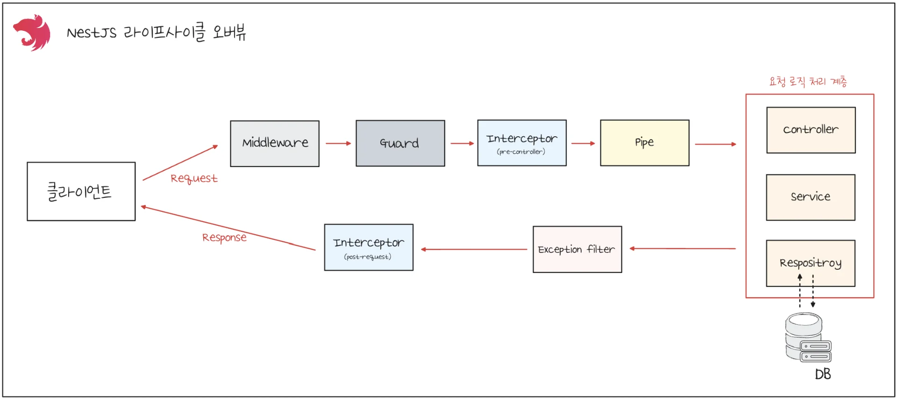

> 
> 
> <a id="260eda9b0fe181d4a789fe1dc6569eab"></a>
> 
> <strong>목차</strong>
> 
> - [NestJS 라이프사이클 오버뷰](#260eda9b0fe181679d3ae0f1fac5fdee)
> - [의문점](#260eda9b0fe1808ead9fceb1d16ae413)
> - [배경](#260eda9b0fe180f1a699ef425d6f748f)
> - [의문 발생 포인트](#260eda9b0fe180839fb2c0c7fe1084e3)
> - [해결 - 왜 ‘책임이 중복되는 것처럼’ 보이는가?](#260eda9b0fe1800a99fbcaab725ffc1e)
> - [Case 1. 로깅: 미들웨어 vs 인터셉터](#260eda9b0fe180258904e4d40140ae27)
> - [Case 2. 쿠키 파싱, 토큰 추출:  미들웨어, 가드](#260eda9b0fe18014aed3de5c0ee2b26e)
> - [실무용 권장 책임 분리 가이드](#260eda9b0fe1807aa1f4e41aa8920e53)

<a id="260eda9b0fe181679d3ae0f1fac5fdee"></a>

## NestJS 라이프사이클 오버뷰

---

> 📖 
> 
> <a id="260eda9b0fe180b18515e7183593bcfa"></a>
> 
> 아래 그림은 NestJS에서의 <strong><u><code>&#91; 요청 → 응답 &#93;</code></u></strong><strong><u> 처리까지의 라이프사이클</u></strong>을 도식화한 그림이다&#46; 클라이언트에서 요청이 들어오면 아래의 순서를 거쳐 응답이 반환된다 &#46;



<details>
<summary>1&#46; 클라이언트 요청 ( Incoming Request )</summary>

<a id="260eda9b0fe1802cb3fec64a85e1f28e"></a>

브라우저, 모바일 앱, IoT 디바이스 등이 HTTP 또는 Websocket 요청을 보내면

<a id="260eda9b0fe1809c84c7d174b596da37"></a>

NestJS 내부적으로 <strong><u>Express(기본)</u></strong><strong> 또는 </strong><strong><u>Fastify(선택) 기반</u></strong><strong>의 </strong><strong><code>HTTP 서버</code></strong><strong> 위에서 동작</strong>한다&#46; 

</details>

<details>
<summary>2&#46; 미들웨어 ( Middleware )</summary>

- Express/Fastify 미들웨어와 유사

- 요청을 컨트롤러에 전달하기 전에 실행됨

- 공통 로깅, 쿠기 파싱, 인증 토큰 추출 등에 활용

</details>

<details>
<summary>3&#46; 가드 ( Guards )</summary>

- 권한/인가(Authorization) 확인 담당

- <code>canActivate()</code> 가 true를 반환해야 요청이 계속 진행된다&#46; 

<details>
<summary>ex) <code>&#64;Roles(’admin’)</code> 권한 체크</summary>

<a id="260eda9b0fe1808f8dedd1cc68615ab3"></a>

```typescript
@Injectable()
export class RolesGuard implements CanActivate {
		canActivate(ctx: ExcutionContext): boolean {
				const req = ctx.switchToHttp().getRequest();
				return req.user?.role === 'admin';
		}
}
```

</details>

</details>

<details>
<summary>4&#46; 인터셉터 ( Interceptors )</summary>

- 요청/응답 가로채기 ( AOP 비슷 )

- 실행 전/후 로직 추가 기능
    - 로깅

    - 캐싱

    - 응답 데이터 변환

    - 예외 매핑

<details>
<summary>ex) 로깅 </summary>

<a id="260eda9b0fe1806196e5e2389ee12cf1"></a>

```typescript
@Injectable()
export class LoggingInterceptor implements NestInterceptor {
		intercept(ctx: ExecutionContext, next: CallHandler): Observable<any> {
				console.log('Before handler');
				const now = Date.now();
				return next.handle().pipe(
						tap(() => console.log(`After... ${Date.now() -now}ms`)),}
				);
		}
}
```

</details>

</details>

<details>
<summary>5&#46; 파이프 ( Pipes )</summary>

- 입력 데이터 변환 및 검증

- DTO 유효성 검사 ( class&#45;validator), 타입 변환 ( ParseIntPipe ) 등에 활용

<details>
<summary>ex) controller 유효성 검사</summary>

<a id="260eda9b0fe180808baddea8a1b3009d"></a>

```typescript
@Get(':id')
getOne(@Param('id', ParseIntPipe) id: number) {
		return this.service.findOne(id);
}
```

</details>

</details>

<details>
<summary>6&#46; 예외 필터 ( Exception filter )</summary>


</details>

> ✏️ 
> 
> <a id="260eda9b0fe18070bf4bdc3914dd42c1"></a>
> 
> middleware, guard, interceptor, pipe, exception filter 등을 만들지 않아도 엔드포인트에 대한 처리가 가능하다&#46;
> 
> - controller 계층에서 요청 받고 응답을 반환한다&#46; 

<a id="260eda9b0fe1808ead9fceb1d16ae413"></a>

### 의문점

<details>
<summary>🧐 <strong>ExecutionContext</strong></summary>

<a id="260eda9b0fe18089abf7d210a128c672"></a>

<a href="#/post/260eda9b-0fe1-8072-87a2-e6d92cf11b60">페이지</a> 

</details>

<details>
<summary><strong>🧐 각 계층에서 중복 책임 할당</strong></summary>

<a id="260eda9b0fe180f1a699ef425d6f748f"></a>

### 배경

<a id="260eda9b0fe18010921dcea333f3c6fd"></a>

NestJS의 유즈케이스를 학습하던 중, 각 계층의 책임이 명확하게 구분되지 않고 중복되게 처리 예시를 보게 되었다&#46; 이에 대해 의문점이 들어 해당 포스팅을 정리한다&#46; 

<a id="260eda9b0fe180839fb2c0c7fe1084e3"></a>

### 의문 발생 포인트

- <code>로깅</code>&#58; 미들웨어, 인터셉터 

- <code>쿠키 처리</code>&#58; 미들웨어, 가드

<a id="260eda9b0fe1800a99fbcaab725ffc1e"></a>

### 해결 &#45; 왜 ‘책임이 중복되는 것처럼’ 보이는가?

> ✏️ 
> 
> <a id="260eda9b0fe18092b759fb5849365f66"></a>
> 
> Nest는 <strong>유연성 제공</strong>을 위해 <strong>겹치는 듯 보이는 훅 포인트</strong>를 열어둔다&#46;
> 
> <a id="260eda9b0fe18088b3cec757fd48c0a5"></a>
> 
> 따라서 실무에서는 <u>각 레이어의 책임을 좁게 잡아 중복을 없</u><strong>애는 설계</strong>가 핵심이다&#46;

- <strong>레이어 다름&#58;</strong>
    - <code>미들웨어</code> = <strong>프레임워크(Express/Fastify) 층</strong>

    - <code>인터셉터/가드</code> = <strong>Nest 컨텍스트 층</strong>

- <strong>관심사(Concern) 다름</strong>&#58;
    - <code>미들웨어</code> = <strong>전처리·원시 접근</strong> (파싱/코릴레이션ID/기본 접근 로그)

    - <code>가드</code> = <strong>정책 결정(통과/차단)</strong>

    - <code>인터셉터</code> = <strong>핸들러 전후 단위의 부가 기능</strong> (성능, 캐싱, 응답 포맷, 예외 매핑)

- <strong>로그의 수준이 다름</strong>&#58; 
    - 네트워크 접근 로그 vs&#46; 애플리케이션 트레이스

<a id="260eda9b0fe180258904e4d40140ae27"></a>

### Case 1&#46; 로깅&#58; <code>미들웨어</code> vs <code>인터셉터</code>

> ✏️ 
> 
> <a id="260eda9b0fe1805694efea3a91286cd7"></a>
> 
> <strong>실무 분리 패턴(권장)</strong>
> 
> - <strong><code>미들웨어</code></strong><strong>&#58;</strong> <strong><u>네트워크 관점</u></strong> 진입 로그(모든 요청)
>     - “들어왔다/나갔다”
> 
> - <strong><code>인터셉터</code></strong>&#58; <strong><u>애플리케이션 관점</u></strong> 트레이스 
>     - “어떤 핸들러가 얼마나 걸렸고 무엇을 반환/실패했나”

<details>
<summary>미들웨어 로깅 ( Access Log )</summary>

- <strong>위치</strong>
    - 라우팅 전(Controllers/Guards/Interceptors <strong>이전</strong>)

- <strong>대상</strong>
    - <strong>모든 요청</strong> (정적 파일/헬스체크/미등록 라우트 포함)

- <strong>역할</strong>
    - Nginx/Express의 <strong>Access Log</strong>처럼 <strong>들어온 요청 자체</strong> 기록

- <strong>장점</strong>
    - 가볍고 빠름, 프레임워크 비의존(원시 req/res)

- <strong>한계</strong>
    - <strong>핸들러/메타데이터</strong>(컨트롤러/메서드명), <strong>응답 본문/처리시간</strong> 등은 직접 측정하기 까다로움

<details>
<summary>ex) </summary>

<a id="260eda9b0fe180ea8eaacbf0d78bd9f9"></a>

```typescript
// middleware/logger.middleware.ts
import { Injectable, NestMiddleware } from '@nestjs/common';
import { Request, Response, NextFunction } from 'express';

@Injectable()
export class AccessLogMiddleware implements NestMiddleware {
  use(req: Request, res: Response, next: NextFunction) {
    const started = Date.now();
    res.on('finish', () => {
      const elapsed = Date.now() - started;
      // 원시 레벨: 메서드/URL/상태코드/바이트 수 등을 남김
      console.log(`[ACCESS] ${req.method} ${req.originalUrl} ${res.statusCode} ${elapsed}ms`);
    });
    next();
  }
}
```

</details>

</details>

<details>
<summary><strong>인터셉터 로깅(App&#45;Level Trace)</strong></summary>

- <strong>위치</strong>&#58; 
    - 컨트롤러 메서드 <strong>전후를 감쌈</strong>

- <strong>대상</strong>&#58; 
    - <strong>핸들러 단위</strong> (가드 통과 후)

- <strong>역할</strong>&#58;
    -  ExecutionContext로 <strong>컨트롤러/핸들러 이름</strong> 접근, RxJS로 <strong>처리시간/응답 가공</strong> 가능, <strong>예외 흐름</strong>도 잡아 측정

- <strong>장점</strong>&#58; 
    - <strong>비즈니스 엔드포인트와 1&#58;1 매핑</strong>된 성능/사용자/라벨 수집에 최적

- <strong>한계</strong>&#58; 
    - <strong>가드에서 막힌 요청</strong>이나 <strong>미등록 라우트</strong>는 인터셉터까지 못 옴

<details>
<summary>ex) </summary>

<a id="260eda9b0fe180a38776f758e0529bae"></a>

```typescript
// interceptors/trace.interceptor.ts
import { CallHandler, ExecutionContext, Injectable, NestInterceptor } from '@nestjs/common';
import { Observable, tap } from 'rxjs';

@Injectable()
export class TraceInterceptor implements NestInterceptor {
  intercept(ctx: ExecutionContext, next: CallHandler): Observable<any> {
    const req = ctx.switchToHttp().getRequest<Request>();
    const handler = ctx.getHandler().name;
    const controller = ctx.getClass().name;
    const started = Date.now();

    return next.handle().pipe(
      tap({
        next: (data) => {
          const ms = Date.now() - started;
          // 핸들러/컨트롤러/유저ID 등 라벨링에 유리
          console.log(`[TRACE] ${controller}.${handler} ${req.method} ${req.url} ${ms}ms`);
        },
        error: (err) => {
          const ms = Date.now() - started;
          console.error(`[TRACE][ERR] ${controller}.${handler} ${req.method} ${req.url} ${ms}ms ${err?.message}`);
        }
      }),
    );
  }
}
```

</details>

</details>

<a id="260eda9b0fe18014aed3de5c0ee2b26e"></a>

### Case 2&#46; 쿠키 파싱, 토큰 추출&#58;  <code>미들웨어</code>, <code>가드</code>

> ✏️ 
> 
> <a id="260eda9b0fe180b892c8d14b0896c102"></a>
> 
> <code>미들웨어</code>는 <strong><u>데이터를 읽기 좋</u></strong>게 만들고, <strong><u>보안 판단</u></strong>은 <code>가드</code>에서 한다&#46; 
> 
> - 미들웨어에서 JWT 검증, 판단까지 해버리면, <strong><u>보안 정책</u></strong><strong>이 </strong><strong><u>라우터 레벨의 흐름</u></strong><strong>(가드/메타데이터/데코레이터)과 </strong><strong><u>분리</u></strong>되어 <strong><u>유지보수가 어려워</u></strong>진다&#46; 

<details>
<summary>ex) </summary>

<a id="260eda9b0fe180458affc6f15d7ba3dd"></a>

```typescript
// main.ts - 쿠키 파서 미들웨어 등록 (전처리)
import * as cookieParser from 'cookie-parser';
app.use(cookieParser());
```

<a id="260eda9b0fe18029bfd6e44cf13aa146"></a>

```typescript
// auth/jwt-auth.guard.ts - 인증/인가를 가드에서
import { CanActivate, ExecutionContext, Injectable, UnauthorizedException } from '@nestjs/common';
import { JwtService } from '@nestjs/jwt';

@Injectable()
export class JwtAuthGuard implements CanActivate {
  constructor(private readonly jwt: JwtService) {}

  canActivate(ctx: ExecutionContext): boolean {
    const req = ctx.switchToHttp().getRequest<any>();
    const token = req.cookies?.access_token || this.extractBearer(req.headers.authorization);
    if (!token) throw new UnauthorizedException('Missing token');

    const payload = this.jwt.verify(token);          // ✅ 검증은 가드에서
    req.user = { sub: payload.sub, role: payload.role };
    return true;
  }

  private extractBearer(auth?: string) {
    if (!auth?.startsWith('Bearer ')) return null;
    return auth.slice(7);
  }
}
```

</details>

<a id="260eda9b0fe1807aa1f4e41aa8920e53"></a>

### 실무용 권장 책임 분리 가이드

<details>
<summary>미들웨어 </summary>

- cookie&#45;parser, body&#45;parser, compression 등 <strong>전처리</strong>

- <strong>RequestId</strong> 삽입(코릴레이션ID), <strong>기본 접근 로그</strong>(모든 리퀘스트)

- 초경량 allowlist(예&#58; 헬스체크/내부 프록시) 정도는 OK

- ❌ JWT 검증/권한 판정은 지양

</details>

<details>
<summary><strong>가드</strong></summary>

- <strong>AuthGuard</strong>&#58; 토큰 추출 &#38; 검증 → req&#46;user 세팅(인증)

- <strong>Role/Policy Guard</strong>&#58; req&#46;user 기반 <strong>인가</strong>

- ❌ 응답 변환/타이밍 측정 같은 AOP는 인터셉터로

</details>

<details>
<summary><strong>인터셉터</strong></summary>

- <strong>핸들러 단위 성능 로깅</strong>, 

- <strong>응답 포맷 통일</strong>,

-  <strong>캐싱(CacheInterceptor)</strong>, 

- <strong>예외 매핑</strong>

- 컨트롤러/메서드 메타데이터(ExecutionContext&#46;getClass/getHandler)로 <strong>라벨링</strong>

</details>

<details>
<summary><strong>파이프</strong></summary>

- <strong>DTO 검증/변환</strong>만 (비즈니스X)

- 전역 파이브 설정 이후, DTO 내부에서 각 필드 검증

</details>

<details>
<summary><strong>예외 필터</strong></summary>

- 에러 로깅/응답 매핑 중앙집중

</details>

</details>
