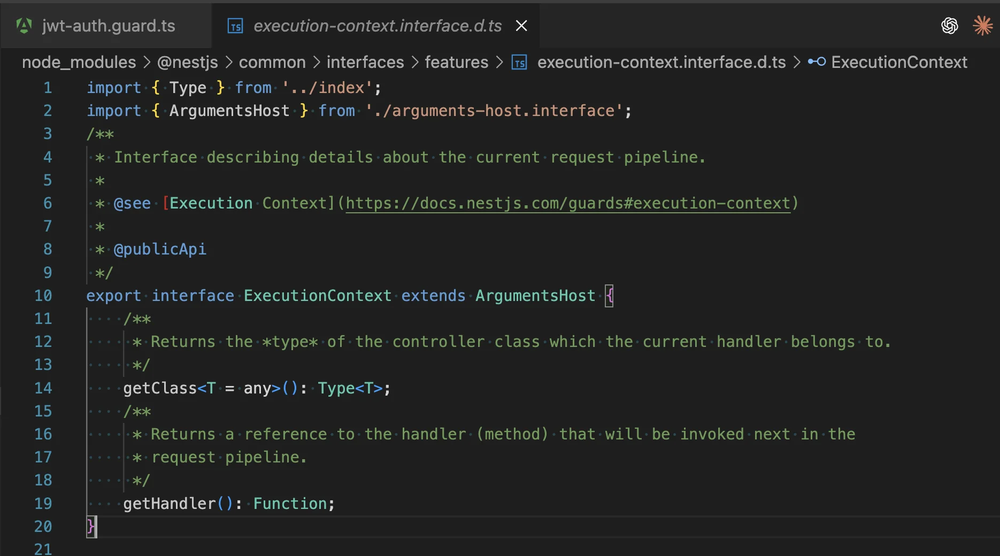
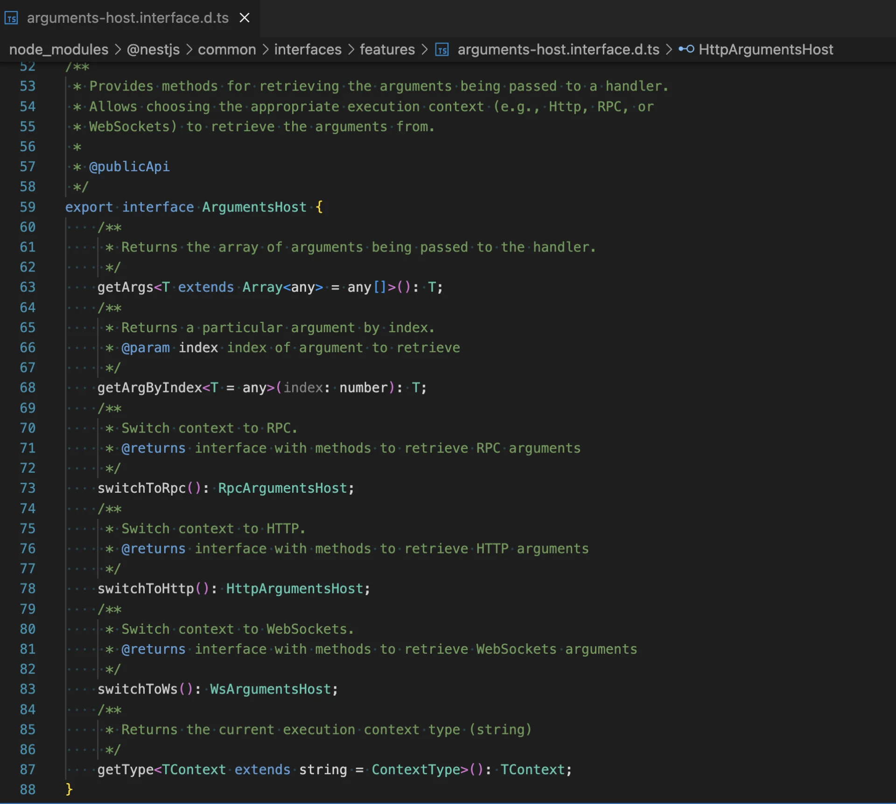
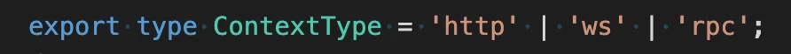
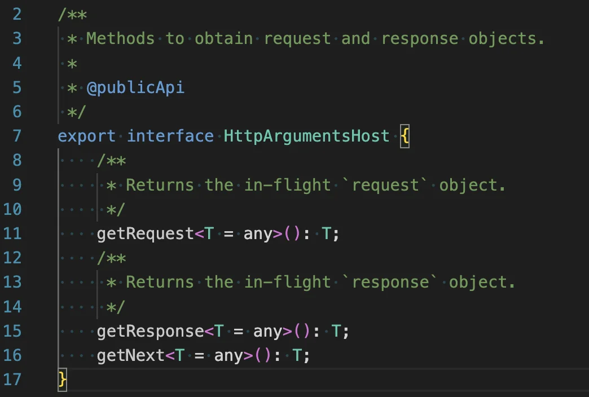
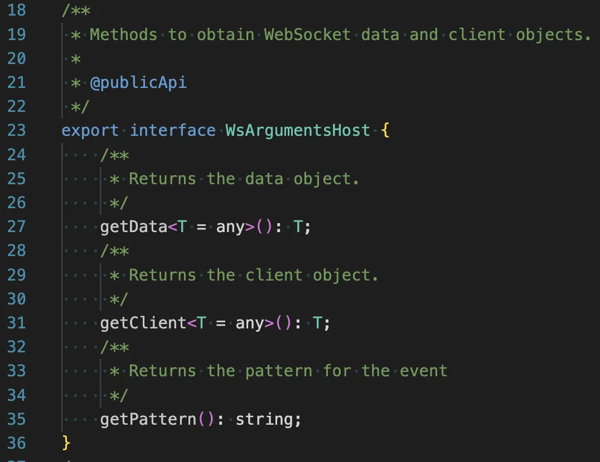
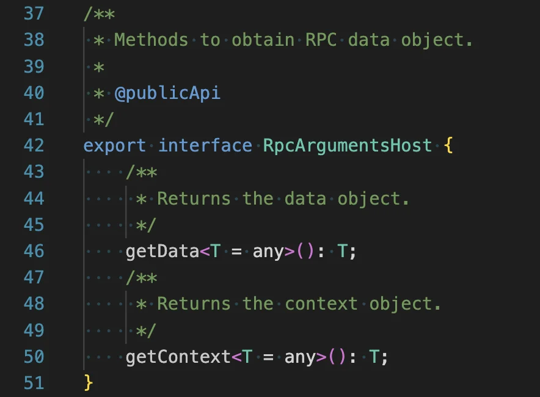

> 
> 
> <a id="260eda9b0fe18014984dcf07fc51367f"></a>
> 
> <strong>목차</strong>
> 
> - [ExecutionContext](#260eda9b0fe18069a7d1eb5e56cbef24)
> - [ArgumentsHost](#260eda9b0fe18094a998f27d0f14c899)
> - [Reference](#260eda9b0fe180a59dc3dae614a2b7c4)

<a id="260eda9b0fe18069a7d1eb5e56cbef24"></a>

## ExecutionContext

---

> 📖 
> 
> <a id="260eda9b0fe180fba048db4855377edf"></a>
> 
>  <code>ExecutionContext</code>는 NestJS의 핵심 추상화 객체로, <strong><u>현재 실행 중인 컨텍스트(요청/핸들러)에 대한 정보를 읽고 제어</u></strong>할 수 있는 객체이다&#46;
> 
> - <code>ExecutionContext</code>는 <code>ArgumentsHost</code>를 확장한 인터페이스로서, 런타임에 현재 동작 중인 요청이나 이벤트의 정보를 제공한다&#46;
> 
> - <strong><code>가드(Guard)</code></strong>, <strong><code>인터셉터(Interceptor)</code></strong>, <strong><code>파이프(Pipe)</code></strong>, <strong><code>예외 필터(Exception Filter)</code></strong> 등에서 <strong><u>어떤 요청이 들</u></strong><strong>어왔고, </strong><strong><u>어디서 실행</u></strong><strong> 중인지 파악할 수 있는 </strong><strong><u>API를 제공</u></strong>한다&#46;

<details>
<summary>주요 사용처 및 역할</summary>

> ✏️ 
> 
> <a id="260eda9b0fe1804bb2fffed512616d3d"></a>
> 
> 가장 대표적인 사용처는 <code>가드(Guard)</code>, <code>인터셉터(Interceptor)</code>, <code>파이프(Pipe)</code>, <code>예외 필터(Exception Filter)</code>이다&#46;

- 가드&#58; 
    - 사용자 권한 체크, 인증 정보 확인 등 요청의 컨텍스트에 따라 접근 제어 가능

- 인터셉터&#58; 
    - 응답 값 변환, 로깅, 캐싱 등 요청이 처리되는 전후의 컨텍스트를 기반으로 부가 작업 수행&#46;

- 파이프&#58; 
    - 입력값 변환, 유효성 검사 등 요청 데이터의 상태에 따라 동작&#46;

- 예외 필터&#58; 
    - 에러 발생 시 컨텍스트를 기반으로 적절한 예외 처리 및 응답값 조정

</details>

<details>
<summary><strong>제공 API 및 주요 기능</strong></summary>

> ✏️ 
> 
> <a id="260eda9b0fe18039854cc181873e1451"></a>
> 
> ExecutionContext에서는 다음과 같은 메서드를 제공한다

- <code>getType()</code>
    - 현재 실행 중인 요청의 타입(HTTP, RPC, WebSocket 등)을 반환

- <code>getClass()</code> 
    - 현재 요청을 처리하는 클래스(대부분 컨트롤러)를 반환

- <code>getHandler()</code>
    - 실제 요청을 처리하는 핸들러(메서드)를 반환

- <code>switchToHttp()</code>, <code>switchToRpc()</code>, <code>switchToWs()</code>
    - 해당 플랫폼별 ArgumentsHost로 변환하여, 각 환경에 맞게 요청, 응답 객체를 추출

</details>

<details>
<summary>&#91; 코드 &#93; <strong>ExecutionContext</strong></summary>

<a id="260eda9b0fe180c0982ff46fe63129c9"></a>

<strong>코드 </strong>

<a id="260eda9b0fe180539c04f0d3ce9d4182"></a>

```typescript
// excution-context.interface.d.ts
export interface ExecutionContext extends ArgumentsHost {
    getClass<T = any>(): Type<T>;
    getHandler(): Function;
}
```

<a id="260eda9b0fe180898c48fddbb0c3ae55"></a>

<strong>이미지</strong> 



</details>

<details>
<summary>ex)  가드 &#45; 인증/인가</summary>

<a id="260eda9b0fe180e29619d9d7baedd982"></a>

```typescript
// auth/jwt-auth.guard.ts
import { CanActivate, ExecutionContext, Injectable, UnauthorizedException } from '@nestjs/common';
import { JwtService } from '@nestjs/jwt';

@Injectable()
export class JwtAuthGuard implements CanActivate {
  constructor(private readonly jwt: JwtService) {}

  canActivate(ctx: ExecutionContext): boolean {
    const req = ctx.switchToHttp().getRequest<any>();
    const token = req.cookies?.access_token || this.extractBearer(req.headers.authorization);
    if (!token) throw new UnauthorizedException('Missing token');

    const payload = this.jwt.verify(token);          // ✅ 검증은 가드에서
    req.user = { sub: payload.sub, role: payload.role };
    return true;
  }

  private extractBearer(auth?: string) {
    if (!auth?.startsWith('Bearer ')) return null;
    return auth.slice(7);
  }
}
```

</details>

<a id="260eda9b0fe18094a998f27d0f14c899"></a>

## <strong>ArgumentsHost</strong>

> 📖 
> 
> <a id="260eda9b0fe180698825f520a450aa59"></a>
> 
> ArgumentsHost는 NestJS에서 <strong>다양한 실행 컨텍스트(HTTP, RPC, WebSocket 등)에서 핸들러(Controller 메서드)에 전달된 인자(arguments)를 추상화</strong>하여 제공하는 객체(인터페이스)이다&#46; 
> 
> <a id="260eda9b0fe180d885abd31c9da816eb"></a>
> 
> 해당 interface를 ExecuteContext가 상속하여 가드, 인터셉터, 예외 필터 등에서 <strong><u>요청 및 응답 객체, 기타 실행 환경에 맞는 인자들에 접근</u></strong>하여 실<strong>행 중인 컨텍스트에 따라 적합한 방식으로 데이터를 추출</strong>할 수 있도록 한다&#46; 

<details>
<summary>&#91; 코드 &#93; <strong>ArgumentsHost</strong></summary>

<a id="260eda9b0fe180c8b46ee5b5df72bb73"></a>

<strong>코드 </strong>

<a id="260eda9b0fe18071b0e5d4dbfe4b308c"></a>

```typescript
// arguments-host.interface.d.ts
export interface ArgumentsHost {
    getArgs<T extends Array<any> = any[]>(): T;
    getArgByIndex<T = any>(index: number): T;
    switchToRpc(): RpcArgumentsHost;
    switchToHttp(): HttpArgumentsHost;
    switchToWs(): WsArgumentsHost;
    getType<TContext extends string = ContextType>(): TContext;
}
```

<a id="260eda9b0fe180b7ac7cf09cd5e01eb0"></a>

<strong>이미지</strong> 











</details>

<details>
<summary>주요 역할 및 구조 </summary>

<details>
<summary>핸들러 인자 추상화</summary>

- ArgumentsHost는 컨트롤러/핸들러에 전달되는 인자를 ‘컨텍스트’ 별로 캡슐화한다&#46; 

- ex) 
    - <code>HTTP</code>&#58; request, response, next

    - <code>GraphQL</code>&#58; root, args, context, info 

</details>

<details>
<summary>컨텍스트 선택 메서드 </summary>

- 메서드를 통해 해당 컨텍스트 인자 추출

- <code>switchToHttp()</code>, <code>switchToRpc()</code>, <code>switchToWs()</code> 

</details>

<details>
<summary>유틸리티 메서드</summary>

- 각 컨텍스트에서 요청/응답 객체, 소캣 클라이언트 등 필요한 인자를 쉽게 가져오는 메서드 제공

</details>

</details>

<a id="260eda9b0fe180a59dc3dae614a2b7c4"></a>

## Reference

[Documentation &#124; NestJS &#45; A progressive Node&#46;js framework]()

[&#91;NestJS &#124; Docs&#93; Execution context 알아보기 (feat&#46; ArgumentHost)]()

[18&#46; Execution context]()

[Interceptors]()
