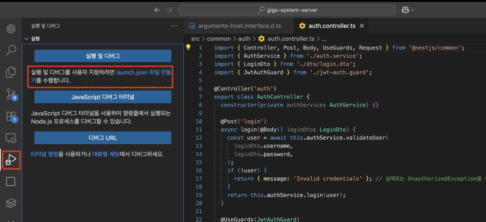
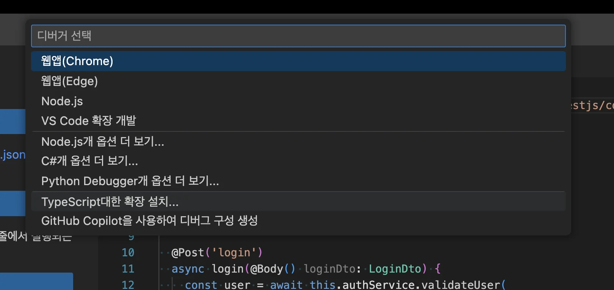
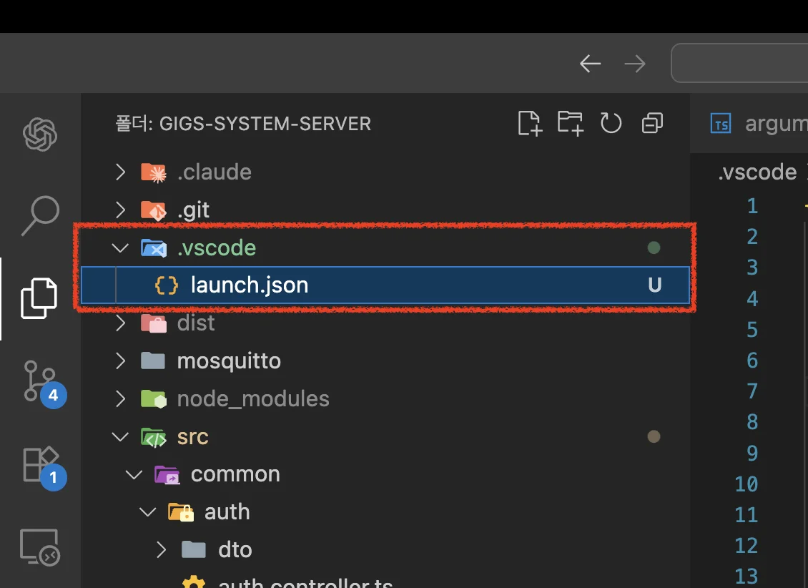
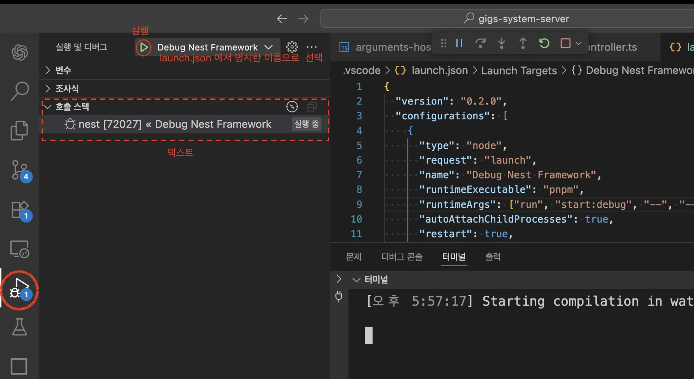
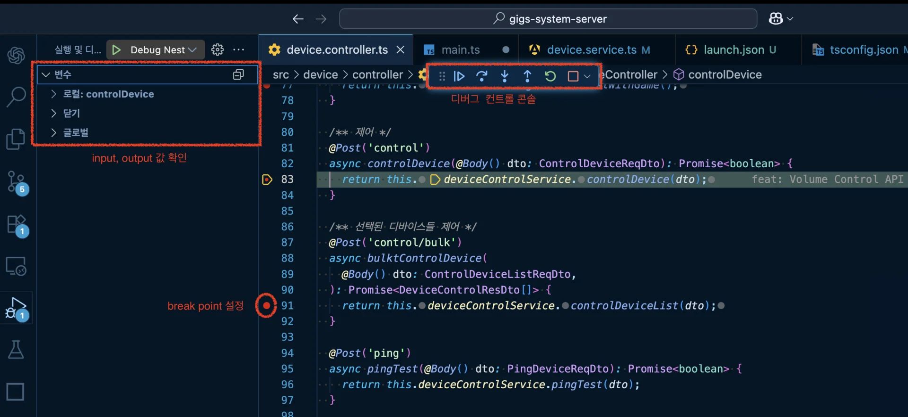
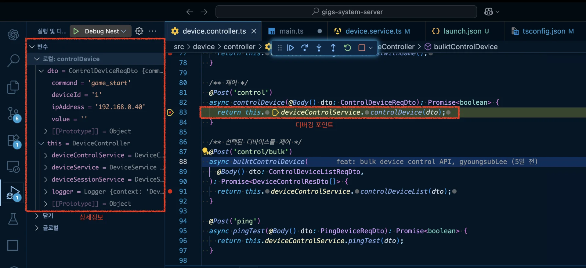
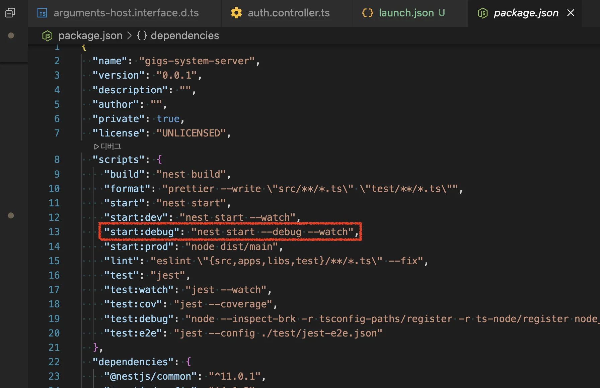
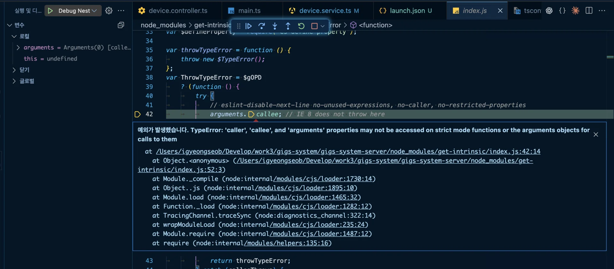

> 
> 
> <a id="260eda9b0fe1814a8ed3d87991cf47af"></a>
> 
> <strong>목차</strong>
> 
> - [디버거 ( Debugger )](#260eda9b0fe181079fbade8a6f16ba60)
> - [VS Code (or Cursor ) 디버거 설정](#260eda9b0fe1800a8246e394b90a5b7b)
> - [[ 실습 ] 디버깅](#260eda9b0fe180b685c0c7e470e13329)
> - [원인](#260eda9b0fe1808f953bc63f455f7009)
> - [해결](#260eda9b0fe180c38418ddbf78fc0638)

<a id="260eda9b0fe1813c800dfee95b8ebab3"></a>

<a href="https://beautiful-college-c84.notion.site/5f9bfe0e65c64574aaba2ff4ebdf6a22">페이지</a> 

<a id="260eda9b0fe181079fbade8a6f16ba60"></a>

## 디버거 ( Debugger )

> 📖 
> 
> <a id="260eda9b0fe180d1b595d94210229253"></a>
> 
> <code>디버그(Debug)</code> 혹은 <code>디버깅(Debugging)</code>은 프로그램 또는 시스템에 존재하는 <strong><u>오류(버그)를 찾아내고 수정하는 과정</u></strong>을 의미한다&#46; 
> 
> <a id="260eda9b0fe18102b68adc13db02ec6a"></a>
> 
> 분석하고하는 요청 흐름에 <code>break point</code>를 걸어 각 요청 흐름을 단계적으로 분석하고, 함수의 입출력 값들을 손쉽게 확인할 수 있다&#46; <br>이를 통해 오류 발생 지점을 찾고 개선할 수 있다&#46; 

<a id="260eda9b0fe1800a8246e394b90a5b7b"></a>

### <strong>VS Code (or Cursor ) 디버거 설정</strong>



- <code>launch&#46;json 파일 만들기</code>  클릭



- 옵션 선택  
    - 직접 세팅할 것이기 때문에 아무거나 선택해도 상관없음



- 프로젝트에 <code>&#46;vscode/launch&#46;json</code> 파일 생성됨
    - 해당 파일에 Debug 설정을 세팅한다 &#46;

<a id="260eda9b0fe18057b186ff438ac96f1f"></a>

```json
{
  "version": "0.2.0",
  "configurations": [
    {
      "type": "node",
      "request": "launch",
      "name": "Debug Nest Framework",
      "runtimeExecutable": "pnpm",  // 패키지 매니저
      "runtimeArgs": ["run", "start:debug", "--", "--inspect-brk"],
      "autoAttachChildProcesses": true,
      "restart": true,
      "sourceMaps": true,
      "stopOnEntry": false,
      "console": "integratedTerminal"
    }
  ]
}
```

- 세팅 설정

<a id="260eda9b0fe180b685c0c7e470e13329"></a>

### <strong>&#91; 실습 &#93; 디버깅</strong>



- <code>디버그 모드</code>로 프로젝트 실행





- break point 설정을 통해 특정 요청 흐름에 멈춤 설정을 하여 특정 함수의 I/O 값을 확인하며 다음 작업을 단계적으로 확인할 수 있다&#46; 


- 디버깅 콘솔

> 🗣 
> 
> 
> 
> <a id="260eda9b0fe18031bb6cd071b56b8e57"></a>
> 
> <strong><u>nest cli</u></strong>에서도 <strong><u>debug 기능을 제공</u></strong>한다&#46;
> 
> - <code>pnpm run start&#58;debug</code>

<details>
<summary><strong>&#91; 🤬  오류 &#93;</strong><strong> Strict mode에서 arguments&#46;callee 접근으로 발생하는 의도적 TypeError (get&#45;intrinsic 초기화 과정)</strong></summary>

<a id="260eda9b0fe1808f953bc63f455f7009"></a>

### 원인



<a id="260eda9b0fe1800aaf4fc9a3ae94a15e"></a>

<strong>디버거가 “잡힌 예외(caught exceptions)”에도 멈추도록 설정됨</strong>

- <code>get&#45;intrinsic</code> 라이브러리가 초기화 과정에서 <strong>일부러</strong> <code>arguments&#46;callee</code>에 접근해 <strong>TypeError를 유도</strong>하고, 그걸 <strong>try/catch로 바로 잡아</strong> 내부 동작을 확인한다&#46;

- 코드상 문제는 없는데, 디버거가 “잡힌 예외에도 멈춤”이 켜져 있어 그 <strong>의도적 예외 지점에서 멈춰 보이는 것이다&#46;</strong>

<a id="260eda9b0fe180c38418ddbf78fc0638"></a>

### 해결

<a id="260eda9b0fe180ca88abeb16db351c0c"></a>

```json
// .vscode/launch.json
"skipFiles": ["<node_internals>/**", "${workspaceFolder}/node_modules/**"]
```

-  skipFiles로 <code>node&#95;modules/&#42;&#42;</code> 전체를 스킵한다&#46;<br>라이브러리 내부(특히 get&#45;intrinsic)에서 더 이상 멈추지 않는다&#46;

- get&#45;intrinsic 같이 node&#95;modules 안에 있는 모든 라이브러리 코드가 디버깅 스텝 대상에서 제외 처리

</details>
