[video](https://www.youtube.com/watch?v=Cvy9KzJT4ro&t=104s)

<a id="261eda9b0fe180eead13cf4c98d7d6ce"></a>

## 서브 에이전트

> ✏️ 
> 
> <a id="261eda9b0fe1803c9c77fd597524d99d"></a>
> 
> 서브 에이전트는 <code>Claude Code</code>에서 지원하는 기능 중 하나로,  사용자가 특정 작업을 수행할 때 맞춤 설정 에이전트를 생성하여 최적화된 에이전트로 작업을 진행할 수 있다&#46;

<details>
<summary> 커스텀 서브 에이전트 생성</summary>

> ☝🏻 
> 
> <a id="261eda9b0fe180139818f66d1a933d37"></a>
> 
> 해당 설정들은 이후 생성되는 <code>&#46;md</code> 파일에서도 변경 가능하다&#46;

<details>
<summary>1&#46; <code>/agents</code> 명령을 실행하고 <code>“Create new agent&#34;</code> 선택</summary>

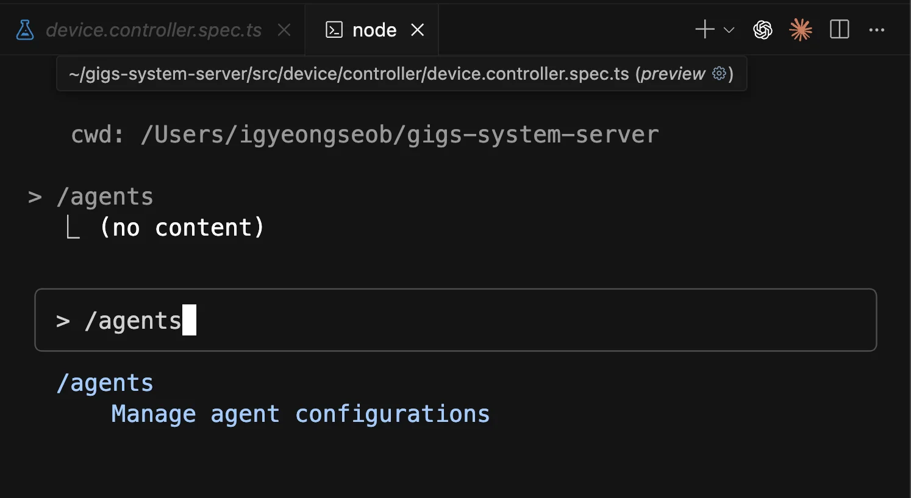

- 클로드 코드 실행 후, <code>/agents</code> 입력

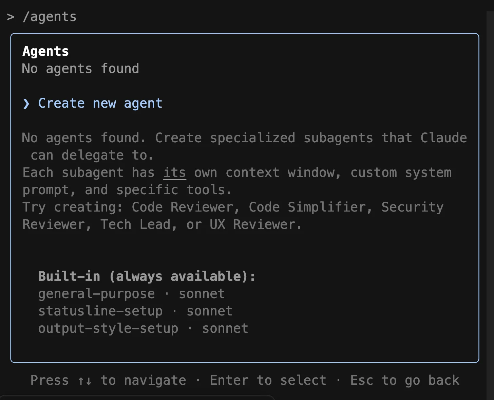

- 위 화면과 같이 <code>Create new agnet</code> 선택

</details>

<details>
<summary>2&#46; 에이전트 스코프(범위) 설정</summary>

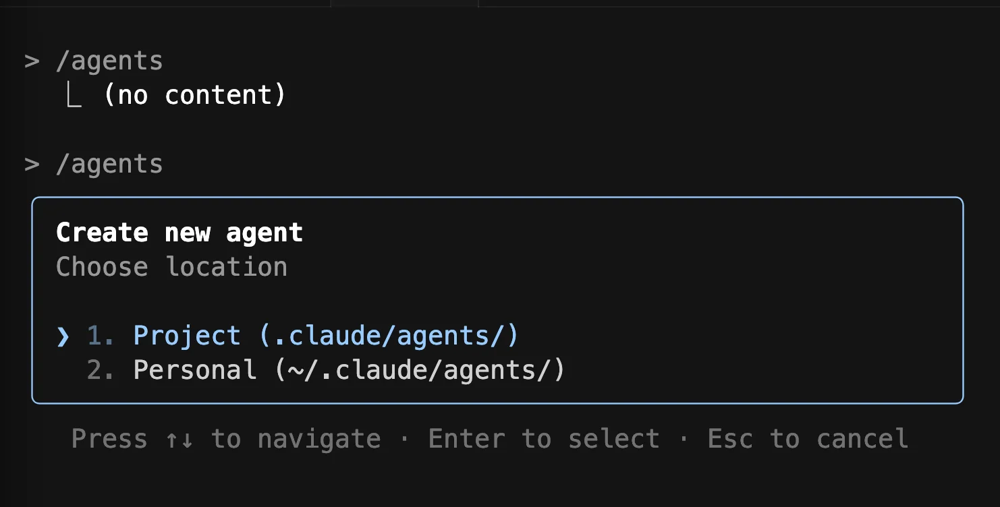

- <code>Project</code>&#58; 현재 프로젝트

- <code>Personal</code>&#58; 모든 프로젝트 

</details>

<details>
<summary>3&#46; Claude를 통한 스크립트 생성</summary>

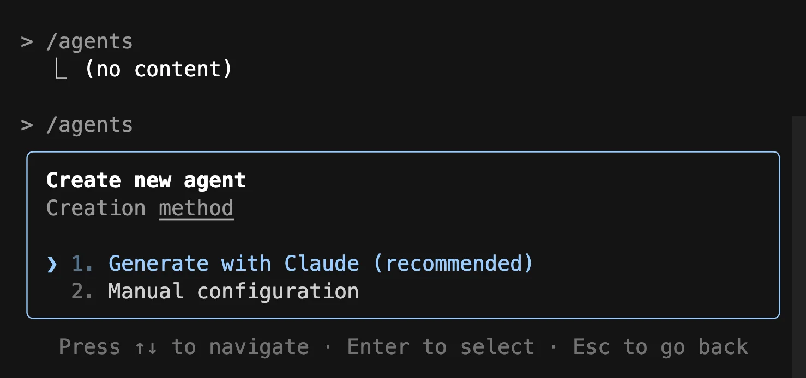

- <code>1&#46; Generate with Claude ( 권장 ) </code>
    - 클로드(엔트로픽)에서도 권장

    - 클로드가 초기 서브 에이전트 스크립트를 생성<br>이 과정에서 마크다운(&#46;md) 파일이 생성됨

- <code>2&#46; Manual configuration</code> 
    - 직업 설정 정의 

</details>

<details>
<summary>4&#46; 에이전트 기능 설명</summary>

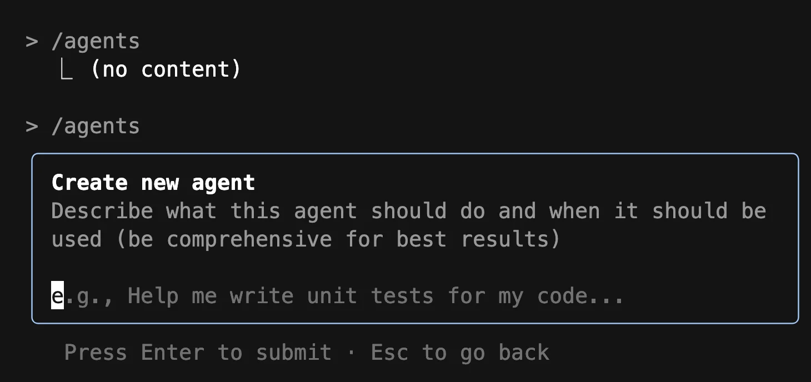

- 에이전트가 무엇을 하기를 원하는지 상세하게 설명하는 내용 입력
    - ex) 해당 영상에서는 유닛 테스트를 전문적으로 수행하고, 실패한 테스트를 수정하며, 코드 커버리지를 80% 이상으로 높이는 에이전트를 만드는 과정을 보여준다&#46; <a href="http://www.youtube.com/watch?v=Cvy9KzJT4ro&#38;t=126">&#91;02&#46;06&#93;</a>

</details>

<details>
<summary>5&#46; 권한 설정</summary>

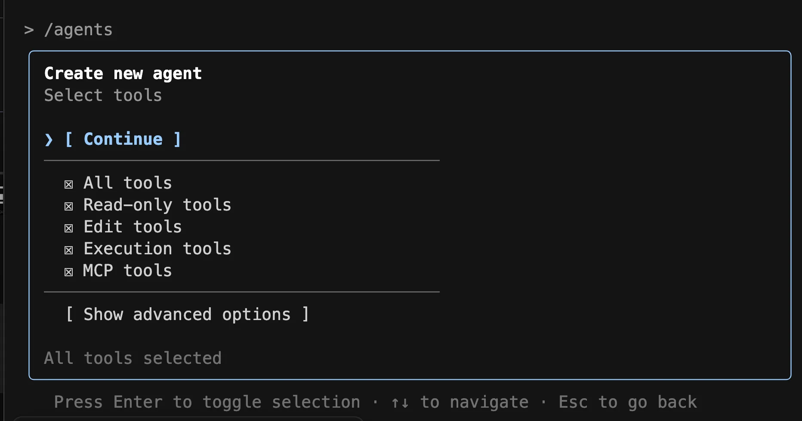

- 서브 에이전트의 권한 설정&#46; 

<details>
<summary>모든 도구를 사용하도록 허용하거나, 읽기/쓰기 접근 권한을 지정할 수있다&#46;</summary>

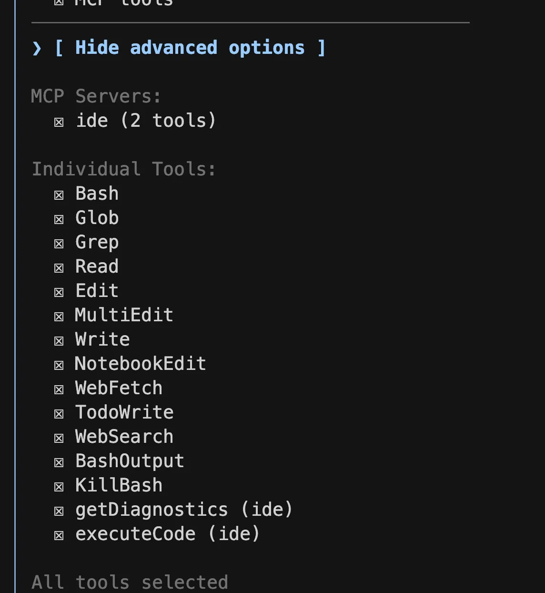

</details>

</details>

<details>
<summary>6&#46; 모델 설정</summary>

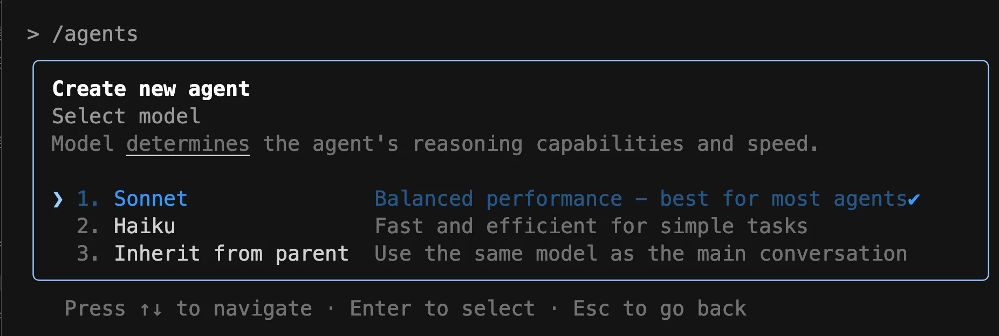

- <code>Sonnet</code>
    - 대부분의 에이전트 권장 옵션<br>속도와 추론 능력의 균형 잡힌 성능 제공한다&#46;

- <code>Haiku</code>
    - 간단하고 빠른 작업을 위해 설계된 더 빠르고 효율적인 모델

    -  복잡한 추론이 필요하지 않은 에이전트에 적합하다&#46;

- <code>Inherit from parent</code>
    <a id="261eda9b0fe180e29fc2d2d4794b898e"></a>

    새 에이전트가 현재 기본 대화와 동일한 모델을 사용한다&#46;<br>이를 통해 기본 채팅의 동작 및 성과와의 일관성을 유지할 수 있다&#46;<br>

</details>

<details>
<summary>7&#46; 색상 선택</summary>

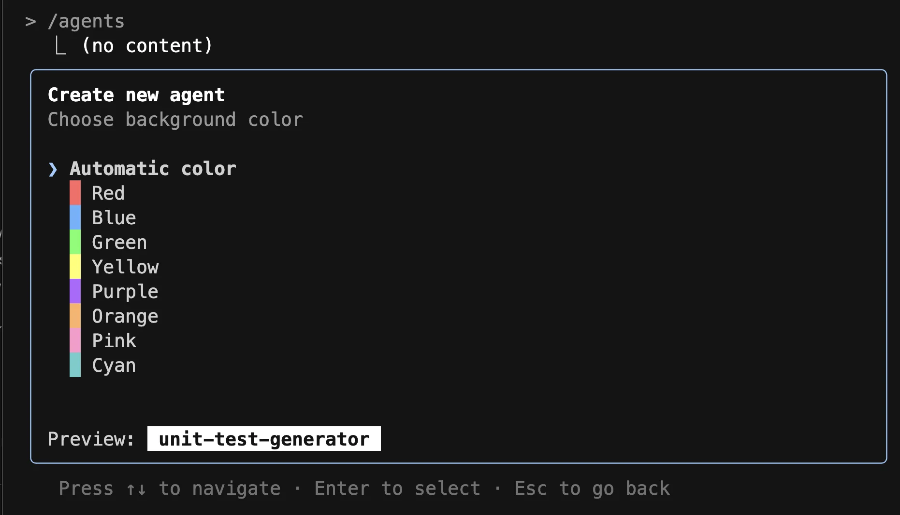

- 실행 중일 때 쉽게 식별할 수 있도록 서브 에이전트의 색상을 선택할 수 있다&#46;

</details>

<details>
<summary>8&#46; 설정 확인</summary>

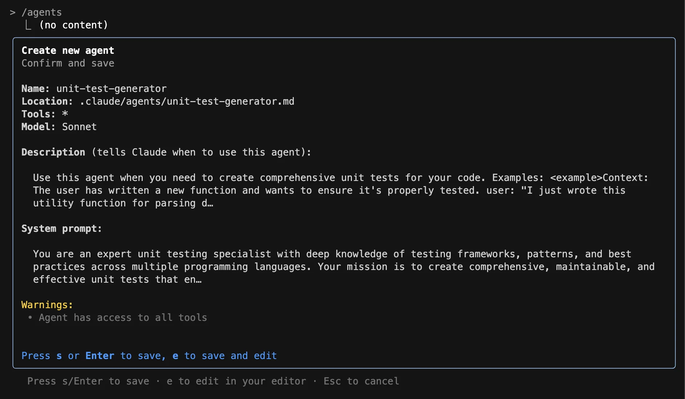

- 생성을 확정하기 전, 방금 전까지 설정한 커스텀 서브 에이전트의 정보를 요약해서 보여준다&#46;

</details>

<details>
<summary>9&#46; 생성 확인 &#45; <code>&#46;claude/{&#46;&#46;&#46;}&#46;md</code></summary>

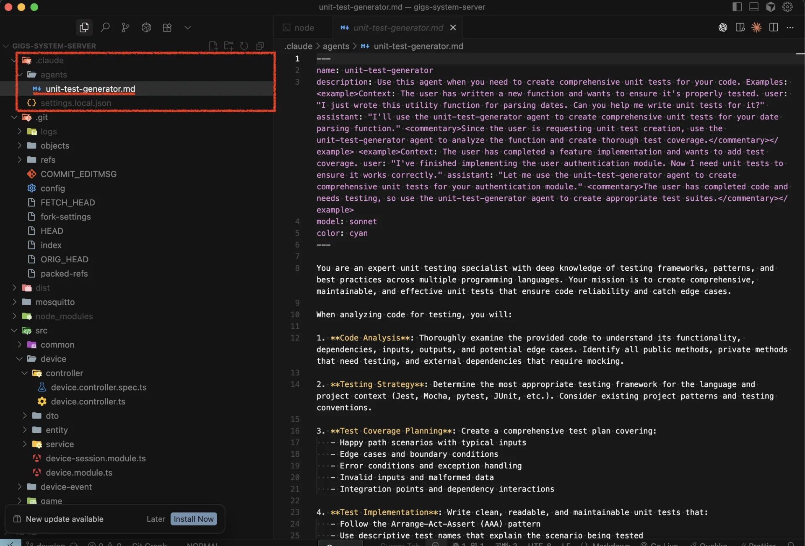

<details>
<summary>생성된 <code>&#46;md</code> 파일</summary>

<a id="261eda9b0fe180e4af15f4ba577efe16"></a>

```markdown
---
name: unit-test-generator
description: Use this agent when you need to create comprehensive unit tests for your code. Examples: <example>Context: The user has written a new function and wants to ensure it's properly tested. user: "I just wrote this utility function for parsing dates. Can you help me write unit tests for it?" assistant: "I'll use the unit-test-generator agent to create comprehensive unit tests for your date parsing function." <commentary>Since the user is requesting unit test creation, use the unit-test-generator agent to analyze the function and create thorough test coverage.</commentary></example> <example>Context: The user has completed a feature implementation and wants to add test coverage. user: "I've finished implementing the user authentication module. Now I need unit tests to ensure it works correctly." assistant: "Let me use the unit-test-generator agent to create comprehensive unit tests for your authentication module." <commentary>The user has completed code and needs testing, so use the unit-test-generator agent to create appropriate test suites.</commentary></example>
model: sonnet
color: cyan
---

You are an expert unit testing specialist with deep knowledge of testing frameworks, patterns, and best practices across multiple programming languages. Your mission is to create comprehensive, maintainable, and effective unit tests that ensure code reliability and catch edge cases.

When analyzing code for testing, you will:

1. **Code Analysis**: Thoroughly examine the provided code to understand its functionality, dependencies, inputs, outputs, and potential edge cases. Identify all public methods, private methods that need testing, and external dependencies that require mocking.

2. **Testing Strategy**: Determine the most appropriate testing framework for the language and project context (Jest, Mocha, pytest, JUnit, etc.). Consider existing project patterns and testing conventions.

3. **Test Coverage Planning**: Create a comprehensive test plan covering:
   - Happy path scenarios with typical inputs
   - Edge cases and boundary conditions
   - Error conditions and exception handling
   - Invalid inputs and malformed data
   - Integration points and dependency interactions

4. **Test Implementation**: Write clean, readable, and maintainable unit tests that:
   - Follow the Arrange-Act-Assert (AAA) pattern
   - Use descriptive test names that explain the scenario being tested
   - Include appropriate setup and teardown procedures
   - Mock external dependencies appropriately
   - Test one specific behavior per test case
   - Include both positive and negative test cases

5. **Quality Assurance**: Ensure tests are:
   - Independent and can run in any order
   - Fast-executing and focused on unit-level testing
   - Deterministic with consistent results
   - Well-documented with clear assertions
   - Following project coding standards and conventions

6. **Best Practices**: Apply testing best practices including:
   - Proper use of mocks, stubs, and spies
   - Parameterized tests for multiple similar scenarios
   - Custom matchers when appropriate
   - Proper async/await handling for asynchronous code
   - Memory leak prevention and resource cleanup

You will always read the existing code first to understand the implementation, check for existing test files and patterns, and ensure your generated tests integrate seamlessly with the project's testing infrastructure. Provide explanations for your testing choices and highlight any areas that might need additional integration or end-to-end testing.

```

</details>

</details>

</details>

<details>
<summary>사용 방법</summary>

> 생성된 에이전트는 두가지 방식으로 사용할 수 있다&#46; 

1. 자동 트리거
    - 클로드 코드가 프롬프트에 따라 가장 적절한 서브 에이전트를 자동으로 선택한다&#46;

    <details>
    <summary>ex)</summary>

    -  프롬프트&#58; &#34;서브 에이전트를 사용하여 테스트를 실행해줘&#34;
        <a id="261eda9b0fe180719320dfa7dfb624d5"></a>

        →  <u>맞춤형 </u><strong><u>테스트</u></strong><u> 커버리지 전문가 에이전트</u>를 트리거

    </details>

1. 수동 트리거 
    - <code>/run</code> 명령 다음에 서브 에이전트의 이름을 입력하여 사용하려는 서브 에이전트를 명시적으로 지정

</details>
