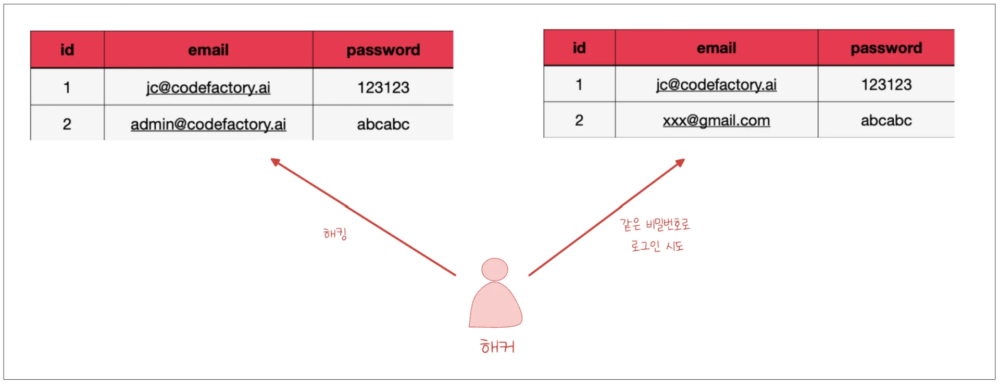
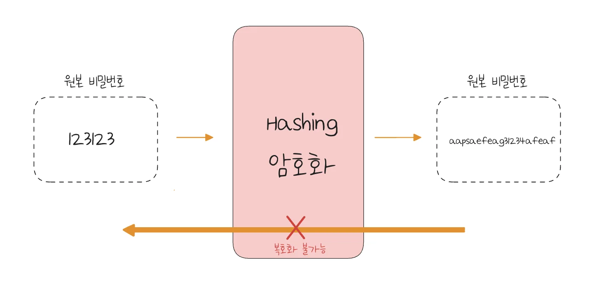
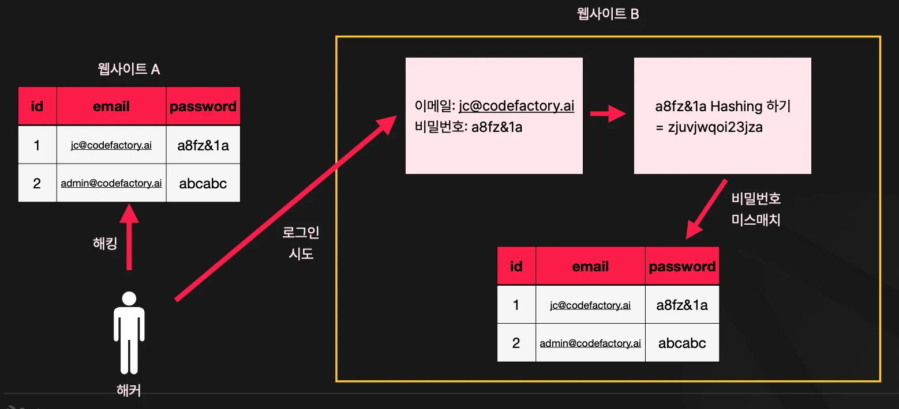
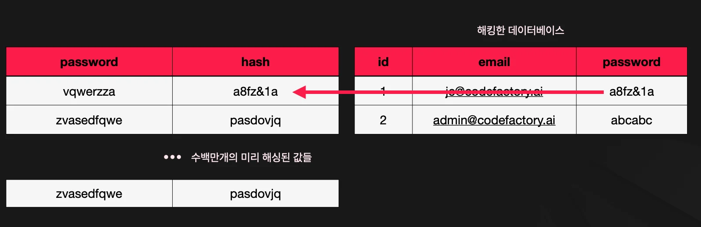
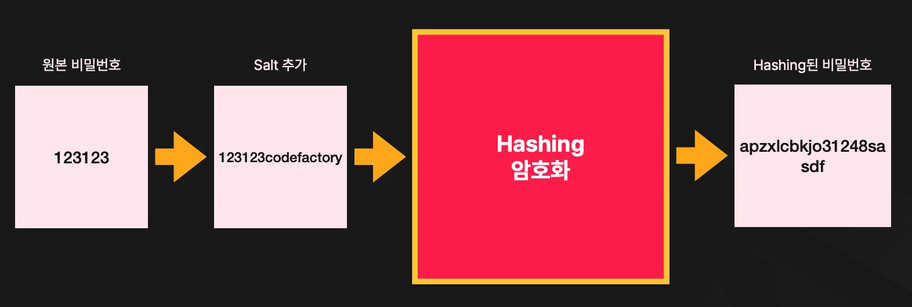
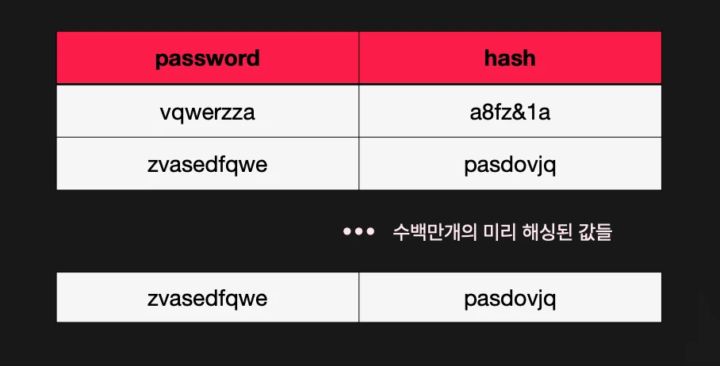
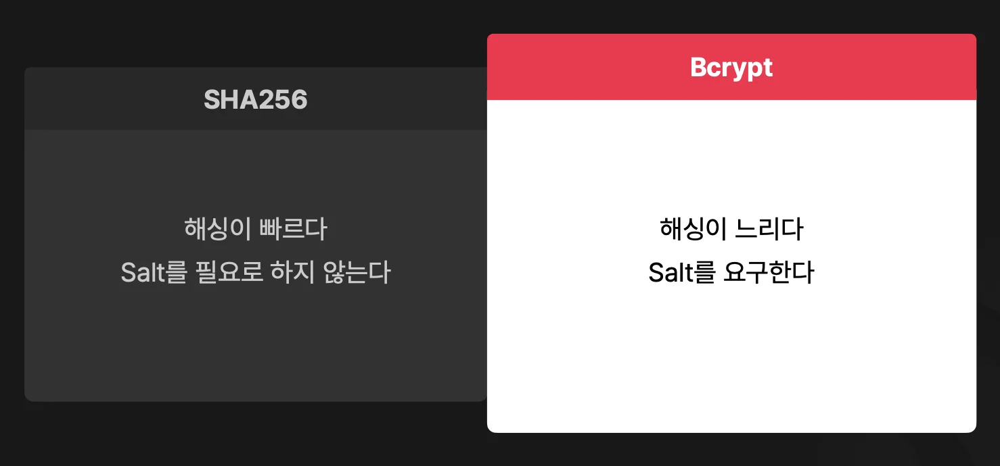

> 
> 
> 
> 
> <strong>목차</strong>
> 
> - [회원 가입, 로그인 프로세스](#265eda9b0fe180d0a80aef7bc2352a2d)
> - [비밀번호를 암호화 해야하는 이유](#265eda9b0fe180c49dbaff6ba7e93767)
> - [Hashing](#265eda9b0fe180448935ec8783287700)
> - [Hashing이 제공하는 보안](#265eda9b0fe180778c6fc516402a63eb)
> - [Dictionary Attack](#265eda9b0fe1803eb491e5e95eb45ae4)
> - [Salt](#265eda9b0fe180e6900af1d1f9f0c44a)
> - [Hash Algorithms](#265eda9b0fe1808cbd65fdbed135b12f)

> ✏️ 
> 
> 
> 
> 이전 정리 내용 
> 
> - <a href="#/post/265eda9b-0fe1-80b4-ae74-de4911ac0952">페이지</a> 

## 회원 가입, 로그인 프로세스

---

회원 가입

- 이메일, 비밀번호 서버로 전달

- 비밀번호 암호화 후, 이메일과 함께 데이터베이스 저장

로그인

- 이메일, 비밀번호 서버로 전달

- 이메일과 비밀번호 해시 값 비교 검증

- 액세스 토큰 및 리프레시 토큰 생성

- 클라이언트에 토큰 전달

- 프라이빗 리소스 요청 및 토큰 재발급 시 토큰 사용 ( 인가 )

> ✏️ 
> 
> 
> 
> <strong>회원가입 및 비밀번호 암호화</strong>
> 
> - <strong><u>원본 비빌번호 저장 ❌</u></strong>
> 
> - 대신 <strong>암호화된 값</strong>을 <strong><u>데이터베이스에 저장</u></strong>한다&#46; 
>     - 서버가 해킹되어도 비밀번호를 알 수 없게하기 위함이다&#46;
> 
> - 비밀번호는 <strong><u>절대 복호화가 되지 않고, 같은 결과를 반횐하는 알고리즘을 사용</u></strong>해서 암호화한다&#46; 
> 
> - 비밀번호를 비교할 때는 입력된 비밀번호를 다시 암호화하고 암호화된 값이 같은지 비교한다&#46; 
> 
> - <code>bcryp</code>가 가장 많이 사용되는 비밀번호 알고리즘이다&#46; 

### 비밀번호를 암호화 해야하는 이유

대부분의 사람은 비슷한 비밀번호, 혹은 아에 같은 비밀번호를 여러 사이트에서 사용한다&#46; 따라서 비밀번호를 암호화 없이 DB에 저장하면 공격자(해커)에게 DB 정보를 탈취 후, 해당 공격자(해커)가 다른 사이트에서도 해당 정보로로그인을 시도하여 사용자의 민감한 정보들을 탈취한다&#46; 

이를 방지하기 위해, DB에 비밀번호 원본 데이터를 저장하지 않는다&#46; 

- TMI) 유료 서비스를 사용하여 랜덤하게 비밀번호를 관리해주는 서비스 사용을 권장함

## Hashing

---

- 원본 데이터를 해시 함수(알고리즘)를 통해 암호화 처리

- 복호화 불가능

### Hashing이 제공하는 보안

해싱 처리된 값은 다시 해싱처리를 하면 다른 값으로 나온다&#46; 

이를 통해 보안성을 강화한다&#46;

- 해당 방법은 다른 사이트 A에서도 hash를 통해 암호화된 값을 저장한다는 전제로 

### Dictionary Attack

일반적으로 <strong><u>많이 사용하는 비밀번호들을 미리 해싱</u></strong>하여 dictionary를 만든다&#46;

즉, 미리 해싱된 값들을 세팅하고 해당 값들을 돌려서 원본 값을 찾는다&#46; 

### Salt

원본 데이터에 무작위 값(salt)을 추가하여 보안성을 강화한다&#46; 

> ❗ 
> 
> 
> 
> <strong>Salt 값까지 해킹 당한 경우?</strong>
> 
> 
> 
> 
> 
> 만약<strong> salt 값이 해킹 당</strong>한 경우, 이에 따른 dictionary 생성이 가능하다&#46;  따라서 <strong><u>보안 취약점이 발</u></strong>생된다&#46; 

### Hash Algorithms

> salt도 추가하고 <strong><u>hashing이 </u></strong><strong><u>느린 알고리즘을 사용</u></strong>하면 딕셔너리 생성이 불가능하다&#46; 

bcypt 사용 시 알고리즘이 느리기 때문에 salt가 해킹 당해도 dictionary 생성이 불가능하다&#46; 

- bcypt 는 굉장히 느리게 해싱 처리하도록 설계되었고, 원하는 만큼 설정도 가능하다&#46; 

- 🧐 빠르게 처리하도록 하면 가능하지 않나?
