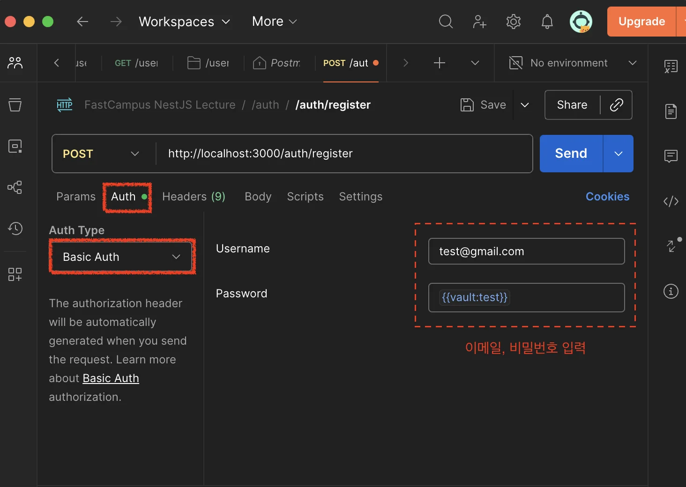
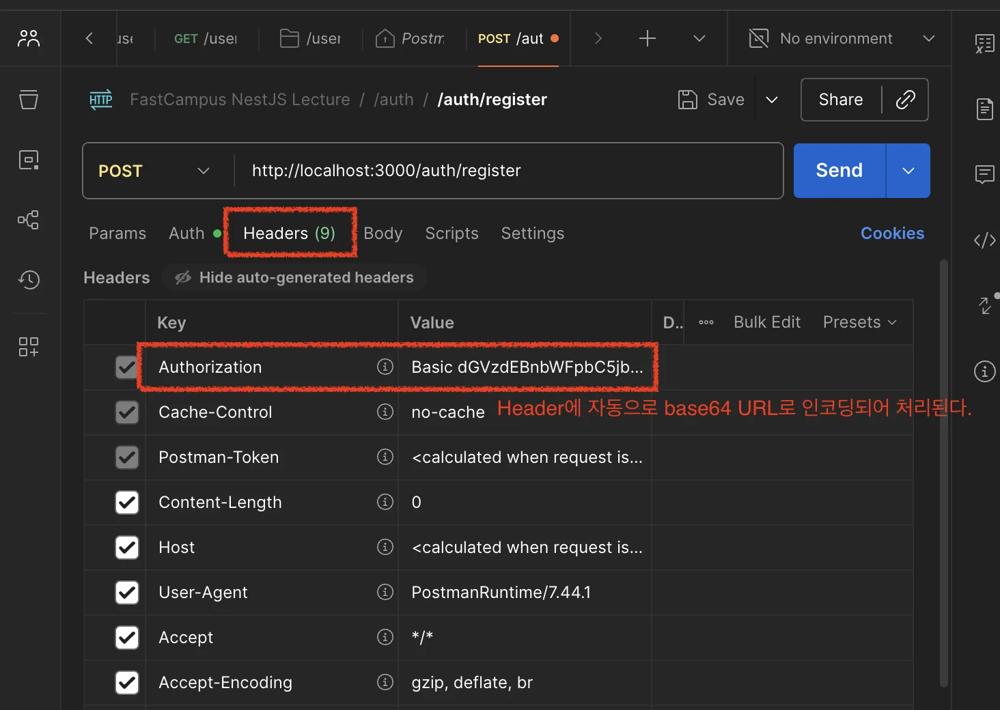
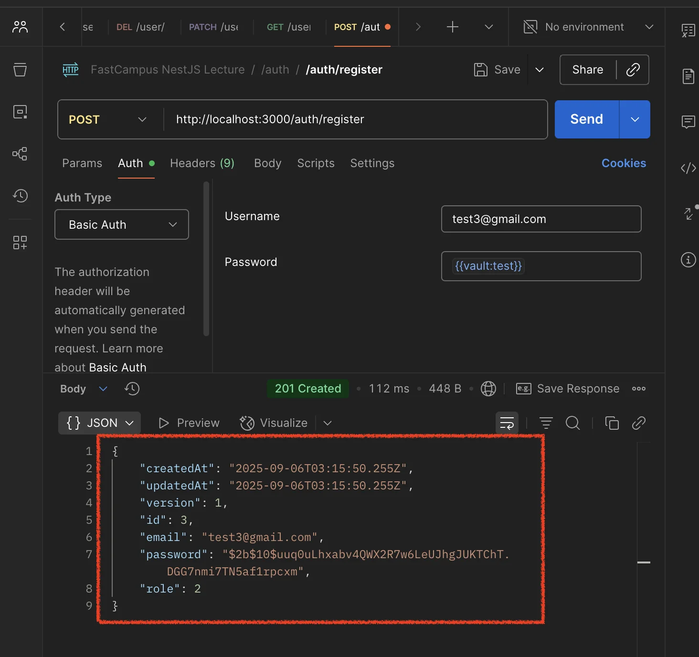
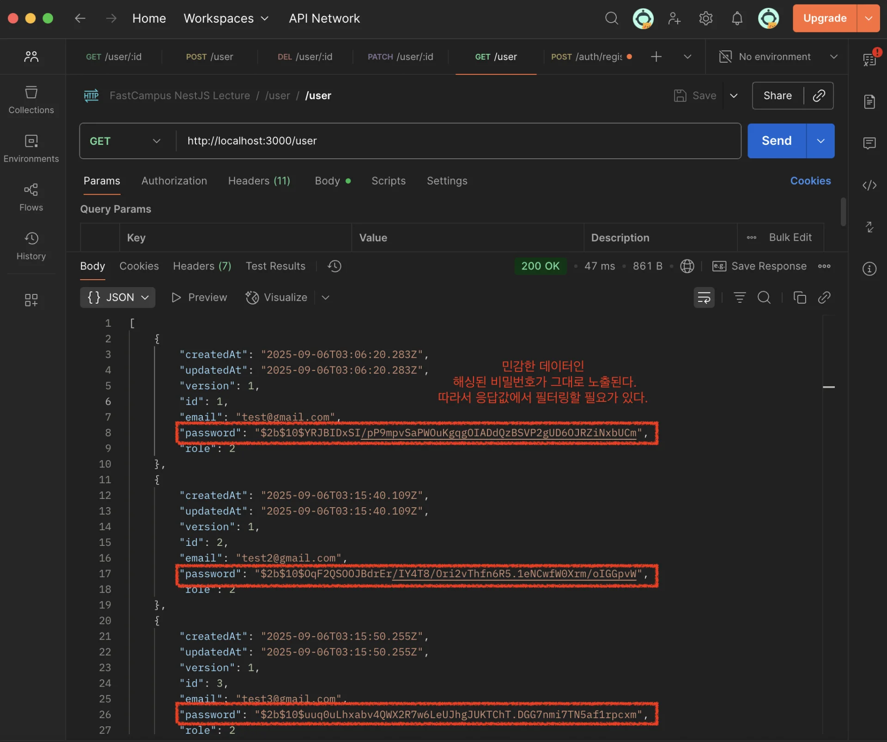
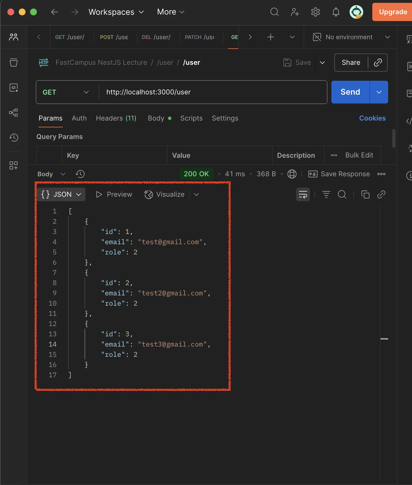

> 
> 
> <a id="266eda9b0fe1808d989ee40c44c43eba"></a>
> 
> <strong>목차</strong>
> 
> - [auth, user 모듈 템플릿 생성](#266eda9b0fe18065a887feb326113a53)
> - [도메인: User ( 유저 CRUD )](#266eda9b0fe18043b42eed15ad6ec908)
> - [1. 엔티티 정의](#266eda9b0fe180ae8392dfa62aac92a2)
> - [2. 모듈에 TypeOrmModule 불러오기, app 모듈에 해당 entity 의존성 추가](#266eda9b0fe18099a709d638cac67ded)
> - [3. Controller, Service 로직 정의](#266eda9b0fe180c9a212e45000da78a5)
> - [도메인: Auth ( 회원가입 )](#266eda9b0fe180f49632d7378e8227b4)
> - [1. 의존성 설치](#266eda9b0fe1804e9597ddbd8ede0128)
> - [2. Controller, Service, AuthModule 정의](#266eda9b0fe180e39215cd53e2ae5eef)
> - [3. API 테스트  ( Postman )](#266eda9b0fe1808c9b41f5edab594905)
> - [오류: 응답 JSON에 비밀번호 토큰 값이 같이 담겨 옴](#266eda9b0fe18015bd4dc122643aa5da)
> - [해결](#266eda9b0fe180c8ae0cffd8c7ae8bcf)
> - [확인](#266eda9b0fe18064b2f5f817970410e6)

<a id="266eda9b0fe18065a887feb326113a53"></a>

### auth, user 모듈 템플릿 생성

<a id="266eda9b0fe1807d8ea9d54390878180"></a>

```bash
nest g resource 
# auth, RESTApi, n
# user, RESTApi, y[
```

<a id="266eda9b0fe18043b42eed15ad6ec908"></a>

## 도메인&#58; <code>User</code> ( 유저 CRUD )

---

<a id="266eda9b0fe180ae8392dfa62aac92a2"></a>

### 1&#46; 엔티티 정의

<details>
<summary><strong>&#91; 코드 &#93; BaseTable</strong></summary>

<a id="266eda9b0fe1805da8cadc3a5bafa8d3"></a>

```typescript
import { ApiHideProperty } from '@nestjs/swagger';
import { Exclude } from 'class-transformer';
import { CreateDateColumn, UpdateDateColumn, VersionColumn } from 'typeorm';


export class BaseTable {
  @CreateDateColumn()
  @Exclude()
  @ApiHideProperty()
  createdAt: Date;

  @UpdateDateColumn()
  @Exclude()
  @ApiHideProperty()
  updatedAt: Date;

  @VersionColumn()
  @Exclude()
  @ApiHideProperty()
  version: number;
}
```

</details>

<details>
<summary><strong>&#91; 코드 &#93; User</strong></summary>

<a id="266eda9b0fe1803598bfd57b54c8a41f"></a>

```typescript
import { Exclude } from 'class-transformer';
import { BaseTable } from 'src/common/entity/base-table.entity';
import { Column, Entity, PrimaryGeneratedColumn } from 'typeorm';

export enum Role {
  admin,
  paidUser,
  user,
}

@Entity()
export class User extends BaseTable {
  @PrimaryGeneratedColumn()
  id: number;

  @Column({ unique: true })
  email: string;

  @Column()
  @Exclude({
    toPlainOnly: true,
  })
  password: string;

  @Column({
    enum: Role,
    default: Role.user,
  })
  role: Role;
}

```

</details>

<a id="266eda9b0fe18099a709d638cac67ded"></a>

### 2&#46; 모듈에 <code>TypeOrmModule</code> 불러오기, app 모듈에 해당 entity 의존성 추가

<details>
<summary><strong>&#91; 코드 &#93; UserModule</strong></summary>

<a id="266eda9b0fe180049e11fd675601e401"></a>

```typescript
// user.module.ts
import { Module } from '@nestjs/common';
import { UserService } from './user.service';
import { UserController } from './user.controller';
import { TypeOrmModule } from '@nestjs/typeorm';
import { User } from './entities/user.entity';

@Module({
  imports: [ TypeOrmModule.forFeature([User]) ],
  controllers: [UserController],
  providers: [UserService],
})
export class UserModule {}
```

</details>

<details>
<summary><strong>&#91; 코드 &#93; AppModule</strong></summary>

<a id="266eda9b0fe180bb909afba41e003871"></a>

```typescript
// app.module.ts
import { Module } from '@nestjs/common';
import { ConfigModule, ConfigService } from '@nestjs/config';
import { TypeOrmModule } from '@nestjs/typeorm';
import { AuthModule } from './auth/auth.module';
import { UserModule } from './user/user.module';
import { User } from './user/entities/user.entity';

@Module({
  imports: [
    ConfigModule.forRoot({ isGlobal: true }), // .env 로딩
    TypeOrmModule.forRootAsync({
      inject: [ConfigService],
      useFactory: (cfg: ConfigService) => ({
        type: 'postgres',
        host: cfg.get<string>('DB_HOST'),
        port: cfg.get<number>('DB_PORT'),
        username: cfg.get<string>('DB_USERNAME'),
        password: cfg.get<string>('DB_PASSWORD'),
        database: cfg.get<string>('DB_DATABASE'),
        entities: [ 
	        User, 
        ],
        synchronize: false, // 운영에서는 반드시 false
        logging: true,
      }),
    }),
    TypeOrmModule.forFeature([User]),
    AuthModule,
    UserModule,
  ],
})
export class AppModule {}
```

</details>

<a id="266eda9b0fe180c9a212e45000da78a5"></a>

### 3&#46; Controller, Service 로직 정의

<details>
<summary><strong>&#91; 코드 &#93; UserController</strong></summary>

<a id="266eda9b0fe180b89ec8ef9b6e78bb31"></a>

```typescript
import { Controller, Get, Post, Body, Patch, Param, Delete } from '@nestjs/common';
import { UserService } from './user.service';
import { CreateUserDto } from './dto/create-user.dto';
import { UpdateUserDto } from './dto/update-user.dto';

@Controller('user')
export class UserController {
  constructor(private readonly userService: UserService) {}

  @Post()
  create(@Body() createUserDto: CreateUserDto) {
    return this.userService.create(createUserDto);
  }

  @Get()
  findAll() {
    return this.userService.findAll();
  }

  @Get(':id')
  findOne(@Param('id') id: string) {
    return this.userService.findOne(+id);
  }

  @Patch(':id')
  update(@Param('id') id: string, @Body() updateUserDto: UpdateUserDto) {
    return this.userService.update(+id, updateUserDto);
  }

  @Delete(':id')
  remove(@Param('id') id: string) {
    return this.userService.remove(+id);
  }
}
```

</details>

<details>
<summary><strong>&#91; 코드 &#93; UserService</strong></summary>

<a id="266eda9b0fe1809fb3a9c47fa32c2f1d"></a>

```typescript
// user.service.ts
import { Injectable, NotFoundException } from '@nestjs/common';
import { CreateUserDto } from './dto/create-user.dto';
import { UpdateUserDto } from './dto/update-user.dto';
import { Repository } from 'typeorm';
import { User } from './entities/user.entity';
import { InjectRepository } from '@nestjs/typeorm';

@Injectable()
export class UserService {
  constructor(
    @InjectRepository(User)
    private readonly userRepository: Repository<User>,
  ) {}

  create(createUserDto: CreateUserDto) {
    return this.userRepository.save(createUserDto);
  }

  findAll() {
    return this.userRepository.find();
  }

  findOne(id: number) {
    const user = this.userRepository.findOne({
      where: { id },
    });

    if (!user) {
      throw new NotFoundException('존재하지 않는 사용자입니다.');
    }

    return user;
  }

  async update(id: number, updateUserDto: UpdateUserDto) {
    const user = this.userRepository.findOne({
      where: { id },
    });

    if (!user) {
      throw new NotFoundException('존재하지 않는 사용자입니다.');
    }

    await this.userRepository.update({ id }, updateUserDto);

    return this.userRepository.findOne({
      where: { id },
    });
  }

  remove(id: number) {
    return this.userRepository.delete(id);
  }
}

```

</details>

<a id="266eda9b0fe180f49632d7378e8227b4"></a>

## 도메인&#58; <code>Auth</code> ( 회원가입 )

---

<a id="266eda9b0fe1804e9597ddbd8ede0128"></a>

### 1&#46; 의존성 설치

> ✏️ 
> 
> <a id="266eda9b0fe18094b432e2d0b772bcc4"></a>
> 
> 비밀번호를 해싱 처리하여 저장하기 위해 <code>bcypt</code> 라이브러리를 설치한다&#46;

<details>
<summary><code>bcrypt</code>, <code>&#64;types/bcrypt</code></summary>

<a id="266eda9b0fe180b5a85cfbfaecc8b434"></a>

```bash
pnpm add bcrypt              # bcrypt 라이브러리 본체 설치 (runtime dependency)
pnpm add -D @types/bcrypt    # 타입 정의 설치 (dev dependency)
```

</details>

<a id="266eda9b0fe180e39215cd53e2ae5eef"></a>

### 2&#46; Controller, Service, AuthModule 정의

<details>
<summary><strong>&#91; 코드 &#93; AuthController</strong></summary>

<a id="266eda9b0fe180ff8fc8d46733358c8c"></a>

```typescript
// auth.controller.ts
import { Controller, Headers, Post } from '@nestjs/common';
import { AuthService } from './auth.service';

@Controller('auth')
export class AuthController {
  constructor(private readonly authService: AuthService) {}

  @Post('register')
  /// authorization: Basic $token
  registerUser(@Headers('authorization') token: string) {
    return this.authService.register(token);
  }
}

```

</details>

<details>
<summary><strong>&#91; 코드 &#93; AuthService</strong></summary>

<a id="266eda9b0fe18062b248c1833470d3dd"></a>

```typescript
// auth.service.ts
import { BadRequestException, Injectable } from '@nestjs/common';
import { ConfigService } from '@nestjs/config';
import { InjectRepository } from '@nestjs/typeorm';
import { User } from 'src/user/entities/user.entity';
import { Repository } from 'typeorm';
import * as bcrypt from 'bcrypt';

@Injectable()
export class AuthService {
  constructor(
    @InjectRepository(User)
    private readonly userRepository: Repository<User>,
    private readonly configService: ConfigService,
  ) {}

  /// rawToken: Basic $token
  async register(rawToken: string) {
    const { email, password } = this.parseBasicToken(rawToken);

    const user = await this.userRepository.findOne({
      where: { email },
    });

    if (user) {
      throw new BadRequestException('이미 가입한 이메일입니다.');
    }

    // 환경변수 처리: 해시 강도(BCRYPT_SALT_ROUNDS) 기본값 10
    const saltRounds = Number(
      this.configService.get<number | string>('BCRYPT_SALT_ROUNDS', 10),
    );

    const hash = await bcrypt.hash(password, saltRounds);

    await this.userRepository.save({
      email,
      password: hash,
    });

    return this.userRepository.findOne({
      where: { email },
    });
  }

  parseBasicToken(rawToken: string) {
    /**
     * 1) 토큰을 ' ' 기준으로 스플릿 한 후 토큰 값만 추출하기
     *  => ['Basic', $token]
     */
    const basicSplit = rawToken.split(' ');

    if (basicSplit.length !== 2) {
      throw new BadRequestException('토큰 포맷이 유효하지 않습니다. 1');
    }

    const [_, token] = basicSplit;

    /**
     * 2) 추출한 토큰을 base64 디코딩해서 이메일과 비밀번호로 나눈다.
     *
     */
    const decoded = Buffer.from(token, 'base64').toString('utf-8');

    const inputInfo = decoded.split(':');

    console.log(inputInfo);

    if (inputInfo.length !== 2) {
      throw new BadRequestException('토큰 포맷이 유효하지 않습니다. 2');
    }

    const [email, password] = inputInfo;

    return {
      email,
      password,
    };
  }
}

```

</details>

<details>
<summary><strong>&#91; 코드 &#93; AuthModule</strong></summary>

<a id="266eda9b0fe1809ebe96c06e2d14f44d"></a>

```typescript
// auth.module.ts
import { Module } from '@nestjs/common';
import { AuthService } from './auth.service';
import { AuthController } from './auth.controller';
import { TypeOrmModule } from '@nestjs/typeorm';
import { User } from 'src/user/entities/user.entity';

@Module({
  imports: [TypeOrmModule.forFeature([User])],
  controllers: [AuthController],
  providers: [AuthService],
})
export class AuthModule {}
```

</details>

<a id="266eda9b0fe1808c9b41f5edab594905"></a>

### 3&#46; API 테스트  ( Postman )

<details>
<summary>회원가입&#58; <code>/auth/register</code></summary>



- auth &#45; Basic Auth &#45; 이메일, 비밀번호 입력



- <code>auth/Basic Auth</code>로 설정 시, 위와 같이 자동으로 header에 <code>Basic token</code>  설정이 된다&#46; 



- 위와 같이 회원가입이 정상적으로 이뤄짐

</details>

<details>
<summary>Response 비밀번호 필터링</summary>

<a id="266eda9b0fe18015bd4dc122643aa5da"></a>

### 오류&#58; 응답 JSON에 비밀번호 토큰 값이 같이 담겨 옴



<a id="266eda9b0fe180c8ae0cffd8c7ae8bcf"></a>

### 해결

> ✏️ 
> 
> <a id="266eda9b0fe18028b95bef6a1f5a9a4a"></a>
> 
> <code>&#64;Exclude()</code> 옵션
> 
> - <code>toClassOnly&#58; true</code>&#58;  Request 필터링
> 
> - <code>toPlainOnly&#58; true</code>&#58;  Reponse 필터링

<details>
<summary><strong>&#91; 코드 &#93; User  &#45; password </strong><strong><code>&#64;Exclude()</code></strong><strong> 적용</strong></summary>

<a id="266eda9b0fe1800a980affee2e7c781d"></a>

```typescript
// user.entity.ts
import { Exclude } from 'class-transformer';
import { BaseTable } from 'src/common/entity/base-table.entity';
import { Column, Entity, PrimaryGeneratedColumn } from 'typeorm';

export enum Role {
  admin,
  paidUser,
  user,
}

@Entity()
export class User extends BaseTable {
  @PrimaryGeneratedColumn()
  id: number;

  @Column({ unique: true })
  email: string;

  @Column()
  @Exclude({
    toPlainOnly: true,
  })
  password: string;

  @Column({
    enum: Role,
    default: Role.user,
  })
  role: Role;
}

```

</details>

<details>
<summary><strong>&#91; 코드 &#93; UserController  &#45; </strong><strong><code>ClassSerializerInterceptor</code></strong><strong> 적용</strong></summary>

<a id="266eda9b0fe180048e55d873aaca171e"></a>

```typescript
// user.controller.ts
import {
  Controller,
  Get,
  Post,
  Body,
  Patch,
  Param,
  Delete,
  UseInterceptors,
  ClassSerializerInterceptor,
} from '@nestjs/common';
import { UserService } from './user.service';
import { CreateUserDto } from './dto/create-user.dto';
import { UpdateUserDto } from './dto/update-user.dto';

@Controller('user')
@UseInterceptors(ClassSerializerInterceptor)
export class UserController {
  constructor(private readonly userService: UserService) {}

  @Post()
  create(@Body() createUserDto: CreateUserDto) {
    return this.userService.create(createUserDto);
  }

  @Get()
  findAll() {
    return this.userService.findAll();
  }

  @Get(':id')
  findOne(@Param('id') id: string) {
    return this.userService.findOne(+id);
  }

  @Patch(':id')
  update(@Param('id') id: string, @Body() updateUserDto: UpdateUserDto) {
    return this.userService.update(+id, updateUserDto);
  }

  @Delete(':id')
  remove(@Param('id') id: string) {
    return this.userService.remove(+id);
  }
}

```

</details>

<a id="266eda9b0fe18064b2f5f817970410e6"></a>

### 확인



- 응답 데이터가 필터링되어 반환되는 것을 확인할 수 있다&#46;

</details>
