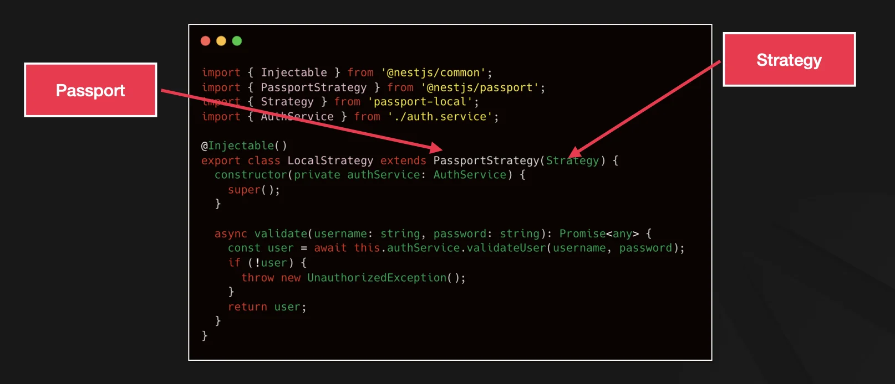
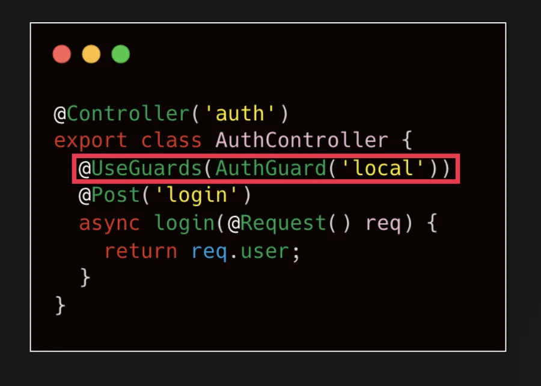

> 
> 
> <a id="26deda9b0fe180d08a37d00f13e33fe0"></a>
> 
> <strong>목차</strong>
> 
> - [Passport](#267eda9b0fe180d58371c39daa38ffc0)
> - [직접 구현 시, 다뤄야 하는 features](#267eda9b0fe180c48f89eae853e95df6)
> - [passport, @nestjs/passport 사용 시 이점](#267eda9b0fe180f1b84ffd6dd181af4c)
> - [NestJS 에서의 Passport](#267eda9b0fe1802da3a7cc54dc01b53f)
> - [Reference](#267eda9b0fe180de8575d96ccebdd399)

<a id="267eda9b0fe180d58371c39daa38ffc0"></a>

## Passport

---

> 📖 
> 
> <a id="267eda9b0fe18045a3e5c4537cc4e740"></a>
> 
> <code>Passport</code> 라이브러리는 Node&#46;js 애플리케이션의  <strong><u>인증(Authentication) 기능을 손쉽게 구현</u></strong>하기 위해 제공되는 모듈이다&#46; 
> 
> - Node&#46;js의 대표적인 인증 미들웨어이며, NestJS에서도 이를 공식적으로 지원하는 래퍼 모듈을 제공한다&#46;  ( <code>&#64;nestjs/passport</code> )
> 
> <a id="267eda9b0fe18042a855e9a5af978570"></a>
> 
> 다양한 인증 전략(Strategy)을 통해 유연하고 범용적으로 사용 가능하다&#46;
> 
> - 보통 JWT, OAuth2( Google, Kakao, Github 등 ), Local( ID/PW) 전략과 함께 사용한다&#46;  <br>( 실제 수많은 운영 애플리케이션에서 성공적으로 활용되고 있다&#46;) 
> 
> - 각 전략(Strategy)은 사용자의 자격 증명(예&#58; 아이디, 비밀번호, 토큰 등)을 확인하는 역할하며, 필요에 따라 커스터마이징 가능하다&#46;

<details>
<summary>특징</summary>

- <code>모듈화된 인증 시스템</code>
    - 다양한 전략(Strategy)를 쉽게 연결해 사용 가능하다&#46; 

    - 따라서 인증관련 코드가 줄어 유지보수할 코드를 줄일 수 있다&#46;

- <code>미들웨어 기반 디자인</code>
    - 요청, 응답 라이프사이클에 비파괴적 방식으로 통합

    - 기존의 코드 변경없이 확장 가능하다  &#45; <code>OCP</code>

- <code>일반화된 가벼운 코어</code>
    - passport 코어는 넓은 전략을 수용할 수 있도록 가볍고 일반적으로 (Unopinonated) 설계됐다&#46;

- <code>세션 및 토큰 방식 사용</code>
    - 세션 기반과 토큰 기반의 인증 시스템 모두 사용 가능하다&#46;

- <code>방대한 생태계</code>
    - 다양한 오픈소스 전략들이 무료로 공개되어 있다&#46; <br>따라서 직접 코딩할 필요없이 가져다가 사용하면 된다&#46; 

</details>

<details>
<summary>사용 이유</summary>

> 🧐 
> 
> <a id="267eda9b0fe1800ebf9ed9cc43c3dc04"></a>
> 
> 인증 관련 로직은 직접 구현하는 경우도  많지만, 실제 실무에서 passport를 사용하여 애플리케이션을 구성하는 경우도 많다&#46; 
> 
> <a id="267eda9b0fe18049a31ddecec93f5696"></a>
> 
> 그렇다면 왜 passport를 사용하는가? 

<a id="267eda9b0fe180c48f89eae853e95df6"></a>

### 직접 구현 시, 다뤄야 하는 <code>features</code>

> ❗ 
> 
> <a id="267eda9b0fe180239568f992c70db215"></a>
> 
> “직접 구현”은 가능하지만, <strong>보안 체크리스트와 경계 사례</strong>가 매우 많고, 실수 시 사고로 바로 이어진다&#46; 
> 
> <a id="267eda9b0fe1803e9150f8cc4e1fbe38"></a>
> 
> OWASP도 인증/인가 구현 시 표준·검증된 컴포넌트 사용을 권장한다&#46;
> 
> - ‣

1. 토큰/JWT 처리

1. 세션 쿠키 기반 인증
    - Session fixation 방지, CSRF 대응, HttpOnly/SameSite/Secure 쿠키 정책, 직렬화/역직렬화 정책, 세션 저장소/정책

    - ‣<br>

1. OAuth 2&#46;0 / OpenID Connect
    - state/nonce/PKCE 처리, 리다이렉트 검증, provider 마다 다른 scope/클레임/엔드포인트 표준화, 프로필 정규화, 에러/취소 플로우<br>

1. 권한( Authorization ) 결합
    - Guard 레벨에서 RBAC/Claims 결합, 라우트 메타데이터 처리, WebSocket 등 전송 경로별 인증

    - ‣

<a id="267eda9b0fe180f1b84ffd6dd181af4c"></a>

### <code>passport</code>, <code>&#64;nestjs/passport</code> 사용 시 이점

> ✏️ 
> 
> <a id="267eda9b0fe180a8802cca2c71e32963"></a>
> 
> 보안 • 유지보수 리스크를 낮추고, 표준화된 전략(Strategy) 생태계와 Guard/DI에 자연스럽게 붙이기 위해서이다&#46; 

1. <strong>표준화된 전략(Strategy) 인터페이스 &#43; 대규모 생태계</strong>

1. <strong>NestJS Guard/DI와의 밀착 통합</strong>

1. <strong>세션/직렬화·역직렬화 등의 베스트 프랙티스 내장</strong>

1. <strong>검증된 보안 관행을 기본값으로</strong>

1. <strong>학습·온보딩 비용 절감 &#38; 벤더 교체 용이</strong><br><br>

</details>

<a id="267eda9b0fe1802da3a7cc54dc01b53f"></a>

### NestJS 에서의 <code>Passport</code>

> ✏️ 
> 
> <a id="267eda9b0fe180219321ccaacebbc297"></a>
> 
> NestJS에서 제공하는 래퍼 모듈(<code>&#64;nestjs/passport</code>) 사용 시, DI 컨테이너 구조와 데코레이션 기반 패턴에 맞게 통합 가능하다 &#46;

<details>
<summary>의존성 설치</summary>

<a id="267eda9b0fe1800cb3fcee872ab56d04"></a>

```bash
# 기본 passport 모듈
pnpm add @nestjs/passport passport # NestJS passport 래퍼, passport 본체
pnpm add -D @types/passport # type 

# JWT strategy
pnpm add @nestjs/jwt passport-jwt
pnpm add -D @types/passport-jwt

# 소셜 로그인 ( 선택 )
	# 구글 OAuth2
pnpm add passport-google-oauth20
pnpm add -D @types/passport-google-oauth20

	# 카카오
pnpm add passport-kakao
pnpm add -D @types/passport-kakao
```

<a id="267eda9b0fe1803c8275d0d1314e6e69"></a>

```bash
# 공식문서 권장 - passport, (선택) local, jwt
pnpm i @nestjs/passport passport  @nestjs/jwt passport-jwt passport-local
pnpm i -D @types/passport-jwt @types/passport-local 


pnpm i @nestjs/passport passport @nestjs/jwt passport-jwt 
pnpm i -D @types/passport-jwt
```

</details>

<details>
<summary>주요 구성 요소</summary>

- <code>PassporStrategy</code>
    - 각 인증 전략(local, jwt, google 등)을 NestJS에 등록할 때 사용하는 클래스

- <code>AuthGuard</code>
    - 전략별 인증 과정을 라우트에 지정할 수 있게 해주는 NestJS Garud 클래스

- <code>createPassportContext</code>
    - 실제 인증 과정(request, response 객체를 활용)을 Passport와 NestJS Guard가 연동하는 핵심 함수이다&#46;

- <code>Strategies</code>
    - Local, JWT, OAuth2, Google 등 여러 인증 전략 구현됨

    - 각 전략의 옵션과 유효성 검증 방식에 따라 customize 가능함

</details>

<details>
<summary>사용 방법</summary>

1. <code>PassportStrategy</code> 클래스를 확장하여 추가 및 각 전략 별로 <code>validate()</code> 메서드 구현
    

1. 인증 로직은 <code>AuthGuard</code> 와 같은 <code>NestJS Guard</code>를 통해 <u>라우트 계층</u>에서 간편하게 적용
    

</details>

> ☝🏻 
> 
> <a id="267eda9b0fe18097a905c99699697045"></a>
> 
> passport의 추상화(abstraction)가 불편한 점들이 있어 커스터마이징 해서 사용하기도 한다&#46;
> 
> - 실제 서비스에 맞는 환경구성이 어렵다&#46; 
> 
> <a id="267eda9b0fe1809c9d4fe6f9b05e5170"></a>
> 
> 띠라서 상황에 맞게 사용하면 된다&#46; 

<a id="267eda9b0fe180de8575d96ccebdd399"></a>

## Reference

[Documentation &#124; NestJS &#45; A progressive Node&#46;js framework]()

[bookmark]()

[file&#46;notion&#46;so]()
