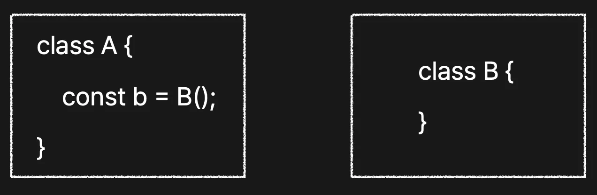
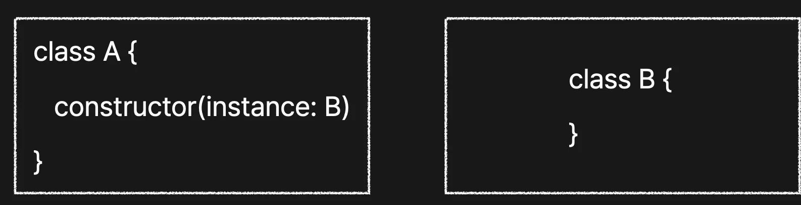
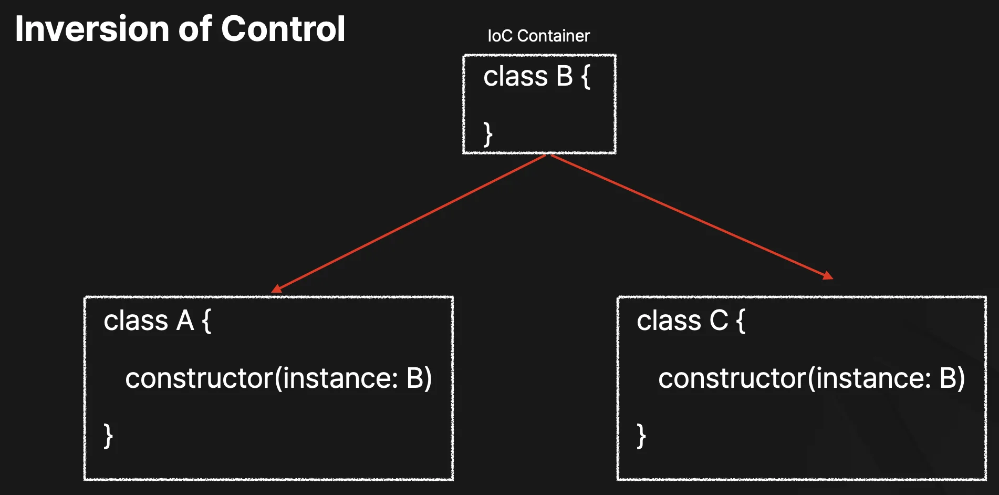
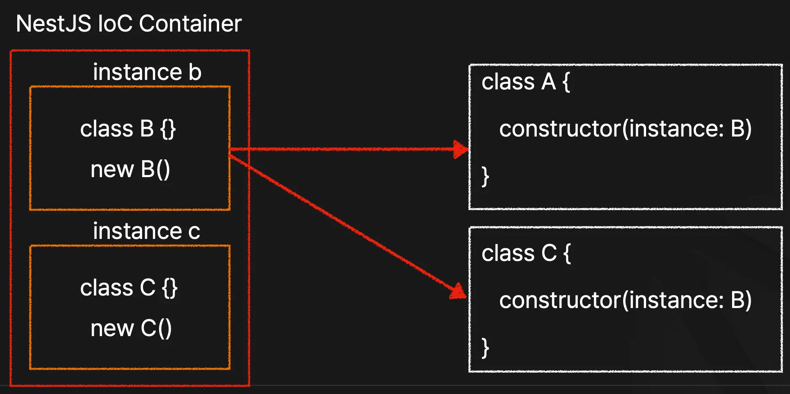

> 
> 
> <a id="266eda9b0fe1811898a8cf8a61fea3c0"></a>
> 
> <strong>목차</strong>
> 
> - [Dependency Injection ( DI, 의존성 주입 )d](#266eda9b0fe1802f86c4eabb29b007ab)
> - [Inversion of Control ( IoC, 제어의 역전 )](#266eda9b0fe1808496ffedd02b73cb7a)
> - [IoC and DI](#266eda9b0fe180379d51eb89ee2d14c7)

<a id="266eda9b0fe1802f86c4eabb29b007ab"></a>

### Dependency Injection ( DI, 의존성 주입 )d

> ❗ 
> 
> <a id="266eda9b0fe180d79875f92e2a871dda"></a>
> 
> 의존성 주입에는 필드 주입, setter 주입, 생성자 주입이 있으나, 일반적으로 생성자 주입을 사용한다&#46; ( 권장 )

<details>
<summary>일반 인스턴스화</summary>

> ❗ 
> 
> <a id="266eda9b0fe1805d84d7dd713113e051"></a>
> 
> JavaScript 에서는 <strong>new 키워드 없</strong>이 클래스의 인스턴스를 생성할 수 있다&#46; 
> 
> - 호출<code>()</code> 을 통해 인스턴스 생성



<a id="266eda9b0fe180b7b95af69c8a987c8d"></a>

```typescript
// 클래스 B 정의
export class B {
  . . . 
}

// 일반 인스턴스화 - 호출을 통해 이뤄짐
export class A {
	
	const b = B();
	
  	. . .
}
```

</details>

<details>
<summary>의존성 주입 &#45; 생성자 주입</summary>



<a id="266eda9b0fe1802ea5bafbd931fbbe93"></a>

```typescript
// 클래스 B 정의
export class B {
  . . . 
}

// 의존성 주입 - 생성자 주입
export class A {
	
	constructor(instance: B)
	
  	. . .
}
```

</details>

<a id="266eda9b0fe1808496ffedd02b73cb7a"></a>

### Inversion of Control ( IoC, 제어의 역전 )



<a id="266eda9b0fe1801c8e7ad1ec5c824ca5"></a>

인스턴스 생성에 대한 컨트롤을 외부로 설정하므로써 각 클래스 간에  의존성(종속성)을 낮추는 패턴이다&#46;

<a id="266eda9b0fe180b48db5fec46bb1ab48"></a>

외부 IoC Container에서 각 클래스의 인스턴스를 생성하고 해당하는 클래스로 주입한다&#46; 

- 이때 생성자 주입을 통해 받아온다&#46; 

<a id="266eda9b0fe180379d51eb89ee2d14c7"></a>

### <code>IoC</code> and <code>DI</code>



<a id="266eda9b0fe180398005d88a96d4c92c"></a>

위에 2가지 내용을 통합해서 정리한 그림이다&#46; 

<a id="266eda9b0fe1801ba920f31b79415a3f"></a>

그림과 같이 NestJS의 IoC Container에서 인스턴스를 생성하고 생성자 주입을 통해 해당 클래스로 주입된다&#46; 

<a id="266eda9b0fe180f9833bc773c75993f0"></a>

이를 통해 각 클래스들 간에 coupling을 낮춰 확장성에 용이하고, 유지보수성이 높은 코드 설계를 할 수 있다&#46;
