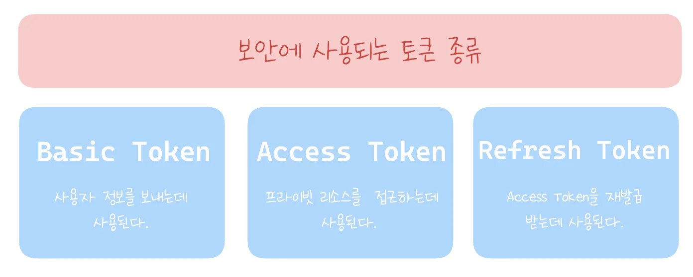
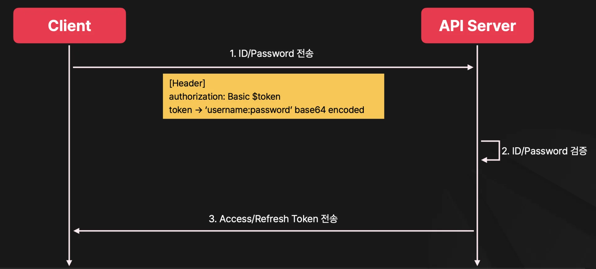
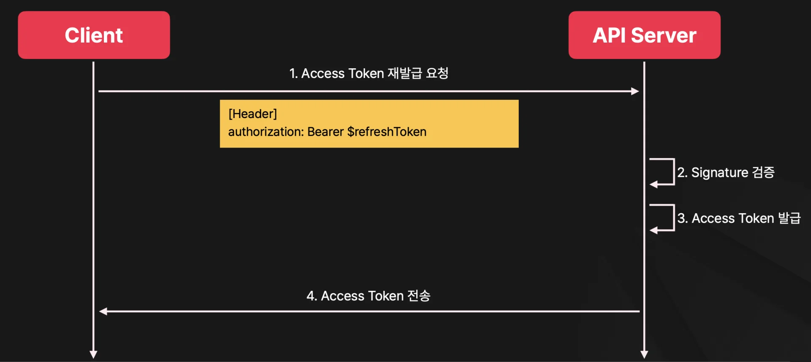
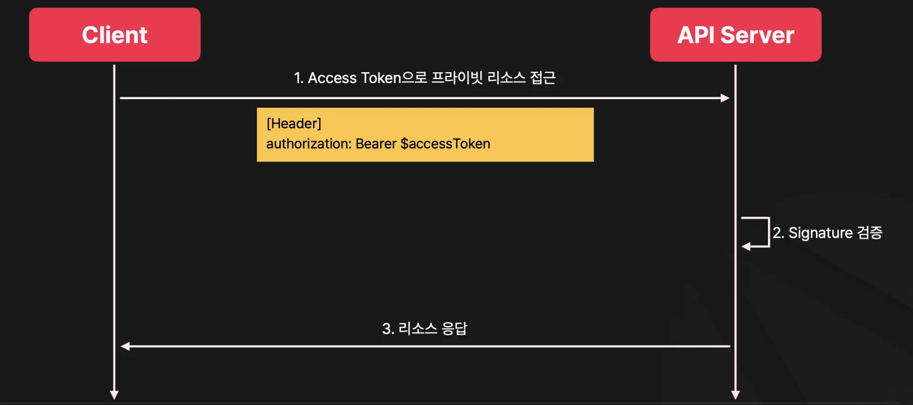
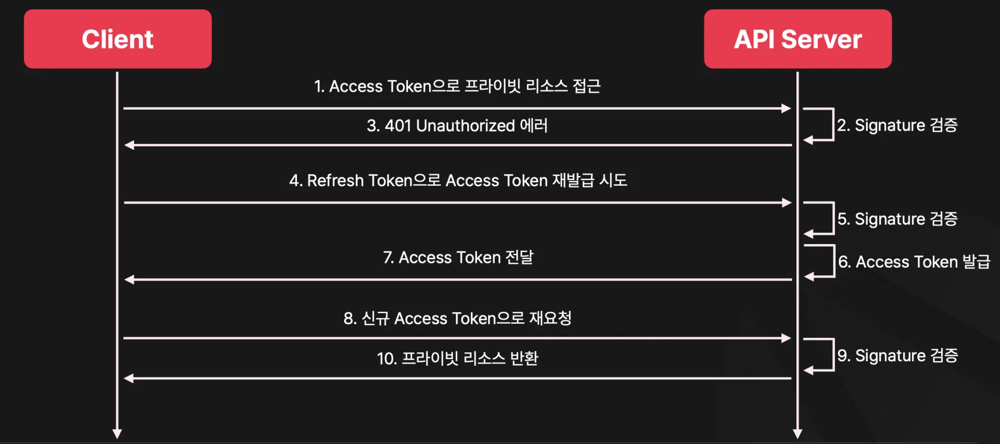
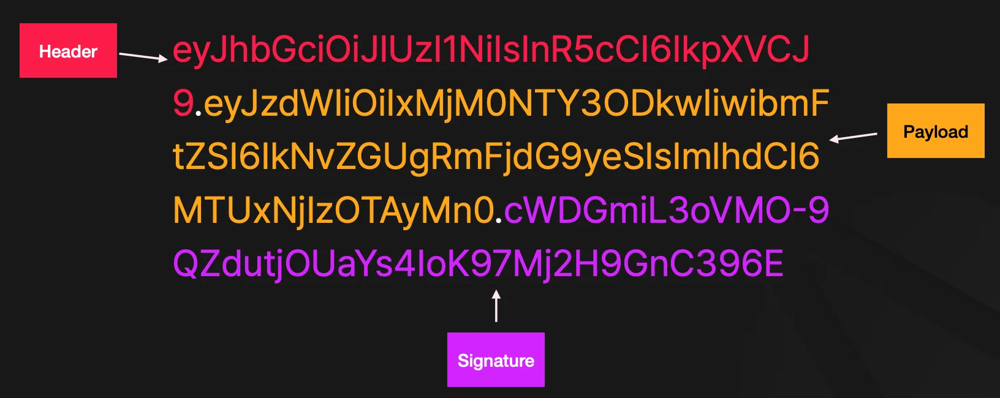
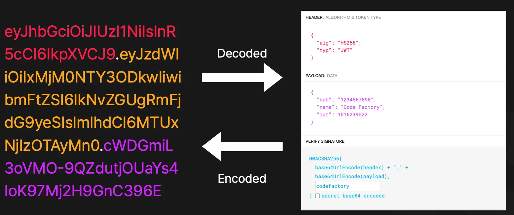
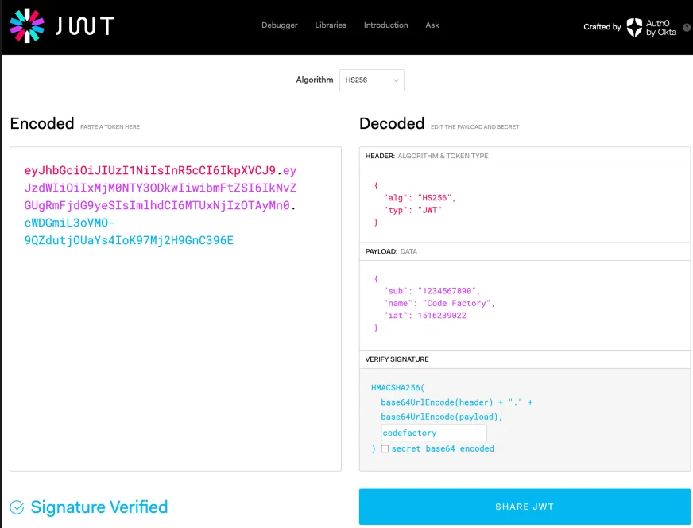

> 
> 
> 
> 
> <strong>목차</strong>
> 
> - [토큰](#266eda9b0fe18063b415d373cc1ef943)
> - [보안(인증)에 사용되는 토큰 종류 ](#266eda9b0fe18089babde2e37e348ca9)
> - [로그인 과정](#266eda9b0fe180ae99ddf154a9573724)
> - [Refresh Token 사용 과정](#266eda9b0fe18000af98ff339bc42fa9)
> - [Access Token 사용 과정](#266eda9b0fe1805cb1f9caa55eaa421d)
> - [정리) Access Token 만료 시, Refresh Token을 통한 갱신 및 사용](#266eda9b0fe180a1b772f42211301451)
> - [JWT](#266eda9b0fe180708668c1111d05e9f4)

## 토큰

---

### 보안(인증)에 사용되는 토큰 종류 

1. <code>Basic Token</code>
    - 사용자 정보를 보내는데 사용

1. <code>Access Token</code>
    - 프라이빗 리소스를 접근하는데 사용

1. <code>Refresh Token</code>
    - Access Token을 재발급 받는데 사용

### 로그인 과정

### Refresh Token 사용 과정

1. 사용자의 Access Token 만료 시, 서버로 Access Token 재발급 요청을 한다&#46;  이때, Refresh Token을 header에 담아 보낸다&#46; 

1. 받아온 Refresh Token의 Signature를 검증하여 인증 여부를 판단하고, 인증이 된 경우, Access Token을 다시 발급하여 사용자에게 넘긴다&#46; 

### Access Token 사용 과정

### 정리) Access Token 만료 시, Refresh Token을 통한 갱신 및 사용

1. 만료된 Access Token으로 인가 요청 ( 프라이빗 리소스 접근 )
    -  만료가 되어 401 Unauthorized 오류 발생

1. Refresh Token으로 Access Token 재발급 시도
    - 서버에 Refresh Token을 요청 header에 담아 갱신 요청 보냄

    - 서버에서 Refresh Token의 signature를 검증하여 인증 여부 판단

    - 인증 완료 후, Access Token을 재생성하여 클라이언트로 전송

1. 클라이언트에서는 갱신된 Access Token으로 인가 요청 ( 프라이빗 리소스 접근 )
    - 인증에 성공하여, 프라이빗 리소스를 반환 받음

### JWT

---

> ✏️ 
> 
> 
> 
> 이전 정리 내용
> 
> - <a href="#/post/13deda9b-0fe1-8152-ad91-da9d646c6232">페이지</a> 
> 
> - <a href="https://beautiful-college-c84.notion.site/1dfeda9b0fe18060a5e1fed52e34c78f">페이지</a> 
> 
> - <a href="#/post/22feda9b-0fe1-8028-8cb5-c9861355f44b">페이지</a> 

