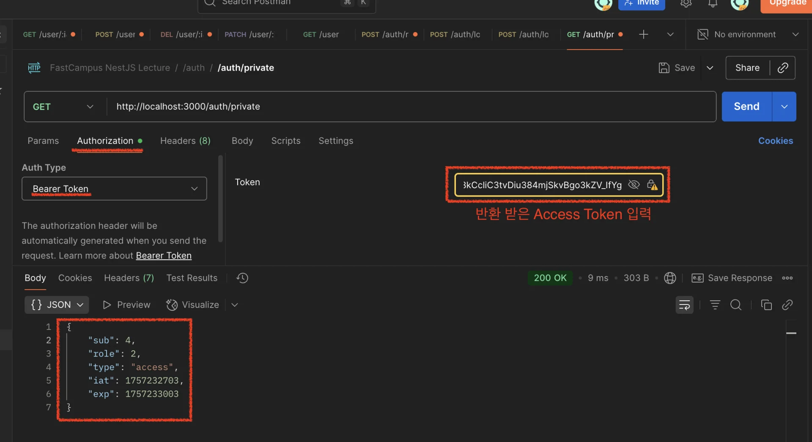

<a id="267eda9b0fe180ff883ec53cf968940c"></a>

## 로그인&#58; <code>Passport</code> 사용

---

<a id="267eda9b0fe1806f9944e48126c6dcf6"></a>

### 1&#46; 의존성 설치

<details>
<summary><code>passport</code>, <code>&#64;nestjs/passport</code>, <code>passport&#45;local</code> ( strategy ), <code>passport&#45;jwt</code> ( strategy )</summary>

<a id="267eda9b0fe180a39851d84cc0d7bbe7"></a>

```bash
pnpm i @nestjs/passport passport passport-local passport-jwt
pnpm i -D @types/passport-local @types/passport-jwt
```

</details>

<a id="267eda9b0fe180899637d1ffd9d235a5"></a>

### 2&#46;  Local Strategy  적용

<details>
<summary><strong>&#91; 코드 &#93; AuthModule</strong></summary>

<a id="267eda9b0fe180af8852d056c6b00514"></a>

```typescript
import { Module } from '@nestjs/common';
import { AuthService } from './auth.service';
import { AuthController } from './auth.controller';
import { TypeOrmModule } from '@nestjs/typeorm';
import { User } from 'src/user/entities/user.entity';
import { JwtModule } from '@nestjs/jwt';
import { LocalStrategy } from './strategy/local.strategy';

@Module({
  imports: [TypeOrmModule.forFeature([User]), JwtModule.register({})],
  controllers: [AuthController],
  providers: [AuthService, LocalStrategy],
  exports: [AuthService],
})
export class AuthModule {}

```

- module 계층에서 providers에 등록해야 정상적으로 DI 가능하다&#46; 

</details>

<details>
<summary><strong>&#91; 코드 &#93; AuthService</strong></summary>

<a id="267eda9b0fe180039d6bc97b2be86a61"></a>

```typescript
import { BadRequestException, Injectable } from '@nestjs/common';
import { ConfigService } from '@nestjs/config';
import { InjectRepository } from '@nestjs/typeorm';
import { User } from 'src/user/entities/user.entity';
import { Repository } from 'typeorm';
import * as bcrypt from 'bcrypt';
import { JwtService } from '@nestjs/jwt';

@Injectable()
export class AuthService {
  constructor(
    @InjectRepository(User)
    private readonly userRepository: Repository<User>,
    private readonly configService: ConfigService,
    private readonly jwtService: JwtService,
  ) {}
	
  	. . .

  /// rawToken: Basic $token
  async login(rawToken: string) {
    const { email, password } = this.parseBasicToken(rawToken);

    const user = await this.authenticate(email, password);

    return {
      refreshToken: await this.issueToken(user, false),
      accessToken: await this.issueToken(user, false),
    };
  }

  async issueToken(user: User, isRefreshToken: boolean) {
    const refreshTokenSecret = this.configService.get<string>(
      'REFRESH_TOKEN_SECRET',
    );
    const accessTokenSecret = this.configService.get<string>(
      'ACCESS_TOKEN_SECRET',
    );

    return this.jwtService.signAsync(
      {
        sub: user.id,
        role: user.role,
        type: isRefreshToken ? 'refresh' : 'access',
      },
      {
        secret: isRefreshToken ? refreshTokenSecret : accessTokenSecret,
        expiresIn: isRefreshToken ? '24h' : 300,
      },
    );
  }

  async authenticate(email: string, password: string) {
    const user = await this.userRepository.findOne({
      where: { email },
    });

    if (!user) {
      throw new BadRequestException('잘못된 로그인 정보입니다.'); // 보안적 취약점이 될 수 있기 때문에, 이메일이라는 구체적 정보를 명시하지 않음
    }

    const passOk = await bcrypt.compare(password, user.password);

    if (!passOk) {
      throw new BadRequestException('잘못된 로그인 정보입니다.'); // 보안적 취약점이 될 수 있기 때문에, 이메일이라는 구체적 정보를 명시하지 않음
    }

    return user;
  }

  . . .
  
}

```

- module 계층에서 providers에 등록해야 정상적으로 DI 가능하다&#46; 

</details>

<details>
<summary><strong>&#91; 코드 &#93; AuthController</strong></summary>

<a id="267eda9b0fe1806f8335f235fa7ed4c6"></a>

```typescript
import { Controller, Headers, Post, Request, UseGuards } from '@nestjs/common';
import { AuthService } from './auth.service';
import { AuthGuard } from '@nestjs/passport';

@Controller('auth')
export class AuthController {
	 
	  . . .
	  
	@UseGuards(LocalAuthGuard)
  async loginUserPassport(@Request() req) {
    return {
      refreshToken: await this.authService.issueToken(req.user, false),
      accessToken: await this.authService.issueToken(req.user, false),
    };
  }
}
```

- <strong>LocalStrategy의 기본 식별자는 </strong><strong><code>local</code></strong><strong> 이다&#46;</strong>

</details>

<details>
<summary><strong>&#91; 코드 &#93; LocalStrategy</strong></summary>

<a id="267eda9b0fe1800c8bb7e384d867f4a7"></a>

```typescript
import { AuthGuard, PassportStrategy } from '@nestjs/passport';
import { Strategy } from 'passport-local';
import { AuthService } from '../auth.service';
import { Injectable } from '@nestjs/common';

export class LocalAuthGuard extends AuthGuard('local') {}

@Injectable()
export class LocalStrategy extends PassportStrategy(Strategy) {
  constructor(private readonly authService: AuthService) {
    super();
  }

  async validate(username: string, password: string) {
    const user = await this.authService.authenticate(username, password);
    return user;
  }
}
```

</details>

<details>
<summary>기본 필드 명칭 변경</summary>

> ✏️ 
> 
> <a id="267eda9b0fe180739ef0e59bed7770b0"></a>
> 
> <code>PassportStrategy</code>에서 제공하는 옵션으로 기본 필드 명칭을 변경할 수 있다&#46; 
> 
> - 기본 명칭&#58; <code>username</code>, <code>password</code> …
>     - username → <code>usernameField&#58; {새로운 명칭}</code>
> 
>     - password → <code>passwordField&#58; {새로운 명칭}</code>

<details>
<summary><strong>&#91; 코드 &#93; LocalStrategy</strong></summary>

<a id="267eda9b0fe1804c8621f46c4b9fa66c"></a>

```typescript
import { AuthGuard, PassportStrategy } from '@nestjs/passport';
import { Strategy } from 'passport-local';
import { AuthService } from '../auth.service';
import { Injectable } from '@nestjs/common';

@Injectable()
export class LocalStrategy extends PassportStrategy(Strategy) {
  constructor(private readonly authService: AuthService) {
    super({
      usernameField: 'email',
    });
  }

  async validate(email: string, password: string) {
    const user = await this.authService.authenticate(email, password);
    return user;
  }
}
```

</details>

</details>

<details>
<summary>Strategy 식별 명칭 변경</summary>

> ✏️ 
> 
> <a id="267eda9b0fe18094a20dc9d917c01f91"></a>
> 
> <code>PassportStrategy</code>  상속(extends) 처리 시, <strong><u>2번째 인자로 명칭을 명시</u></strong>하면 해당 명칭을 <strong>새로운 Strategy 식별자</strong>로 사용 가능하다&#46; 

<details>
<summary><strong>&#91; 코드 &#93; LocalStrategy</strong></summary>

<a id="267eda9b0fe180199239ef72c26ab4a6"></a>

```typescript
import { AuthGuard, PassportStrategy } from '@nestjs/passport';
import { Strategy } from 'passport-local';
import { AuthService } from '../auth.service';
import { Injectable } from '@nestjs/common';

@Injectable()
export class LocalStrategy extends PassportStrategy(Strategy, 'test') { // 식별자 부여 
  constructor(private readonly authService: AuthService) {
    super({
      usernameField: 'email',
    });
  }

  async validate(email: string, password: string) {
    const user = await this.authService.authenticate(email, password);
    return user;
  }
}
```

</details>

<details>
<summary><strong>&#91; 코드 &#93; AuthController</strong></summary>

<a id="267eda9b0fe18026b092f91ff2ab1291"></a>

```typescript
import { Controller, Headers, Post, Request, UseGuards } from '@nestjs/common';
import { AuthService } from './auth.service';
import { AuthGuard } from '@nestjs/passport';

@Controller('auth')
export class AuthController {
  constructor(private readonly authService: AuthService) {}

   . . .

  @UseGuards(AuthGuard('test'))  // 부여한 식별자로 Strategy 식별 가능
  @Post('login/passport')
  loginUserPassport(@Request() req) {
    return req.user;
  }
}
```

</details>

</details>

<details>
<summary>Guard 명칭 부여</summary>

> ✏️ 
> 
> <a id="267eda9b0fe180c3a6cade01135d609b"></a>
> 
> <strong><u>string 값</u></strong>은 <strong><u>오타</u></strong>에 대한 <strong><u>컴파일 check가 불가능</u></strong>하다&#46; 
> 
> <a id="267eda9b0fe180439bd0c186bfea76ca"></a>
> 
> 즉, <strong>오류가 </strong><strong><u>런타임 환경</u></strong><strong>에서 확인</strong>된다&#46;  이건 굉장히 크리티컬한 오류 상황이다&#46; 
> 
> <a id="267eda9b0fe180aeb1cfcbeb1828dec6"></a>
> 
> 따라서 해당 문제를 class로 선언으로 <strong>컴파일에서 인식 가능한 형태로 변환</strong>하여 해결한다&#46; 
> 
> -  enum 사용과 의미 동일

<details>
<summary><strong>&#91; 코드 &#93; TestGuard</strong></summary>

<a id="267eda9b0fe18081be7fd7d3321ca405"></a>

```typescript
import { AuthGuard, PassportStrategy } from '@nestjs/passport';
import { Strategy } from 'passport-local';
import { AuthService } from '../auth.service';
import { Injectable } from '@nestjs/common';

export class TestGuard extends AuthGuard('test') {}

@Injectable()
export class LocalStrategy extends PassportStrategy(Strategy, 'test') {
  constructor(private readonly authService: AuthService) {
    super({
      usernameField: 'email',
    });
  }

  /** LocalStrategy
   *
   * validate : username, password
   *
   * return ->  Request();
   */
  async validate(email: string, password: string) {
    const user = await this.authService.authenticate(email, password);

    return user;
  }
}

```

</details>

<details>
<summary><strong>&#91; 코드 &#93; AuthController</strong></summary>

<a id="267eda9b0fe180098c32f8e981534f1c"></a>

```typescript
import { Controller, Headers, Post, Request, UseGuards } from '@nestjs/common';
import { AuthService } from './auth.service';
import { TestGuard } from './strategy/local.strategy';

@Controller('auth')
export class AuthController {
  constructor(private readonly authService: AuthService) {}

   . . .

  @UseGuards(TestGuard)
  @Post('login/passport')
  loginUserPassport(@Request() req) {
    return req.user;
  }
}
```

</details>

</details>

<a id="267eda9b0fe1805bbee0d936c2d8643e"></a>

### 3&#46;  JWT Strategy  적용

<details>
<summary><strong>&#91; 코드 &#93; AuthModule</strong></summary>

<a id="267eda9b0fe180d78f18f56fbe861dec"></a>

```typescript
import { Module } from '@nestjs/common';
import { AuthService } from './auth.service';
import { AuthController } from './auth.controller';
import { TypeOrmModule } from '@nestjs/typeorm';
import { User } from 'src/user/entities/user.entity';
import { JwtModule } from '@nestjs/jwt';
import { LocalStrategy } from './strategy/local.strategy';

@Module({
  imports: [TypeOrmModule.forFeature([User]), JwtModule.register({})],
  controllers: [AuthController],
  providers: [AuthService, LocalStrategy, JwtStrategy],
  exports: [AuthService],
})
export class AuthModule {}
```

- module 계층에서 providers에 등록해야 정상적으로 DI 가능하다&#46; 

</details>

<details>
<summary><strong>&#91; 코드 &#93; AuthController</strong></summary>

<a id="267eda9b0fe1808888fafb6dacab12c5"></a>

```typescript
import {
  Controller,
  Get,
  Headers,
  Post,
  Request,
  UseGuards,
} from '@nestjs/common';
import { AuthService } from './auth.service';
import { LocalAuthGuard } from './strategy/local.strategy';
import { JwtAuthGuard } from './strategy/jwt.strategy';

@Controller('auth')
export class AuthController {
  constructor(private readonly authService: AuthService) {}

  . . . 

  @UseGuards(JwtAuthGuard)
  @Get('private')
  private(@Request() req) {
    return req.user;
  }
}

```

- <strong>LocalStrategy의 기본 식별자는 </strong><strong><code>local</code></strong><strong> 이다&#46;</strong>

</details>

<details>
<summary><strong>&#91; 코드 &#93; JwtStrategy</strong></summary>

<a id="267eda9b0fe180d2ba08efcbb0d27ad6"></a>

```typescript
import { AuthGuard, PassportStrategy } from '@nestjs/passport';
import { Injectable } from '@nestjs/common';
import { ExtractJwt, Strategy } from 'passport-jwt';
import { ConfigService } from '@nestjs/config';

export class JwtAuthGuard extends AuthGuard('jwt') {}

@Injectable()
export class JwtStrategy extends PassportStrategy(Strategy) {
  constructor(private readonly configService: ConfigService) {
    super({
      /// Bearer $token
      jwtFromRequest: ExtractJwt.fromAuthHeaderAsBearerToken(),       // jwt token 추출 - bear token 방식 ( 다양한 방식의 메서드 지원 )
      ignoreExpiration: false,                                        // jwt 만료 설정 무시 여부 - false: 만료 설정 반영
      secretOrKey: configService.get<string>('ACCESS_TOKEN_SECRET')!, // AppModule에서 이미 필수 값으로 설정함, 따라서 '!' 를 통해 required 값이라는 것을 알림
    });
  }
	
	// 디코딩된 jwt의 payload 반환
  validate(payload: any) {
    return payload;
  }
}

```

</details>

<details>
<summary><strong>Postman 테스트</strong></summary>

- url&#58; <code>http&#58;//localhost&#58;3000/auth/private</code>
    

    - Authorization &#45; Baerer Token &#45; 응답받은 Access Token 입력

</details>
