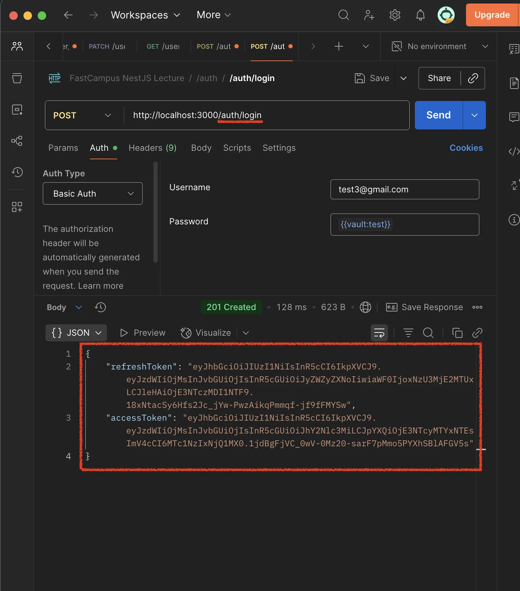
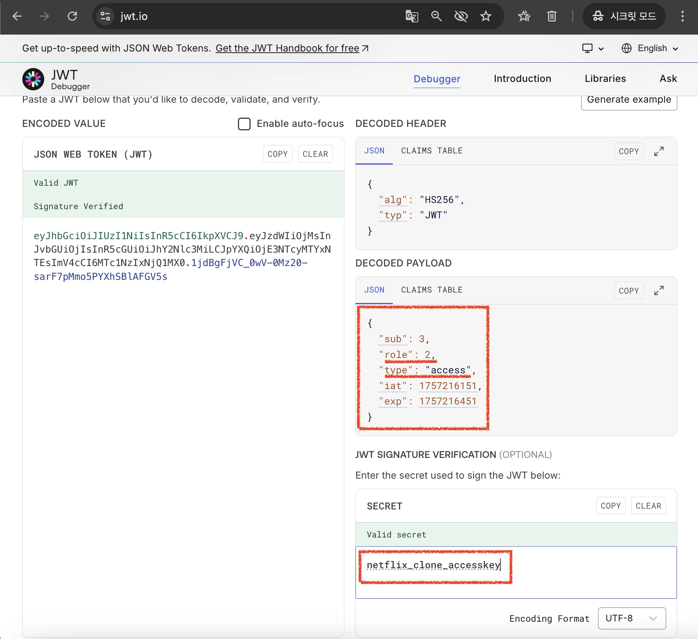

<a id="267eda9b0fe180a98b77e0de6aaf0d24"></a>

## 로그인&#58;  라이브러리 사용 ❌  ( 기본 구현 )

---

<a id="267eda9b0fe180bc8781f8fd06c3167b"></a>

### 1&#46; 의존성 설치&#58;

<details>
<summary><code>jwt</code></summary>

<a id="267eda9b0fe18068b517d7eb80ce7d8a"></a>

```bash
pnpm i @nestjs/jwt
```

</details>

<a id="267eda9b0fe1809fb8f7ecefee596cbb"></a>

 

<a id="267eda9b0fe180f58fe6df52848b73fd"></a>

### 2&#46; <code>AuthModule</code>에 <code>JwtModule</code>등록 및  Secret key 설정

<details>
<summary><strong>환경변수 &#45; ( access token, refresh token ) secret 값 설정</strong></summary>

<a id="267eda9b0fe1807c8573f71d554557d2"></a>

```bash
# App
ENV=dev # test, dev, prod
PORT=3000

# DB
DB_TYPE=postgres
DB_HOST=localhost
DB_PORT=5432    
DB_USERNAME=myapp
DB_PASSWORD=myapp_pw
DB_DATABASE=myapp

# Hash
HASH_ROUNDS=10  # 10 일반적인 bcrypt hash rounds 값이다. 해당 값보다 커지면 해싱 처리가 느려지고, 낮으면 빨라진다. 

# JWT
 # 베포 시, 해당 값을 랜덤하게 설정하고 주기적으로 변경하는 것이 좋다. 
ACCESS_TOKEN_SECRET=netflix_clone_accesskey
REFRESH_TOKEN_SECRET=netflix_clone_refreshkey
```

</details>

<details>
<summary><strong>&#91; 코드 &#93; AppModule</strong></summary>

<a id="267eda9b0fe1807382abc43152c95d24"></a>

```typescript
import { Module } from '@nestjs/common';
import { TypeOrmModule } from '@nestjs/typeorm';
import { User } from './user/entities/user.entity';
import { AuthModule } from './auth/auth.module';
import { UserModule } from './user/user.module';
import { ConfigModule, ConfigService } from '@nestjs/config';
import { SnakeNamingStrategy } from 'typeorm-naming-strategies';
import * as Joi from 'joi';

@Module({
  imports: [
    ConfigModule.forRoot({
      isGlobal: true,
      validationSchema: Joi.object({
        ENV: Joi.string().valid('dev', 'prod').required(),
        DB_TYPE: Joi.string().valid('postgres').required(),
        DB_HOST: Joi.string().required(),
        DB_USERNAME: Joi.string().required(),
        DB_PASSWORD: Joi.string().required(),
        DB_DATABASE: Joi.string().required(),
        HASH_ROUNDS: Joi.number().required(),
        ACCESS_TOKEN_SECRET: Joi.string().required(),
        REFRESH_TOKEN_SECRET: Joi.string().required(),
      }),
    }),
    TypeOrmModule.forRootAsync({
      inject: [ConfigService],
      useFactory: (cfg: ConfigService) => ({
        type: cfg.get<string>('DB_TYPE') as 'postgres',
        host: cfg.get<string>('DB_HOST'),
        port: cfg.get<number>('DB_PORT'),
        username: cfg.get<string>('DB_USERNAME'),
        password: cfg.get<string>('DB_PASSWORD'),
        database: cfg.get<string>('DB_DATABASE'),
        entities: [User],
        synchronize: cfg.get<string>('DB_TYPE') === 'prod' ? false : true, // 운영에서는 반드시 false
        logging: true,
        namingStrategy: new SnakeNamingStrategy(),
      }),
    }),
    AuthModule,
    UserModule,
  ],
})
export class AppModule {}
```

</details>

<details>
<summary><strong>&#91; 코드 &#93; AuthModule</strong></summary>

<a id="267eda9b0fe1801cad1cf206428aeaf2"></a>

```typescript
import { Module } from '@nestjs/common';
import { AuthService } from './auth.service';
import { AuthController } from './auth.controller';
import { TypeOrmModule } from '@nestjs/typeorm';
import { User } from 'src/user/entities/user.entity';
import { JwtModule } from '@nestjs/jwt';

@Module({
  imports: [
	  TypeOrmModule.forFeature([User]), 
	  JwtModule.register({})
  ],
  controllers: [AuthController],
  providers: [AuthService],
})
export class AuthModule {}

```

</details>

<a id="267eda9b0fe180638be3e8c5df553c0a"></a>

### 3&#46; 로그인 API 구현

<details>
<summary><strong>&#91; 코드 &#93; AuthController</strong></summary>

<a id="267eda9b0fe1806ab7d6ce6a5cdb4115"></a>

```typescript
import { Controller, Headers, Post } from '@nestjs/common';
import { AuthService } from './auth.service';

@Controller('auth')
export class AuthController {
  constructor(private readonly authService: AuthService) {}

	. . .

  @Post('login')
  /// authorization: Basic $token
  loginUser(@Headers('authorization') token: string) {
    return this.authService.login(token);
  }
}
```

</details>

<details>
<summary><strong>&#91; 코드 &#93; User</strong><br></summary>

<a id="267eda9b0fe180ada170c6b5f182b500"></a>

```typescript
import { BadRequestException, Injectable } from '@nestjs/common';
import { ConfigService } from '@nestjs/config';
import { InjectRepository } from '@nestjs/typeorm';
import { User } from 'src/user/entities/user.entity';
import { Repository } from 'typeorm';
import * as bcrypt from 'bcrypt';
import { JwtService } from '@nestjs/jwt';

@Injectable()
export class AuthService {
  constructor(
    @InjectRepository(User)
    private readonly userRepository: Repository<User>,
    private readonly configService: ConfigService,
    private readonly jwtService: JwtService,
  ) {}

		. . .
	
  /// rawToken: Basic $token
  async login(rawToken: string) {
    const { email, password } = this.parseBasicToken(rawToken);

    const user = await this.userRepository.findOne({
      where: { email },
    });

    if (!user) {
      throw new BadRequestException('잘못된 로그인 정보입니다.'); // 보안적 취약점이 될 수 있기 때문에, 이메일이라는 구체적 정보를 명시하지 않음
    }

    const passOk = await bcrypt.compare(password, user.password);

    if (!passOk) {
      throw new BadRequestException('잘못된 로그인 정보입니다.'); // 보안적 취약점이 될 수 있기 때문에, 이메일이라는 구체적 정보를 명시하지 않음
    }

    const refreshTokenSecret = this.configService.get<string>(
      'REFRESH_TOKEN_SECRET',
    );
    const accessTokenSecret = this.configService.get<string>(
      'ACCESS_TOKEN_SECRET',
    );

    return {
      refreshToken: await this.jwtService.signAsync(
        {
          sub: user.id,
          role: user.role,
          type: 'refresh',
        },
        {
          secret: refreshTokenSecret,
          expiresIn: '24h',
        },
      ),
      accessToken: await this.jwtService.signAsync(
        {
          sub: user.id,
          role: user.role,
          type: 'access',
        },
        {
          secret: accessTokenSecret,
          expiresIn: 300,
        },
      ),
    };
  }

  parseBasicToken(rawToken: string) {
    /**
     * 1) 토큰을 ' ' 기준으로 스플릿 한 후 토큰 값만 추출하기
     *  * Basic $token  ->  ['Basic', $token]
     */
    const basicSplit = rawToken.split(' ');

    if (basicSplit.length !== 2) {
      throw new BadRequestException('토큰 포맷이 유효하지 않습니다. 1');
    }

    const [_, token] = basicSplit;

    /**
     * 2) 추출한 토큰을 base64 디코딩해서 이메일과 비밀번호로 나눈다.
     *  * base64  ->  email:password  ->  ['email', 'password']
     */
    const decoded = Buffer.from(token, 'base64').toString('utf-8');

    const inputInfo = decoded.split(':');

    console.log(inputInfo);

    if (inputInfo.length !== 2) {
      throw new BadRequestException('토큰 포맷이 유효하지 않습니다. 2');
    }

    const [email, password] = inputInfo;

    return {
      email,
      password,
    };
  }
}
```

</details>

<a id="267eda9b0fe18093a985c95c7da528a5"></a>

### 4&#46; API 테스트  ( Postman )

<details>
<summary>postman 호출&#58; <code>/auth/login</code></summary>



- 회원가입과 동일하게 <code>Basic &#36;token</code> 형식으로 header에 담아 로그인 요청을 보낸다&#46; 

- 위 화면과 같이 정상적으로 <code>refresh token</code>, <code>access token</code> 이 생성되는 것을 확인할 수 있다&#46;

</details>

<details>
<summary>JWT 디코딩</summary>



- 응답 받은 JWT 토큰을 디코딩하면 위 하면과 같이 서버에서 설정한 내용과 동일한 것을 확인할 수 있다&#46; 
    - ‣

</details>
