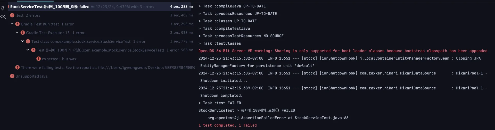

<a id="525eda9b0fe182aeb928015cb90e4794"></a>

## 문제점

<a id="68deda9b0fe182de965601817fb7528f"></a>

이전 재고 감소 로직의 테스트 케이스는 요청이 한개 씩 들어오는 상황만을 가정한다&#46;

<a id="411eda9b0fe183d5ae3901a5ab41d9cc"></a>

→ <a href="#/post/bd3eda9b-0fe1-83df-9d30-81ab20e73a36">페이지</a> 

<a id="949eda9b0fe182fba4f68102229cb3e8"></a>

## 🧐 만약 요청이 여러 개가 들어온다면 어떻게 되는가?

<a id="e64eda9b0fe183ed8140812c8800a41d"></a>

### 동시에 100개의 요청이 들어오는 테스트 케이스 

<details>
<summary>🧐 <em><code>ExecutorService</code></em></summary>

- 비동기로 실행하는 작업을 단순화하여 사용할 수 있게 도와주는 Java API

</details>

- 테스트 코드
    - 멀티스레드 사용 &#45; <em><code>ExecutorService</code></em><em>, </em><code>Executors&#46;newFixedThreadPool()</code>

    <a id="8faeda9b0fe1832fa6d2816f0eeb8d06"></a>

    ```java
    @Test
    public void 동시에_100개의_요청() throws InterruptedException {
        int threadCount = 100;
        ExecutorService executorService = Executors.newFixedThreadPool(32);
        CountDownLatch latch = new CountDownLatch(threadCount);

        for (int i = 0; i < threadCount; i++) {
            executorService.submit(() -> {
                try {
                    stockService.decrease(1L, 1L);
                } finally {
                    latch.countDown();
                }
            });
        }

        latch.await();

        Stock stock = stockRepository.findById(1L).orElseThrow();
        // 100 - ( 1 * 100 ) = 0
        assertEquals(0, stock.getQuantity())
    }
    ```

- 결과 &#45; 테스트 실패 
    

<a id="757eda9b0fe183608086816557e69e02"></a>

## 원인 &#45; <u>레이스 컨디션</u>

<details>
<summary>🧐 레이스 컨디션</summary>

<a id="e61eda9b0fe182b0b45881b6a3da8465"></a>

둘 이상의 <code>Thread</code>가 공유 데이터에 엑서스하여 동시에 변경을 하려고 할때, 발생되는 문제이다&#46;

</details>

<a id="f38eda9b0fe18299a3d601659eac944b"></a>

### 예상 스레드 동작

<a id="9b3eda9b0fe1821882fd014bc779d7ea"></a>

위 테스트코드의 동작을 아래와 같이  <code>Thread 1</code>이 데이터를 가져가 갱신을 한 후 <code>Thread 2</code>가 가져가 갱신을 하는 것으로 예상했다&#46;

| Thread &#45; 1 | Stock | Thread &#45; 2 |
| --- | --- | --- |
| select &#42;<br>from stock<br>where id = 1 | { id&#58; 1, quantity&#58; 5 } |  |
| update set quantity = 4<br>from stock<br>where id = 1 | { id&#58; 1, quantity&#58; 4} |  |
|  | { id&#58; 1, quantity&#58; 4 } | select &#42;<br>from stock<br>where id = 1 |
|  | { id&#58; 1, quantity&#58; 3 } | update set quantity = 3<br>from stock<br>where id = 1 |

<a id="ed3eda9b0fe1821db59181784d1684f4"></a>

### 실제 쓰레드 동작

<a id="ff7eda9b0fe183108c71818efc7c6fe7"></a>

그러나 실제로는 아래와 같이 <code>Thread 1</code> 데이터를 가져가<u> 갱신을 하기 전</u>에, <code>Thread 2</code>가 데이터를 가져간다&#46; 

<a id="d8beda9b0fe182b3b4398110f168346a"></a>

따라서 둘다 재고가 5인 상태에서 1을 줄인 값을 갱신하기 때문에 갱신이 누락된다&#46; 

| Thread &#45; 1 | Stock | Thread &#45; 2 |
| --- | --- | --- |
| select &#42;<br>from stock<br>where id = 1 | { id&#58; 1, quantity&#58; 5 } |  |
|  | { id&#58; 1, quantity&#58; <code>5</code> } | select &#42;<br>from stock<br>where id = 1 |
| update set quantity = 4<br>from stock<br>where id = 1 | { id&#58; 1, quantity&#58; <code>4</code>} |  |
|  | { id&#58; 1, quantity&#58; <code>4</code> } | update set quantity = 3<br>from stock<br>where id = 1 |

<a id="e92eda9b0fe1837d803c01505533dec0"></a>

이렇게 <strong><u>두개 이상의 쓰레드가 공유 데이터에 액세스 할 수 있고 동시에 변경하려고 할 때, 발생되는 문제</u></strong>를 <strong><u>레이스 컨디션</u></strong>이라고 한다&#46; 

<a id="951eda9b0fe18208a66501db76d3fdfc"></a>

해당 문제를 해결하기 위해서는 처음 예상대로<strong><u> 하나의 스레드에서 작업이 완료된 후</u></strong>,<strong><u> 다음 쓰레드가 데이터에 접근할 수 있도록 하면 된</u></strong>다&#46; 

<a id="52ceda9b0fe1837aa9a481aa010331f3"></a>

이에 대한 여러가지 방법들을 다음 챕터에서부터 다룬다&#46;
