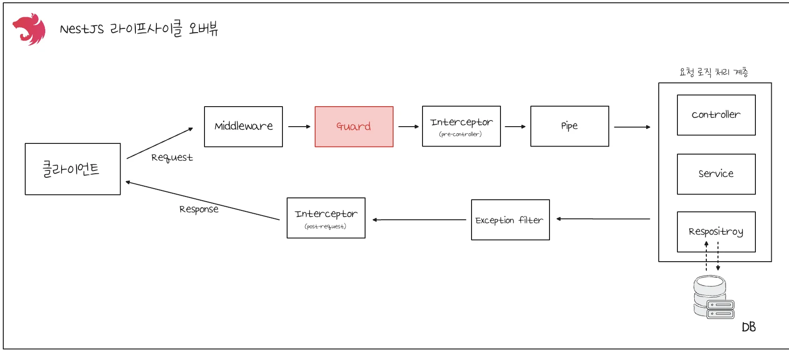
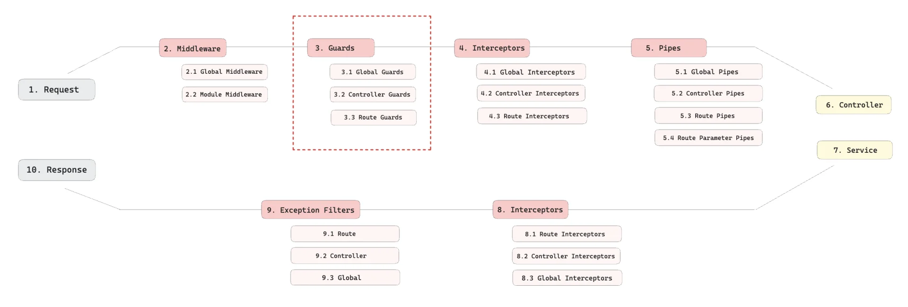
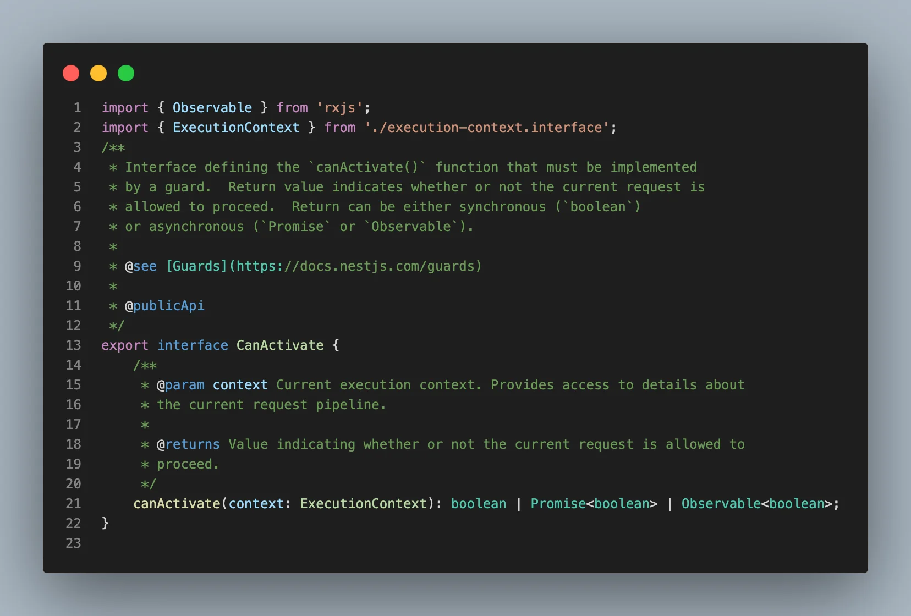
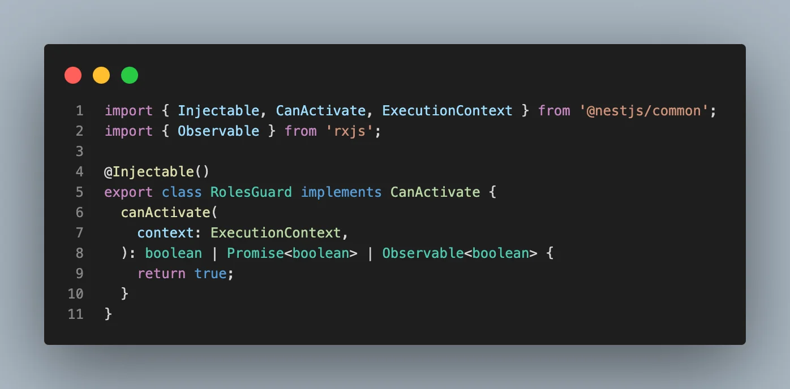
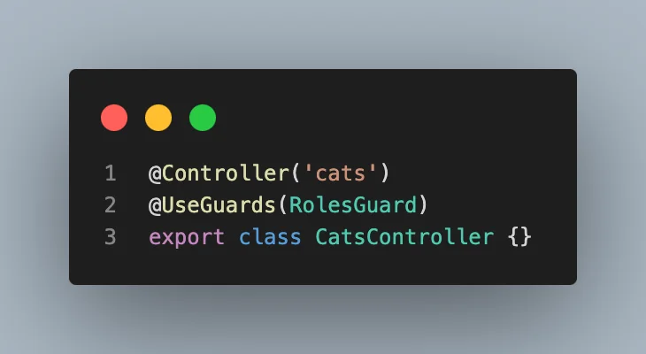
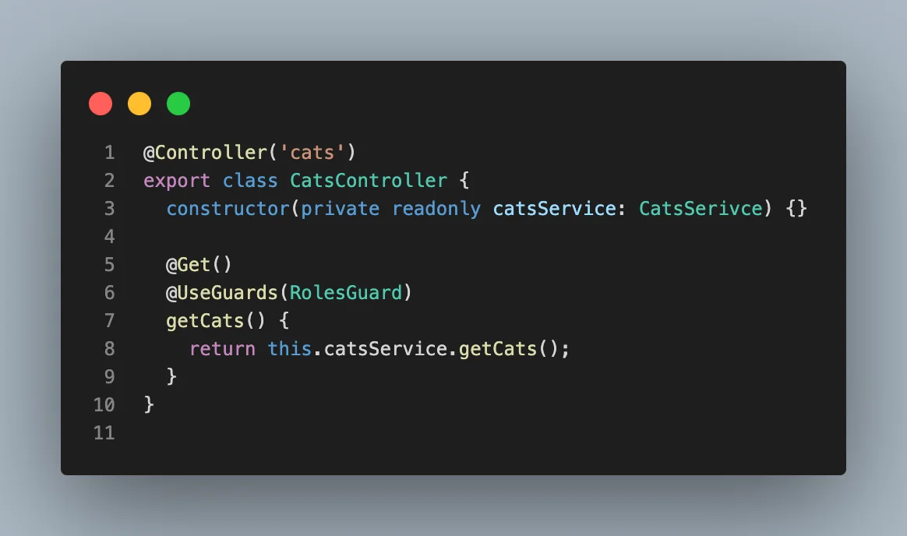
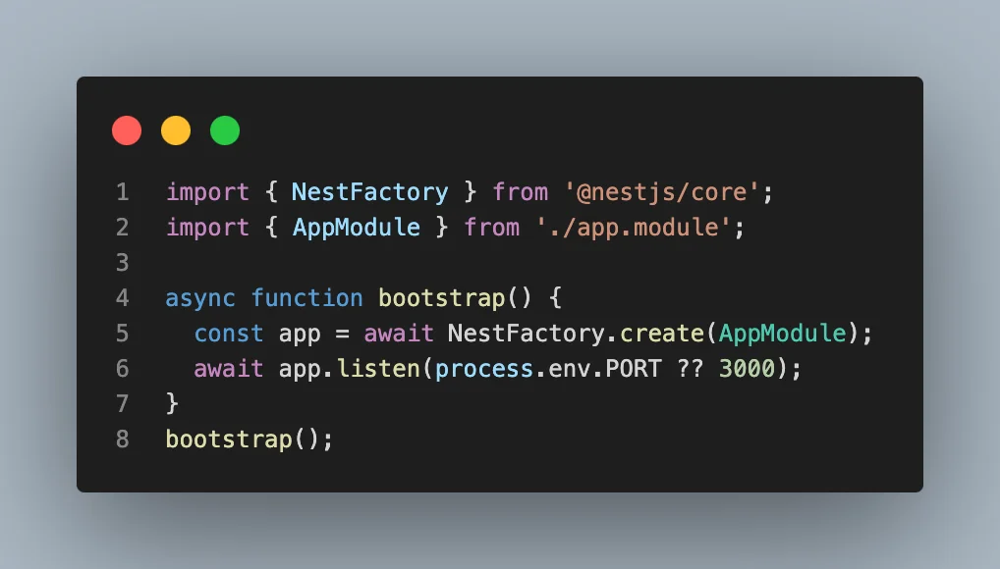
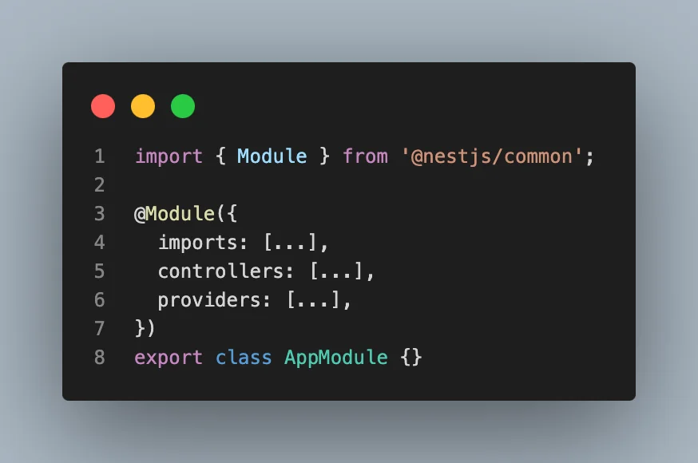
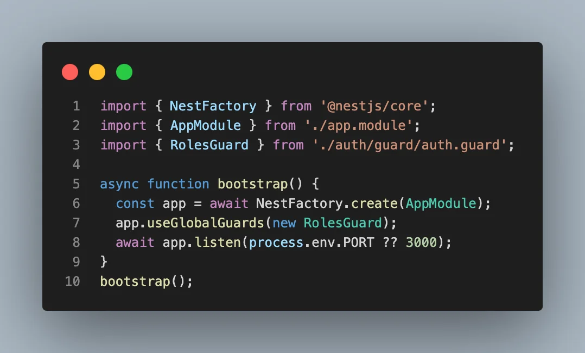
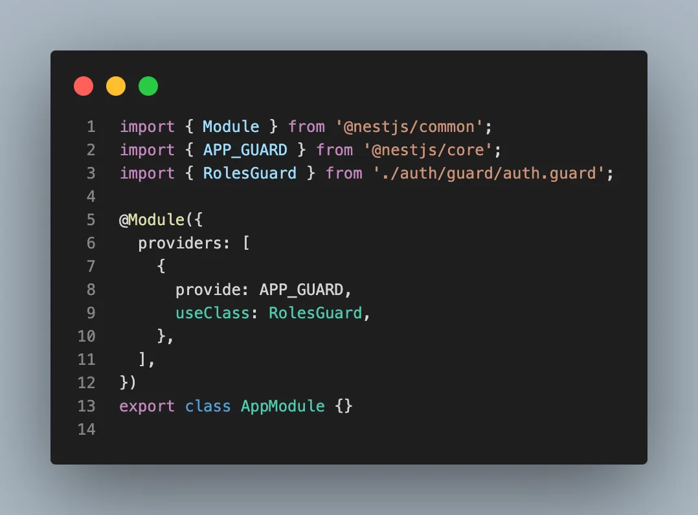

> 
> 
> <a id="26deda9b0fe1800ea890ed411b8cec4f"></a>
> 
> <strong>목차</strong>
> 
> - [Guard 란?](#26deda9b0fe180e2be4bca5c85d26ed8)
> - [[ 선언법 ] Guard 정의](#26eeda9b0fe180dfa9fcea0ac8c9770d)
> - [[ 사용법 1 ] Controller Guards, Route Guards](#26eeda9b0fe180279a63cc897e2d1fff)
> - [[ 사용법 2 ] Global Gaurds](#26eeda9b0fe180c79d4adc057cd62154)

<a id="26deda9b0fe180e2be4bca5c85d26ed8"></a>

## Guard 란?

---





> 📖 
> 
> <a id="26deda9b0fe1808daedecac332b9f655"></a>
> 
> <code>Guard</code>는 권한 등 조건을 확인 후 요청이 라우터 핸들러로 전달될지 말지를 결정한다&#46;  
> 
> <a id="26eeda9b0fe180cf8f9bc5cc78053752"></a>
> 
> 이 과정을 흔히 <code>인가 (Authorization)</code>라고 부르며 요청을 보낸 사용자가 요청을 수행할 자격이 있는지 확인한다&#46; 

> ❗ 
> 
> <a id="26eeda9b0fe18083a932e04e7e8b1d48"></a>
> 
> <code>Middleware</code>에서도 Guard와 같은 기능을 수행할 수 있지만, <code>Middleware</code>는 “<strong><u>실행 문맥”이 부족</u></strong>하다&#46;  
> 
> <a id="26eeda9b0fe1808a9d44d1121d27ace4"></a>
> 
> 반면에 <code>Guard</code>는 <code>ExecutionContext</code> 객체를 통해  <strong><u>어떤 기능이 다음으로 실행될 지 정확히 알 수 있</u></strong>다&#46;  
> 
> - 따라서 <strong>해당 요청에 맞는 인증/인가(Authorization) 로직을 적용</strong>할 수 있기 때문에, <strong><u>예측 가능하고 유지보수에 강한 보안 패턴 설계가 가능</u></strong>하다&#46;

<details>
<summary><strong>Middleware의 한계점</strong></summary>

- Middleware는 Express 스타일로 동작하며 request, response, next 세 개의 파라미터만 인자로 받아 <code>next() </code>호출을 통해 다음 동작(context)으로 넘어간다&#46;

- 그러나 <code>next()</code>를 호출한 이후에 어떤 컨텍스트(라우트 핸들러, 파이프, 가드, 인터셉터)가 다음에 실행될지 Middleware에서는 알 수 없다&#46; 

- 따라서 실행 시점이나 다음 실행될 컨텍스트에 대한 정보 없이 request를 가공하거나, 로그, 쿠키 파싱, 인증(기본)과 같은 일반적인 사전 작업만 가능하다&#46; 
    - 세밀한 라우트 정보 또는 선언적 실행 흐름을 알 수 없다&#46; 

</details>

<details>
<summary><strong>Guard의 컨텍스트 활용</strong></summary>

> 
> 
> <a id="26eeda9b0fe180aa9c9dc523a1b20b30"></a>
> 
> <code>ExecutionContext</code>는 <strong><u>현재 진행중</u></strong>인 <strong>요청의 타입(HTTP, GraphQL, WebSocket 등), 라우터 핸들러 정보, 클래스, 메서드 데코레이터, 메타데이터 등</strong> <strong><u>“실행 문맥”을 상세하게 제공</u></strong>한다&#46;

- Guard는 <code>CanActivate</code> 인터페이스를 반드시 구현하며, <br>always ExecutionContext 객체를 인자로 받는다&#46; 
    <details>
    <summary>&#91; 코드 &#93; ExcutionContext</summary>

    

    </details>

- 즉, <strong><u>Guard </u></strong><strong><u>내 어떤 컨트롤러, 어떤 메서드(엔드포인트), 어떤 인자, 데코레이터가 적용</u></strong><strong>되어 있는지 모두 확인</strong>할 수 있고, <strong><u>다음에 어떤 기능이 실행될 지 정확히 파</u></strong>악해 커스텀 인증/권한 검사를 적용할 수 있다&#46;
    - <code>ExecutionContext&#46;switchToHttp()&#46;getRequest()</code> 등 다양한 switchTo() 메서드로 request뿐만 아니라 handler 정보도 쉽게 접근할 수 있다&#46;

</details>

<a id="26eeda9b0fe180dfa9fcea0ac8c9770d"></a>

### &#91; 선언법 &#93; Guard 정의

> ✏️ 
> 
> - <code>TRUE</code>를 반환하는 경우 Guard를 통과한다&#46; 
> 
> - <code>FALSE</code>를 반환할 경우 Guard를 통과하지 못한다&#46; 



<details>
<summary>&#91; 코드 &#93; RolesGuard</summary>

<a id="26eeda9b0fe180ada377cdcc1e268e47"></a>

```typescript
import { Injectable, CanActivate, ExecutionContext } from '@nestjs/common';
import { Observable } from 'rxjs';

@Injectable()
export class RolesGuard implements CanActivate {
  canActivate(
    context: ExecutionContext,
  ): boolean | Promise<boolean> | Observable<boolean> {
    return true;
  }
}
```

</details>

<a id="26eeda9b0fe180279a63cc897e2d1fff"></a>

### &#91; 사용법 1 &#93; <code>Controller Guards</code>, <code>Route Guards</code>

> ✏️ 
> 
> <a id="26eeda9b0fe180b1a64fdd55841ff3c7"></a>
> 
> <code>UseGuard</code> 데코레이터를 사용해 사용할 Guard를 지정할 수 있다&#46; 

<details>
<summary><code>Controller Guards</code></summary>

> 컨트롤러 클래스 위에 UseGuard 데코레이터를 사용해 적용



<details>
<summary>&#91; 코드 &#93; CatsController</summary>

<a id="26eeda9b0fe180ab969bda9b314cd9d8"></a>

```typescript
@Controller('cats')
@UseGuards(RolesGuard)
export class CatsController {}
```

</details>

</details>

<details>
<summary><code>Route Guards</code></summary>

> Controller 내 적용하려는 Route 위에 <code>&#64;UseGuard</code> 데코레이터를 사용해 적용



<details>
<summary>&#91; 코드 &#93; CatsController</summary>

<a id="26eeda9b0fe180ca92a2e0f57589520b"></a>

```typescript
@Controller('cats')
export class CatsController {
  constructor(private readonly catsService: CatsSerivce) {}

  @Get()
  @UseGuards(RolesGuard)
  getCats() {
    return this.catsService.getCats();
  }
}
```

</details>

</details>

<a id="26eeda9b0fe180c79d4adc057cd62154"></a>

### &#91; 사용법 2 &#93; <code>Global Gaurds</code>

> ✏️ 
> 
> <a id="26eeda9b0fe1801d8bbbf6b1d35c1d93"></a>
> 
> <code>Guard</code>를 <code>Global</code>하게 적용할 수 있는 방법은 아래와 같다&#46;
> 
> 1. <code>bootstrap</code> ( <code>main&#46;ts</code> )
> 
> 1. 루트 모듈 ( <code>AppModule</code> )에서 적용
>     - DI가 필요한 경우 해당 방법을 사용한다&#46; 

<details>
<summary>🧐 <code>bootstrap</code>(<code>main&#46;ts</code>) vs  <code>AppModule</code>(<code>app&#46;module&#46;ts</code>)</summary>

> 
> 
> <a id="26eeda9b0fe18099bec4f501c978b1b6"></a>
> 
> <code>main&#46;ts</code>는 Express 또는 Fastify 와 같은 HTTP 서버가 실제로 실행되는 엔트리 포인트이며, 여기서 NestJS의 메인 DI 시스템과 모듈 구조가 bootstrapping 된다&#46; <br>즉, main&#46;ts에서 NestFactory가 Express 인스턴스를 내부적으로 띄우지만, <code>app&#46;module&#46;ts</code>부터가 NestJS의 ‘모듈화, DI, 데코레이터 구조’가 적용되는 진짜 NestJS 코드의 시작점이다&#46; 
> 
> ---
> 
> - <code>main&#46;ts</code>
>     - Express 기반 Node 서버를 최종적으로 실행시키는 역할
> 
>     - 서버 초기화 및 listen 
> 
> - <code>app&#46;module&#46;ts</code>
>     - NestJS의 의존성 주입, 모듈 구성, 데코레이터 기반 설계가 적용된 구조의 진입점<br>

<details>
<summary>&#91; 코드 &#93; bootstrap</summary>



</details>

<details>
<summary>&#91; 코드 &#93; AppModule</summary>



</details>

</details>

<details>
<summary>1&#46; <code>bootstrap</code>(<code>main&#46;ts</code>) 에서 적용</summary>



<details>
<summary>&#91; 코드 &#93; <code>bootstrap()</code></summary>

<a id="26eeda9b0fe18006974ed9983914cfcd"></a>

```typescript
import { NestFactory } from '@nestjs/core';
import { AppModule } from './app.module';
import { RolesGuard } from './auth/guard/auth.guard';

async function bootstrap() {
  const app = await NestFactory.create(AppModule);
  app.useGlobalGuards(new RolesGuard);
  await app.listen(process.env.PORT ?? 3000);
}
bootstrap();
```

</details>

</details>

<details>
<summary>2&#46; <code>AppModule</code>(<code>app&#46;module&#46;ts</code>)</summary>



<details>
<summary>&#91; 코드 &#93; CatsController</summary>

<a id="26eeda9b0fe1806f9ecdcb6eb54bce54"></a>

```typescript
import { Module } from '@nestjs/common';
import { APP_GUARD } from '@nestjs/core';
import { RolesGuard } from './auth/guard/auth.guard';

@Module({
  providers: [
    {
      provide: APP_GUARD,
      useClass: RolesGuard,
    },
  ],
})
export class AppModule {}
```

</details>

</details>
