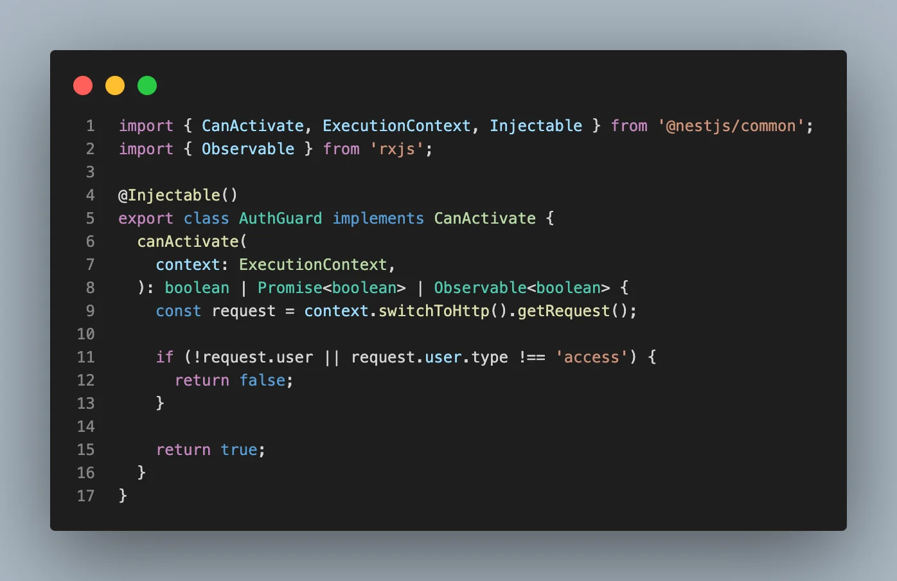
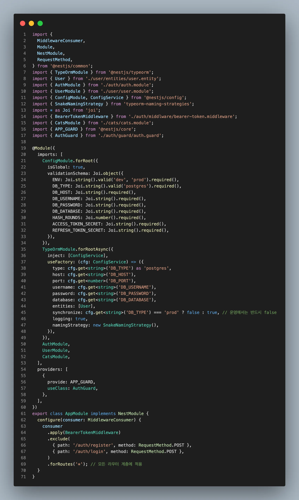
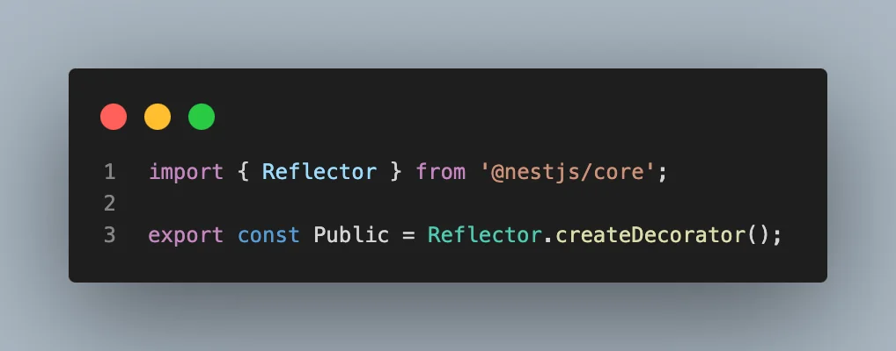
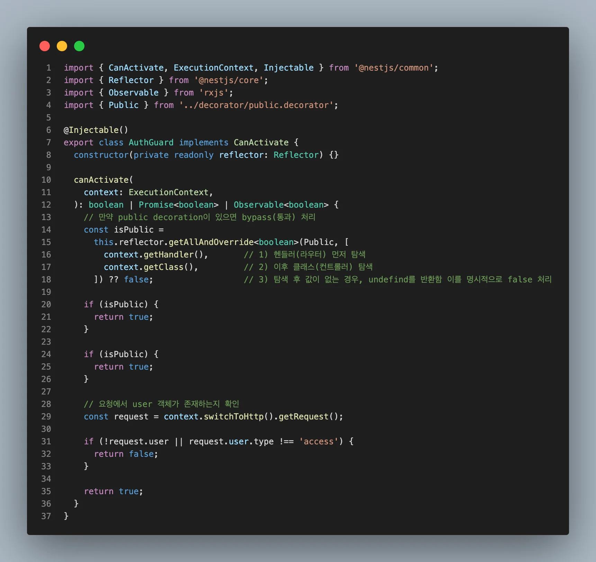
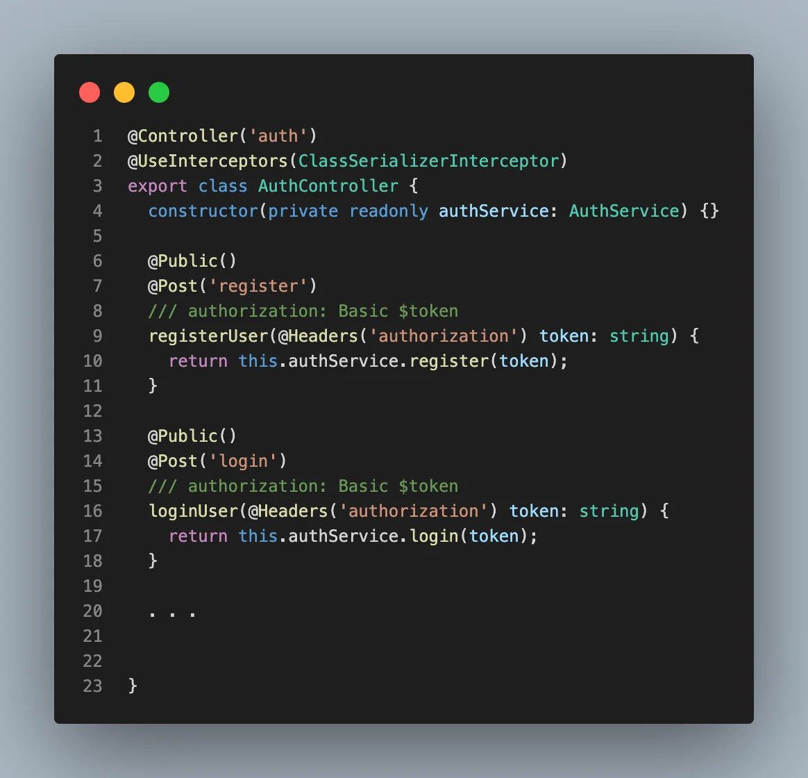
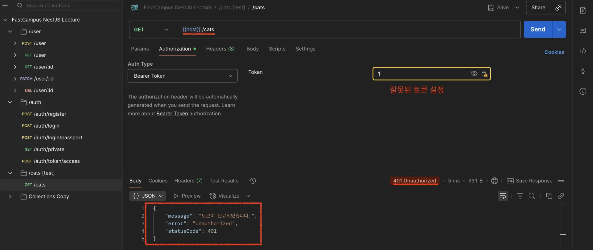
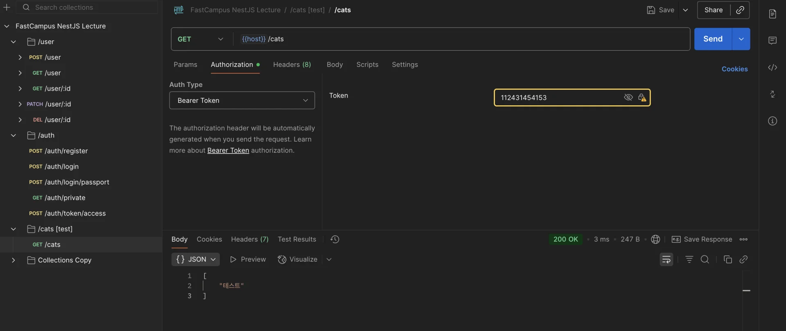

> 
> 
> <a id="26deda9b0fe180a9a30afd44a040414c"></a>
> 
> <strong>목차</strong>
> 
> - [1. AuthGuard 생성](#26deda9b0fe180aab808c65aeb2bffa9)
> - [1. AuthGuard 정의](#26eeda9b0fe180469854ca68f14157ad)
> - [2. Route에 AuthGuard 적용 ( Route Guard )](#26eeda9b0fe180faa506ca4883d27472)
> - [3. 글로벌로 AuthGuard 적용 ( Global Guard )](#26eeda9b0fe1805582f3d3c95f4eec57)
> - [2. Custom Decorator - @Public() 생성 및 라우터 예외처리](#26eeda9b0fe180419201eb78ad8a5acd)
> - [1.  커스텀 데코레이터 정의: @Public()](#26eeda9b0fe18075ac8bf908cdaeeaaa)
> - [2.  AuthGuard 리펙토링](#26eeda9b0fe1804aa737d494a8754798)
> - [3. 회원가입, 로그인 라우터 예외처리 (bypass)](#26eeda9b0fe1804082f9ebeec9bbf44f)
> - [3. Bearer Token Middleware 토큰 검증 개선](#26eeda9b0fe1806aa840f61c5014f9c2)
> - [미들웨어(BearerTokenMiddleware) 토큰 검증 로직 개선](#26eeda9b0fe1806d857af3c68030a902)

<a id="26deda9b0fe180aab808c65aeb2bffa9"></a>

## 1&#46; AuthGuard 생성

---

<a id="26eeda9b0fe180469854ca68f14157ad"></a>

### 1&#46; AuthGuard 정의

> 
> 
> <a id="26eeda9b0fe180df8a82f8ad77a3101d"></a>
> 
> 미들웨어(<code>BearerTokonMiddleware</code>) 계층에서 JWT 유무를 확인하고 디코딩된 payload <code>req&#46;user</code>로 담는다&#46; 이때 생성된 user 객체를 Guard(<code>AuthGuard</code>) 확인하여 인가 유무를 판단한다&#46; 
> 
> <details>
> <summary>미들웨어에 대한 내용은 아래 참조</summary>
> 
> - <a href="#/post/26deda9b-0fe1-8118-bfba-d6685fee395f">페이지</a> 
> 
> </details>



<details>
<summary><strong>&#91; 코드 &#93; </strong></summary>

<a id="26deda9b0fe18031a92ad347a58dee4f"></a>

```typescript
import { CanActivate, ExecutionContext, Injectable } from '@nestjs/common';
import { Observable } from 'rxjs';

@Injectable()
export class AuthGuard implements CanActivate {
  canActivate(
    context: ExecutionContext,
  ): boolean | Promise<boolean> | Observable<boolean> {
    const request = context.switchToHttp().getRequest();

    if (!request.user || request.user.type !== 'access') {
      return false;
    }

    return true;
  }
}
```

</details>

<a id="26eeda9b0fe180faa506ca4883d27472"></a>

### 2&#46; Route에 AuthGuard 적용 ( <code>Route Guard</code> )

<details>
<summary><strong>&#91; 코드 &#93; </strong>CatsController</summary>

<a id="26eeda9b0fe18156b686d0601650f886"></a>

```typescript
import { Controller, Get, Req, UseGuards } from '@nestjs/common';
import { AuthGuard } from 'src/auth/guard/auth.guard';

@Controller('cats')
export class CatsController {

  @UseGuards(AuthGuard)
  @Get()
  findAll(@Req() req: any) {
    return ['테스트'];
  }
}

```

</details>

<a id="26eeda9b0fe1805582f3d3c95f4eec57"></a>

### 3&#46; 글로벌로 AuthGuard 적용 ( <code>Global Guard</code> )



<details>
<summary>&#91; 코드 &#93; AppModule</summary>

<a id="26eeda9b0fe18030bcafdf151823ad3b"></a>

```typescript
import {
  MiddlewareConsumer,
  Module,
  NestModule,
  RequestMethod,
} from '@nestjs/common';
import { TypeOrmModule } from '@nestjs/typeorm';
import { User } from './user/entities/user.entity';
import { AuthModule } from './auth/auth.module';
import { UserModule } from './user/user.module';
import { ConfigModule, ConfigService } from '@nestjs/config';
import { SnakeNamingStrategy } from 'typeorm-naming-strategies';
import * as Joi from 'joi';
import { BearerTokenMiddleware } from './auth/middlware/bearer-token.middleware';
import { CatsModule } from './cats/cats.module';
import { APP_GUARD } from '@nestjs/core';
import { AuthGuard } from './auth/guard/auth.guard';  // 주의) 직접 정의한 Guard를 import 해야한다.  ( passport/guard import X )
@Module({
  imports: [
    ConfigModule.forRoot({
      isGlobal: true,
      validationSchema: Joi.object({
        ENV: Joi.string().valid('dev', 'prod').required(),
        DB_TYPE: Joi.string().valid('postgres').required(),
        DB_HOST: Joi.string().required(),
        DB_USERNAME: Joi.string().required(),
        DB_PASSWORD: Joi.string().required(),
        DB_DATABASE: Joi.string().required(),
        HASH_ROUNDS: Joi.number().required(),
        ACCESS_TOKEN_SECRET: Joi.string().required(),
        REFRESH_TOKEN_SECRET: Joi.string().required(),
      }),
    }),
    TypeOrmModule.forRootAsync({
      inject: [ConfigService],
      useFactory: (cfg: ConfigService) => ({
        type: cfg.get<string>('DB_TYPE') as 'postgres',
        host: cfg.get<string>('DB_HOST'),
        port: cfg.get<number>('DB_PORT'),
        username: cfg.get<string>('DB_USERNAME'),
        password: cfg.get<string>('DB_PASSWORD'),
        database: cfg.get<string>('DB_DATABASE'),
        entities: [User],
        synchronize: cfg.get<string>('DB_TYPE') === 'prod' ? false : true, // 운영에서는 반드시 false
        logging: true,
        namingStrategy: new SnakeNamingStrategy(),
      }),
    }),
    AuthModule,
    UserModule,
    CatsModule,
  ],
  providers: [
    {
      provide: APP_GUARD,
      useClass: AuthGuard,
    },
  ],
})
export class AppModule implements NestModule {
  configure(consumer: MiddlewareConsumer) {
    consumer
      .apply(BearerTokenMiddleware)
      .exclude(
        { path: '/auth/register', method: RequestMethod.POST },
        { path: '/auth/login', method: RequestMethod.POST },
      )
      .forRoutes('*'); // 모든 라우터 계층에 적용
  }
}

```

</details>

<a id="26eeda9b0fe180419201eb78ad8a5acd"></a>

## 2&#46; Custom Decorator &#45; <code>&#64;Public()</code> 생성 및 라우터 예외처리

---

> ❗ 
> 
> <a id="26eeda9b0fe180ffbc58d3c17fa03332"></a>
> 
> 위와 같이 <strong><u>AuthGuard를 글로벌로 정의</u></strong>하면<u> </u><strong><u>public 접근이 필요한 엔드포인트</u></strong><strong>(회원가입, 로그인 …)들도 </strong><strong><u>인가 권한을 요구</u></strong>한다&#46;
> 
> <a id="26eeda9b0fe1804cb0f7f12ea7acbed6"></a>
> 
> 따라서 이에 대한 예외처리 구현들 중 public 커스텀 데코레이터를 통해 처리하는 방법을 실습한다&#46; 

<a id="26eeda9b0fe18075ac8bf908cdaeeaaa"></a>

### 1&#46;  커스텀 데코레이터 정의&#58; <code>&#64;Public()</code>

> ✏️ 
> 
> <a id="26eeda9b0fe1801e9ef4e6154ed04a27"></a>
> 
> <code>Reflector&#46;createDecorator()</code>를 사용하여 메타데이터 생성
> 
> - 자세한 내용은  <a href="#/post/26eeda9b-0fe1-8072-83bc-d3258aeaba03">페이지</a> 참조



<details>
<summary><strong>&#91; 코드 &#93; </strong>Public</summary>

<a id="26eeda9b0fe180559a7df14677cdb16c"></a>

```typescript
import { Reflector } from '@nestjs/core';

export const Public = Reflector.createDecorator();
```

</details>

<a id="26eeda9b0fe1804aa737d494a8754798"></a>

### 2&#46;  AuthGuard 리펙토링

> ✏️ 
> 
> <a id="26eeda9b0fe1801cad34dcc39f6c1544"></a>
> 
> <code>Reflector</code> 와 <code>ExecutionContext</code>를 통해 <strong><u>런타임 환경에서 다이나믹하게 해당 라우터에 </u></strong><strong><u><code>&#64;Public()</code></u></strong><strong><u>  유무를 확인</u></strong>하여 붙어있는 경우, 예외처리(통과) 한다&#46;



<details>
<summary><strong>&#91; 코드 &#93; </strong>AuthGuard</summary>

<a id="26eeda9b0fe180b48259dfea74187e04"></a>

```typescript
import { CanActivate, ExecutionContext, Injectable } from '@nestjs/common';
import { Reflector } from '@nestjs/core';
import { Observable } from 'rxjs';
import { Public } from '../decorator/public.decorator';

@Injectable()
export class AuthGuard implements CanActivate {
  constructor(private readonly reflector: Reflector) {}

  canActivate(
    context: ExecutionContext,
  ): boolean | Promise<boolean> | Observable<boolean> {

    // 만약 public decoration이 있으면 bypass(통과) 처리
    const isPublic =
      this.reflector.getAllAndOverride<boolean>(Public, [
        context.getHandler(),       // 1) 헨들러(라우터) 먼저 탐색
        context.getClass(),         // 2) 이후 클래스(컨트롤러) 탐색
      ]) ?? false;                  // 3) 탐색 후 값이 없는 경우, undefind를 반환함 이를 명시적으로 false 처리

    if (isPublic) {
      return true;
    }

    if (isPublic) {
      return true;
    }

    // 요청에서 user 객체가 존재하는지 확인
    const request = context.switchToHttp().getRequest();

    if (!request.user || request.user.type !== 'access') {
      return false;
    }

    return true;
  }
}
```

</details>

<a id="26eeda9b0fe1804082f9ebeec9bbf44f"></a>

### 3&#46; 회원가입, 로그인 라우터 예외처리 (bypass)

> ✏️ 
> 
> <a id="26eeda9b0fe180efa0aadcc22013ed3e"></a>
> 
> 정의한 <code>&#64;Public()</code>를 라우터 위에 선언하여 <code>AuthGuard</code>의 인증 로직을 통과하도록 한다&#46; 



<details>
<summary><strong>&#91; 코드 &#93;  </strong>AuthController &#45; 회원가입, 로그인 라우터 예외처리</summary>

<a id="26eeda9b0fe180d59223fcf74b69ac2f"></a>

```typescript
@Controller('auth')
@UseInterceptors(ClassSerializerInterceptor)
export class AuthController {
  constructor(private readonly authService: AuthService) {}

  @Public()
  @Post('register')
  /// authorization: Basic $token
  registerUser(@Headers('authorization') token: string) {
    return this.authService.register(token);
  }

  @Public()
  @Post('login')
  /// authorization: Basic $token
  loginUser(@Headers('authorization') token: string) {
    return this.authService.login(token);
  }

  . . .


}
```

</details>

<a id="26eeda9b0fe1806aa840f61c5014f9c2"></a>

## 3&#46; Bearer Token Middleware 토큰 검증 개선

---

> ❗ 
> 
> <a id="26eeda9b0fe180afb630c9c51323771a"></a>
> 
> <strong><u>public 처리(</u></strong><strong><u><code>&#64;Public 적용</code></u></strong><strong><u>)를 한 route에 잘못된 토큰을 담아 요청 보내</u></strong>면 아래와 같이 <strong><u>exception이 발생</u></strong>된다&#46; 
> 
> 
> 
> <a id="26eeda9b0fe1801aa759ccb2c9a13a19"></a>
> 
> 이는 기존에 글로벌로 등록한 middleware(<code>BearerTokenMiddleware</code>)에서 public 유무와 상관없이 JWT 토큰이 있는 경우, 파싱을 하여 예외를 발생시키기 때문이다&#46; 
> 
> <details>
> <summary> &#91; 코드 &#93; BearerTokenMiddleware ( 개선전 ) </summary>
> 
> <a id="26eeda9b0fe180d7bfa2edf58bfe73c3"></a>
> 
> ```typescript
> import {
>   BadRequestException,
>   Injectable,
>   NestMiddleware,
>   UnauthorizedException,
> } from '@nestjs/common';
> import { ConfigService } from '@nestjs/config';
> import { JwtService } from '@nestjs/jwt';
> import { Request, Response, NextFunction } from 'express';
> 
> @Injectable()
> export class BearerTokenMiddleware implements NestMiddleware {
>   constructor(
>     private readonly jwtService: JwtService,
>     private readonly configService: ConfigService,
>   ) {}
> 
>   async use(req: Request, res: Response, next: NextFunction) {
>     try {
>       // Basic $token
>       // Bearer $token
>       const authHeader = req.headers['authorization'];
> 
>       if (!authHeader) {
>         next();
>         return;
>       }
> 
>       const payload = await this.parseBearerToken(authHeader);
>       req.user = payload;
>       next();
>     } catch (e) {
>       throw new UnauthorizedException('토큰이 만료되었습니다.');
>       next();
>     }
>   }
> 
>   async parseBearerToken(rawToken: string) {
>     const token = this.validateBearerToken(rawToken);
>     const decodedPayload = this.isDecodedPayload(token);
>     const isRefreshToken = this.isRefreshToken(decodedPayload);
> 
>     const secretKey = isRefreshToken
>       ? this.configService.get<string>('REFRESH_TOKEN_SECRET')
>       : this.configService.get<string>('ACCESS_TOKEN_SECRET');
> 
>     const payload = await this.jwtService.verifyAsync(token, {
>       secret: secretKey,
>     });
> 
>     return payload;
>   }
> 
>   private isRefreshToken(payload: any): boolean {
>     if (payload.type === 'refresh') {
>       return true;
>     } else if (payload.type === 'access') {
>       return false;
>     } else {
>       throw new UnauthorizedException('잘못된 토큰입니다.');
>     }
>   }
> 
>   private isDecodedPayload(token: string) {
>     return this.jwtService.decode(token);
>   }
> 
>   private validateBearerToken(rawToken: string) {
>     const basicSplit = rawToken.split(' ');
> 
>     if (basicSplit.length !== 2) {
>       throw new BadRequestException('토큰 포맷이 유효하지 않습니다.');
>     }
> 
>     const [bearer, token] = basicSplit;
> 
>     if (bearer.toLowerCase() !== 'bearer') {
>       throw new BadRequestException('토큰 포맷이 유효하지 않습니다.');
>     }
> 
>     return token;
>   }
> }
> 
> ```
> 
> </details>

<a id="26eeda9b0fe1806d857af3c68030a902"></a>

### 미들웨어(<code>BearerTokenMiddleware</code>) 토큰 검증 로직 개선

> 
> 
> <a id="26eeda9b0fe1807aa3ebe7798939ec5c"></a>
> 
> 새로 추가된 <code>Guard (AuthGuard)</code>에서 <strong><u>JWT에 대한 검증을 진행</u></strong>한다&#46; 
> 
> <a id="26eeda9b0fe180c98be1ca2e18b2c519"></a>
> 
> 따라서 기존에 <code>Middleware ( BearerTokenMiddleware )</code>의  exception 발생 로직을 제거하고 오류 유무에 상관없이 Guard로 넘긴다&#46; 
> 
> <a id="26eeda9b0fe18087b222e62ecc39bb0b"></a>
> 
> ( try&#45;catch는 이후 작업에 사용함 따라서 제거하지 않음 )

<details>
<summary><strong>&#91; 코드 &#93;  </strong>BearerTokenMiddleware</summary>

<a id="26eeda9b0fe1804a9070d8a4e861c741"></a>

```typescript
import {
  BadRequestException,
  Injectable,
  NestMiddleware,
  UnauthorizedException,
} from '@nestjs/common';
import { ConfigService } from '@nestjs/config';
import { JwtService } from '@nestjs/jwt';
import { Request, Response, NextFunction } from 'express';

@Injectable()
export class BearerTokenMiddleware implements NestMiddleware {
  constructor(
    private readonly jwtService: JwtService,
    private readonly configService: ConfigService,
  ) {}

  async use(req: Request, res: Response, next: NextFunction) {
    // Basic $token
    // Bearer $token
    const authHeader = req.headers['authorization'];

    if (!authHeader) {
      next();
      return;
    }

    try {
      const payload = await this.parseBearerToken(authHeader);
      req.user = payload;
      next();
    } catch (e) {
      if (e.name === 'TokenExpiredError') {
        throw new UnauthorizedException('토큰이 만료됐습니다.');
      }
      next();  // 토큰 만료를 제외한 오류들은 무시하고 Guard(AuthGuard)로 넘김, Guard 에서 처리
    }
  }

  async parseBearerToken(rawToken: string) {
    const token = this.validateBearerToken(rawToken);
    const decodedPayload = this.isDecodedPayload(token);
    const isRefreshToken = this.isRefreshToken(decodedPayload);

    const secretKey = isRefreshToken
      ? this.configService.get<string>('REFRESH_TOKEN_SECRET')
      : this.configService.get<string>('ACCESS_TOKEN_SECRET');

    const payload = await this.jwtService.verifyAsync(token, {
      secret: secretKey,
    });

    return payload;
  }

  private isRefreshToken(payload: any): boolean {
    if (payload.type === 'refresh') {
      return true;
    } else if (payload.type === 'access') {
      return false;
    } else {
      throw new UnauthorizedException('잘못된 토큰입니다.');
    }
  }

  private isDecodedPayload(token: string) {
    return this.jwtService.decode(token);
  }

  private validateBearerToken(rawToken: string) {
    const basicSplit = rawToken.split(' ');

    if (basicSplit.length !== 2) {
      throw new BadRequestException('토큰 포맷이 유효하지 않습니다.');
    }

    const [bearer, token] = basicSplit;

    if (bearer.toLowerCase() !== 'bearer') {
      throw new BadRequestException('토큰 포맷이 유효하지 않습니다.');
    }

    return token;
  }
}

```

</details>



- 위와 같이 기존에 발생한 오류가 해결된 것을 확인할 수 있다&#46; 

<details>
<summary>🧐 토큰 만료에 대한 부분은 어디서 체크하는가?</summary>

> 
> 
> <a id="26feda9b0fe1801ea531cfab9f501e96"></a>
> 
> 발생되는 오류 name이 <code>TokenExpiredError</code>인지를 확인하고 예외처리
> 
> - 토큰 만료 시 <code>TokenExpiredError</code> 오류가 발생됨 

<a id="26feda9b0fe18031bbb8ce6efa7aa3de"></a>

```
@Injectable()
export class BearerTokenMiddleware implements NestMiddleware {
  constructor(
    private readonly jwtService: JwtService,
    private readonly configService: ConfigService,
  ) {}

  async use(req: Request, res: Response, next: NextFunction) {
    // Basic $token
    // Bearer $token
    const authHeader = req.headers['authorization'];

    if (!authHeader) {
      next();
      return;
    }

    try {
      const payload = await this.parseBearerToken(authHeader);
      req.user = payload;
      next();
    } catch (e) {
      if (e.name === 'TokenExpiredError') {
        throw new UnauthorizedException('토큰이 만료됐습니다.');
      }
      next();
    }
  }
```

</details>
