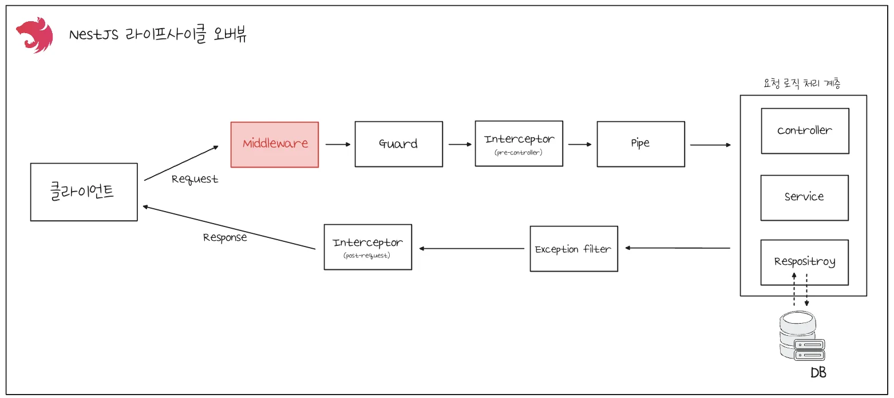
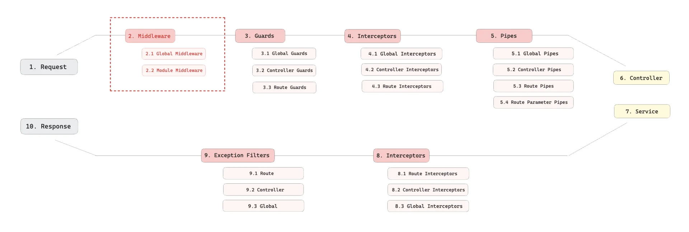
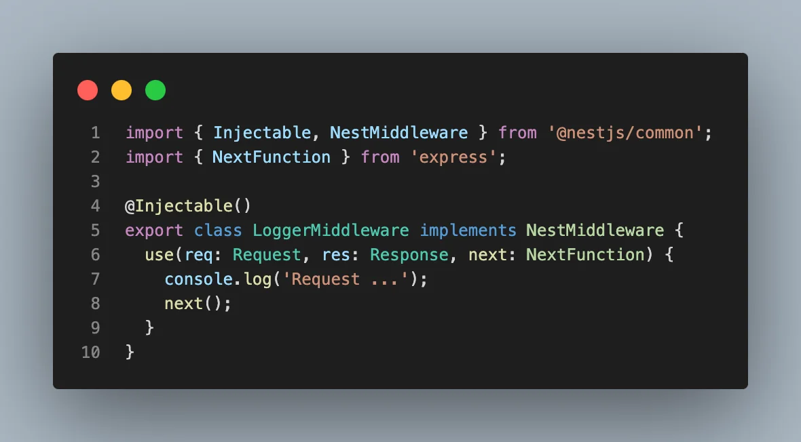
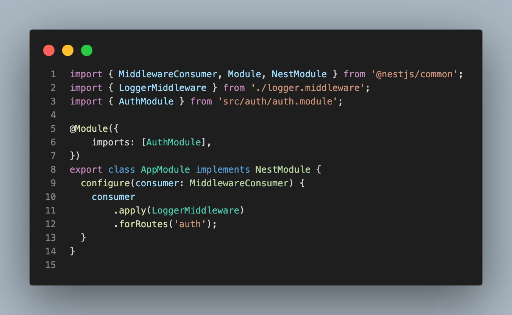
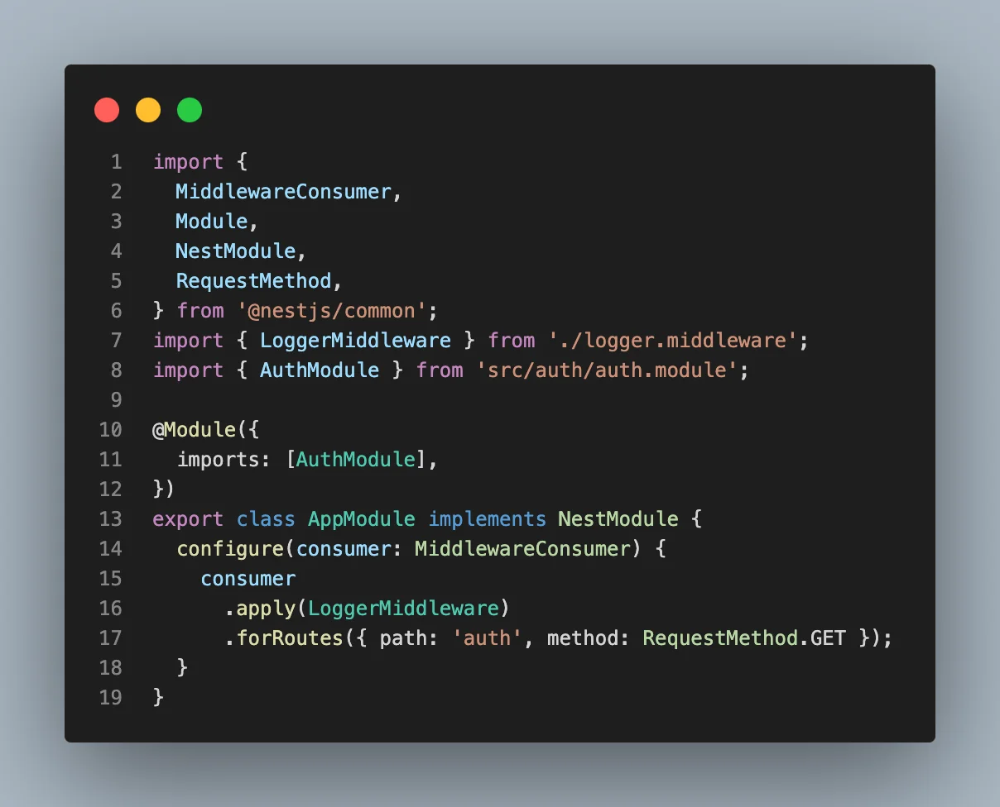
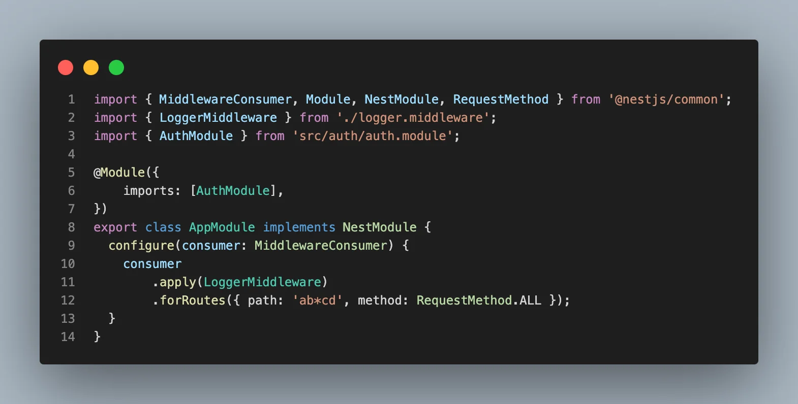
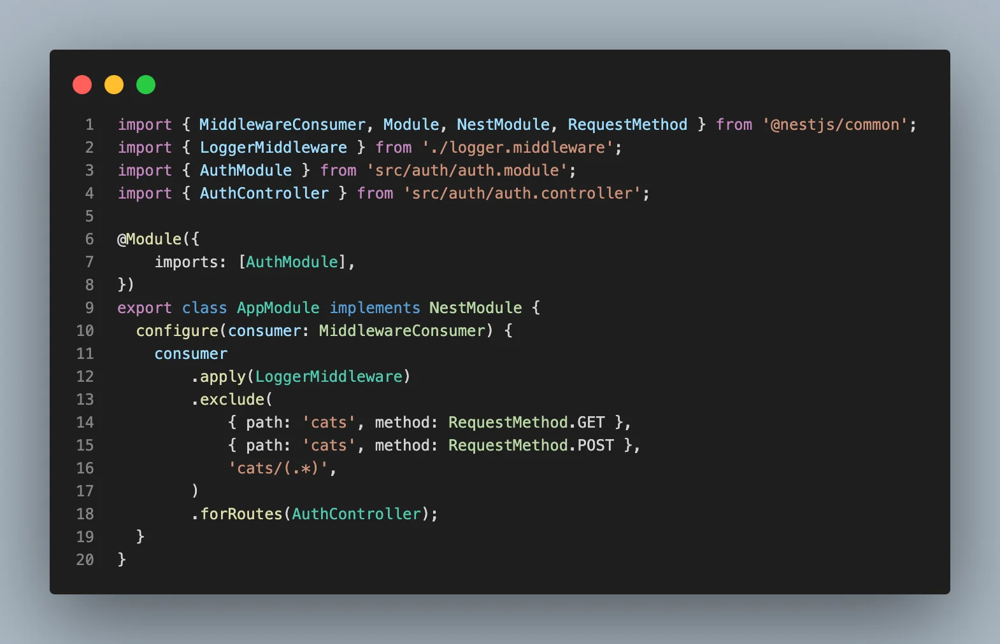
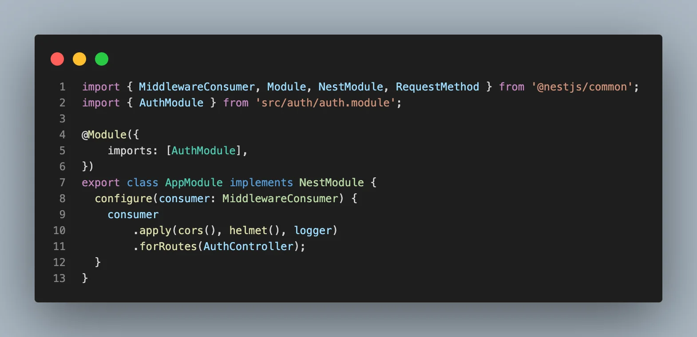
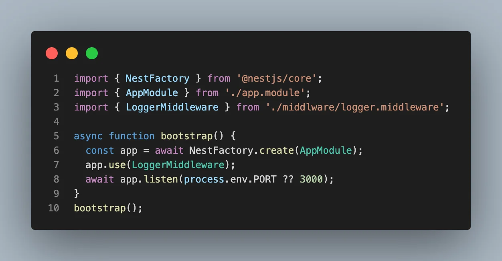

> 
> 
> <a id="26deda9b0fe180629d0dc88474f4a2ad"></a>
> 
> <strong>목차</strong>
> 
> - [미들웨어 ( Middleware )](#26deda9b0fe181bf98adeec02fb1ca3e)
> - [[ 선언법 ] Middleware 정의 ( LoggerMiddleware )](#26deda9b0fe181c68f1bdff9a3908ef3)
> - [[ 사용법 1 ] 루트 모듈(AppModule)에 정의한 미들웨어 클래스 (LoggerMiddleware) 적용](#26deda9b0fe18036b828e316e90f1d77)
> - [ex) 코드 예시](#26deda9b0fe180b78701fd673e1509da)
> - [[ 사용법 2 ] 글로벌(main.ts)하게  정의한 미들웨어 클래스 (LoggerMiddleware) 적용](#26deda9b0fe180d5bfe7ef18e91fc1db)

<a id="26deda9b0fe181bf98adeec02fb1ca3e"></a>

## 미들웨어 ( Middleware )

---





> ✏️ 
> 
> <a id="26deda9b0fe180b28d66fad213b45436"></a>
> 
> NestJS의 middlware 계층은<em><strong> </strong></em><strong><u><code>요청(Request)</code></u></strong><strong><u>이 </u></strong><strong><u>컨트롤러 헨들러에 도달하기 전</u></strong><strong><u>에 실행되는 함수</u></strong>로, Express의 미들웨어와 거의 동일하게 동작하며 요청&#45;응답 흐름의 앞단에서 <strong><u>공통 로직(로깅 인증, body 파싱 등</u></strong>)을 처리한다&#46;
> 
> <details>
> <summary>특징</summary>
> 
> - <code>Middleware</code> 는 라우터 핸들러가 실행되기 전에 실행된다&#46; 
>     - 따라서 라우터(controller) 하위 계층과 상관없이 확장 및 변경이 가능하다&#46; 
> 
> - <code>Request</code>, <code>Response</code>  객체에 접근 가능하다&#46;
> 
> </details>
> 
> <details>
> <summary>사용 예시 </summary>
> 
> - 요청, 응답 객체 변경 
> 
> - 요청 &#45; 응답 사이클 중단
> 
> - 다음 미들웨어 실행
> 
> - 공통 로직 처리 ( 로깅 인증, body 파싱 등 )
> 
> </details>

> ❗ 
> 
> <a id="26deda9b0fe1801498bac5f8c018aeec"></a>
> 
> NestJS의 <code>middleware</code>는 요청과 응답 객체, 그리고 <code>next()</code> 함수를 받아 다음 미들웨어 또는 라우터 핸들러로 처리를 넘긴다&#46;
> 
> <a id="26deda9b0fe1807582b4c322ae25f2ef"></a>
> 
> 따라서 만약 <code>next()</code>를 호출하지 않는다면 <strong><u>요청이 중단되어 처리되지 않</u></strong>는다&#46; 

<a id="26deda9b0fe181c68f1bdff9a3908ef3"></a>

### &#91; 선언법 &#93; Middleware 정의 ( LoggerMiddleware )



<details>
<summary>&#91; 코드 &#93; LoggerMiddleware</summary>

<a id="26deda9b0fe180b4aa94e829f6943efb"></a>

```typescript
// logger.middleware.ts
import { Injectable, NestMiddleware } from '@nestjs/common';
import { NextFunction } from 'express';

@Injectable()
export class LoggerMiddleware implements NestMiddleware {
  use(req: Request, res: Response, next: NextFunction) {
    console.log('Request ...');
    next();
  }
}
```

</details>

<a id="26deda9b0fe18036b828e316e90f1d77"></a>

### &#91; 사용법 1 &#93; 루트 모듈(<code>AppModule</code>)에 정의한 미들웨어 클래스 (<code>LoggerMiddleware</code>) 적용

> ✏️ 
> 
> <a id="26deda9b0fe1800191b6da5205807046"></a>
> 
> 루트 모듈(AppModule)에서 부분적으로 적용
> 
> > <strong><code>NestModule</code></strong>  implements 필요
> 
> - <code>apply(&#46;&#46;&#46;)</code>&#58; 정의한 middleware 적용
> 
> - <code>exclude(&#46;&#46;&#46;)</code>&#58; 제외할 router 설정
> 
> - <code>forRoutes(&#46;&#46;&#46;)</code>&#58; 적용할 router 설정

<a id="26deda9b0fe180b78701fd673e1509da"></a>

### ex) 코드 예시

<details>
<summary>1&#46; <code>URI</code></summary>



<details>
<summary>&#91; 코드 &#93; <strong>AppModule</strong></summary>

<a id="26deda9b0fe180828fc8f64a2983e4e8"></a>

```typescript
import { MiddlewareConsumer, Module, NestModule } from '@nestjs/common';
import { LoggerMiddleware } from './logger.middleware';
import { AuthModule } from 'src/auth/auth.module';

@Module({
    imports: [AuthModule],
})
export class AppModule implements NestModule {
  configure(consumer: MiddlewareConsumer) {
    consumer
        .apply(LoggerMiddleware)
        .forRoutes('auth');
  }
}
```

</details>

</details>

<details>
<summary>2&#46; <code>URI</code> &#43; <code>Http Method</code></summary>



<details>
<summary>&#91; 코드 &#93; <strong>AppModule</strong></summary>

<a id="26deda9b0fe1804e9051ff4a7beb88c9"></a>

```typescript
import {
  MiddlewareConsumer,
  Module,
  NestModule,
  RequestMethod,
} from '@nestjs/common';
import { LoggerMiddleware } from './logger.middleware';
import { AuthModule } from 'src/auth/auth.module';

@Module({
  imports: [AuthModule],
})
export class AppModule implements NestModule {
  configure(consumer: MiddlewareConsumer) {
    consumer
      .apply(LoggerMiddleware)
      .forRoutes({ path: 'auth', method: RequestMethod.GET });
  }
}
```

</details>

</details>

<details>
<summary>3&#46; <code>와일드카드(&#42;)</code></summary>



<details>
<summary>&#91; 코드 &#93; <strong>AppModule</strong></summary>

<a id="26deda9b0fe180338d81e0bac668f1f9"></a>

```typescript
import { MiddlewareConsumer, Module, NestModule, RequestMethod } from '@nestjs/common';
import { LoggerMiddleware } from './logger.middleware';
import { AuthModule } from 'src/auth/auth.module';

@Module({
    imports: [AuthModule],
})
export class AppModule implements NestModule {
  configure(consumer: MiddlewareConsumer) {
    consumer
        .apply(LoggerMiddleware)
        .forRoutes({ path: 'ab*cd', method: RequestMethod.ALL });
  }
}
```

</details>

</details>

<details>
<summary>4&#46; 제외(<code>exclude</code>) 처리 </summary>



<details>
<summary>&#91; 코드 &#93; <strong>AppModule</strong></summary>

<a id="26deda9b0fe18068b57cd7f1985aa8f4"></a>

```typescript
import { MiddlewareConsumer, Module, NestModule, RequestMethod } from '@nestjs/common';
import { LoggerMiddleware } from './logger.middleware';
import { AuthModule } from 'src/auth/auth.module';
import { AuthController } from 'src/auth/auth.controller';

@Module({
    imports: [AuthModule],
})
export class AppModule implements NestModule {
  configure(consumer: MiddlewareConsumer) {
    consumer
        .apply(LoggerMiddleware)
        .exclude(
            { path: 'cats', method: RequestMethod.GET },
            { path: 'cats', method: RequestMethod.POST },
            'cats/(.*)',
        )
        .forRoutes(AuthController);
  }
}
```

</details>

</details>

<details>
<summary>5&#46; 여러 미들웨어 순차적으로 적용</summary>



<details>
<summary>&#91; 코드 &#93; <strong>AppModule</strong></summary>

<a id="26deda9b0fe180969c13cd3353cb81e0"></a>

```typescript
import { MiddlewareConsumer, Module, NestModule, RequestMethod } from '@nestjs/common';
import { AuthModule } from 'src/auth/auth.module';

@Module({
    imports: [AuthModule],
})
export class AppModule implements NestModule {
  configure(consumer: MiddlewareConsumer) {
    consumer
        .apply(cors(), helmet(), logger)  // 예시 파라미터 - cors, helmet, logger
        .forRoutes(AuthController);
  }
}
```

</details>

</details>

<a id="26deda9b0fe180d5bfe7ef18e91fc1db"></a>

### &#91; 사용법 2 &#93; 글로벌(<code>main&#46;ts</code>)하게  정의한 미들웨어 클래스 (<code>LoggerMiddleware</code>) 적용

> ✏️ 
> 
> <a id="26deda9b0fe180968bc2f0d93882438c"></a>
> 
> 글로벌하게 <strong><u>NestJS 프로젝트 전체 적용</u></strong>



<details>
<summary>&#91; 코드 &#93; main&#46;ts</summary>

<a id="26deda9b0fe180159128f2c02f87c4b6"></a>

```typescript
// main.ts
import { NestFactory } from '@nestjs/core';
import { AppModule } from './app.module';
import { LoggerMiddleware } from './middlware/logger.middleware';

async function bootstrap() {
  const app = await NestFactory.create(AppModule);
  app.use(LoggerMiddleware);
  await app.listen(process.env.PORT ?? 3000);
}
bootstrap();
```

</details>
