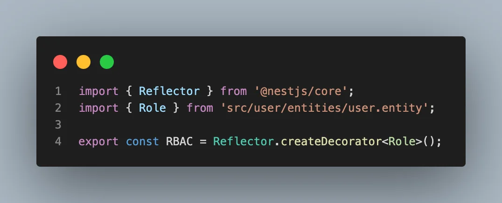
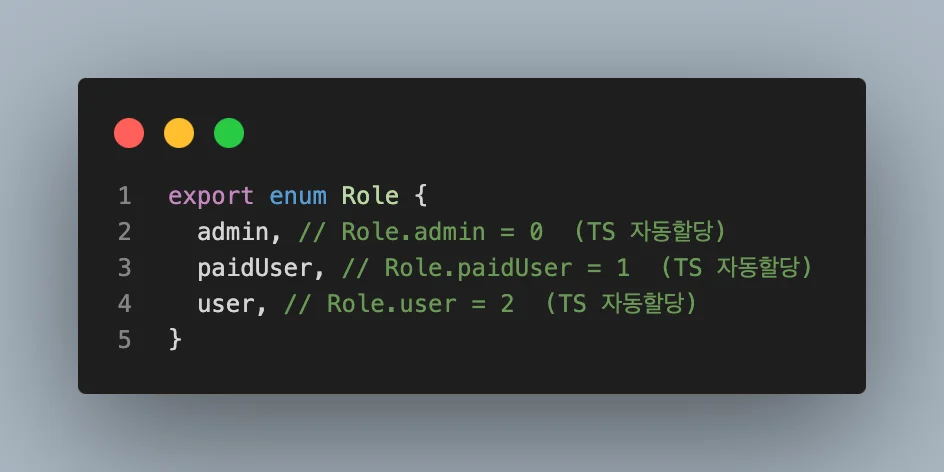
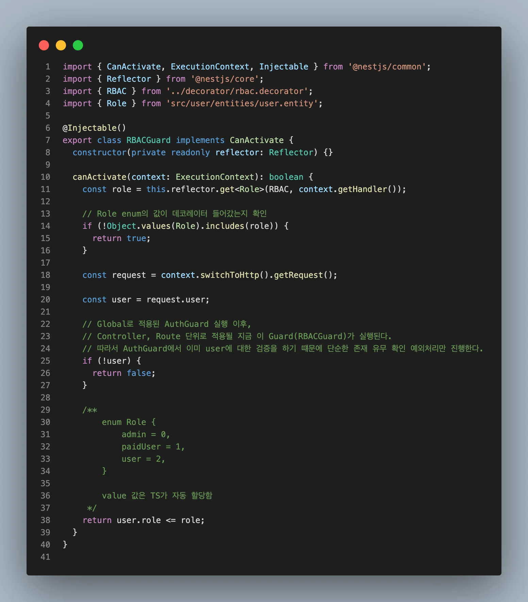
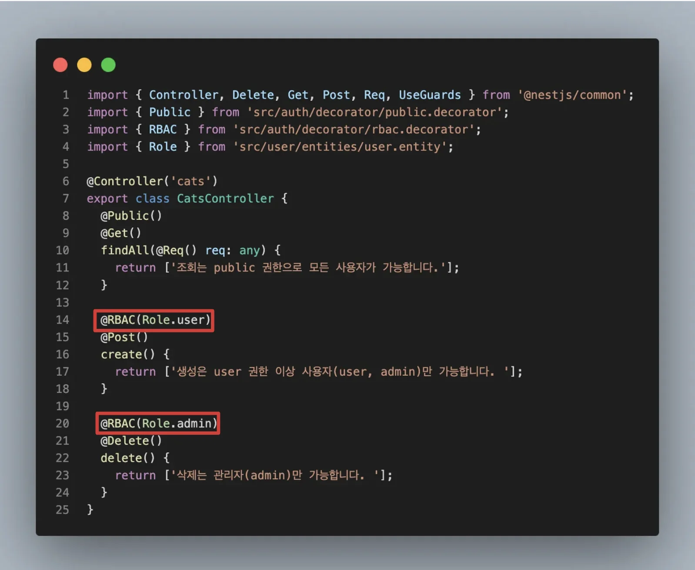

> 
> 
> <a id="26feda9b0fe1815ab182e1190d7aad2a"></a>
> 
> <strong>목차</strong>
> 
> - [RBAC ( Role 기반 역할 관리 ) 적용 및 테스트 ](#26feda9b0fe1819aa07acf112db11c36)
> - [1.  RBAC 적용](#26feda9b0fe18189a0c5e25541822bd6)
> - [2. 테스트  ( 포스트맨 )](#26feda9b0fe1815aae08fc6f56b0e236)

<a id="26feda9b0fe1819aa07acf112db11c36"></a>

## RBAC ( Role 기반 역할 관리 ) 적용 및 테스트 

---

<a id="26feda9b0fe18189a0c5e25541822bd6"></a>

### 1&#46;  RBAC 적용

[feat: RBAC 기반 인가 및 테스트](https://github.com/gyungsubLee/netflix_clone/commit/708eae91172c36dc9aa4265c082bb066ae5553f6)

<details>
<summary>커스텀 데코레이터 정의&#58; <code>&#64;RBAC()</code></summary>



<details>
<summary><strong>&#91; 코드 &#93;  </strong>RBAC</summary>

<a id="26feda9b0fe1815cba04ee31fc5358c6"></a>

```typescript
import { Reflector } from '@nestjs/core';
import { Role } from 'src/user/entities/user.entity';

export const RBAC = Reflector.createDecorator<Role>();
```

</details>

</details>

<details>
<summary>enum 정의 &#45; <code>Role</code></summary>



<details>
<summary><strong>&#91; 코드 &#93; </strong>Role</summary>

<a id="26feda9b0fe18019b8f4e7b49b1054b4"></a>

```typescript
import { Exclude } from 'class-transformer';
import { BaseTable } from 'src/common/entity/base-table.entity';
import { Column, Entity, PrimaryGeneratedColumn } from 'typeorm';

export enum Role {
  admin, // Role.admin = 0  (TS 자동할당)
  paidUser, // Role.paidUser = 1  (TS 자동할당)
  user, // Role.user = 2  (TS 자동할당)
}

@Entity()
export class User extends BaseTable {
  @PrimaryGeneratedColumn()
  id: number;

  @Column({ unique: true })
  email: string;

  @Column()
  @Exclude({
    toPlainOnly: true,
  })
  password: string;

  @Column({
    enum: Role,
    default: Role.user,
  })
  role: Role;
}

```

</details>

</details>

<details>
<summary>Guard 정의  &#45; <code>RBACGuard</code></summary>



<details>
<summary><strong>&#91; 코드 &#93;  </strong>RBACGuard</summary>

<a id="26feda9b0fe18094ad9aec1686cf3b89"></a>

```typescript
import { CanActivate, ExecutionContext, Injectable } from '@nestjs/common';
import { Reflector } from '@nestjs/core';
import { RBAC } from '../decorator/rbac.decorator';
import { Role } from 'src/user/entities/user.entity';

@Injectable()
export class RBACGuard implements CanActivate {
  constructor(private readonly reflector: Reflector) {}

  canActivate(context: ExecutionContext): boolean {
    const role = this.reflector.get<Role>(RBAC, context.getHandler());

    // Role enum의 값이 데코레이터 들어갔는지 확인
    if (!Object.values(Role).includes(role)) {
      return true;
    }

    const request = context.switchToHttp().getRequest();

    const user = request.user;

    // Global로 적용된 AuthGuard 실행 이후,
    // Controller, Route 단위로 적용될 지금 이 Guard(RBACGuard)가 실행된다.
    // 따라서 AuthGuard에서 이미 user에 대한 검증을 하기 떄문에 단순한 존재 유무 확인 예외처리만 진행한다.
    if (!user) {
      return false;
    }

    /**
        enum Role {
            admin = 0,
            paidUser = 1,
            user = 2,
        }

        value 값은 TS가 자동 할당함
     */
    return user.role <= role;  // user Role이 적용된 RBAC 보다 작거나 같은 경우만 true로 판단
  }
}

```

</details>

</details>

<details>
<summary>Route에 RBAC 적용 &#45; 데코레이터(<code>&#64;RBAC</code>) 기반 Route Guard</summary>



<details>
<summary><strong>&#91; 코드 &#93; </strong>CatsController ( 테스트용 controller )</summary>

<a id="26feda9b0fe1809db1e0c69a4f55f44a"></a>

```typescript
import { Controller, Delete, Get, Post, Req, UseGuards } from '@nestjs/common';
import { Public } from 'src/auth/decorator/public.decorator';
import { RBAC } from 'src/auth/decorator/rbac.decorator';
import { Role } from 'src/user/entities/user.entity';

@Controller('cats')
export class CatsController {
  @Public()
  @Get()
  findAll(@Req() req: any) {
    return ['조회는 public 권한으로 모든 사용자가 가능합니다.'];
  }

  @RBAC(Role.user)
  @Post()
  create() {
    return ['생성은 user 권한 이상 사용자(user, admin)만 가능합니다. '];
  }

  @RBAC(Role.admin)
  @Delete()
  delete() {
    return ['삭제는 관리자(admin)만 가능합니다. '];
  }
}
```

</details>

</details>

<details>
<summary>루트모듈에 Guard 적용 &#45; Global Guard</summary>

> ✏️ 
> 
> <a id="26feda9b0fe180568d8bc6942ed37134"></a>
> 
> <code>AuthGuard</code>보다 하위에 정의해야 다음 순서로 실행된다&#46;

<details>
<summary><strong>&#91; 코드 &#93; AppModule</strong></summary>

<a id="26feda9b0fe18092ada3c0cbb723ef16"></a>

```typescript
import {
  MiddlewareConsumer,
  Module,
  NestModule,
  RequestMethod,
} from '@nestjs/common';
import { TypeOrmModule } from '@nestjs/typeorm';
import { User } from './user/entities/user.entity';
import { AuthModule } from './auth/auth.module';
import { UserModule } from './user/user.module';
import { ConfigModule, ConfigService } from '@nestjs/config';
import { SnakeNamingStrategy } from 'typeorm-naming-strategies';
import * as Joi from 'joi';
import { BearerTokenMiddleware } from './auth/middlware/bearer-token.middleware';
import { CatsModule } from './cats/cats.module';
import { APP_GUARD } from '@nestjs/core';
import { AuthGuard } from './auth/guard/auth.guard';
import { RBACGuard } from './auth/guard/rbac.guard';

@Module({
  imports: [
    ConfigModule.forRoot({
      isGlobal: true,
      validationSchema: Joi.object({
        ENV: Joi.string().valid('dev', 'prod').required(),
        DB_TYPE: Joi.string().valid('postgres').required(),
        DB_HOST: Joi.string().required(),
        DB_USERNAME: Joi.string().required(),
        DB_PASSWORD: Joi.string().required(),
        DB_DATABASE: Joi.string().required(),
        HASH_ROUNDS: Joi.number().required(),
        ACCESS_TOKEN_SECRET: Joi.string().required(),
        REFRESH_TOKEN_SECRET: Joi.string().required(),
      }),
    }),
    TypeOrmModule.forRootAsync({
      inject: [ConfigService],
      useFactory: (cfg: ConfigService) => ({
        type: cfg.get<string>('DB_TYPE') as 'postgres',
        host: cfg.get<string>('DB_HOST'),
        port: cfg.get<number>('DB_PORT'),
        username: cfg.get<string>('DB_USERNAME'),
        password: cfg.get<string>('DB_PASSWORD'),
        database: cfg.get<string>('DB_DATABASE'),
        entities: [User],
        synchronize: cfg.get<string>('DB_TYPE') === 'prod' ? false : true, // 운영에서는 반드시 false
        logging: true,
        namingStrategy: new SnakeNamingStrategy(),
      }),
    }),
    AuthModule,
    UserModule,
    CatsModule,
  ],
  providers: [
    // AuthGuard -> RBACGuard
    {
      provide: APP_GUARD,
      useClass: AuthGuard,
    },
    {
      provide: APP_GUARD,
      useClass: RBACGuard,
    },
  ],
})
export class AppModule implements NestModule {
  configure(consumer: MiddlewareConsumer) {
    consumer
      .apply(BearerTokenMiddleware)
      .exclude(
        { path: '/auth/register/user', method: RequestMethod.POST },
        { path: '/auth/register/admin', method: RequestMethod.POST },
        { path: '/auth/login', method: RequestMethod.POST },
      )
      .forRoutes('*'); // 모든 라우터 계층에 적용
  }
}

```

</details>

</details>

<a id="26feda9b0fe1815aae08fc6f56b0e236"></a>

### 2&#46; 테스트  ( 포스트맨 )

[video](https://www.youtube.com/watch?v=WjjuAk5Xekc)
