> 
> 
> 
> 
> <strong>목차</strong>
> 
> - [Pagination](#26feda9b0fe18144a857fbdc8417cf98)
> - [ Pagination의 종류 ( 2가지 )](#26feda9b0fe1816b9ff9f13d42317447)
> - [1. Page Based Pagination](#26feda9b0fe18131b886eb3e8327b09f)
> - [2. Cursor Based Pagination](#271eda9b0fe180909dbed862c5149063)

> /icons/tag_gray.svg 
> 
> 
> 
> <strong>이전 정리 내용</strong>
> 
> - <a href="#/post/1c3eda9b-0fe1-81bd-9548-f2eadadc9ae8">페이지</a> 

## Pagination

---

> 📖 
> 
> 
> 
> <code>Pagination</code>&#58; 많은 데이터를 부분적으로 나눠서 불러오는 기술이다 

> ✏️ 
> 
> - <code>데이터 분할</code>
>     - 큰 분량의 데이터를 분할해서 다루기 쉽게 부분적으로 불러올 수 있다&#46; 
> 
> - <code>네이게이션 컨트롤</code>
>     - 다음 페이지, 이전 페이지 등 기능을 통해 쉽게 페이지 이동이 가능하다&#46; 
> 
> - <code>균일한 데이터 규격</code>
>     - 요청과 응답이 균일한 규격으로 제공되어 예측하기 쉽다&#46;
> 
> - <code>상태 유지</code> 
>     - Pagination 요청 자체에 상태 정보가 존재한다&#46;  (e&#46;g&#46; 몇번째 페이지 )
> 
> - <code>퍼포먼스 최적화</code>
>     - 한번에 필요한 분량의 데이터만 불러오기 때문에 퍼포먼스 최적화가 가능하다&#46; 

##  Pagination의 종류 ( 2가지 )

### 1&#46; Page Based Pagination

> ✏️ 
> 
> 
> 
> 데이터를 페이지 기반으로 나눠서 처리한다&#46; 
> 
> - ex)  100개 데이터 한번에 20개 씩 가져온다면 5개의 페이지로 나눌 수 있다&#46; 

예제 ) 12 데이터, 4개 씩 조회

- <code>Page 1</code>&#58; 1 &#126; 4
    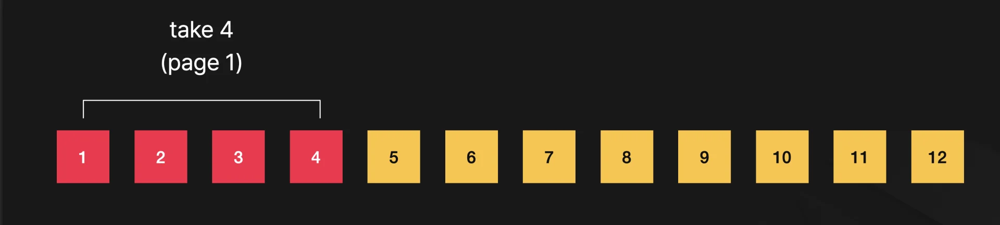

- <code>Page 2</code>&#58; 5 &#126; 8
    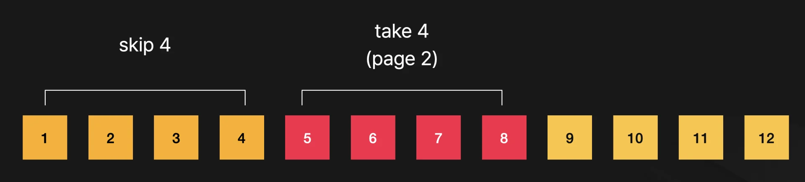

- <code>Page 3</code>&#58; 9 &#126; 12
    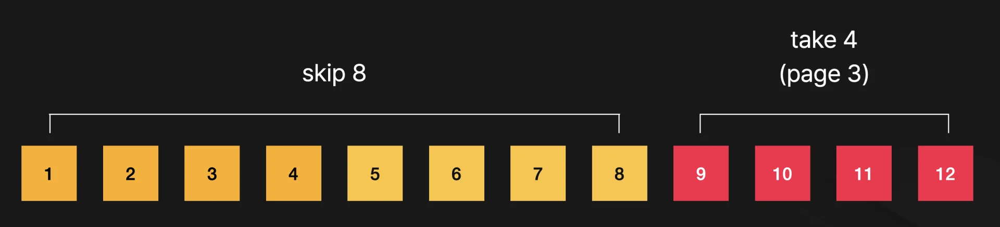

문제점 ) 데이터 삽입

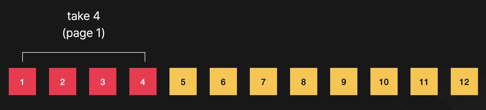

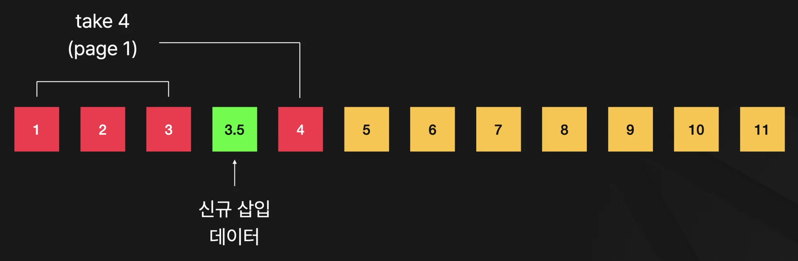

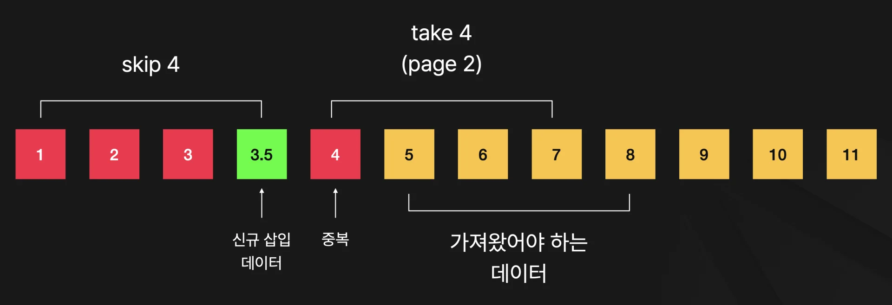

- <code>리소스 중복 조회</code>
    - 신규 데이터 삽입 시, 중복 조회되는 데이터가 생긴다&#46; 

    - 서버 계층에서는 해결할 수 없다&#46;  ( 클라이언트에서 필터링 처리 )

    - 중복 조회되는 데이터 마다 추가적으로 비용이 든다&#46;

문제점 ) 데이터 삭제

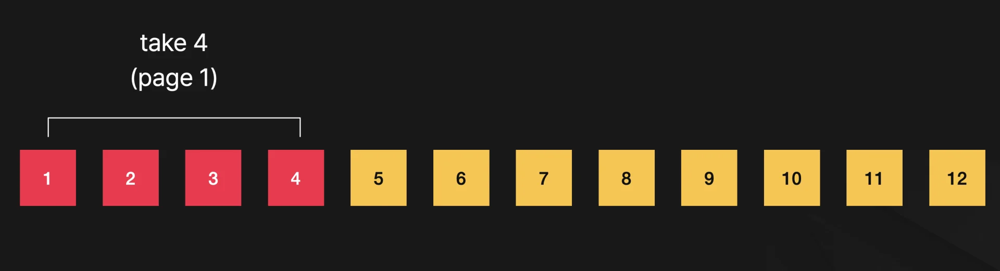

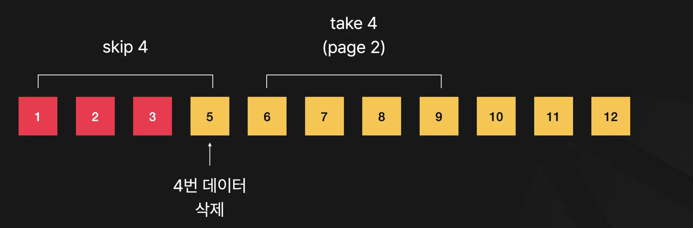

- 다음 페이지 조회 시앞 데이터가 삭제 돼서, 조회가 누락되는 경우가 생긴다  ( 앞 페이지 끝을 다시 확인해야함 )

### 2&#46; Cursor Based Pagination

> ✏️ 
> 
> 
> 
> 마지막 불러온 데이터를 기반으로 다음 가져올 데이터를 정한다&#46; 
> 
> - ex) 
>     
> 
>     마지막으로 불러온 데이터가 20번이었다면 다음 요청은 21번부터 가져온다/

예제 ) 12 데이터, 4개 씩 조회

- <code>Page 1</code>&#58; 1 &#126; 4
    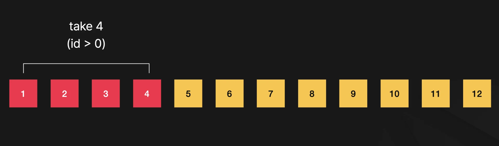

- <code>Page 2</code>&#58; 5 &#126; 8
    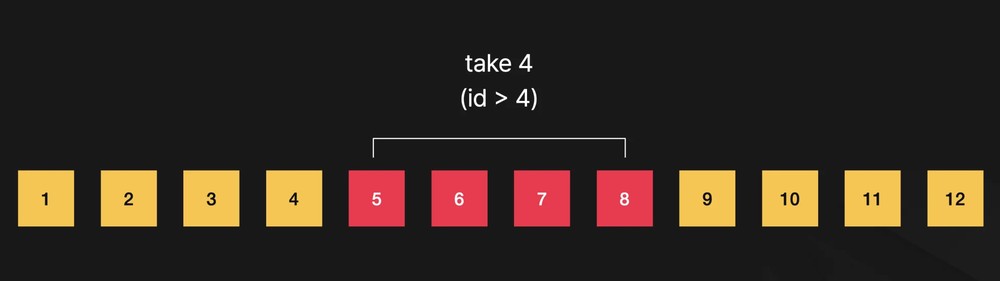

- <code>Page 3</code>&#58; 9 &#126; 12
    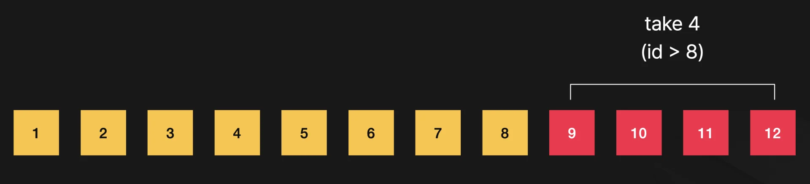

예제 ) 데이터 삽입

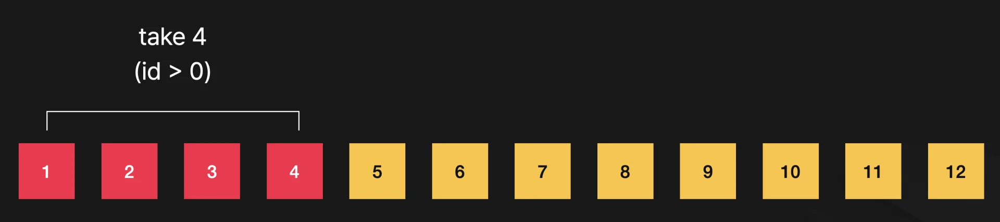

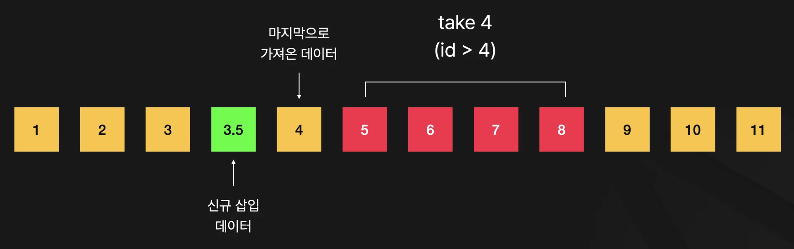

예제 ) 데이터 삭제

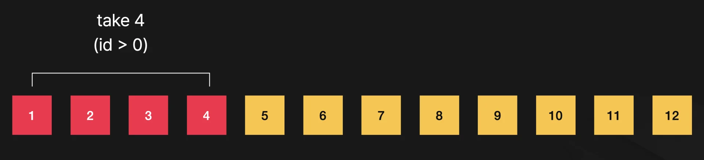

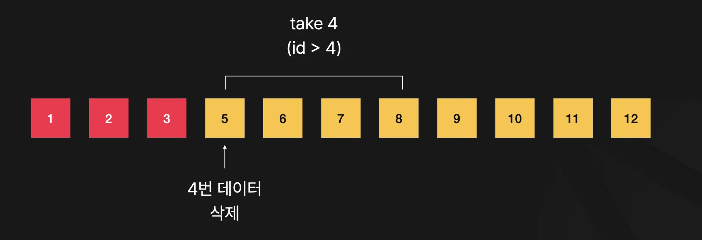

> ❗ 
> 
> 
> 
> <code>Cursor 기반 페이징 처리</code>를 통해 <code>Page 기반 페이징 처리</code>의 단점을 해결할 수 있다&#46;  그러나 더 구현 난이도가 높다&#46;
> 
> - 특히 <code>uuid 기반 페이징 처리</code> 시 어렵다&#46;
