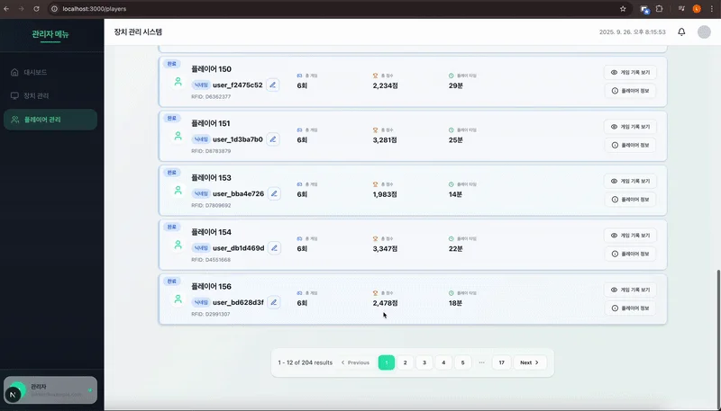

> 
> 
> <a id="26feda9b0fe181f5a0bfc545acba56de"></a>
> 
> <strong>목차</strong>
> 
> - [Page Based Pagination 적용](#26feda9b0fe181fa834dfae5281e4b9a)
> - [[ 예시 ] Page Based Pagination](#27beda9b0fe1801d8150cae1b7b6bd1d)
> - [코드](#27beda9b0fe181238597d4e945d368d8)

<a id="26feda9b0fe181fa834dfae5281e4b9a"></a>

## Page Based Pagination 적용

---

> ✏️ 
> 
> - <code>skip()</code>&#58;  OFFSET &#45;  스킵하는 데이터 개수, <code>(page &#45; 1) &#42; size</code>
> 
> - <code>take()</code>&#58; LIMIT &#45; 조회하는 데이터 개수
> 
> - <code>getManyAndCount()</code>&#58; <u>여러 데이터</u> 및 <u>총 데이터 개수</u> 반환

<details>
<summary>1&#46; 페이지 기반 페이지네이션 적용</summary>

<details>
<summary>&#91; 코드 &#93; GetMoviesReqDto</summary>

<a id="26feda9b0fe1816ba83dcb27b6c0b23a"></a>

```typescript
import { IsOptional, IsString } from 'class-validator';
import { PaginationReqDto } from 'src/common/dto/pagination.request.dto';

export class GetMoviesReqDto extends PaginationReqDto {
  @IsString()
  @IsOptional()
  title?: string;
}
```

<a id="290eda9b0fe180f4b510e9b240073779"></a>

```typescript
import { IsInt, IsOptional } from 'class-validator';

export class PaginationReqDto {
  @IsInt()
  @IsOptional()
  page: number = 1;

  @IsInt()
  @IsOptional()
  size: number = 5;
}
```

</details>

<details>
<summary>&#91; 코드 &#93; MovieController</summary>

<a id="290eda9b0fe180d0a427ceac9a94fdb5"></a>

```typescript
@Controller('movie')
export class MovieController {
  constructor(private readonly movieService: MovieService) {}

  @Get()
  @Public()
  getMovicesBytitle(@Query() dto: GetMoviesReqDto) {
    return this.movieService.findAllByTitle(dto);
  }

```

</details>

<details>
<summary>&#91; 코드 &#93; MovieService</summary>

<a id="290eda9b0fe1806b9c0cc842f3a168a8"></a>

```typescript
@Injectable()
export class MovieService {
  constructor(
    @InjectRepository(Movie)
    private readonly movieRepository: Repository<Movie>,
    @InjectRepository(MovieDetail)
    private readonly movieDetailRepository: Repository<MovieDetail>,
    @InjectRepository(Director)
    private readonly directorRepository: Repository<Director>,
    @InjectRepository(Genre)
    private readonly genreRepository: Repository<Genre>,
    private readonly dataSource: DataSource,
  ) {}

  async findAllByTitle(dto: GetMoviesReqDto) {
    const { title, page, size } = dto;
    const skip = (page - 1) * size;

    const qb = this.dataSource
      .getRepository(Movie)
      .createQueryBuilder('movie')
      .leftJoinAndSelect('movie.director', 'director')
      .leftJoinAndSelect('movie.genres', 'genres')
      .leftJoinAndSelect('movie.detail', 'detail');

    if (title) {
      qb.where('movie.title LIKE :title', { title: `%${title}%` });
    }
    
    if (page && size) {
      qb.take(size);
      qb.skip(skip);
    }

		return await qb.getManyAndCount();
  }
```

</details>

</details>

<details>
<summary>2&#46;1&#46; Pagination DTO &#45; 정적 팩토리 패턴</summary>

<details>
<summary>&#91; 코드 &#93; PaginationResDto</summary>

<a id="290eda9b0fe180338361e90d51600045"></a>

```typescript
export class PaginationResDto<T> {
  readonly data: T[];
  readonly size: number;
  readonly page: number;
  readonly totalCount?: number;
  readonly totalPage?: number;

  private constructor(
    data: T[],
    size: number,
    page: number,
    totalCount?: number,
  ) {
    this.data = data;
    this.size = size;
    this.page = page;

    if (totalCount !== undefined) {
      this.totalCount = totalCount;
      this.totalPage = Math.ceil(totalCount / size);
    }

    Object.freeze(this);
  }

  static from<T>(data: T[], size: number, page: number, totalCount?: number) {
    return new PaginationResDto(data, size, page, totalCount);
  }
}
```

</details>

<details>
<summary>&#91; 코드 &#93; MovieService</summary>

<a id="290eda9b0fe180c29fabed228faaaf56"></a>

```typescript
@Injectable()
export class MovieService {

	...

  async findAllByTitle(dto: GetMoviesReqDto) {
    const { title, page, size } = dto;
    const skip = (page - 1) * size;

    const qb = this.dataSource
      .getRepository(Movie)
      .createQueryBuilder('movie')
      .leftJoinAndSelect('movie.director', 'director')
      .leftJoinAndSelect('movie.genres', 'genres')
      .leftJoinAndSelect('movie.detail', 'detail');

    if (title) {
      qb.where('movie.title LIKE :title', { title: `%${title}%` });
    }
    
     if (page && size) {
      qb.take(size);
      qb.skip(skip);
    }

		const [movies, count] = await qb.getManyAndCount();

    // 정적 팩토리 패턴
    return PaginationResDto.from(movies, page, size);
  }
  
	...
```

</details>

</details>

<details>
<summary>2&#46;2&#46; Pagination DTO  &#45; 빌더 패턴</summary>

<details>
<summary>&#91; 코드 &#93; PaginationBuilderResDto</summary>

<a id="290eda9b0fe180419e20d6352eb867ee"></a>

```typescript
class PaginationBuilder<T> {
  data: T[] = [];
  size = 10;
  page = 1;
  totalCount?: number;

  withData(data: T[]): this {
    this.data = data;
    return this;
  }
  withSize(size: number): this {
    this.size = size;
    return this;
  }
  withPage(page: number): this {
    this.page = page;
    return this;
  }
  withTotalCount(totalCount: number): this {
    this.totalCount = totalCount;
    return this;
  }

  build(): PaginationBuilderResDto<T> {
    return new PaginationBuilderResDto(this);
  }
}

export class PaginationBuilderResDto<T> {
  readonly data: T[];
  readonly size: number;
  readonly page: number;
  readonly totalCount?: number;
  readonly totalPage?: number;

  constructor(builder: PaginationBuilder<T>) {
    this.data = builder.data;
    this.size = builder.size;
    this.page = builder.page;

    if (builder.totalCount) {
      this.totalCount = builder.totalCount;
      this.totalPage = Math.ceil(builder.totalCount / builder.size);
    }

    Object.freeze(this);
  }

  static builder<T>() {
    return new PaginationBuilder<T>();
  }
}
```

</details>

<details>
<summary>&#91; 코드 &#93; MovieService</summary>

<a id="290eda9b0fe180b092cde39e542ba51c"></a>

```typescript
@Injectable()
export class MovieService {
  constructor(
    @InjectRepository(Movie)
    private readonly movieRepository: Repository<Movie>,
    @InjectRepository(MovieDetail)
    private readonly movieDetailRepository: Repository<MovieDetail>,
    @InjectRepository(Director)
    private readonly directorRepository: Repository<Director>,
    @InjectRepository(Genre)
    private readonly genreRepository: Repository<Genre>,
    private readonly dataSource: DataSource,
  ) {}

  async findAllByTitle(dto: GetMoviesReqDto) {
    const { title, page, size } = dto;
    const skip = (page - 1) * size;

    const qb = this.dataSource
      .getRepository(Movie)
      .createQueryBuilder('movie')
      .leftJoinAndSelect('movie.director', 'director')
      .leftJoinAndSelect('movie.genres', 'genres')
      .leftJoinAndSelect('movie.detail', 'detail');

    if (title) {
      qb.where('movie.title LIKE :title', { title: `%${title}%` });
    }
    
     if (page && size) {
      qb.take(size);
      qb.skip(skip);
    }

		const [movies, count] = await qb.getManyAndCount();

    return PaginationBuilderResDto.builder()
      .withData(movies)
      .withPage(page)
      .withSize(size)
      .withTotalCount(count)
      .build();
  }
```

</details>

</details>

<details>
<summary>3&#46; CommonService 로 분리</summary>

> ✏️ 
> 
> <a id="292eda9b0fe1800a91c1e4fc23172e5b"></a>
> 
> Pagination은 다른 도메인의 조회 로직에서도 사용될 가능성이 매우 높기 때문에 공통 서비스 로직(<code>CommonService</code>)으로 분리하여 재사용 처리한다&#46;

<details>
<summary>&#91; 코드 &#93; CommonModule</summary>

<a id="292eda9b0fe18092b7f2d2a07270a2eb"></a>

```typescript
import { Module } from '@nestjs/common';
import { CommonService } from './common.service';

@Module({
  imports: [],
  controllers: [],
  providers: [CommonService],
  exports: [CommonService],
})
export class CommonModule {}
```

</details>

<details>
<summary>&#91; 코드 &#93; CommonService</summary>

<a id="292eda9b0fe1806fa03ecc9cce13ef59"></a>

```typescript
import { Injectable } from '@nestjs/common';
import { ObjectLiteral, QueryBuilder, SelectQueryBuilder } from 'typeorm';
import { PagePaginationReqDto } from './dto/page/page-pagination.request.dto';

@Injectable()
export class CommonService {
  constructor() {}

  applyPagePaginationParamsToQb<T extends ObjectLiteral>(
    qb: SelectQueryBuilder<T>,
    page: number,
    size: number,
  ) {
    const skip = (page - 1) * size;

    qb.take(size);
    qb.skip(skip);
  }
}
```

</details>

---

<details>
<summary>&#91; 코드 &#93; MovieModule</summary>

<a id="292eda9b0fe1803b8b74d6961fed171e"></a>

```typescript
import { Module } from '@nestjs/common';
import { MovieService } from './movie.service';
import { MovieController } from './movie.controller';
import { TypeOrmModule } from '@nestjs/typeorm';
import { Movie } from './entities/movie.entity';
import { MovieDetail } from './entities/movie-datail.entity';
import { Director } from 'src/director/entities/director.entity';
import { Genre } from 'src/genre/entities/genre.entity';
import { User } from 'src/user/entities/user.entity';
import { CommonModule } from 'src/common/common.module';

@Module({
  imports: [
    TypeOrmModule.forFeature([Movie, MovieDetail, Director, Genre, User]),
    CommonModule,
  ],
  controllers: [MovieController],
  providers: [MovieService],
})
export class MovieModule {}
```

</details>

<details>
<summary>&#91; 코드 &#93; MovieService</summary>

<a id="292eda9b0fe180649199ec30aa9e652d"></a>

```typescript
@Injectable()
export class MovieService {
  constructor(
    @InjectRepository(Movie)
    private readonly movieRepository: Repository<Movie>,
    @InjectRepository(MovieDetail)
    private readonly movieDetailRepository: Repository<MovieDetail>,
    @InjectRepository(Director)
    private readonly directorRepository: Repository<Director>,
    @InjectRepository(Genre)
    private readonly genreRepository: Repository<Genre>,
    private readonly dataSource: DataSource,
    private readonly commonSerivce: CommonService,
  ) {}

  async findAllByTitle(dto: GetMoviesReqDto) {
    const { title, page, size } = dto;
    const skip = (page - 1) * size;

    const qb = this.dataSource
      .getRepository(Movie)
      .createQueryBuilder('movie')
      .leftJoinAndSelect('movie.director', 'director')
      .leftJoinAndSelect('movie.genres', 'genres')
      .leftJoinAndSelect('movie.detail', 'detail');

    if (title) {
      qb.where('movie.title LIKE :title', { title: `%${title}%` });
    }

    if (page && size) {
      this.commonSerivce.applyPagePaginationParamsToQb(qb, page, size);
    }

    const [movies, count] = await qb.skip(skip).take(size).getManyAndCount();

    // 정적 팩토리 패턴
    // return PaginationResDto.from(movies, page, size);

    return PagePaginationBuilderResDto.builder()
      .withData(movies)
      .withPage(page)
      .withSize(size)
      .withTotalCount(count)
      .build();
  }
```

</details>

</details>

<a id="27beda9b0fe1801d8150cae1b7b6bd1d"></a>

## &#91; 예시 &#93; Page Based Pagination

> ✏️ 
> 
> <a id="27beda9b0fe18075948cef718c0851eb"></a>
> 
> 인턴쉽(긱블) 중에 실제 업무에 적용한 예시를 추가로 정리



<a id="27beda9b0fe181238597d4e945d368d8"></a>

### 코드

<details>
<summary><strong>&#91; 코드 &#93;  </strong>common paginationDto<strong> ( </strong><code>PaginationDto</code>, <code>PaginationResponseDto</code> )</summary>

<a id="27beda9b0fe181fab73ef27dd2d3c652"></a>

```typescript
import { ApiProperty } from '@nestjs/swagger';

export class PaginationDto {
  @ApiProperty({ example: 1 }) page: number;
  @ApiProperty({ example: 10 }) limit: number;
  @ApiProperty({ example: 45 }) total: number;
  @ApiProperty({ example: 5 }) totalPages: number;
  @ApiProperty({ example: true }) hasNext: boolean;
  @ApiProperty({ example: false }) hasPrev: boolean;

  static build(total: number, page: number, limit: number): PaginationDto {
    const totalPages = Math.max(1, Math.ceil(total / limit));
    return {
      page,
      limit,
      total,
      totalPages,
      hasNext: page < totalPages,
      hasPrev: page > 1,
    };
  }
}

export class PaginationResponseDto<T> {
  @ApiProperty({ isArray: true })
  data: T[];

  @ApiProperty({ type: () => PaginationDto })
  pagination: PaginationDto;

  constructor(data: T[], pagination: PaginationDto) {
    this.data = data;
    this.pagination = pagination;
  }

  static from<T>(
    data: T[],
    pagination: PaginationDto,
  ): PaginationResponseDto<T> {
    return new PaginationResponseDto<T>(data, pagination);
  }
}

```

</details>

<details>
<summary><strong>&#91; 코드 &#93; </strong>FindPlayersReqDto</summary>

<a id="27beda9b0fe1802db7b9e8cb131801e3"></a>

```typescript
import { ApiPropertyOptional } from '@nestjs/swagger';
import { Type } from 'class-transformer';
import { IsInt, IsOptional, Min } from 'class-validator';

export class FindPlayersReqDto {
  @ApiPropertyOptional({
    example: 1,
    description: 'Current page number',
    default: 1,
  })
  @IsOptional()
  @Type(() => Number)
  @IsInt()
  @Min(1)
  page: number = 1;

  @ApiPropertyOptional({
    example: 10,
    description: 'Items per page',
    default: 10,
  })
  @IsOptional()
  @Type(() => Number)
  @IsInt()
  @Min(1)
  limit: number = 10;
}
```

</details>

<details>
<summary><strong>&#91; 코드 &#93; </strong>PlayerResDto</summary>

<a id="27beda9b0fe180f5810ae8faf41bd2bf"></a>

```typescript
import { ApiProperty } from '@nestjs/swagger';
import { PlayerProgressState } from 'src/common/enums/player-progressStatus.enum';

export class PlayerResDto {
  @ApiProperty({ example: 123 })
  id: number;

  @ApiProperty({ example: 'A1B2C3D4', description: 'RFID tag' })
  rfid: string;

  @ApiProperty({ example: '김태그', nullable: true })
  nickname?: string;

  @ApiProperty({
    enum: PlayerProgressState,
    example: PlayerProgressState.ENTER,
  })
  progressState: PlayerProgressState;

  @ApiProperty({ example: 150 })
  totalGames: number;

  @ApiProperty({ example: 12500 })
  totalScore: number;

  @ApiProperty({ example: 245, description: 'Total playtime (minutes)' })
  totalPlaytime: number;

  @ApiProperty({ example: '2025-09-26T01:23:45.000Z' })
  createdAt: Date;

  @ApiProperty({ example: '2025-09-26T02:33:10.000Z' })
  updatedAt: Date;

  static toDto(e: any): PlayerResDto {
    const d = new PlayerResDto();
    d.id = e.id;
    d.rfid = e.rfid;
    d.nickname = e.nickname ?? null;
    d.progressState = e.progressState;
    d.totalGames = e.totalGames;
    d.totalScore = e.totalScore;
    d.totalPlaytime = e.totalPlaytime;
    d.createdAt = e.createdAt;
    d.updatedAt = e.updatedAt;
    return d;
  }
}
```

</details>

<details>
<summary><strong>&#91; 코드 &#93; </strong>FindPlayersResDto</summary>

<a id="27beda9b0fe1809e9f35d525b5e14c21"></a>

```typescript
import { ApiExtraModels, ApiProperty } from '@nestjs/swagger';
import {
  PaginationDto,
  PaginationResponseDto,
} from 'src/common/dto/pagination.dto';
import { PlayerResDto } from 'src/player/dto/response/player.res.dto';

@ApiExtraModels(PlayerResDto, PaginationDto)
export class FindPlayersResDto extends PaginationResponseDto<PlayerResDto> {}

```

</details>

<details>
<summary><strong>&#91; 코드 &#93; </strong>PlayerController</summary>

<a id="27beda9b0fe180f08544f612ebddaf18"></a>

```typescript
@Controller('api/players')
@ApiTags('Player Management')
export class PlayerController {
  constructor(private readonly playerService: PlayerService) {}

	@ApiOperation({ summary: 'Get all players' })
  @Get()
  @ApiOkResponse({ type: FindPlayersResDto })
  async findAll(@Query() req: FindPlayersReqDto): Promise<FindPlayersResDto> {
    return this.playerService.findAll(req);
  }
}
```

</details>

<details>
<summary><strong>&#91; 코드 &#93; </strong>PlayerService</summary>

<a id="27beda9b0fe1801487a5d7a1948e87b0"></a>

```typescript
@Injectable()
export class PlayerService {
  private readonly logger = new Logger(PlayerService.name);

  constructor(
    @InjectRepository(Player)
    private readonly playerRepository: Repository<Player>,
    private readonly playerGameService: PlayergameService,
  ) {}
  
   **
   * 모든 플레이어 조회 (페이지네이션)
   */

  async findAll(req: FindPlayersReqDto): Promise<FindPlayersResDto> {
    const page = req.page ?? 1;
    const limit = req.limit ?? 10;
    const skip = (page - 1) * limit;

    // progressState: ENTER(0) → INPROGRESS(1) → EXIT(2)
    // + 같은 상태 내 createdAt DESC
    const qb = this.playerRepository.createQueryBuilder('player');

    qb.orderBy(
      `CASE \`player\`.\`progress_state\`
       WHEN :enter THEN 0
       WHEN :inprogress THEN 1
       WHEN :exit THEN 2
       ELSE 3
     END`,
      'ASC',
    )
      .addOrderBy('player.createdAt', 'DESC') // 엔티티 프로퍼티명 기준 매핑됨
      .skip((page - 1) * limit)
      .take(limit)
      .setParameters({
        enter: 'ENTER',
        inprogress: 'INPROGRESS',
        exit: 'EXIT',
      });

    const [rows, total] = await qb.getManyAndCount();

    const data = rows.map(PlayerResDto.toDto);
    const pagination = PaginationDto.build(total, page, limit);
    return PaginationResponseDto.from<PlayerResDto>(
      data,
      pagination,
    ) as FindPlayersResDto;
  }
  
    . . .
}
```

</details>
